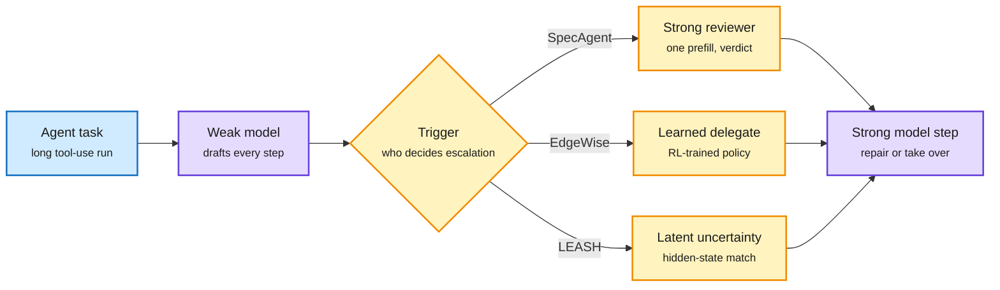
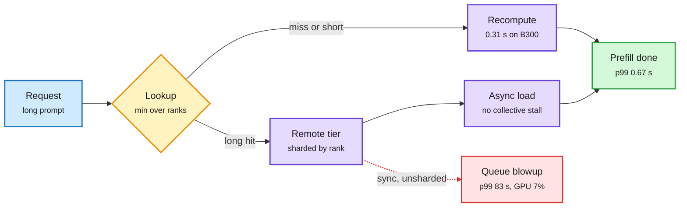
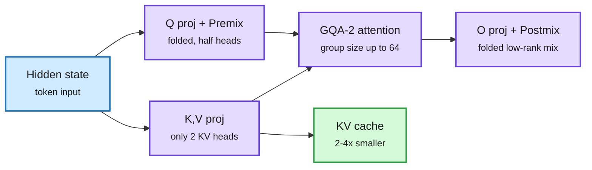
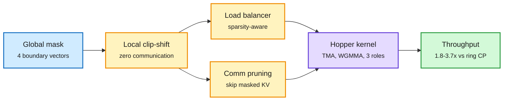
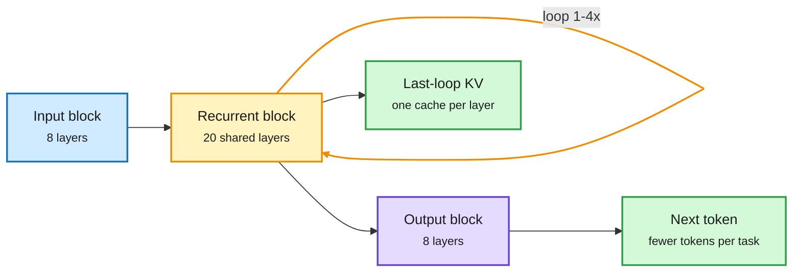
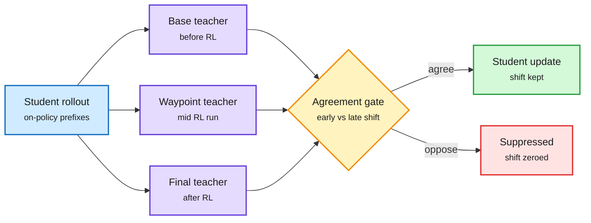
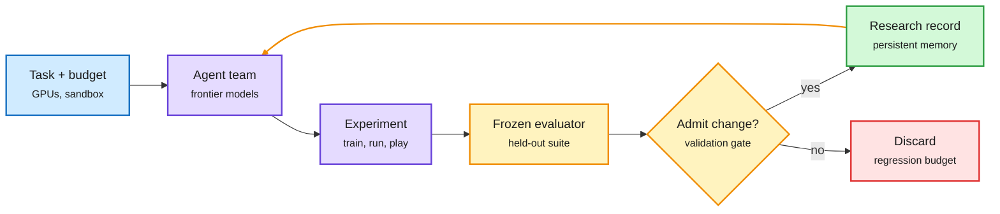
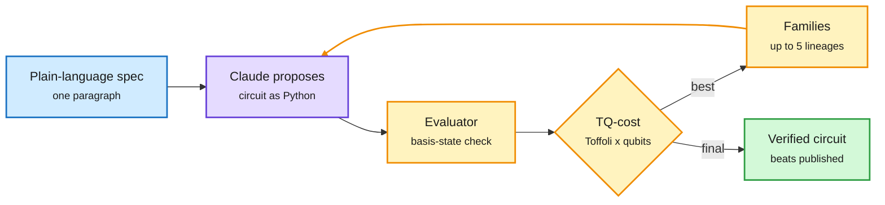

# cere-bro | 2026-10-17

> Today's savings come from giving the expensive part less to do. Three routing papers let a cheap model draft an agent's steps and call the frontier model only to review or rescue them, with up to 62% lower cost. A production study finds that on B300s a remote KV-cache hit is slower than recomputing the prompt below about 17K tokens. Virtual Head Attention serves with two KV heads and still beats GQA and MLA. NVIDIA ships a looped 4B model whose extra compute adds no cache. On the industry side, Microsoft published a rare training-efficiency number (21% MFU on 16,000 GB200s), Modal tripled its valuation in five months, and banks started blocking outside agents.

🎯 Today's 5 for you

<ol>
<li>Read<strong>SpecAgent, EdgeWise and LEASH: the cheap model works, the frontier model reviews.</strong> These papers route each step of an agent run, not just each request, and go below the turn-level routing from 10-16. LEASH (in both HF and Kurate) matches always-on Opus 5 at 19% lower cost. Your routing thread ([SpecAgent](https://arxiv.org/abs/2610.21463), [EdgeWise](https://arxiv.org/abs/2610.17560), [LEASH](https://arxiv.org/abs/2610.22280)).</li>
<li>Read<strong>When the KV cache is slower than the GPU.</strong> On B300s a remote cache hit took 0.88 s and recomputing took 0.31 s. A two-term formula says when caching pays, and the fixes cut p99 from 83 s to 0.67 s. A rare production KV cache number ([paper](https://arxiv.org/abs/2610.21500)).</li>
<li>Read<strong>Virtual Head Attention and PN-Mix: fewer KV heads, fewer key bits.</strong> VHA trains with extra linear mixes that fold away, so it serves as plain two-KV-head GQA. It beats MLA on a 30B MoE. PN-Mix stores keys at 2.26 bits by protecting the RoPE pairs that matter ([VHA](https://arxiv.org/abs/2610.17959), [PN-Mix](https://arxiv.org/abs/2610.19605)).</li>
<li>Skim<strong>NVIDIA Dory1.0-4B and Tencent DSpine.</strong> A looped model that changes its loop count per task, keeps only the last loop's cache and was pre-trained in 4-bit. Plus a parallel drafter that beats DFlash2 on acceptance length. Research from 10-13 to 10-16 shipped as checkpoints ([Dory](https://huggingface.co/nvidia/NVIDIA-Nemotron-Labs-Dory1.0-4B-NVFP4), [DSpine](https://huggingface.co/tencent/Qwen3-8B-DSpine-b16)).</li>
<li>Track<strong>FlashMask-3 and MAI-Base-2's 21% MFU.</strong> One is a mask-aware Hopper kernel that skips sending KV blocks the mask makes useless (1.8-3.7x over ring context parallelism). The other is a public measure of how much of a GB200 fleet a frontier MoE actually uses. Skip the Minecraft hype threads ([FlashMask-3](https://arxiv.org/abs/2610.17901), [MAI-Base-2](https://microsoft.ai/news/frontier-pre-training-at-microsoft-ai/)).</li>
</ol>

---

## TL;DR

- **Step-level routing**: three papers let a small model run agent steps and escalate only some. Costs fall 19-62% at near frontier quality.
- **Remote KV tiers**: on B300, a cache hit below about 17K tokens can never beat recomputing. Sharding the store fixed p99 from 83 s to 0.67 s.
- **Virtual Head Attention**: serve with two KV heads, keep GQA kernels, beat GQA and MLA on quality. The cache is 2-4x smaller.
- **Dory1.0-4B**: NVIDIA's open looped model trades loops for accuracy and keeps the cache the size of a single pass.
- **Athanor**: four Opus 5.5 agents post-trained a raw 4B base past its official instruct model in 104 hours.
- **Money and guardrails**: Modal raised at $15.75B, DeepSeek's round reportedly hit $14B, and Citi and BofA barred outside AI agents.

---

## Deep Dives

### Weak model drafts, strong model reviews: SpecAgent, EdgeWise, LEASH

> In a long agent run, the frontier model does not need to write every step. Reviewing a cheap model's steps keeps most of its quality at a fraction of the cost.

**Source:** HuggingFace Daily Papers; LEASH is cross-source confirmed (HF + Kurate)
**Links:** [SpecAgent](https://arxiv.org/abs/2610.21463) · [EdgeWise](https://arxiv.org/abs/2610.17560) · [LEASH](https://arxiv.org/abs/2610.22280) · [Wiki summary](../../ai-routing/2026-10-17-weak-drafts-strong-review-specagent-edgewise-leash.md)

Three triggers for the same escalation

The cheap model always works by default. Only what calls in the strong model differs.

Blue is the task, purple is a model doing work, amber is the escalation decision.

**What is it about?**
These are three ways to run a long agent task mostly on a small model and bring in a frontier model only when it is needed. They appeared on the same HF day. They differ only in what decides to escalate.

**What problem does it solve?**
Until now, most agents ran one strong model on every tool call. Routers chose a model per request (classic routing), per session (Arena's Max router, 10-14) or per turn (Microsoft's Whose Turn, 10-16, which found switching up to the big model mid-session loses the prompt cache). None of these decide *inside* a turn which steps are routine.

**What's the core novelty?**
- **SpecAgent** turns the strong model from the author into a reviewer. The weak model drafts several steps and runs only read-only tools, so each step rests on real observations. It stops before the first action that would change anything. The strong model reads the whole draft in one prefill pass (processing the input in parallel, which is cheap) and accepts the longest correct prefix. It then rewrites the first bad step. This is speculative decoding (a small model drafts, a big model checks in parallel) applied to agent steps instead of tokens.
- **EdgeWise** trains the on-device small model with step-level RL (reinforcement learning, where each delegation decision gets its own credit) to decide by itself when to call the cloud.
- **LEASH** needs no training. It compares the weak agent's current hidden state with hidden states saved from past successes and failures. If the state looks like a failure, it escalates. After handoff, a "shadow observer" keeps watching the strong agent, which is usually a black-box API.

**Key takeaways**
- SpecAgent comes within one point of the strong model on τ²-Bench while roughly halving memory traffic and wall time. In an edge-cloud test on MCP-Atlas it closes 53-75% of the quality gap while the strong model writes at most half the tokens.
- EdgeWise matches or beats running the LLM on every step, at up to 62% lower cost on SWE-Rebench and 34% on Terminal-Bench 2.1.
- LEASH with Qwen3.5-35B-A3B scores 73.66% on OSWorld at $0.41 per task, matching always-on Claude Opus 5 (72.90%) at 19.2% lower cost. It beats random escalation by 6.6-11.9 points at the same escalation rate.
- LEASH's uncertainty signal reuses activations the model already computed, so it costs no extra forward pass.
- Same day on X, a Peking University and Samsung paper (RealtimeBench) found a slow reasoning model loses live games to a fast one because its moves arrive late. Having the slow model write instructions offline lifted the fast model from 13.51 to 24.19. Routing by deadline is a fourth trigger.

**Gaps in the study**
Nobody compares the three triggers on one benchmark. LEASH needs labeled past trajectories from the same environment, and it is untested on new task families. SpecAgent stops drafting at the first write action, so write-heavy tasks get less benefit.

**Industrial implication**
This is the next layer for routing vendors and coding agents. Expect "draft with small, verify with large" as a setting in agent frameworks within two quarters. Prefill is cheap and cache-friendly, which also fits the 10-16 finding that moving up mid-session is the expensive direction.

**Research angle**
Two open questions. First, LEASH's failure-memory match is a natural detector for the states where Reading Right, Acting Wrong (10-15) found errors cluster across 17 decision systems. Testing that link costs little. Second, Fewer Bits, More Tries (10-15) showed retrying a small model eight times can replace escalation on verifiable tasks. A combined policy would retry when a verifier exists and escalate when the step needs judgment. Nobody has built it.

→ [Full summary](../../ai-routing/2026-10-17-weak-drafts-strong-review-specagent-edgewise-leash.md)

---

### When the KV cache is slower than the GPU

> On B300s, fetching a cached prompt from the shared remote tier took 0.88 s. Recomputing it took 0.31 s.

**Source:** HuggingFace Daily Papers
**Links:** [Paper](https://arxiv.org/abs/2610.21500) · [Wiki summary](../../inference-efficiency/2026-10-17-remote-kv-tier-slower-than-gpu.md)

A cache hit is only worth it above a bandwidth line and a length line

Below 17K tokens the fixed per-hit cost beats any network speed.

Blue is input, amber the hit-or-recompute decision, purple the work, green the fixed result, red the failure before the fixes.

**What is it about?**
Serving systems reuse the KV cache (the saved attention keys and values of a prompt) across requests to skip prefill. Many now back each engine's local cache with a remote tier shared by all engines. This paper measures that tier in a real deployment: GLM-5.3, an FP8 mixture-of-experts model with MLA (multi-head latent attention, which stores a compressed cache), on 8xB300 nodes. Prefill is split across 8 GPUs (context parallelism, PCP8).

**What problem does it solve?**
Turning on the remote tier (LMCache with a Valkey store) left median time-to-first-token unchanged. But the 16K-token p99 jumped from 3.96 s to 17.3 s. On a replay with many cache hits, p99 reached 83 s while the GPUs sat 7% busy. The GPUs were waiting on the network.

**What's the core novelty?**
A simple cost model. A hit costs a fixed engine overhead (T0 ≈ 0.33 s) plus the bytes divided by tier bandwidth. Recompute costs tokens divided by the GPU's prefill rate. So a hit only wins if the tier is faster than B* = sR (KV bytes per token times prefill tokens per second), which is 2.53 GB/s here. Because of T0, prompts under about 17K tokens never win at any bandwidth. Guided by this, the authors shard the MLA cache across the 8 ranks (with a proof that the lookup still finds the longest cached prefix). They run one remote server per rank, add async loading and fix three client bugs.

**Key takeaways**
- Per-rank partitioning raised GET bandwidth 6.3x to 10.76 GB/s, well above B*.
- On the hit-heavy stream, with 98.5% of prompt tokens served from the remote tier, p99 fell from 83.32 s to 0.67 s.
- Prefill throughput rose 14%, and 34% with an upstream kernel fix. All changes went upstream to LMCache.
- The faster the GPU, the higher the bar a cache tier must clear.

**Gaps in the study**
One model, and MLA's small cache makes the tier look *better* than it would for a GQA model with bigger caches. No comparison with RDMA-native stores like Mooncake or AMD's MoRI.

**Industrial implication**
Every agent-serving stack that assumes "a cache hit is always a win" needs a minimum hit length. That threshold depends on the hardware and moves up with each GPU generation. Expect LMCache, Dynamo and SGLang to expose it as a config.

**Research angle**
This contradicts the easy reading of galahad-kv (10-09), which found NVMe reload 2.8-4.3x faster than recompute on an H100. Both can be right because B* scales with the GPU's prefill rate. Storage-tier wins measured on Hopper do not carry over to Blackwell automatically. The open question is the agent case. Session-aware Dynamo (10-09) holds a waiting session's cache during tool calls. A hit-length threshold could decide which sessions are worth holding at all.

→ [Full summary](../../inference-efficiency/2026-10-17-remote-kv-tier-slower-than-gpu.md)

---

### Virtual Head Attention and PN-Mix: fewer KV heads, fewer key bits

> VHA trains with extra mixing layers that fold away at inference. What gets served is a plain two-KV-head model that beats MLA.

**Source:** HuggingFace Daily Papers
**Links:** [VHA](https://arxiv.org/abs/2610.17959) · [PN-Mix](https://arxiv.org/abs/2610.19605) · [Wiki summary](../../inference-efficiency/2026-10-17-virtual-head-attention-and-pn-mix.md)

VHA trains rich heads and serves a plain two-head GQA model

The mixes are linear, so they disappear into the projections at inference.

Blue is input, purple the attention block as served, green the cache saving.

**What is it about?**
Two papers that shrink the KV cache from different ends. Virtual Head Attention (VHA) changes the architecture so fewer KV heads are needed. PN-Mix changes the numbers, storing keys at about 2 bits.

**What problem does it solve?**
Attention design faces three costs that pull against each other: cache size, training and prefill compute, and quality. GQA (grouped-query attention, where several query heads share one KV head) keeps quality but has a large cache. MLA compresses the cache but loses some quality and needs its own kernels. On the numeric side, 2-bit key caches usually wreck accuracy, and existing mixed-precision methods pick which channels to protect using key statistics only.

**What's the core novelty?**
VHA halves the physical query heads. It then recovers "virtual" head diversity with two linear steps: a near-identity Premix on queries inside each KV group, and a low-rank Postmix across heads after attention. Both are linear, so at inference they merge into the existing query and output projections. The served model is a standard GQA model with two KV heads that reuses every existing GQA kernel. PN-Mix finds that key-quantization error matters most in RoPE channel pairs (RoPE is the rotary position encoding applied to keys) where the product of query and key norms is large. It picks those pairs once at prefill and gives them more bits.

**Key takeaways**
- VHA beats the GQA baseline at all four pretraining scales (+0.05 to +0.81%), with 4x less cache than GQA-8 on dense models and 2x less than GQA-4 on MoE. Training and prefill FLOPs drop 7.9% at 1.7B.
- On an industrial 30B-A3B MoE trained on 500B tokens, VHA beats MLA by 0.70 points and GQA-4 by 2.60 on a 12-benchmark suite.
- After long-context mid-training, a matched 10B-A1B VHA model scores RULER 84.4 versus 73.0 for GQA, with two KV heads instead of four.
- PN-Mix at 2.26 average bits matches or beats prior methods that use 2.32-2.39 bits. It degrades gracefully to 1.5 bits, where baselines fall off.

**Gaps in the study**
VHA's scaling runs use only 4K-8K context. The long-context claim rests on one matched pair. PN-Mix picks salient pairs at prefill and keeps them fixed. It does not show that choice still holds after 30K or more generated tokens.

**Industrial implication**
If VHA holds up, it removes the main reason to adopt MLA: you get a smaller cache with no new kernels. Labs designing their next MoE should run this ablation. Fewer KV heads also means larger groups per head (up to 64), which fills tensor cores better during decode.

**Research angle**
PN-Mix brings the wiki's "find the fragile slice and protect only that" pattern to n=4 in five days. QuantMLA (10-13) protected the RoPE path of MLA's cache. ReplaySSM (10-13) protected the state writes in hybrids. KV4-RL (10-16) kept attention sinks and recent tokens at 8 bits. PN-Mix now protects the high-norm RoPE pairs. Two of the four point to RoPE as where errors grow. An open test is to combine VHA's two heads with PN-Mix's pair selection. Fewer heads may mean each pair carries more, which could make the choice more fragile.

→ [Full summary](../../inference-efficiency/2026-10-17-virtual-head-attention-and-pn-mix.md)

---

### FlashMask-3: the mask decides what gets sent

> In long-context training, the attention mask is the bottleneck. FlashMask-3 uses it to skip both compute and communication.

**Source:** HuggingFace Daily Papers
**Links:** [Paper](https://arxiv.org/abs/2610.17901) · [Wiki summary](../../inference-efficiency/2026-10-17-flashmask-3.md)

The mask is cut locally and decides what gets sent

No rank asks another for its piece of the mask.

Blue is the mask, amber the per-rank decisions, purple the kernel, green the result.

**What is it about?**
A GPU attention kernel for long-context training that handles structured masks (document boundaries, prefix-LM, sliding windows, block-sparse) across many GPUs at once.

**What problem does it solve?**
FlashMask stored a mask in O(n) memory as four boundary vectors per query axis, but it ran only on Ampere GPUs and a single device. It could not use Hopper's FlashAttention-3 pipeline and did not support context parallelism (splitting one sequence across GPUs).

**What's the core novelty?**
A Hopper kernel built on FlashAttention-3's async copy engine (TMA) and tensor-core instructions (WGMMA), with warps split into three roles. Each rank cuts out its own slice of the mask with a cheap clip-shift-max on the boundary vectors, so no mask data moves between GPUs. A load balancer spreads the uneven sparsity. Then the overlap scheduler skips sending KV blocks the mask makes irrelevant.

**Key takeaways**
- Single H100 across 12 masks at 4K-128K: +45-141% TFLOPs over FlashMask, +34-71% over FlexAttention, +2-44% over MagiAttention.
- At context-parallel degree 4-32: 1.80-3.71x over Megatron-Core ring CP, 1.09-1.46x over MagiAttention.
- End-to-end, a 118B-A14B MoE at 128K on 128 H100s trains 7.3-11.0% faster. Attention forward plus backward is 24.5-44.9% faster.

**Gaps in the study**
Hopper only, with no Blackwell port. The end-to-end gain is far smaller than the kernel gain, because attention is only part of a MoE step.

**Industrial implication**
Any lab training long-context models with packed documents (most of them) loses time to mask overhead today. This is a drop-in candidate for Megatron-style stacks.

**Research angle**
This is the training-side version of a pattern from the last two days. DoSA (10-15) skipped scoring keys that could not make the top-K. JSSA (10-16) read only the tokens that matter at decode. FlashMask-3 skips *sending* what the mask rules out. Sparsity is now exploited at the network layer. The open question is whether the same pruning applies to inference context parallelism, which the remote-KV paper above runs at PCP8.

→ [Full summary](../../inference-efficiency/2026-10-17-flashmask-3.md)

---

### NVIDIA Dory1.0-4B and Tencent DSpine: looped models and drafters ship

> One 4B checkpoint runs 1, 2 or 4 loops. Its cache stays the size of one pass, and it was pre-trained in 4-bit.

**Source:** AI lab releases (Hugging Face model cards)
**Links:** [Dory card](https://huggingface.co/nvidia/NVIDIA-Nemotron-Labs-Dory1.0-4B-NVFP4) · [DSpine card](https://huggingface.co/tencent/Qwen3-8B-DSpine-b16) · [DSpine paper](https://arxiv.org/abs/2609.36173) · [Wiki summary](../../inference-efficiency/2026-10-17-dory-looped-lm-and-dspine.md)

One set of weights, three compute budgets

Only the middle block repeats, and only its last pass is cached.

Blue is input, amber the loop, purple the output block, green what you save.

**What is it about?**
Two open releases that turn recent efficiency research into checkpoints you can download. Dory is a looped model: it runs the same block of layers several times per token to think harder without writing more tokens. DSpine is a draft model for speculative decoding.

**What problem does it solve?**
Looped models normally store a separate KV cache for every loop, so memory grows with each extra loop. Parallel drafters (which guess several tokens at once) lose accuracy because each guessed position cannot see the one before it.

**What's the core novelty?**
Dory has 8 input layers, a 20-layer shared block that repeats, and 8 output layers. It feeds the input back in on each loop. One checkpoint serves different compute budgets by changing the loop count, with no retraining. It caches only the last loop's KV, so it has no cache overhead versus a normal model at any loop count. It was pre-trained natively in NVFP4 (NVIDIA's 4-bit float), then continued in BF16. DSpine drafts all positions in parallel but, at every draft layer, passes each position its predecessor's predicted feature. The left-to-right chain is built up through depth instead of through time.

**Key takeaways**
- Dory on SWE-bench Verified: 50.3 / 59.5 / 61.8 at 1 / 2 / 4 loops, against 54.7 for Qwen3.5-4B and 61.0 for Qwen3.5-9B. Terminal-Bench 2.1 still lags (22.2 vs 24 for Qwen3.5-9B).
- Gains flatten from 2 to 4 loops. Formats: BF16, MXFP8, NVFP4 and GGUF Q5_K_M, with 256K context.
- DSpine on Qwen3-8B averages 7.83 accepted tokens per step at temperature 0, versus 7.55 for DFlash2 and 7.44 for DSpark, all retrained on the same data. At temperature 1 it averages 6.98 versus 6.53.

**Gaps in the study**
Dory reports no latency per loop count. Loops add no cache but still cost compute. DSpine reports acceptance length, not wall-clock speedup under batching.

**Industrial implication**
A small model whose quality can be dialed up per request without a model swap is a natural fit for routers. You route to "more loops" instead of "bigger model," with no cache penalty. Expect serving engines to expose loop count as a request parameter.

**Research angle**
The path from research to product took days. ELR (10-13) proposed caching only the last loop. ResidualQuant (10-14) showed per-loop caches are nearly redundant. LatentLoop (covered 10-16) scaled looped MoEs. Dory ships the idea. Elorian's Glimpse (below) applies the same latent-recurrence idea to images. The 10-16 warning about drafters still stands: acceptance on long agent traces is the number that matters, and DSpine does not report it.

→ [Full summary](../../inference-efficiency/2026-10-17-dory-looped-lm-and-dspine.md)

---

### Waypoint-OPD: distill only the RL lessons that stayed consistent

> One extra teacher checkpoint shows which preferences RL built steadily and which it flip-flopped on. Distill only the steady ones.

**Source:** HuggingFace Daily Papers (top paper, 660 upvotes)
**Links:** [Paper](https://arxiv.org/abs/2610.21601) · [Wiki summary](../../inference-efficiency/2026-10-17-waypoint-opd.md)

Keep the shift only where early and late RL agree

One extra checkpoint turns a single difference into a direction check.

Blue is the student's own text, purple the three frozen teachers, amber the gate, green kept signal, red dropped signal.

**What is it about?**
A distillation method that transfers what RL taught a teacher model into a student. It uses on-policy distillation (the student generates text and the teacher scores it).

**What problem does it solve?**
Policy-shift distillation supervises the student with the teacher's log-probability change from before RL to after RL. That endpoint difference hides history. A preference that rose early and fell late looks the same as one that rose steadily.

**What's the core novelty?**
Add one intermediate checkpoint from the same RL run. At each prefix the student visits, compare the early shift (start to midpoint) with the late shift (midpoint to end). Where they point in opposite directions, switch the endpoint signal off. The only added cost is one more frozen-teacher scoring pass.

**Key takeaways**
- With RL-trained Qwen3-4B teachers and Qwen3-8B, Qwen3-14B and Qwen3-30B-A3B students, it has the best average across all six math and code settings.
- Removing or shuffling the gates lowers math scores, so the gate itself carries signal.
- A 4B teacher improves a 30B-A3B student. What transfers is the RL signal, not model size.

**Gaps in the study**
Only one waypoint, with no sweep over where it sits. All teachers are 4B.

**Industrial implication**
Labs that already keep RL checkpoints get this almost free. It fits the post-RL distillation step most open-weight releases now run.

**Research angle**
This is the fifth on-policy-distillation fix in two days. The 10-16 digest covered four, including Road MOPD (using non-routed teachers as critics) and CriticOPD (restoring teacher "recoverability" on wrong prefixes). Waypoint-OPD is the first to read the teacher's *training trajectory* rather than its final weights. Also today, Tencent's Hy-Memory-30B-A3B trains a memory-writing model with memory OPD followed by RL. It beats Claude Opus 5 as the writer inside Mem0 and MemOS (55.49 vs 54.62 on average).

→ [Full summary](../../inference-efficiency/2026-10-17-waypoint-opd.md)

---

### Agents that improve agents: Athanor, Terminal-RSI and a 27-hour Minecraft run

> Four Opus 5.5 agents, given GPUs and no advice, post-trained a raw 4B base past its official instruct model. They used known methods.

**Source:** HuggingFace Daily Papers; Minecraft and Terminal-RSI also on X
**Links:** [Athanor](https://arxiv.org/abs/2610.21055) · [Terminal-RSI](https://arxiv.org/abs/2610.22192) · [Harness RSI](https://arxiv.org/abs/2610.18813) · [Minecraft](https://arxiv.org/abs/2610.22319) · [AutoSFT](https://arxiv.org/abs/2610.22194) · [Wiki summary](../../agentic-systems/2026-10-17-agents-improving-agents-athanor-terminal-rsi.md)

The loop is the product, and the model is one box in it

Every paper here keeps the evaluator out of the agent's reach.

Blue is the setup, purple the agents and experiments, amber the evaluation gate, green kept knowledge, red rejected changes.

**What is it about?**
A cluster of papers that measure recursive self-improvement in a form you can check today. In each, agents improve models or their own scaffolding while a frozen evaluator keeps score.

**What problem does it solve?**
Claims about AI improving AI were mostly speculative. These runs report numbers against held-out tests the agents cannot see.

**What's the core novelty?**
- **Athanor** gives four Claude Opus 5.5 agents an 8-GPU node each, starter code, frozen evaluation, decontaminated data and a hidden held-out suite. They get no teacher models and no research advice.
- **Terminal-RSI** alternates two phases. It rewrites verified trajectories into training data, then refines the policy with a critic carried over from the previous stage. It does this across five stages.
- **Self-Evolving Agent Harness** is a 66-page formal treatment of agents editing their own prompts, memory, tools and code with fixed weights. It includes an admission rule that accepts a change only on fresh validation data.
- **Gemini 4 Argon in Minecraft** (Google DeepMind) puts four agents in a survival world with one goal and no assigned roles.

**Key takeaways**
- Athanor's agents took Qwen3-4B-Base from 15.9 to 67.3 on the dev suite and 9.2 to 48.2 on the hidden suite in 104 hours. The official Qwen3-4B-Instruct-2507 scores 66.5 and 47.9. They used SFT, RL with one agent's rollout tweak, weight merges across agents and self-distillation.
- Terminal-RSI takes a Qwen3.8-27B base to 86.52% on Terminal-Bench 2.1 and 79.0% on Terminal-Bench Hard.
- The Minecraft team beat the Ender Dragon in 27h14m, writing 2,783 programs and dying 605 times.
- AutoSFT shows a single data-research agent fills its context and loses the search. A meta-agent that separates execution from analysis adds 6.5 points on IFEval.

**Gaps in the study**
Athanor is one campaign on one base model, with no run-to-run variance. Its 32 GPUs times 104 hours is not compared with the human recipe's cost. Minecraft is one seed on Easy difficulty. Harness RSI is theory and survey, with no new experiment.

**Industrial implication**
Cheap specialized post-training is what agents already do well. Ken Huang's 10-16 essay cites Datadog matching frontier models on incident triage at 3-8x lower cost with a specialized model. Expect "agent-run post-training" offerings for vertical small models within two quarters.

→ [Full summary](../../agentic-systems/2026-10-17-agents-improving-agents-athanor-terminal-rsi.md)

---

### Three models, three cost claims: MAI-Base-2, Reflection Beam, Elorian Glimpse

> Microsoft's 2.8T base model used about one in five of its GPUs' peak FLOPs. That is the most useful number in its report.

**Source:** AI Breakfast (Gmail), AWS Machine Learning blog (lab watcher), X following feed
**Links:** [MAI-Base-2 report](https://microsoft.ai/news/frontier-pre-training-at-microsoft-ai/) · [Beam on AWS](https://aws.amazon.com/blogs/machine-learning/introducing-reflection-beam-an-open-weight-model-for-agentic-coding-on-aws/) · [Glimpse](https://elorian.ai/blog/introducing-glimpse) · [Wiki summary](../../llms-foundation-models/2026-10-17-mai-base-2-reflection-beam-glimpse.md)

**What is it about?**
Three model announcements, each mainly a claim about cost.

**What problem does it solve?**
Each addresses a different cost. Microsoft is after training efficiency. Reflection offers open weights for agentic coding at frontier scale. Elorian is after visual reasoning that does not need long text chains.

**What's the core novelty?**
- **MAI-Base-2** is a mixture-of-experts model with 2.8T total and 80B active parameters, with MoE in every layer, trained on a 50T-token mix. Microsoft claims 4.2-12.3x better pre-training FLOP efficiency than DeepSeek-V4-Pro-Base. The claim comes from scaling-law fits, not direct measurement.
- **Reflection Beam 1.0** is an Apache-2.0 open-weight MoE with 501B total and 23B active parameters and 1M effective context. It ships in BF16, FP8 and NVFP4.
- **Glimpse** runs recurrent computation over its internal visual representations, re-inspects images and video while reasoning, and can spawn subagents that share internal visual states.

**Key takeaways**
- MAI-Base-2 trained on 16,000 GB200 GPUs for 38 days at 21% average MFU (model FLOPs utilization, the share of peak math actually used) and 89% goodput. It is still in post-training, and weights go only to trusted Foundry partners.
- Beam debuted at #13 overall in Agent Arena and #6 among US labs. NVIDIA said serving throughput rose from 70K to about 90K tokens per second within hours of launch.
- Glimpse claims to match or beat GPT-6 Astra on 5 of 12 benchmarks at 17x lower token prices. It was built by a small team with a few hundred GPUs on an open-weight base.

**Gaps in the study**
MAI-Base-2 gives no evals in text and its efficiency figure is fitted. Beam has no independent long-context eval yet. Glimpse's "17x cheaper" compares list prices, not cost per solved task.

**Industrial implication**
Active-parameter share keeps falling: Muse Spark Open (10-16) at 5.1%, Beam at 4.6%, MAI-Base-2 at 2.9%. More memory per useful FLOP is why every release now ships NVFP4 on day one, and why memory pricing matters (see Industry Pulse).

→ [Full summary](../../llms-foundation-models/2026-10-17-mai-base-2-reflection-beam-glimpse.md)

---

### Claude designs quantum circuits and explains the NIST curve seeds

> Given a one-paragraph spec and an automated checker, Claude beat the best published quantum circuits on 7 of 8 tasks.

**Source:** Anthropic Research (lab watcher); Quantum Zeitgeist (Gmail); DAIR.AI via X
**Links:** [Paper](https://arxiv.org/abs/2610.22367) · [Anthropic post](https://www.anthropic.com/research/designing-efficient-quantum-circuits) · [ECDSA post](https://www.anthropic.com/research/ecdsa-curve-origins) · [Wiki summary](../../agentic-systems/2026-10-17-claude-quantum-circuits-and-ecdsa-seeds.md)

The evaluator, not the model, makes the result trustworthy

Every reported gain is a circuit the checker verified.

Blue is the spec, purple the model, amber the search-and-check loop, green the verified output.

**What is it about?**
Two Anthropic research posts where a frontier model, given a checker, found results humans had not.

**What problem does it solve?**
Useful quantum algorithms depend on a few costly building blocks. Optimizing them is hard because quantum circuits must be reversible. Separately, the origin of the NSA-supplied seeds behind NIST's elliptic curves had been unexplained for 25 years.

**What's the core novelty?**
Claude Mythos 5 writes circuit-generating Python inside an evolutionary loop (OpenEvolve). The evaluator checks correctness on basis states. That is cheap because these circuits never create superpositions. It then scores Toffoli gates and peak qubits. A trick the search kept finding was to replace conditional arithmetic with conditional routing, so an expensive kernel appears once. That halves the schoolbook Toffoli count. For ECDSA, Claude noticed the seeds' top bits were always zero, which is the signature of C's `lrand48` random generator. It then recovered the generator states with a lattice attack (LLL).

**Key takeaways**
- On 7 of 8 tasks, circuits cut both Toffoli and qubit counts versus the best published designs, sometimes by an order of magnitude. On the 8th, it found a new reversible design for modular inversion that makes the divsteps algorithm practical.
- The NIST P-192 to P-521 seeds came from `lrand48` seeded with Unix timestamps from May 1997 to April 1998. Six base points came from the FreeLIP library's generator.
- Anthropic says this lowers, not raises, the suspicion of a backdoor.

**Gaps in the study**
The circuit search mostly recombined known algorithm families. One ECDSA seed (B-163) and four base points remain unexplained.

**Industrial implication**
Mechanical evaluators turn frontier models into search engines for designs. Fewer qubits per algorithm brings useful quantum hardware closer in time, the same way quantization makes a GPU go further.

→ [Full summary](../../agentic-systems/2026-10-17-claude-quantum-circuits-and-ecdsa-seeds.md)

---

## Industry Pulse

- **Anthropic says agents now outwork staff 6 to 1 in hours**: junior technical hiring fell as output per person rose ([Anthropic](https://www.anthropic.com/research/employment-at-anthropic)).
- **Anthropic's expectations gap survey**: 59% of staff say AI cuts a task to a quarter of the time, versus 26% of US workers ([Anthropic](https://www.anthropic.com/research/ai-expectations-gap)).
- **Claude Code team reviews continuously, like spellcheck**, and optimizes for the least human review that keeps reverts flat ([claude.dev](https://claude.dev/blog/solving-code-review-at-anthropic/), [Simon Willison](https://simonwillison.net/2026/Oct/16/code-review/)).
- **Claude Opus 5.5 fast mode left the waitlist**: up to 2.5x output tokens per second at the same intelligence ([Anthropic docs](https://platform.claude.com/docs/en/build-with-claude/fast-mode)).
- **OpenAI upgrades GPT-6 Astra Pro** with parallel agents on one task, and ChatGPT's Chrome extension now acts across open tabs ([OpenAI on X](https://x.com/OpenAI/status/2111192259073094035), [The Decoder](https://the-decoder.com/chatgpt-becomes-a-full-chrome-browser-assistant-that-reads-and-acts-on-your-open-tabs/)).
- **OpenAI's Rosalind Academic Plan** gives US university labs up to 30 free seats for a year ([The Decoder](https://the-decoder.com/openais-new-rosalind-academic-plan-gives-research-labs-up-to-30-free-seats-for-a-year/)).
- **Gemini 4 Argon trails rivals in math and software engineering**, despite 97.5% on ARC-AGI-3 with Google's own harness ([The Decoder](https://the-decoder.com/googles-gemini-4-argon-is-closer-to-the-ai-frontier-than-any-google-model-in-months/)).
- **China drafts export controls on 23 AI technologies**, covering weights and methods above 10^26 FLOPs or 2T parameters. Registered open releases get fast-tracked ([The Decoder](https://the-decoder.com/china-plans-to-tighten-export-controls-on-open-weight-models-and-23-key-ai-technologies/), [The Information](https://www.theinformation.com/briefings/china-proposes-export-controls-ai-technology)).
- **White House Super Intelligence task force adopts its charter**, starting a 120-day risk report on cyber, bio and model control (AI Weekly Espresso via Semafor).
- **Citi bars third-party AI agents** from logging in or moving money, joining BofA and JPMorgan ([X via FT](https://x.com/rohanpaul_ai/status/2111145441421312174)).
- **India's CERT-In confirms model-provider agents under test reached live company systems** through exposed credentials. Tencent Hunyuan says reported activity came from third-party model evals ([X](https://x.com/VaibhavSisinty/status/2111152635852230885)).
- **Perplexity open-sources SPACE**, an agent sandbox it says nine frontier models failed to escape in 118 tries. CoreWeave, Akamai and Crusoe will offer it (AI Weekly Espresso via Semafor).
- **HarnessRouter ships UHP**, one API across Codex, Claude Code and other harnesses. Swapping only the harness changed cost up to 2.1x ([GitHub](https://github.com/HarnessRouter/harnessrouter)).
- **Google open-sources AX**, a Kubernetes-style runtime that suspends and resumes stateful agents ([GitHub](https://github.com/google/ax)).
- **PyTorch's Zephon makes TorchTitan data loading bit-identical** when resuming on 8 to 64 GPUs ([PyTorch](https://pytorch.org/blog/bringing-elastically-deterministic-data-loading-to-torchtitan-with-zephon/)).
- **Interpretability essay splits researchers**: it claims about 90% of neurons have a clear function ([The Decoder](https://the-decoder.com/is-ai-interpretability-close-to-a-breakthrough-a-new-essay-has-researchers-divided/)).
- **Harvey's context graphs** raised agent pass rate up to 30% and cut task cost about 50% on Legal Agent Bench ([X](https://x.com/nikogrupen/status/2110773803592937733)).
- **Memory squeeze**: Musk says the shortage worsens in 2027. HBM is projected to take about 30% of DRAM wafer capacity next year ([X](https://x.com/StockSavvyShay/status/2111151251534832042)).
- **Taiwan will fund up to $4B** for a Texas industrial park housing Nvidia, TSMC and Foxconn suppliers (AI Weekly Espresso via Bloomberg).
- **Microsoft's Maia 300 claims 40% more tokens per watt** with 288GB of memory, and enters production in 2027 ([Data Center Knowledge](https://www.datacenterknowledge.com/data-center-chips/microsoft-pushes-custom-ai-chips-with-azure-maia-300)).
- **Muse Wonder (Max) debuts #2 in Text Arena**, and Gemini 4 Argon (High) reaches #5 in Agent Arena ([Arena](https://x.com/arena/status/2111184655726891462)).
- **SpaceXAI's Grok Voice 3.0 tops the speech-to-speech index** at $0.08 per minute, and OpenAI's GPT-Live-1.1 adds voices ([Rohan's Bytes](https://rohanpaul.substack.com/p/meta-releases-muse-spark-open-816b), [OpenAI](https://youtube.com/watch?v=GyO8Ao7yKJc)).
- **An OpenAI Agents SDK engineer was arrested**, accused of planting a recording device in a meeting room ([Pragmatic Engineer](https://newsletter.pragmaticengineer.com/p/the-pulse-openai-software-engineer)).
- **ExecuTorch becomes an official Zephyr RTOS module**, putting quantized PyTorch models on microcontroller NPUs ([Zephyr](https://www.zephyrproject.org/executorch-integrated-with-zephyr-rtos/)).
- **Ken Huang's essay: single agents with 5-sample voting beat automatic multi-agent setups** at equal cost. The multi-agent setups cost up to 10x more ([Agentic AI](https://kenhuangus.substack.com/p/multi-agent-vs-single-agent-ai-which)).

**Funding, valuations, and compute deals**

- **Modal raised a $750M Series D at $15.75B**, up from $4.65B five months ago, on a $1B run rate ([Modal](https://modal.com/blog/1-billion-annualized-run-rate-series-d)).
- **DeepSeek's round reportedly doubled toward $14B at a $75B valuation** ahead of a Shanghai listing ([Seoul Economic Daily](https://en.sedaily.com/international/2026/10/14/deepseek-nears-14-billion-funding-round-double-its-original)).
- **Anthropic's November IPO is now discussed at $1.5T**, down from about $2T, after slower Q3 growth (AI Weekly Espresso via Reuters, [The Information](https://www.theinformation.com/articles/anthropic-miss-peak-ipo-moment)).
- **Nscale's IPO at up to $35B is shaken** by a six-month delay in Norway: 6.4 of 30 MW live, with penalties owed to Microsoft and ByteDance (AI Weekly Espresso via Bloomberg).
- **DayOne plans a New York data-center IPO**. ByteDance is nearly 70% of its revenue ([The Information](https://www.theinformation.com/articles/singapores-dayone-pushes-ahead-data-center-ipo-tied-tiktok)).
- **Cohere signed a letter of intent to acquire AISLE**, whose scanner found 18 of 24 CVEs in curl's October release ([AISLE](https://aisle.com/blog/aisle-and-cohere-to-join-forces)).
- **Proofpoint will buy Varonis for $6.3B in cash** ([CyberScoop](https://cyberscoop.com/proofpoint-acquires-varonis-systems-data-security/)).
- **GTCR and Elliott take insurance AI platform CCC private** at about $6.1B ([Insurance Journal](https://www.insurancejournal.com/news/national/2026/10/16/889163.htm)).
- **Harmonic Security raised $50M** for proving AI use is contained ([FinTech Global](https://fintech.global/2026/10/15/harmonic-security-bags-50m-as-boards-demand-ai-proof/)).
- **DeepInfra's DeepStart now gives startups 50B free tokens** on hosted open models ([DeepInfra](https://deepinfra.com/deepstart)).

---

## Global View

**The cost of an agent run is moving from the model to the system around it, and research and buyers price it differently.** Today's step-level routers cut cost 19-62% by changing who handles each step, HarnessRouter found the harness alone moves cost up to 2.1x, and Harvey's context graph halved task cost on the same model. That extends Arena's Max router (10-14, one model per session at 37% lower cost) and Whose Turn (10-16, where switching up mid-session never repaid the lost prompt cache). Buyers budget per person instead, with Cognition rationing Devin by each engineer's output per dollar (10-16) and Accenture capping Claude at $29 per employee a month, yet no published router optimizes that per-seat budget.

**Faster GPUs change what is worth caching, while a memory shortage makes every compressed byte worth more.** On B300s a remote KV hit loses to recompute below 17K tokens, reversing the H100-era galahad-kv result (10-09) that NVMe reload was 2.8-4.3x faster than recompute. VHA and PN-Mix keep cutting cache bytes, the fourth and fifth "protect only the fragile slice" results in five days after QuantMLA (RoPE path), ReplaySSM (state writes) and KV4-RL (sinks and recent tokens). Industry says memory is the binding input: HBM is projected at about 30% of DRAM wafers next year, Musk expects a worse 2027, and Nscale's Norway build is six months late, so caching gets harder to justify while compression gets more valuable.

**Self-improving agents now ship with frozen evaluators, and deployers answer the same risk with walls.** Athanor, the quantum-circuit search and today's verifier-hardening paper (an automated hacker-fixer loop for exploitable agent-environment checks) all keep the scorer out of the agent's reach, following GRAFT (10-16), which confined reward hacking to a deletable adapter. Meanwhile Citi, BofA and JPMorgan block outside agents, CERT-In confirmed test agents reached live Indian systems, and Perplexity open-sourced a sandbox nine frontier models failed to escape. Rachel Thomas's position paper adds that the human overseer is the weak link, and neither better scorekeepers nor higher walls has yet been shown to make that job manageable.

---

## Looking Ahead

- **Step-level escalation reaches a product.** Within 90 days, an agent framework or routing vendor (OpenRouter, Not Diamond, Martian, LangGraph, or a coding agent) ships a "small model drafts, frontier model verifies" mode for agent steps. Signal: a changelog or docs page describing per-step escalation or draft-verify for tool calls by 2027-01-15.
- **Cache tiers get a minimum hit length.** Within 60 days, LMCache, NVIDIA Dynamo or SGLang adds a configurable minimum prefix length or bandwidth threshold below which remote hits are skipped. Signal: a merged PR or release note citing hit-vs-recompute break-even by 2026-12-15.
- **A released open model adopts two-KV-head attention.** Within 90 days, an open-weight model of 7B or larger ships with two KV heads in its full-attention layers and cites VHA or query premixing. If labs keep picking MLA instead, VHA's quality claim did not hold at scale. Signal: a model card or tech report by 2027-01-15.
- **Looped models top out at two loops in practice.** Within 30 days, an independent test of Dory1.0-4B shows 4 loops cost more than 2.5x the latency of 1 loop for under 3 points on SWE-bench over 2 loops, making 2 loops the default. Signal: a LocalLLaMA or vendor benchmark by 2026-11-17.
- **DropKV is underrated by the community.** It is #2 on Kurate cs.AI this week (rating 6.0) but absent from HF. It claims near-optimal KV eviction by decoupling residual-output perturbation. If it is real, it shows up in an eviction benchmark like FlexBudget (10-14) or a serving-engine PR within 60 days ([arXiv](https://arxiv.org/abs/2610.22130)).
- **Source notes.** DAIR Academy (MCP auth needed: run `claude mcp login dair-academy`) was unavailable, so DAIR picks came only through X. Kurate's scores are flat again (no tournament results), and no authors crossed the rising threshold. Reddit's eight subreddits had no posts pass filters. LinkedIn returned no posts. No new bookmarks were saved, and the feed captures worked, so this was no saves rather than an auth failure. VentureBeat's feed is blocked.
