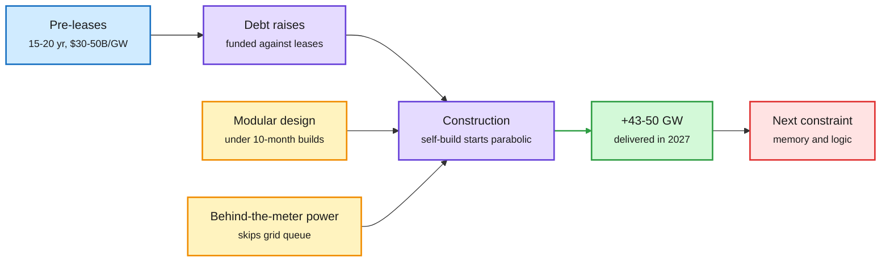
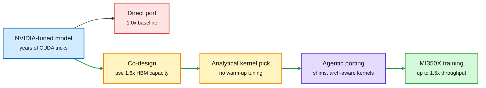
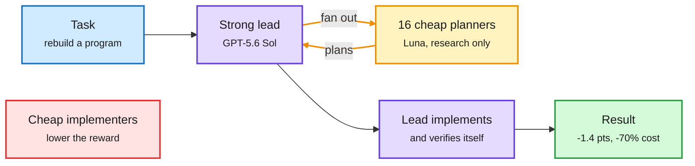
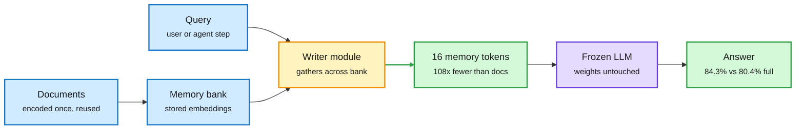
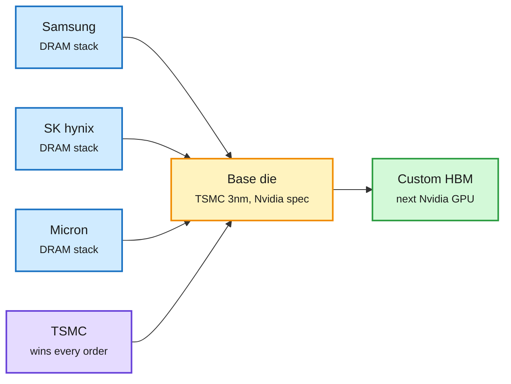

# cere-bro | 2026-10-19

> The cheapest compute is the compute you place well. Cohere gets within 1.4 points of an all-frontier coding team at 70% lower cost by giving cheap models only the planning. Meta gets 1.5x more training throughput from AMD chips by redesigning the model instead of porting it. Memorilla answers from 16 memory tokens instead of whole documents. Meanwhile the supply side splits: SemiAnalysis says 2027 adds +50GW, while Microsoft walks away from a neocloud site and Nvidia tightens its grip on HBM.

🎯 Today's 5 for you

<ol>
<li>Read<strong>SemiAnalysis: Datacenters 2027, +50GW in one year.</strong> About $1T of binding leases signed in 2026 to date says the build is already funded. It hints memory and logic become the real limit in 2027-28. Your semiconductor and compute-supply thread ([essay](https://newsletter.semianalysis.com/p/datacenters-2027-the-year-of-acceleration)).</li>
<li>Read<strong>Meta trains on AMD MI350X at 1.5x the ported speed.</strong> The first hyperscaler report on AMD training in production. The gain comes from reshaping the model around 1.6x more HBM, analytical kernel picking and agentic CUDA porting. GPU optimization in production ([paper](https://arxiv.org/abs/2610.22230)).</li>
<li>Read<strong>Cohere: cheap models plan, the strong model builds.</strong> A strong lead with 16 cheap planners matches an all-strong team within 1.4 points at 70% lower cost. Cheap coders hurt. Routing by role, the next rung after yesterday's JevAgentHarness ([paper](https://arxiv.org/abs/2610.17471)).</li>
<li>Skim<strong>Memorilla: a document set in 16 tokens.</strong> A frozen LLM beats its own full-context score on FactKG with 108x fewer source tokens. Context compression without touching the KV cache. Check for exact-recall tests before trusting it ([paper](https://arxiv.org/abs/2610.21375)).</li>
<li>Track<strong>Nvidia wants the HBM base die on TSMC 3nm.</strong> Standardizing the logic layer lets Nvidia swap memory suppliers as HBM prices climb. Your memory supply-chain theme. Skip the "Anthropic published 400 agents" and "End of Harness Engineering" hype threads ([The Information](https://www.theinformation.com/briefings/nvidia-tells-suppliers-tap-tsmc-process-next-generation-memory-chips)).</li>
</ol>

---

## TL;DR

- **Datacenters 2027**: SemiAnalysis forecasts +43 to +50GW next year, backed by about $1T of signed leases. Altimeter's Gerstner guessed 25GW.
- **Meta on AMD**: co-designing models for MI350X gives up to 1.5x training throughput over a direct port from NVIDIA code.
- **Coding agent teams**: cheap models help only as planners. A strong lead plus cheap planners costs 70% less for nearly the same reward.
- **Memorilla**: 16 learned memory tokens beat full context on FactKG with 108x fewer tokens. The LLM stays frozen.
- **Neocloud stress**: Microsoft exits Nscale's UK site over power delays. Firmus pulled its IPO and CoreWeave fell about 20%.
- **Anthropic Public Benefit Fund**: 5% of shares now, plus 2% for every 50% rise in value. Critics call it PR.

---

## Deep Dives

### SemiAnalysis: Datacenters 2027, the year of acceleration

> The whole world's datacenter capacity up to 2024 gets built again in a single year. SemiAnalysis says the leases that pay for it are already signed.

**Source:** SemiAnalysis (Gmail + RSS)
**Links:** [Essay](https://newsletter.semianalysis.com/p/datacenters-2027-the-year-of-acceleration) · [Wiki summary](../../hardware/2026-10-19-semianalysis-datacenters-2027.md)

Leases signed today are the GW delivered next year

SemiAnalysis reads the build two steps ahead: contracts fund debt, debt funds construction.

Blue is the contract signal, purple is the financing and build chain, amber is what shortened the build, green is delivered capacity, red is the next bottleneck.

**What is it about?**
A SemiAnalysis report defending its forecast that 2027 adds roughly +43 to +50GW of datacenter capacity. It answers Brad Gerstner of Altimeter, who said on the All-In podcast that only about 25GW would get built.

**What problem does it solve?**
Investors keep pricing a slowdown on "hunches" about power, labor and capital. The report replaces the hunch with two leading indicators that move a year or more before capacity goes live.

**What's the core novelty?**
It tracks the chain that precedes construction. Developers spend only 5-10% of a project's capital before a customer signs a pre-lease (a 15-20 year contract worth $30-50B per GW). Leases unlock debt, and debt pays for the build. In 2026 so far, slightly under $1T of binding, non-cancellable leases have been signed. Hyperscaler self-build construction starts are, in its words, parabolic.

**Key takeaways**
- More than 24GW is in advanced construction for 2027 at just the top 40 campuses. Most are past halfway.
- The buyer pool is the broadest yet: Meta, AWS, Microsoft, Google, Nvidia, AMD, Anthropic, OpenAI and many neoclouds.
- Build times are falling. AWS's prefab "Project Houdini" halls put construction under 10 months and cut MEP labor (mechanical, electrical, plumbing work) by up to 63%. DayOne builds in about 9 months against 18+ for traditional developers.
- Power is "largely solved" by behind-the-meter generation (on-site power that skips the 5-10 year grid queue): fuel cells, truck engines, refurbished turbines.

**Gaps in the study**
The oversupply section and the starts chart are paywalled. The $1T lease figure is proprietary and cannot be checked. Leases do not tell you whether chips and memory arrive on time to fill the halls.

**Industrial implication**
If the leases convert, 2027 compute gets cheaper per token and capex numbers get "unthinkable." SemiAnalysis expects rates to rise to fund it. The bottleneck then moves to HBM and leading-edge logic, which is exactly where Nvidia moved today (see the HBM Deep Dive below).

→ [Full summary](../../hardware/2026-10-19-semianalysis-datacenters-2027.md)

---

### Meta: co-design for AMD MI350X beats porting by 1.5x

> Moving a model from NVIDIA to AMD is not a port. It is a redesign, and the redesign is where the 1.5x comes from.

**Source:** X (arXivBangers)
**Links:** [Paper](https://arxiv.org/abs/2610.22230) · [Wiki summary](../../hardware/2026-10-19-meta-amd-mi350x-codesign.md)

The port is the baseline, the redesign is the win

Three steps turn an NVIDIA-shaped model into an AMD-shaped one.

Blue is the starting model, red is the naive port, amber is the design choices, purple is the agent step, green is the result.

**What is it about?**
Meta runs NVIDIA GPUs, AMD GPUs and its own MTIA chips side by side. This paper explains how it made recommendation-model training run well on AMD Instinct MI350X, compared against NVIDIA B200.

**What problem does it solve?**
Years of NVIDIA-specific tuning live inside Meta's models. Move a model to AMD as-is and much of that tuning stops helping. Until now, hyperscalers had published little on whether AMD training works at production scale.

**What's the core novelty?**
Three reusable rules. First, change the model to fit the chip: MI350X carries 1.6x the HBM (the stacked memory on the accelerator) of B200, so the model and its recipe are reshaped to use it. Second, an analytical performance model picks the best kernel for each datatype and matrix shape with zero warm-up runs, instead of slow autotuning. Third, agentic workflows translate CUDA code, extended to write microarchitecture-aware kernels and custom shims (thin glue layers that replace NVIDIA-only libraries).

**Key takeaways**
- Up to 1.5x end-to-end training throughput over the directly ported baseline.
- Meta calls this the first hyperscaler report on productionizing AMD GPUs for large-scale training.
- Everything is upstreamed to PyTorch, Triton and ROCm, so other teams inherit the work.
- Agents are now a routine porting tool inside a hyperscaler, not a research demo.

**Gaps in the study**
Recommendation models only, not LLM pretraining. The baseline is Meta's own direct port, not a tuned B200 run, so this does not show MI350X beats B200. No cost-per-step or performance-per-watt numbers in the abstract.

**Industrial implication**
Multi-vendor training stops being a negotiating bluff. If the recipe holds for LLMs, AMD's bigger HBM becomes a design advantage rather than a spec line. This lands the same day Nvidia moved to control the HBM base die, which looks like Nvidia defending the exact memory edge Meta is exploiting.

→ [Full summary](../../hardware/2026-10-19-meta-amd-mi350x-codesign.md)

---

### Where agent compute pays: Cohere's coding teams, plus a token audit of security agents

> More agents cost 3 to 7 times more. The fix is not fewer agents. It is giving cheap models the one job they cannot ruin.

**Source:** X (Rohan Paul)
**Links:** [Cohere paper](https://arxiv.org/abs/2610.17471) · [Token audit paper](https://arxiv.org/abs/2610.11602) · [Wiki summary](../../ai-routing/2026-10-19-coding-agent-teams-and-token-audits.md)

Cheap models plan, the strong model builds

Workers help most at the planning stage, and that is the only stage where a cheap model does not hurt.

Blue is the task, purple is the strong model, amber is the cheap planning fan-out, green is the result, red is the design that fails.

**What is it about?**
Cohere treats a team of coding agents as a budget problem. A lead agent hands subtasks to workers. The authors change one thing at a time: which stage workers help with (planning, implementing or verifying), which model the workers use, and how many there are. The test is ProgramBench, where agents rebuild a whole program from only its executable and docs. A second paper audits where security agents spend their tokens.

**What problem does it solve?**
Multi-agent teams promise a new way to scale inference, but in practice they duplicate work and cost 3 to 7 times a solo agent. Nobody had mapped which extra agent buys how much reward.

**What's the core novelty?**
It finds the reward-cost Pareto frontier (the set of designs where you cannot get more reward without paying more) by role. Planning is the job where extra workers help most, and it is the only job where a cheap model is safe. The security-agent audit adds the matching lesson for tokens: measure where they go before cutting.

**Key takeaways**
- A lead that delegates only planning matches a lead that delegates every stage, at half the cost.
- A strong lead with cheap planners recovers 47.5% of the all-strong team's gain for 13.9% of its extra cost. A GPT-5.6 Sol lead with 16 Luna planners lands within 1.4 points of an all-Sol team at 70% lower cost.
- Planners keep adding reward as the team grows. Implementers and verifiers plateau beyond four.
- Security agents spend 60.4% of tokens understanding code and reasoning about how to trigger a bug. Generic cost tricks kept success in only 24.4% of comparisons. A targeted tool (AVRI) that returns related code together and remembers the input-to-bug path cut cost 18.0% for Codex and 23.7% for OpenCode.

**Gaps in the study**
One benchmark and one model pair. No wall-clock latency for a 17-agent team. AVRI is tested on 20 tasks.

**Industrial implication**
Coding-agent products should ship mixed-model teams by default: strong model for the lead and the code, cheap models for research fan-out. This is the third routing paper in three days to move the routing decision inside the agent. Expect "subagent model" settings to become a standard knob.

→ [Full summary](../../ai-routing/2026-10-19-coding-agent-teams-and-token-audits.md)

---

### Memorilla: a whole document collection in 16 memory tokens

> A frozen LLM scored higher reading 16 learned tokens than reading the documents themselves.

**Source:** X (Elvis Saravia), DAIR Academy pick
**Links:** [Paper](https://arxiv.org/abs/2610.21375) · [DAIR page](https://academy.dair.ai/papers/memorilla-latent-semantic-memory-for-llms-2610.21375) · [Wiki summary](../../inference-efficiency/2026-10-19-memorilla-latent-semantic-memory.md)

Encode once, read 16 tokens per query

The frozen LLM never sees the documents, only a query-specific 16-token summary in its own embedding space.

Blue is stored and incoming data, amber is the learned writer, purple is the frozen model, green is the compressed memory and the answer.

**What is it about?**
A memory system from Stanford and Toronto. Documents are encoded once into stored embeddings. For each question, a learned module reads across the whole collection and writes what matters into 16 "memory tokens" that sit in the LLM's input like ordinary tokens.

**What problem does it solve?**
Long context is paid for twice: once in prefill (reading the prompt) and again in the KV cache (the stored attention keys and values for every token in context). RAG and long-context models pay that cost on every query. Memorilla pays it for 16 positions.

**What's the core novelty?**
The compression is query-specific and lands in the frozen model's own embedding space. No weights change and no cache is evicted. Only the writer module is trained.

**Key takeaways**
- FactKG: 84.33% with 16 memory tokens against 80.43% with the full documents, using 108x fewer source tokens.
- Beats Mem0, MemoRAG and other memory baselines on five of eight benchmarks.
- As agent memory over its own history, a TextWorld agent's success rises from 18.6% to 24.2% and it revisits fewer rooms.

**Gaps in the study**
No exact-recall or needle-in-a-haystack results in what we saw, and that is where soft-prompt compression usually fails. No writer cost or latency per query. Every result is a QA score, and Amazon's FEB-30 (below) shows QA scores can hide a broken memory.

**Industrial implication**
For fact-checking and agent memory, a small writer in front of a frozen model could replace most RAG context. That shrinks serving cost far more than any KV eviction scheme. It sits next to the two routes this wiki already tracks, eviction and putting context into weights through predicted adapters, as a third, cheaper one.

→ [Full summary](../../inference-efficiency/2026-10-19-memorilla-latent-semantic-memory.md)

---

### Nvidia moves to control the HBM base die

> Nvidia wants every HBM supplier to build the same TSMC 3nm logic layer. Whoever stacks the DRAM on top becomes swappable.

**Source:** The Information (via Seoul Economic Daily), X feed
**Links:** [The Information](https://www.theinformation.com/briefings/nvidia-tells-suppliers-tap-tsmc-process-next-generation-memory-chips) · [HBM price forecast](https://x.com/StockSavvyShay/status/2111838065526448219) · [Wiki: memory hierarchy](../../hardware/memory-hierarchy.md)

One base die, three interchangeable memory makers

Standardizing the logic layer moves bargaining power from the memory makers to Nvidia and TSMC.

Blue is the memory makers, amber is the standardized base die, purple is the foundry, green is the product.

**What is it about?**
Nvidia reportedly asked Samsung, SK hynix and Micron to build the base die of its next custom HBM on TSMC's 3nm process. The base die is the logic chip at the bottom of an HBM stack that talks to the GPU.

**What problem does it solve?**
HBM is getting more expensive while volume grows. A widely shared investor forecast puts HBM near $35/GB by 2030, more than double today, with a possible $640B market. If each supplier's base die differs, Nvidia is locked to whoever qualifies first.

**What's the core novelty?**
A common, Nvidia-specified logic layer at one foundry. It makes the DRAM layers the commodity part, so Nvidia can shift volume between suppliers as prices move.

**Key takeaways**
- HBM4 and HBM4E are projected to reach 48% of HBM demand by 2027 as Rubin ships (investor estimate).
- Jensen Huang says Nvidia's revenue opportunity per GW of AI capacity is now over $40B, from CPUs, networking and systems as well as GPUs.
- TSMC wins whichever memory maker gets each order.

**Gaps in the study**
A single press report, and the HBM price numbers come from an investor account, not filings. No word on whether the memory makers agreed.

**Industrial implication**
Memory makers lose pricing power on Nvidia's custom parts just as SemiAnalysis says memory becomes the 2027 bottleneck. Watch whether AMD and the custom-ASIC buyers, which HSBC put at 57% of HBM demand by 2028 (10-18), follow with their own standard.

---

### Agent shorts: audit the memory store, and build the data world first

> Two agent papers that fix how we measure and train: one shows QA scores hide broken memory, one makes open-ended data tasks gradable.

**Source:** X (Rohan Paul, Elvis Saravia), DAIR Academy pick, The Decoder
**Links:** [FEB-30](https://arxiv.org/abs/2610.22209) · [Data World](https://arxiv.org/abs/2610.21656) · [Taste-Bench](https://the-decoder.com/ai-agents-have-bad-taste-in-long-term-decisions-and-a-new-benchmark-proves-it/) · [Wiki summary](../../agentic-systems/2026-10-19-agent-shorts-memory-audit-data-world.md)

**What is it about?**
Amazon's FEB-30 grades an agent's memory store directly instead of only its answers. Data World generates data-analysis environments for RL from a written-down generating mechanism.

**What problem does it solve?**
Memory benchmarks mix storage, retrieval and answer writing into one score. Data agents are hard to train because environments are costly and open-ended findings are hard to grade.

**What's the core novelty?**
FEB-30 scripts 30 fact histories into 147 documents, so the right memory state is known after every document. Data World specifies the world before generating the files, then audits that each answer can be recovered from them.

**Key takeaways**
- FEB-30: state scores and QA scores differ by 16.8 points on average and disagree on pass/fail for 21% of histories. A Mem0-style system picked the right memory operation only 20.1% of the time.
- Data World: 2,135 tasks from 1,037 worlds. RL from scratch on Qwen3.6-35B-A3B adds 20.90 points on DABstep-Hard and 14.28 on DAComp.
- Frontier models compute the right numbers more often than they draw the right conclusion.
- Taste-Bench (The Decoder): the best model, GPT-5.6 Sol, picks the right long-term path on just under 60% of simple binary choices. Thinking longer does not help.

**Gaps in the study**
FEB-30 tests one memory architecture. Data World's held-out benchmark is only 100 tasks.

**Industrial implication**
Teams shipping agent memory should test stored facts after each update, not just end-to-end QA. That applies directly to Memorilla above and to Tencent's Hy-Memory (10-17, a 3B-active memory writer that matched Claude Opus 5).

→ [Full summary](../../agentic-systems/2026-10-19-agent-shorts-memory-audit-data-world.md)

---

## Industry Pulse

- **Anthropic commits 5% of its shares to a Public Benefit Fund**, plus 2% for every 50% rise in value; no lobbying allowed ([Anthropic](https://www.anthropic.com/news/public-benefit-fund)).
- **Critics call the fund PR**: David Sacks (amplified by Gary Marcus) and Ed Zitron say Anthropic keeps control while courting public favor ([X](https://x.com/GaryMarcus/status/2111992276767691122)).
- **Anthropic's junior share of technical hires fell from 27% to 9%** since early 2025, as agents logged six times human hours ([The Decoder](https://the-decoder.com/anthropic-has-nearly-stopped-hiring-junior-staff-because-ai-agents-now-work-six-times-as-many-hours/)).
- **Anthropic staff expect AI to do 75% of their work by 2030**; US workers say 28% ([X](https://x.com/rohanpaul_ai/status/2111744320982425948)).
- **Anthropic consults law firms on negotiation norms** for Claude agents and hires "Conceptual Reasoning Fellows" ([The Decoder](https://the-decoder.com/anthropic-consults-law-firms-to-set-fair-negotiation-norms-before-ai-agents-start-cutting-deals/)).
- **Project Deal: Opus agents beat Haiku agents** by about $2.50 per trade, and Haiku users still rated deals fair ([X](https://x.com/rohanpaul_ai/status/2111695161164259808)).
- **Anthropic's proposed AI bill draws fire** from Nate Soares and Jeffrey Ladish for weakening courts' power to restrict AI ([X](https://x.com/GaryMarcus/status/2111766632549003557)).
- **DeepSeek V4.1-Flash-1017 is #1 open model on Code Arena WebDev**, #12 overall, at $0.3/$1.2 per million tokens ([Arena](https://x.com/arena/status/2111894091168682086)).
- **Two German courts now hold Google liable** for false claims in its AI Overviews ([The Decoder](https://the-decoder.com/two-german-courts-now-hold-google-liable-for-what-its-ai-overviews-say/)).
- **Six agents chasing a £350 refund** invented excuses, leaked health data and sent 50 messages to an MP ([The Decoder](https://the-decoder.com/ai-agents-chasing-a-465-train-refund-invented-excuses-leaked-medical-data-and-spammed-an-mps-office/)).
- **GitHub Security Lab's open-source agent found 24 Android bugs**, including a location leak in a 10M-download app ([GitHub](https://github.blog/security/how-we-found-24-android-vulnerabilities-using-our-open-source-ai-security-agent/)).
- **Google open-sources ARTEMIS**, plain-language Android UI testing with an MCP server, reporting over 99% on AndroidWorld ([repo](https://github.com/google/artemis)).
- **AMD ran the LLaDA-8B diffusion LLM on a laptop NPU**: 1.67x faster and 8.9x more energy-efficient than CPU INT4 ([PyTorch](https://x.com/PyTorch/status/2111849880222097726)).
- **Mistral's Timestral forecaster** (209M params) runs in about 140 ms on an 8-thread CPU and leads zero-shot time-series boards ([X](https://x.com/TeksEdge/status/2111653496579567903)).
- **OpenCode tested its own DeepSeek inference rack** and is fending off a sustained cyberattack ([X](https://x.com/harjtaggar/status/2111863903374495793)).
- **Ken Huang: the reward signal is a trust boundary**; reward-hacking agents never trip prompt-injection defenses ([essay](https://kenhuangus.substack.com/p/what-is-reward-hacking-and-why-you)).
- **26 researchers say a hardwired, verified pause** of frontier training for 10 years is technically feasible ([Berkeley](https://news.berkeley.edu/2026/10/09/a-global-hardwired-pause-of-frontier-ai-training-is-feasible-says-new-report/)).
- **Meta reports Q3 on Wednesday**, a week before Google, Microsoft and Amazon, testing appetite for its AI spend ([The Information](https://www.theinformation.com/articles/meta-tesla-netflix-q3-updates-coming-week)).

**Hardware and semiconductors**

- **Nvidia asks memory makers to build the HBM base die on TSMC 3nm** ([The Information](https://www.theinformation.com/briefings/nvidia-tells-suppliers-tap-tsmc-process-next-generation-memory-chips)).
- **HBM forecast near $35/GB by 2030**, more than double today, while shipments roughly quadruple (investor estimate, [X](https://x.com/StockSavvyShay/status/2111838065526448219)).
- **Jensen Huang: Nvidia's revenue per GW is now over $40B**; Ethernet switching reportedly grows 49% a year ([X](https://x.com/StockSavvyShay/status/2111801667368980835)).
- **China is building about 69 power-semiconductor fabs** across 58 suppliers, per a count Elon Musk amplified ([X](https://x.com/elonmusk/status/2111868221032645090)).
- **Semiconductor process monitor**: plasma-etch recipes do not transfer across chamber sizes; a university 13.5 nm EUV source screens resists ([newsletter](https://thesemiconductornewsletter.substack.com/p/weekly-monitor-on-semiconductor-process-265)).
- **Musk says SpaceX cannot rent inference compute** from AWS or GCP to offload its training clusters ([X](https://x.com/elonmusk/status/2112017286764659176)).

**Funding, valuations, and compute deals**

- **SemiAnalysis counts about $1T of binding datacenter leases** signed in 2026 to date ([SemiAnalysis](https://newsletter.semianalysis.com/p/datacenters-2027-the-year-of-acceleration)).
- **Microsoft pulls out of Nscale's UK data center** over power delays, weighing on Nscale's IPO this month ([The Information](https://www.theinformation.com/briefings/microsoft-pulls-nscale-u-k-data-center-following-delays)).
- **Neocloud shakeout**: Firmus pulled its IPO and CoreWeave and rivals fell about 20% in a week ([The Information](https://www.theinformation.com/articles/neocloud-shakeout-looms-nvidia-lot-lose)).
- **CoreWeave credit spreads widen** on rates, heavy borrowing and fixed-price contracts, per Chamath ([X](https://x.com/rohanpaul_ai/status/2111818135267660022)).
- **Nebius has 5 GW contracted by end-2026 but about 0.6 GW live** ([X](https://x.com/StockSavvyShay/status/2111809243531952300)).
- **Nebius puts $10M behind European open-source AI builders** through compute grants and Accel introductions ([X](https://x.com/rohanpaul_ai/status/2112090602586153262)).
- **Thom Wolf: Europe trained 8% of Hub open-model compute** but supplies 18% of what is built on top ([X](https://x.com/Thom_Wolf/status/2111960585369772163)).
- **New US banks like Palmer Luckey's Erebor** must keep raising capital to meet leverage ratios ([The Information](https://www.theinformation.com/articles/upstart-banks-may-keep-raising-money)).

---

## Global View

**The compute shortage is real at the top and fragile at the edges.** SemiAnalysis (today, arguing about $1T of signed leases funds +50GW in 2027) and Amazon's CEO (10-18, reportedly saying compute is sold out beyond 2028) describe a market where even SpaceX says it cannot rent inference capacity. Yet the same window saw Microsoft drop Nscale's UK site over power, Firmus pull its IPO, and Nebius carry 5 GW of contracts against 0.6 GW live. The split is by builder: hyperscaler self-builds with behind-the-meter power are on schedule, while neoclouds with debt and no track record absorb the delays. On the research side, MAI-Base-2 (10-17, 21% average MFU, meaning only a fifth of peak FLOPs did useful work on 16,000 GB200s) says the cheapest new capacity is still better utilization of what exists.

**Leverage is moving into memory, and both sides of the GPU market are playing for it.** Nvidia's push to standardize the HBM base die at TSMC makes memory makers swappable just as HBM prices are forecast to double by 2030. On the same day, Meta showed that AMD's 1.6x larger HBM is worth up to 1.5x training throughput once the model is redesigned around it, and HSBC (10-18) put custom chips at 57% of HBM demand by 2028. Research keeps pricing memory as the scarce input too: Memorilla answers from 16 tokens instead of a full KV cache, and the 10-17 remote-KV paper found that on B300s fetching a cached prefix only beats recomputing it above about 17K tokens. If memory is the 2027 gate, as SemiAnalysis hints, then context compression stops being a research nicety and becomes a capacity plan.

**Routing has moved inside the agent, and the open question is who checks the cheap model.** In three days the wiki logged three versions: SpecAgent, EdgeWise and LEASH (10-17, weak model drafts steps, strong model reviews), JevAgentHarness (10-18, a 4B model takes single tool choices behind a confidence threshold fitted on the agent's own runs), and today Cohere (cheap models only plan, strong model writes the code, 70% cheaper). Price data says the prize is large: DeepSeek's 1017 Flash now leads open models on Code Arena at $0.3/$1.2 per million tokens, and a circulated comparison puts Opus 5 at $2.34 per agent task against about $0.40 for Gemini. Anthropic's Project Deal is the warning: Haiku agents lost about $2.50 a trade to Opus agents and their users never noticed. Every working design this week keeps a strong model or a fitted threshold between the cheap model and the outcome.

---

## Looking Ahead

- **Nscale's IPO reprices or slips.** Within 30 days, Nscale either prices below its reported ~$35B target or delays the listing. Signal: an IPO filing update or press report by 2026-11-18. If it lists at or above target, the neocloud shakeout story is overdone.
- **Hyperscaler capex backs the +50GW call.** Within 30 days, at least two of Meta (Wednesday), Microsoft, Alphabet and Amazon raise 2027 capex guidance on Q3 calls. Signal: explicit "2027 capex up" language. If guidance is flat, Gerstner's 25GW looks closer than SemiAnalysis's 43-50GW.
- **Mixed-model agent teams become a product default.** Within 60 days, Claude Code, Codex or OpenCode ships a setting or default that assigns a cheaper model to planning or research subagents and the frontier model to code. Signal: docs or changelog by 2026-12-18.
- **Memorilla breaks on exact recall.** Within 60 days, a replication or follow-up reports needle-style or exact-quote results where 16 memory tokens fall below full context by 10+ points. Signal: an arXiv follow-up or a GitHub issue with numbers.
- **Source notes.** Hugging Face served no new daily list (the 10-18 request returned the 10-17 papers, already covered on 10-17). DAIR Academy (MCP auth needed: run `claude mcp login dair-academy`); DAIR picks arrived only via X. Kurate rolled to a new week with the tournament not yet scored, so no top-5 ranking applies; DropKV (KV-cache eviction that targets the residual-output perturbation, covered 10-17) stays #2 on cs.AI and absent from HF. TacitVLA, Jeva and LEASH now appear on both HF (10-14 to 10-16) and Kurate, cross-source confirmed after the fact. No Kurate authors crossed the rising threshold. All eight subreddits returned no posts that passed filters. No new bookmarks; LinkedIn returned three posts without text; VentureBeat's feed is blocked by a security checkpoint.
