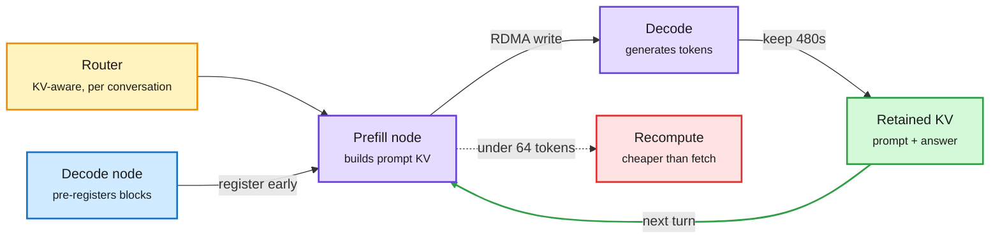
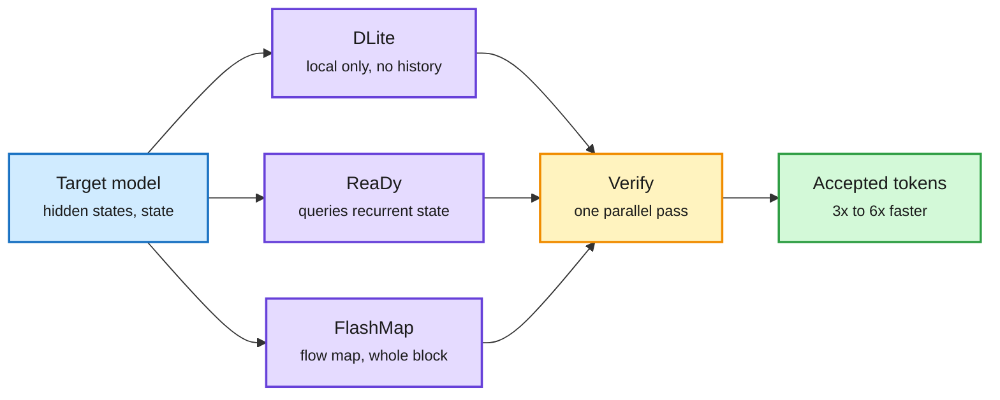
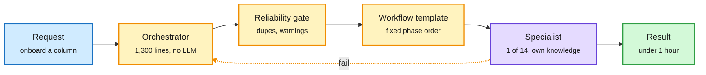
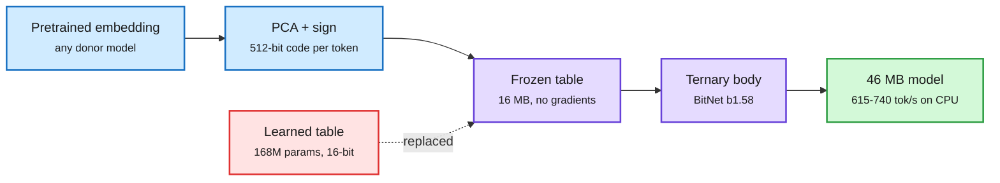
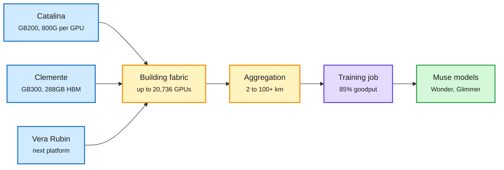
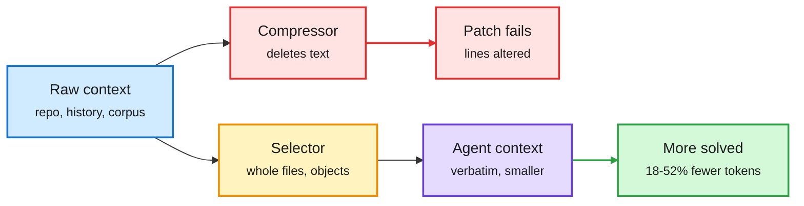

# cere-bro | 2026-10-20

> The day's savings came from moving things, not shrinking them. AWS moves the KV cache earlier and back again for up to 3.3x faster first tokens. Drafters stop dragging agent history and keep their speedups. Meta takes the model out of its router and gets under-an-hour pipeline changes. The hardware market can't decide if it has too many GPUs or too few: Amazon has warehouses of uninstalled chips while B200 spot prices triple.

🎯 Today's 5 for you

<ol>
<li>Read<strong>vLLM KV transfer, push and return.</strong> Push mode gives up to 3x faster first tokens. Sending the cache back on the next agent turn gives 1.6-3.3x. This is the KV-cache work most likely to land in your serving stack this quarter. Both are upstream in vLLM ([push](https://aws.amazon.com/blogs/machine-learning/push-based-kv-transfer-to-improve-ttft-and-tpot-for-disaggregated-inference-in-vllm/), [bi-directional](https://aws.amazon.com/blogs/machine-learning/improve-ttft-for-multi-turn-agentic-workloads-with-bi-directional-kv-transfer-in-vllm/)).</li>
<li>Read<strong>DLite + ReaDy + FlashMap: drafters for agents.</strong> Drafters lose up to 80% of acceptance on long agent contexts. Three fixes landed, from up to 70% over DSpark to 6.1x lossless. This closes the speculative-decoding question open since 10-16 ([DLite](https://arxiv.org/abs/2610.23787), [ReaDy](https://arxiv.org/abs/2610.20503), [FlashMap](https://arxiv.org/abs/2610.24365)).</li>
<li>Read<strong>Meta's Thin Orchestrator.</strong> A router with no LLM reasoning sends work to 14 isolated specialists, cutting the job from 3-4 days to under an hour. It fits your routing tier and your top saved theme, harness engineering ([post](https://engineering.fb.com/2026/10/19/ml-applications/thin-orchestrator-ai-agent-architecture/)).</li>
<li>Skim<strong>A frozen 16 MB vocabulary.</strong> A frozen 1-bit code replaces the embedding table that quantizers leave at 16 bits. A ternary model fits in 46 MB and runs 5-6x faster than an 8-bit GGUF on a laptop CPU. A compression angle almost nobody targets ([paper](https://arxiv.org/abs/2610.22428)).</li>
<li>Track<strong>GPU glut vs GPU shortage.</strong> Amazon reportedly can't install ~$3B a month of GPUs, yet Nebius B200 spot prices tripled in a week. Watch whether powered floor space is the real limit. Skip the "Anthropic's secret Claude Code trick" and "Harness is dead" hype threads ([roundup](../../ai-industry/2026-10-20-industry-roundup-gpu-glut-or-shortage.md)).</li>
</ol>

---

## TL;DR

- **vLLM KV transfer**: AWS pushes the cache before decode asks for it and returns it on the next turn. First tokens get up to 3x faster.
- **Speculative drafting for agents**: DLite drops drafter history, ReaDy reads hybrid-model state, and FlashMap drafts a whole block with dependencies. They report 3x to 6x speedups.
- **Meta Thin Orchestrator**: a deterministic router plus 14 isolated specialist agents turns a multi-day pipeline job into one hour.
- **Frozen 16 MB vocabulary**: a 46 MB ternary model ties the float model on two benchmarks and runs 5-6x faster on a CPU.
- **Meta Prometheus**: hundreds of thousands of GPUs, over 85% goodput, and a path to 1 million. GB300 is only 5-10% faster than GB200.
- **GPU market split**: Amazon has warehoused GPUs it cannot install, while B200 spot prices tripled. Gartner sees $3.5T of write-down risk.

---

## Deep Dives

### vLLM KV transfer: push the cache early, then send it back

> The network didn't change. AWS cut first-token latency up to 3x just by moving the KV handoff's setup work off the critical path.

**Source:** AWS Machine Learning blog (lab watcher)
**Links:** [Push-based KV transfer](https://aws.amazon.com/blogs/machine-learning/push-based-kv-transfer-to-improve-ttft-and-tpot-for-disaggregated-inference-in-vllm/) · [Bi-directional KV transfer](https://aws.amazon.com/blogs/machine-learning/improve-ttft-for-multi-turn-agentic-workloads-with-bi-directional-kv-transfer-in-vllm/) · [Wiki summary](../../inference-efficiency/2026-10-20-vllm-push-and-bidirectional-kv-transfer.md)

The cache stops waiting for paperwork, and stops being thrown away

Push moves setup off the critical path. The return path turns a full recompute into a short read.

Amber is the router, purple are the two GPU pools, green is the reused cache, red is the fallback recompute.

**What is it about?**
Many serving stacks now split inference in two. One pool of GPUs reads the prompt and builds the KV cache (the stored attention keys and values, so the prompt is never reprocessed). Another pool then generates tokens from that cache. This is called prefill-decode (P-D) disaggregation. AWS shipped two changes to how vLLM moves the cache between the pools.

**What problem does it solve?**
Until now the handoff ran in strict order after prefill. The router passed block IDs to decode, decode reserved memory, and then decode pulled the cache over the network. All three steps sat between the prompt and the first token. Agent loops added a second waste. Each new turn resent the whole history, and the prefill node recomputed the cache for text the decode node already held.

**What's the core novelty?**
Push mode has the decode node reserve its destination blocks while prefill is still running. The prefill node then writes the cache straight into them from a background thread, using NIXL (NVIDIA's transfer library) over EFA RDMA (AWS's direct GPU-to-GPU network). Bi-directional mode keeps the decode node's cache for 480 seconds. On the next turn it ships the cache back to prefill, with a KV-aware router tracking where each conversation's blocks live.

**Key takeaways**
- Push: Qwen3-32B at 8 queries/s and 16K input drops from 1,744 ms to about 540 ms TTFT (time to first token), with up to 30% better TPOT (time per output token).
- At low load and short prompts, push and pull tie. The gain appears exactly when the system is busy.
- Bi-directional: TTFT falls 1.6x for Qwen3-32B and 3.3x for GLM-5-FP8 at 20-24K context. The transfer costs 30-130 ms but removes up to 1.8 s of recompute.
- Fetching loses to recomputing for prefixes under 64 tokens, so a threshold decides per request.

**Gaps in the study**
Both benchmarks switch prefix caching off and use one prefill and one decode node. Real fleets with many-to-many pools and warm local caches will see smaller gains. The fixed 480-second hold pins HBM for idle sessions until AWS adds the heartbeat lease it names as future work.

**Industrial implication**
These features are upstream and accelerator-agnostic, built on Trainium and measured on H200s. Expect the major vLLM-based providers to turn them on for agent traffic within a quarter. Push mode also trades away late, load-aware choice of decode node. Schedulers will need a new heuristic for picking the decode node early.

**Research angle.** The KV break-even line is now clearly a property of the tier. On 10-09, galahad-kv found NVMe reload 2.8-4.3x faster than recompute on H100s. On 10-17, a B300 study found a remote cache hit only pays above about 17K tokens. Today a peer GPU over RDMA pays above 64 tokens. A useful paper would fit one model, with break-even as a function of interconnect bandwidth, GPU FLOPs and KV size per token, and test it across all three. A second open problem is the hold time. The hold should track predicted gaps between agent turns, which is a scheduling question no paper in the wiki has addressed.

→ [Full summary](../../inference-efficiency/2026-10-20-vllm-push-and-bidirectional-kv-transfer.md)

---

### Drafters for agent workloads: DLite, ReaDy, FlashMap

> Drafters lose up to 80% of their acceptance on long agent contexts. One fix is to drop their history entirely.

**Source:** HuggingFace (DLite, ReaDy); X home feed (FlashMap, Speculators v0.9)
**Links:** [DLite](https://arxiv.org/abs/2610.23787) · [ReaDy](https://arxiv.org/abs/2610.20503) · [FlashMap](https://arxiv.org/abs/2610.24365) · [Speculators v0.9](https://github.com/vllm-project/speculators/releases/tag/v0.9.0) · [Wiki summary](../../inference-efficiency/2026-10-20-speculative-drafting-dlite-ready-flashmap.md)

Three answers to "what should the drafter look at?"

Same target model. Only the drafter's source of context changes.

Blue is the target's signal, purple are the three drafter designs, amber is verification, green is the output.

**What is it about?**
Speculative decoding uses a small drafter to guess several tokens ahead. The big model then checks the guesses in one parallel pass and keeps the ones it agrees with. "Acceptance length" counts how many guessed tokens survive per check. Higher means faster. Three papers changed what the drafter conditions on.

**What problem does it solve?**
On 10-16, NVIDIA's DFlash2 drafter (shipped with Muse Spark Open) showed acceptance sliding from 3.73 to 2.16 on long, high-entropy prompts. The wiki has flagged "acceptance on agent traces" as open since then. DLite measures it at up to 80% degradation on agent workloads. It also finds that keeping the drafter's own growing KV history adds real system overhead.

**What's the core novelty?**
DLite drops drafter history entirely. It reuses the target's hidden states, predicts locally, and adds a light sequential head to restore order inside the block. ReaDy targets hybrid linear-attention models, which carry a fixed-size recurrent state. Each draft position gets a learned query into that state. FlashMap drafts the whole block in one pass like DFlash, a block-diffusion drafter that predicts each token independently. Its flow-map model captures how the block's tokens depend on each other.

**Key takeaways**
- DLite: acceptance length 2-6 on general, long-context and agentic workloads, and up to 70% better than DSpark, the prior best parallel drafter.
- ReaDy: 3.16x over plain decoding with Qwen3.8-27B on one B200, plus 8.5% acceptance and 8% throughput over DSpark.
- FlashMap: up to 6.1x lossless on Qwen3-8B, with 7% more average speedup than a matched DFlash.
- vLLM Speculators v0.9 makes drafter training cheaper. A fused loss gives up to 2x faster forward passes on ~1B drafters, and FP8 hidden states halve storage.

**Gaps in the study**
None of the three reports wall-clock throughput under batched serving with real agent traffic. Speculation's gains usually shrink as batch size grows. DLite's 70% is a best case, and FlashMap is shown on one 8B model.

**Industrial implication**
Agent traffic is now the main inference load for coding tools. A drafter that keeps 3x+ on long agent traces is worth more than one that hits 6x on chat. Expect DLite-style history-free heads in vLLM and SGLang drafter libraries within months, especially since Speculators v0.9 lowers the cost of training per-model drafters.

**Research angle.** DLite and ReaDy pull in opposite directions. DLite removes history and ReaDy adds more of it. Both beat DSpark. They agree only if the real cost is the drafter maintaining its own long KV, not access to context. ReaDy's context is the target's fixed-size state, which is free to read. A clean test would run a ReaDy-style state reader on DLite's agent traces with a hybrid target. Parallel block drafting is now at five papers in a week (DCOCO 10-13, DFlash2 10-16, DSpine 10-17, plus two today). The field has settled on one-pass blocks. The open race is over dependencies inside the block.

→ [Full summary](../../inference-efficiency/2026-10-20-speculative-drafting-dlite-ready-flashmap.md)

---

### Meta's Thin Orchestrator: the router that does no thinking

> Meta's most reliable production agent got that way by giving its central model less to do, not more.

**Source:** Meta Engineering (lab watcher)
**Links:** [Post](https://engineering.fb.com/2026/10/19/ml-applications/thin-orchestrator-ai-agent-architecture/) · [Wiki summary](../../ai-routing/2026-10-20-meta-thin-orchestrator.md)

The router is the dumbest box, on purpose

Six of seven steps are deterministic. The LLM only runs inside an isolated specialist.

Amber is deterministic control, purple is the only LLM reasoning, green is the outcome.

**What is it about?**
Meta automated "column onboarding" in its recommendation data pipelines. Each column needs coordinated changes across three repos, three languages and up to six pipeline stages. The final system is a small, deterministic router in front of 14 specialist agents.

**What problem does it solve?**
Meta's first build was one agent that knew everything. It worked in demos and hallucinated in production. Past a certain amount of context, more knowledge made it worse. It applied one subsystem's naming rules to another and used the wrong data source's code pattern. A second single-agent design reached 70-80% only with a custom prompt per task, and 10-20% without one.

**What's the core novelty?**
The orchestrator classifies intent, collects fields, checks for duplicates, runs reliability gates and delegates. It never reasons about code. Only the delegate step uses an LLM, inside a specialist that loads just its own knowledge files of a few thousand tokens each. New use cases are new workflow templates, fixed orderings of existing agents, not new agents.

**Key takeaways**
- Configuration prep went from 3-4 days by hand to under an hour. About two-thirds of changes land without significant human edits.
- A new use case (pipeline migration) shipped with zero new agent code.
- Knowledge files load at run time, so an update takes effect next session with no redeploy.
- Meta cites outside work: orchestrated multi-agent systems held 65.3% accuracy on 80-task batches where single agents fell to 16.6%, with up to 65x fewer tokens.

**Gaps in the study**
There is no controlled side-by-side of single agent vs orchestrator on one task set. The 10-20% figure is anecdotal. The domain (config-as-code) has well-typed intents. Open-ended requests may not classify as cleanly with keyword matching.

**Industrial implication**
This is the production version of a pattern the research side has built all week. Teams spending on bigger orchestrator models are likely overspending. The cheap win is a fixed router plus context isolation, with the frontier model kept for the narrow step that needs it.

**Research angle.** This is the fourth routing-inside-the-agent design in four days. On 10-17, SpecAgent had a weak model draft agent steps and a strong one review them. On 10-18, JevAgentHarness sent routine forks to a 4B model behind a threshold fitted on the agent's own runs. On 10-19, Cohere found cheap models are safe as planners but not coders. Meta goes furthest and removes the model from the routing decision. The open question is where deterministic routing stops working. Someone should measure orchestrator accuracy as intent diversity grows, and find where a fitted decision model (the JevAgentHarness approach) overtakes keyword rules.

→ [Full summary](../../ai-routing/2026-10-20-meta-thin-orchestrator.md)

---

### Embeddings Are Overpriced? A frozen 16 MB vocabulary

> In a 270M model, the embedding table is 63% of the parameters. A frozen 1-bit code does nearly as well.

**Source:** HuggingFace
**Links:** [Paper](https://arxiv.org/abs/2610.22428) · [Wiki summary](../../inference-efficiency/2026-10-20-frozen-16mb-vocabulary-ternary.md)

Binarize the vocabulary once, train only the body

The table that was most of the model becomes a fixed 16 MB lookup.

Blue is the one-time construction, purple is what runs, green is the result, red is what was removed.

**What is it about?**
In Gemma 3 270M, the embedding table (the lookup that turns each token ID into a vector) holds 168M of the 268M parameters. Quantization methods usually leave it at 16 bits, so it ends up as most of a compressed model's file. This paper replaces it with a frozen code.

**What problem does it solve?**
Low-bit work has shrunk transformer bodies for a year, while the embedding stayed full precision. For tiny on-device models that table is now the bottleneck in size and memory.

**What's the core novelty?**
The authors take a pretrained embedding once, project it onto its principal components, and keep only the signs. Each token gets a 512-bit code. The table has zero trainable parameters. They then train the same Gemma-shaped body from scratch, on the same 2.05B tokens, with and without it.

**Key takeaways**
- The learned table buys 0.20 nats of validation loss for 2.6x the trainable parameters. Yet the frozen model ties or wins on LAMBADA, HellaSwag and PIQA, and loses only on ARC-Easy.
- With a ternary BitNet b1.58 body (weights in {-1, 0, 1}), the whole model is a 46 MB file. It ties the float model on LAMBADA and PIQA.
- On a laptop CPU it generates 615-740 tokens/s in 62 MB. That is 5-6x the speed of the float model's 8-bit GGUF at a seventh of the memory.
- It handles rare words better (by 1.7-2.3 nats) and absorbs 10,000 new words after training at a 3% cost, where the learned table degrades 43%.

**Gaps in the study**
Only tested at about 270M parameters and 2B tokens. Embeddings are a small share of a 7B model, so the payoff shrinks with scale. The code still needs a donor embedding that someone trained.

**Industrial implication**
For on-device and browser models under 1B, this is a free 3-6x size and speed win, and the weights, data and eval answers are all released. Expect it in edge runtimes (llama.cpp, LiteRT) and in vocabulary-extension workflows for new domains.

**Research angle.** This extends the wiki's [conditional-memory-embeddings](../../inference-efficiency/conditional-memory-embeddings.md) thread, which treats embedding tables as a memory budget to reshape. Two open problems follow. First, does the frozen code hold at 1-3B, where the body dominates but vocabularies are 256K? Second, can the same sign code serve as the output head? Tied unembeddings are where small models spend their last large matmul.

→ [Full summary](../../inference-efficiency/2026-10-20-frozen-16mb-vocabulary-ternary.md)

---

### Inside Prometheus, plus Muse Glimmer

> Meta's gigawatt cluster runs at over 85% goodput. Its newest GB300 racks are only 5-10% faster than GB200 on Meta's jobs.

**Source:** Meta Engineering (lab watcher), AI at Meta on X
**Links:** [Prometheus post](https://engineering.fb.com/2026/10/19/data-center-engineering/inside-prometheus-meta-gigawatt-scale-supercluster/) · [Muse Glimmer announcement](https://x.com/AIatMeta/status/2112265822274302066) · [Wiki summary](../../hardware/2026-10-20-meta-prometheus-supercluster.md)

One machine across buildings, with network and reliability as the real design

Racks scale up, building fabrics scale out, and a 100 km aggregation tier ties them together.

Blue is rack hardware, amber is the network tiers, purple is the training job, green is the output.

**What is it about?**
Prometheus is Meta's supercluster in New Albany, Ohio. It already runs hundreds of thousands of GPUs across several buildings, trained the Muse models, and is scaling toward about 1 million GPUs. Meta also published a tech report on Muse Glimmer, a 30B open-weight agent model that runs at 4-bit on one consumer GPU.

**What problem does it solve?**
At this scale one bad host can stall a whole job. The post is mostly about keeping goodput high, meaning the share of time the cluster spends on useful training.

**What's the core novelty?**
Meta bought GB200 in the two-rack "Ariel" layout to get 800G of scale-out network per GPU instead of 400G. GB200 scaled FLOPs, HBM bandwidth and NVLink over H100 but left scale-out flat, and Meta expected that imbalance to hurt. The network follows the training parallelism. Chatty traffic stays inside a building fabric of up to 20,736 GPUs, and latency-tolerant traffic crosses buildings up to 100+ km apart on 800G-ZR coherent optics.

**Key takeaways**
- Goodput over 85% for pre-training and over 90% for RL. Mean time between interruptions is about 47K GPU-hours, since raised past 54K with firmware fixes.
- GB300 (Clemente) has 288 GB HBM per GPU, 1.5x GB200, and fits 72 GPUs in one ~135 kW rack. On Meta's workloads it is only 5-10% faster than GB200.
- Building fabrics moved from a scheduled fabric to a simpler non-scheduled one once NICs could reorder packets themselves.
- Vera Rubin NVL72 is the third platform, arriving soon.

**Gaps in the study**
No MFU (the share of peak math doing useful work), no failure-cause breakdown, no cost per platform. Muse Glimmer's architecture and quantization details were not captured in this window.

**Industrial implication**
The 5-10% GB300 gain is the number to remember. Rack spec sheets overstate generational gains for real training mixes. That strengthens the case for squeezing utilization and for vendor diversity, which Meta is also pursuing with AMD (10-19).

**Research angle.** MAI-Base-2 (10-17) reported 21% average MFU on 16,000 GB200s. Prometheus reports 85% goodput. These measure different losses, interruptions vs per-step efficiency, but no one publishes both for the same run. A paper that splits wasted GPU-hours into interruption, communication and kernel inefficiency for a 100K-GPU job would show where the next 2x hides. Distance-tolerant pretraining over 100 km is also unexplored in public research. Which parallelism layouts survive millisecond inter-building latency?

→ [Full summary](../../hardware/2026-10-20-meta-prometheus-supercluster.md)

---

### What the agent sees decides what it costs

> At the same token budget, choosing whole files beats compressing them by 6 points. Four papers say selection, not squeezing, saves agent tokens.

**Source:** HuggingFace
**Links:** [TokenEconomizer](https://arxiv.org/abs/2610.22732) · [Skip the Compressor](https://arxiv.org/abs/2610.21073) · [CarryOn](https://arxiv.org/abs/2610.18784) · [Librarian Agents](https://arxiv.org/abs/2610.22273) · [Wiki summary](../../agentic-systems/2026-10-20-agent-context-cost-shorts.md)

Spend the budget on choosing, not on squeezing

All four move effort from compressing text to deciding what enters context.

Red is the compression path that breaks exact code, amber is selection, green is the payoff.

**What is it about?**
Four papers on one question: which tokens belong in an agent's context window. Together they cover coding agents, computer-use agents and deep-research agents.

**What problem does it solve?**
Agent bills are dominated by context. The usual fixes are prompt compressors (delete tokens) and retrievers (pull similar chunks). Both lose information that the task needs exactly.

**What's the core novelty?**
- **TokenEconomizer** runs agents over a sequence of tasks in the same repo. An outside controller learns which skills to inject, which unused tools to prune, and when to break failure loops.
- **CQ2-CARE** ("Skip the Compressor") spends the budget on picking whole files to show verbatim.
- **CarryOn** rebuilds context around reusable task objects instead of the history that produced them.
- **Librarian Agents** trains a builder agent with RL to reorganize a corpus into a filesystem workspace before any question arrives.

**Key takeaways**
- TokenEconomizer: 18.4-30.9% fewer tokens with similar success, across Claude Code, Codex and Copilot CLI.
- CQ2-CARE: 43.7% (GPT-5.6) and 46.7% (Opus 5) resolved on 300 SWE-rebench issues. That is 6.3 points over the best compressor and 9.3-12.7 over the best retriever. Compressors kept the right files but changed lines, so patches failed to apply.
- CarryOn: +5.8% on OSWorld 2.0 with 51.9% fewer tokens.
- Librarian Agents: +33 points on BrowseComp-Plus over the best retrieval baseline.

**Gaps in the study**
The abstracts give averages without variance. Controller and builder costs are not netted out. Librarian's build-cost break-even depends on query volume, which is not quantified.

**Industrial implication**
Coding-agent vendors should stop shipping lossy context compression for code. TokenEconomizer's per-repo learning looks like the next feature for Claude Code or Codex, since it needs no model access.

**Research angle.** This makes five sources in two days with the same claim, that deciding what enters context beats shrinking it. They are Memorilla (10-19, 16 learned memory tokens beat full context on fact checks), Meta's Thin Orchestrator, CQ2-CARE, CarryOn and Librarian Agents. There is a real tension with Memorilla. Soft compression wins on fact verification but, per CQ2-CARE, loses when the task needs exact text. The 10-19 Looking Ahead predicted Memorilla would break on exact recall. CQ2-CARE is indirect support for that prediction, on code.

→ [Full summary](../../agentic-systems/2026-10-20-agent-context-cost-shorts.md)

---

### LEV and "Looped Models Done Right": depth on demand

> One looped checkpoint jumps from 63% to 76% just by running its layers four times, and a small stopper decides when to stop.

**Source:** HuggingFace (LEV, 239 upvotes, the window's #4)
**Links:** [LEV](https://arxiv.org/abs/2610.20951) · [Looped Models Done Right](https://arxiv.org/abs/2610.23036) · [Wiki summary](../../llms-foundation-models/2026-10-20-lev-and-looped-models-done-right.md)

```mermaid
flowchart LR
  Q["Question + options<br/><small>typed decision</small>"] --> P["Prelude<br/><small>runs once</small>"]
  P --> L["Shared block<br/><small>looped, input re-injected</small>"]
  L --> S["Stopper<br/><small>fitted threshold</small>"]
  S -->|unsure| L
  S -->|confident| C["Coda + readout<br/><small>one prob per option</small>"]
  C --> A["Answer<br/><small>15-24% less compute</small>"]
  classDef input fill:#d0ebff,stroke:#1971c2,color:#1b1b1b,stroke-width:2px
  classDef core fill:#e5dbff,stroke:#6741d9,color:#1b1b1b,stroke-width:2px
  classDef loop fill:#fff3bf,stroke:#f08c00,color:#1b1b1b,stroke-width:2px
  classDef exit fill:#d3f9d8,stroke:#2f9e44,color:#1b1b1b,stroke-width:2px
  class Q input
  class P,L,C core
  class S loop
  class A exit
  linkStyle 3 stroke:#f08c00,stroke-width:2px
  linkStyle 4 stroke:#2f9e44,stroke-width:2px
```

Same weights, more loops for harder questions

The stopper routes over depth instead of over models.

Blue is input, purple is the model, amber is the depth decision loop, green is the exit.

**What is it about?**
A looped model reruns the same layers several times, so it can think harder without writing tokens or adding parameters. LEV applies this to decision models, which answer a typed question with one probability per option in a single pass. A companion paper tests which looped design works best.

**What problem does it solve?**
Decision models are fast but spend the same compute on easy and hard questions. Text reasoning can think longer but pays for every token. Looped architectures also lacked controlled comparisons, so design choices were folklore.

**What's the core novelty?**
LEV reads the answer options after every loop and trains all depths jointly. One checkpoint can therefore answer at any depth, and a small stopper picks the depth per question. Looped Models Done Right isolates three axes: where the loop sits, whether the input is re-fed each loop, and how the recurrent state is organized.

**Key takeaways**
- A 2.6B LEV goes from 63.2% at depth 1 to 76.2% at depth 4 on JevBench. The gains are mostly on hard questions.
- The stopper's threshold is fitted on unlabeled requests. It saves 15-24% of compute for under one point of accuracy.
- The Huginn-style design wins: a prelude, a looped middle block and a coda, with input re-injection. It beats Ouro on all ten benchmarks at 730M, and the lead carries to MoE at 8B-A0.8B with more balanced expert use.
- At matched FLOPs, the looped MoE uses 75% fewer resident parameters than a 112-layer feedforward MoE.

**Gaps in the study**
LEV covers fixed-option decisions only, not open generation. The design study stops at 500B tokens. Neither paper measures the monitorability cost of thinking without text.

**Industrial implication**
Resident parameters are what fill HBM. A looped MoE with 75% fewer of them at equal quality is a direct serving-cost lever. NVIDIA already shipped one looped model (Dory1.0-4B, 10-17). Expect more looped small models aimed at routers and decision layers.

→ [Full summary](../../llms-foundation-models/2026-10-20-lev-and-looped-models-done-right.md)

---

### Shorts: memory writers, kernels, distillation, oversight

> A 3B-active model writes agent memory as well as Opus 5. The rest of the window adds kernel, distillation and oversight results worth a minute each.

**Source:** Lab watcher (Tencent HF repo, NVIDIA, AWS), HuggingFace, X home feed, AI Snake Oil
**Links:** [Hy-Memory-30B-A3B](https://huggingface.co/tencent/Hy-Memory-30B-A3B-GGUF) · [Mamba-2 in cuTile](https://developer.nvidia.com/blog/accelerating-mamba-2-with-high-performance-forward-pass-kernels-in-nvidia-cuda-tile/) · [DisaggKD](https://arxiv.org/abs/2610.17644) · [CoT controllability](https://arxiv.org/abs/2610.23257) · Wiki: [memory writer](../../agentic-systems/2026-10-20-hy-memory-30b-a3b-memory-writer.md), [kernels](../../hardware/2026-10-20-kernel-shorts-mamba2-cutile-compileiq-trainium.md), [distillation](../../inference-efficiency/2026-10-20-distillation-shorts-disaggkd-opmd-treeopsd.md), [oversight](../../responsible-ai/2026-10-20-cot-controllability-and-agent-oversight-shorts.md)

- **Hy-Memory-30B-A3B (Tencent).** A 3B-active MoE trained only to write agent memory, inside the Mem0, MemOS and Hy-Memory harnesses. With reader and judge held fixed, it averages 55.49 across four harnesses vs 54.62 for Claude Opus 5, including a held-out harness. The Q4_K_M GGUF (18 GB) loses about two points. Role routing again: a small specialist owns one narrow job.
- **Mamba-2 forward pass in cuTile (Jane Street + NVIDIA).** Three Python tile kernels: a log-space cumulative sum, a Tensor Core "state jump" across chunks, and a fused masked output kept in registers. The causal mask throws away every exponential of a positive number, so the math is stable by construction. No headline speedup is given.
- **CompileIQ + Helion.** NVIDIA exposes ptxas register and scheduling choices to PyTorch Helion's autotuner. Kernels already tuned to the limit get a joint search space.
- **Deepgram on Trainium2.** TorchNeuron port, NKI fused kernels and an agentic tuning toolkit give 11-70% more audio per dollar for batch transcription.
- **DisaggKD.** It does for distillation what P-D disaggregation does for serving. Teachers sit on their own nodes, and an exact sharded loss never builds full-vocabulary logits. Pairs that run out of memory colocated now train.
- **OPMD and TreeOPSD.** OPMD distills a teacher's intermediate computation, not just outputs. TreeOPSD turns tree-backed rewards into bounded teacher targets for agent RL.
- **CoT controllability (2610.23257).** Put a constraint inside the chain of thought as a self-instruction and models follow it far more often. The same trick can evade a CoT monitor.
- **Agents for different parties never check each other (Salesforce).** In 2,500 sessions, no agent re-fetched a document to test a peer's claim. A $24,000 settlement passed all ten outcome checks while leaking confidential details.
- **DeepMind's Busy Beaver agent.** It chose its own BB(6) machines and proved acceleration rules in Lean for eleven unresolved ones. Lean is the gate, so the result needs no trust in the model.
- **ProPerAgent and Harness² (via X).** Meta's ProPerAgent harness adds an LLM check on whether retrieved memories justify a proactive assistant speaking. Accuracy rises from ≤15% to 38% with no weight changes, and 24.0% without the filter. Google Research open-sourced Harness², where agents tune their own prompts, skills and memory over repeated runs.
- **HexaShell (HF, 288 upvotes).** A thin harness lets Codex with GPT-6-Astra drive a two-arm robot by writing its own triangulation tools. It sets a new best of 39.7% on RoboDojo. The limit is contact (insertion 8.3%), not reasoning.

---

## Industry Pulse

- **Amazon reportedly can't install the GPUs it is buying**: an "early rack receipt" program takes ~$3B a month of GPUs with no clear installation path ([Business Insider via @edzitron](https://x.com/edzitron/status/2112346331863744542)).
- **B200 spot prices at Nebius reportedly tripled in a week**, which could lift December-annualized ARR ([@StockSavvyShay](https://x.com/StockSavvyShay/status/2112343015100661983)).
- **IREN's CEO: 2026 capacity sold out**, new contracts priced at more than double last year, and bringing GPUs online is the bottleneck ([@StockSavvyShay](https://x.com/StockSavvyShay/status/2112202767112757716)).
- **Neocloud shakeout**: executives expect only 7-10 of hundreds of AI clouds to survive. Non-hyperscalers are 45% of Nvidia's datacenter revenue ([The Decoder](https://the-decoder.com/the-neocloud-shakeout-is-coming-and-nvidia-has-the-most-to-lose/)).
- **Gartner** sees $6T of AI infrastructure spend in 2027-2030, with over $3.5T at risk of write-downs by 2030 ([@rohanpaul_ai](https://x.com/rohanpaul_ai/status/2112249125127557235)).
- **Morgan Stanley** puts 2027 AI spend at $1.58T counting leases, with Nvidia taking ~$690B, or 44% ([@rohanpaul_ai](https://x.com/rohanpaul_ai/status/2112427961047798236)).
- **Marvell** showed photonic modules that put HBM and DDR up to 50 m from the GPU at hundreds of nanoseconds latency ([@rohanpaul_ai](https://x.com/rohanpaul_ai/status/2112437556445106638)).
- **Nvidia signs Modal for Vera CPUs**, reportedly 2x capacity on agent workloads. Nvidia targets ~$20B of CPU revenue this fiscal year ([@StockSavvyShay](https://x.com/StockSavvyShay/status/2112191541238550971)).
- **AWS TorchNeuron** runs PyTorch on Trainium2/3 natively with one setting change ([PyTorch](https://x.com/PyTorch/status/2112170050581143952)).
- **MiniMax M3.1 Flash**: 42 on the Artificial Analysis index, 73.7% DeepSWE under $0.30 a task, $0.60 per million output tokens ([The Decoder](https://the-decoder.com/minimax-m3-1-flash-shows-chinas-ai-price-race-has-no-floor-in-sight/)).
- **DeepSeek-V4.1-Flash-1017 (Max)** is now the #1 open model in Arena's Agent Arena and #11 overall ([Arena](https://x.com/arena/status/2112247114944360666)).
- **Inception Mercury 3**, a diffusion LLM, is 4-8x faster than comparable small models at the same price, and 2-4x on OpenRouter ([@deedydas](https://x.com/deedydas/status/2112447082883899709)).
- **Together Post-Training** launches RL and SFT as a service, Tinker-compatible, starting with Muse Spark Open, GLM 5.3, Kimi K3 and Qwen 3.8-27B ([Together AI](https://www.together.ai/blog/together-post-training)).
- **OpenAI** reports better coding in COBOL, Fortran and Visual Basic, with new migration evals ([OpenAI](https://openai.com/index/low-resource-programming-languages)).
- **Kling 4.0** adds 30-second clips and ten keyframes but doesn't pull ahead of Wan 3.0 or Seedance 2.5 ([The Decoder](https://the-decoder.com/kling-ai-drops-version-4-0-with-stereo-audio-multilingual-lip-sync-and-a-lighter-flash-variant/)).
- **Meta GenRecs Tokenization** swaps per-item ad IDs for semantic tokens, giving +0.35% conversions across surfaces ([Meta Engineering](https://engineering.fb.com/2026/10/19/ml-applications/genrecs-tokenization-transforming-ads-recommendation-at-meta-with-stable-model-vocabulary/)).
- **Exa 3.0** claims #1 on every search benchmark it tested ([Exa via YC](https://x.com/ycombinator/status/2112296827278315906)).
- **DHS orders civilian agencies to remove DeepSeek** and products built on it, including US-hosted weights ([@rohanpaul_ai](https://x.com/rohanpaul_ai/status/2112265351492972953)).
- **German courts**: Aachen follows Munich in treating Google AI Overviews as Google's own content for liability ([The Decoder](https://the-decoder.com/two-german-courts-now-hold-google-liable-for-what-its-ai-overviews-say/)).
- **Anthropic's leaked AI safety bill** draws fire for a "more than 50 deaths" harm threshold ([@GaryMarcus RT](https://x.com/GaryMarcus/status/2112139487338000694)).
- **Anthropic's worker fund** (5% of shares) prompts Musk to counter with SpaceX shares for children ([The Decoder](https://the-decoder.com/anthropic-plans-fund-for-workers-threatened-by-ai-musk-counters-with-spacex-shares-for-children/)).
- **Stripe** says agent purchases through Link are growing but shares no figures ([The Decoder](https://the-decoder.com/stripe-says-ai-agent-purchases-are-adding-up-but-it-wont-share-the-numbers/)).
- **Germany and Nvidia** sign a declaration of intent on industrial AI ([NVIDIA](https://blogs.nvidia.com/blog/germany-wants-to-lead-the-world-in-industrial-ai-how-nvidia-will-help/)).

**Funding, valuations, and compute deals**

- **Greptile** raised a $50M Series B led by Menlo Ventures at a $750M valuation. It reviews over 1% of GitHub PRs daily ([Greptile](https://www.greptile.com/blog/series-b)).
- **Anthropic** is reportedly negotiating another 460 MW at Nscale's Monarch campus, after a $45B, 6-year deal for the first 460 MW ([@StockSavvyShay](https://x.com/StockSavvyShay/status/2112269323289157764)).
- **Goldman on CoreWeave**: ~15% unlevered IRR even if GPUs are worthless after five years. New contracts run ~$13M/MW ([@StockSavvyShay](https://x.com/StockSavvyShay/status/2112224375063855454)).
- **An agent web-access startup** raised $9M led by General Catalyst, with Robinhood Ventures ([YC](https://x.com/ycombinator/status/2112239834089890029)).
- **Polsia** hit a $20M run rate in 340 days and raised $30M at a $250M valuation. Its AI bill peaked at $1.2M a month ([@zodchiii](https://x.com/zodchiii/status/2112204404887793885)).
- **Anduril** employee share sale reportedly near a $90B valuation, up from ~$30B 16 months ago ([@StockSavvyShay](https://x.com/StockSavvyShay/status/2112295516864438317)).
- **Anthropic IPO talk**: Eric Schmidt's ~1% stake would be worth ~$20B at a $2T listing (speculative) ([@rohanpaul_ai](https://x.com/rohanpaul_ai/status/2112403694973026732)).
- **A $10M European compute-grant program** backed by Nvidia and Accel targets open models, coding agents and inference ([@AnatoliKopadze](https://x.com/AnatoliKopadze/status/2112258266537275625)).

---

## Global View

**The GPU market is short on power and space, not chips, and research is pricing utilization accordingly.** Business Insider's report of warehoused Amazon GPUs and IREN's line that "bringing GPUs online is the bottleneck" describe one thing. Chips pile up where buildings and power lag, and powered GPUs get scarce, which is why B200 spot prices can triple in the same week. This matches SemiAnalysis on 10-19, which argued that about $1T of signed leases funds +50GW in 2027 and construction sets the pace. When powered capacity is the binding input, every point of utilization is worth more than a new chip. Meta's 85% goodput, the GB300's modest 5-10% gain, and AWS's 3x TTFT from moving the KV handoff all sell the same thing: more work out of GPUs already plugged in.

**Cache movement has become a first-class serving decision, and the break-even depends on the tier.** Three wiki results now give three break-even lines for reusing a KV cache over recomputing it. galahad-kv (10-09) found NVMe reload beats recompute on H100s. The B300 remote-store study (10-17) found a remote hit only pays above ~17K tokens. AWS today finds a peer GPU over RDMA pays above 64 tokens. Industry is building toward the cheap end. llm-d tracks where every block lives (PyTorch Conference poster this week), vLLM ships a KV-aware router, and Marvell demos memory 50 m from the GPU. If memory is the 2027-28 limit, as SemiAnalysis hinted on 10-19, the cache-placement scheduler becomes a capacity plan, not a latency tweak.

**Production agents are converging on cheap, fixed routing and strict context control, and the research arrived the same week.** Meta's Thin Orchestrator removes the LLM from routing and isolates each specialist's context. That is the production endpoint of a ladder the wiki logged all week. SpecAgent (10-17) had weak models draft and strong ones review, JevAgentHarness (10-18) used fitted thresholds, and Cohere (10-19) used cheap planners with strong coders. Today's papers say the same about context. CQ2-CARE beats compressors by picking whole files, CarryOn cuts tokens 52%, and TokenEconomizer trims 18-31% per repo. On the money side, Polsia's $1.2M monthly AI bill and Greptile's $50M round for an independent review layer show where the spend is going: fewer tokens per task, and a separate check on what cheap agents produce.

---

## Looking Ahead

- **Bi-directional KV transfer becomes a default for agent traffic.** Within 60 days, at least one major vLLM-based inference provider or llm-d release enables decode-to-prefill KV reuse by default for multi-turn sessions. Signal: release notes or a provider blog by 2026-12-20. If it stays opt-in, the fixed-TTL HBM cost is the reason.
- **History-free drafting shows up in a serving framework.** Within 90 days, vLLM Speculators or SGLang ships a DLite-style drafter (target hidden states, no drafter KV history) or reports agent-trace acceptance numbers. Signal: a release or issue citing 2610.23787 by 2027-01-20.
- **The GPU "glut" stays local.** Within 30 days, B200 or B300 rental indices stay at least 20% above their early-October level despite the Amazon warehouse story. Signal: published rental index or neocloud pricing by 2026-11-20. A fall below October levels would mean the glut is real and the shortage was about power timing.
- **GB300's small gain gets repeated.** Within 60 days, a second large operator (Microsoft, xAI, Oracle or a neocloud) reports GB300 training gains under 15% over GB200 on its own workloads. Signal: an engineering blog or earnings commentary by 2026-12-20.
- **Source notes.** Gmail delivered no newsletters this window. The file was last farmed 2026-10-19 and a retry hung, so newsletter-only items (SemiAnalysis email, Last Week in AI, AI Breakfast) will land in the next digest. DAIR Academy (MCP auth needed: run `claude mcp login dair-academy`). DAIR picks reached us only via X, including DeepMind's Busy Beaver paper and the CoT controllability paper. Kurate published no new weekly leaderboard, and no rising authors crossed the threshold. All eight subreddits passed zero posts through filters. There were no new bookmarks. LinkedIn and YouTube subscriptions returned nothing. The X slot scrapes were empty, but the Following-feed captures were complete. VentureBeat's feed is still blocked by a security checkpoint.
