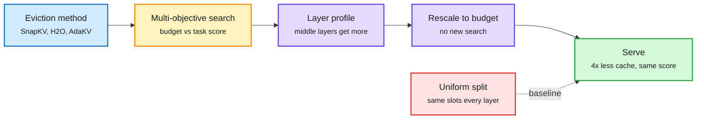
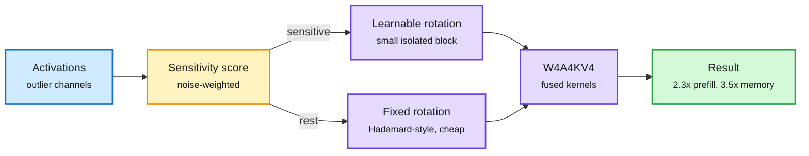
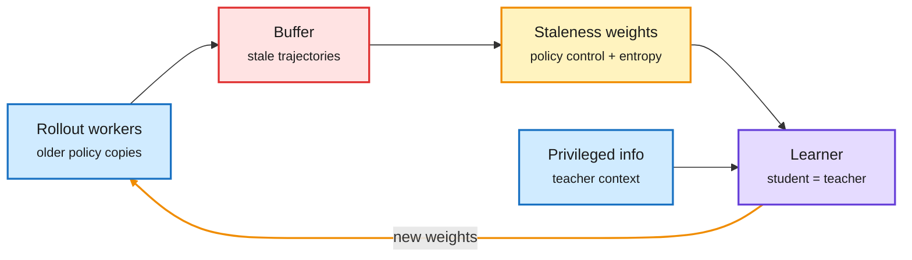
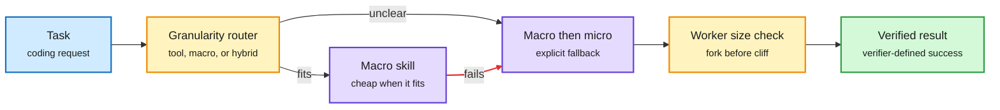
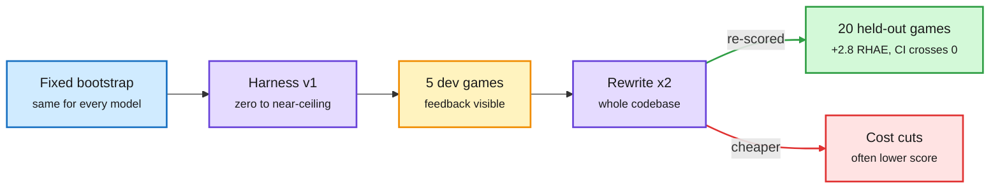
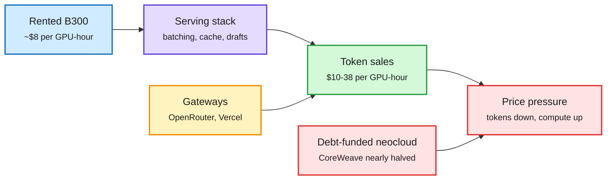

# cere-bro | 2026-10-25

> A quiet US Saturday with a clear cost lesson: spend bytes where they matter, not evenly. MOSAIC gives the KV cache to the middle layers and needs 4x less of it. LIRQuant learns rotations only for the fragile channels. Routers decide step size and context size inside the agent. Meanwhile the market splits: token resellers earn $10-20 per GPU-hour while debt-funded neoclouds lose half their value.

🎯 Today's 5 for you

<ol>
<li>Read<strong>MOSAIC.</strong> A searched per-layer KV budget beats the uniform split in 146 of 154 settings and matches it with 4x less cache. Your KV cache beat, flagged as a Kurate pick yesterday and now #1 on cs.LG. <a href="https://arxiv.org/abs/2610.25431">Paper</a></li>
<li>Read<strong>LIRQuant.</strong> W4A4KV4 with learnable rotations only on sensitive channels: 25-minute calibration, 2.3x prefill, 3.5x memory. Your quantization beat, and the third "protect the fragile slice" result this month. <a href="https://arxiv.org/abs/2610.25675">Paper</a></li>
<li>Read<strong>Token arbitrage vs the neocloud squeeze.</strong> Resellers earn $10-20/GPU-hour on rented B300s while CoreWeave nearly halved in 12 days. Your compute-infrastructure beat, with the numbers that show stack quality is the margin. <a href="https://x.com/deedydas/status/2114195317860266432">Thread</a> · <a href="https://www.theinformation.com/articles/neoclouds-gathering-storm">The Information</a></li>
<li>Skim<strong>Routing inside the coding agent.</strong> A learned router picks tool, macro skill or macro-with-fallback per task (Kurate and DAIR). Pair it with the "fork workers before the context-price cliff" thread, which is unverified. Your routing beat. <a href="https://arxiv.org/abs/2610.31461">Paper</a></li>
<li>Skim<strong>Models rewriting their own harness.</strong> 27 lineages on ARC-AGI-3: two full rewrites add 2.8 held-out points and the interval crosses zero. Your top saved theme, harness engineering, gets its second clean "self-revision overfits" result. Skip the ResonanceDB, "Brainobot" and "emotion circuits" hype threads. <a href="https://arxiv.org/abs/2610.30499">Paper</a></li>
</ol>

---

## TL;DR

- **MOSAIC**: search how much KV cache each layer gets. Middle layers win. Same quality with up to 4x less cache.
- **LIRQuant**: expensive learned rotations only for noise-sensitive channels. State-of-the-art 4-bit weights, activations and KV, calibrated in 25 minutes.
- **AsyncOPSD**: self-distillation with rollouts off the critical path. About 2x training throughput, slightly better math scores.
- **Routing goes inside the agent**: a learned controller picks the skill granularity per task and recovers failed macros.
- **Harness self-improvement stalls**: frontier models rewriting their own ARC-AGI-3 harness gain 2.8 points that may be zero.
- **Inference economics split**: token resellers profit on rented GPUs while CoreWeave nearly halved and Rippling moved its coding work to cheaper OpenAI models.

---

## Deep Dives

### MOSAIC: give the KV cache to the layers that need it

> Every eviction method today keeps the same number of tokens in every layer. A searched layer profile beats that even split almost everywhere, and the winners are the middle layers, not the early ones.

**Source:** Kurate cs.LG weekly #1 (not on HF)
**Links:** [Paper](https://arxiv.org/abs/2610.25431) · [Wiki summary](../../inference-efficiency/2026-10-25-mosaic-per-layer-kv-budgets.md)

The eviction policy picks tokens; MOSAIC picks how many each layer gets

One offline search, then the same layer profile is rescaled to any budget.

Blue is the existing eviction method, amber is the search, purple is the learned profile, green is the result, red is the uniform baseline.

**What is it about?**
The KV cache (the stored attention keys and values for past tokens, which grows with context) is the main memory cost of long-context serving. Eviction methods such as SnapKV and H2O throw out low-value tokens to fit a budget. MOSAIC decides how to split that budget across layers.

**What problem does it solve?**
Until now, eviction methods gave every layer the same number of slots, even though layers need different tokens. Earlier per-layer schemes used hand-made pyramids or slow evolutionary search (EvolKV). MOSAIC replaces both with one multi-objective architecture search.

**What is the core novelty?**
The search maps the whole trade-off between average budget and task score in one pass. The best allocation's shape then transfers to any target budget without searching again. It works on top of any eviction method, so it is a layer-axis knob that composes with token-axis selection.

**Key takeaways**
- Beats uniform allocation in 146 of 154 task, method and budget settings, by up to +48 points on RULER and +11.9 on LongBench LCC.
- Matches uniform-allocation quality with up to 4x less KV cache on Llama-3-8B-Instruct and Mistral-7B-Instruct.
- Against EvolKV it searches a far larger space with 4x fewer evaluations and 18% fewer GPU-hours per budget, and wins 5 of 6 settings.
- Learned profiles favour a small set of middle layers. That cuts against the pyramid assumption that early layers need the most.

**Gaps in the study**
Only two 7-8B dense models with standard attention. No GQA- or MLA-heavy frontier models, no hybrids where most layers hold a fixed-size state, and no paged serving engine, where uneven per-layer budgets complicate block allocation.

**Industrial implication**
This is a free win for anyone already running eviction: a static per-model profile file, computed once. Expect serving engines that support eviction to accept per-layer budgets within two quarters. The open question is the joint search: tokens, layers and bits (see LIRQuant below) are now three separate knobs nobody has tuned together.

This closes a thread from yesterday's Looking Ahead, which flagged MOSAIC as a Kurate pick not yet on HuggingFace. It is also the seventh instance of the KV-cache page's "selection beats compression" pattern, the running claim that choosing what to keep beats squeezing everything, now applied to layers instead of tokens.

→ [Full summary](../../inference-efficiency/2026-10-25-mosaic-per-layer-kv-budgets.md)

---

### LIRQuant: learn rotations only for the fragile channels

> Rotation-based 4-bit quantization learns one big transform for every channel. Most channels do not need it. Isolating the sensitive few makes calibration fast and keeps state-of-the-art accuracy.

**Source:** Kurate cs.AI weekly #13
**Links:** [Paper](https://arxiv.org/abs/2610.25675) · [Wiki summary](../../inference-efficiency/2026-10-25-lirquant-selective-rotation.md)

Spend the expensive rotation only where noise hurts

A sensitivity score splits channels; each group gets a different rotation.

Blue is the input, amber is the split decision, purple is the transform and quantized compute, green is the result.

**What is it about?**
Post-training quantization (PTQ, shrinking a trained model's numbers to fewer bits without retraining) struggles with activation outliers: a few huge values blow up the 4-bit range. Rotation methods (QuaRot, SpinQuant) multiply activations by a rotation that spreads outliers across channels. LIRQuant applies rotations selectively.

**What problem does it solve?**
Global rotations treat all channels alike, even though channels differ in how much quantization noise hurts. Learnable global rotations are accurate but slow and memory-hungry to calibrate.

**What is the core novelty?**
A noise-weighted sensitivity metric picks the sensitive channels. Only that small block gets an expressive learned rotation. The rest get a cheap fixed rotation. Fewer learned parameters means a smaller, faster optimization with the same outlier smoothing.

**Key takeaways**
- State-of-the-art accuracy at W4A4KV4 (4-bit weights, activations and KV cache) across LLaMA-2/3, Mistral, Qwen3 and Mixtral.
- Calibrates LLaMA-3-8B in 25 minutes at 20.3 GB peak GPU memory, the fastest and leanest among learnable-rotation methods.
- Fused kernels give up to 2.3x prefill speedup and 3.5x memory saving over FP16.

**Gaps in the study**
Averages only. The 10-23 MiniMax M3.1 Flash talk showed 4-bit KV keeping the average flat while one sub-score fell 6.6 points, so per-slice results matter. No long-context or agent evals, where KV errors compound.

**Industrial implication**
Cheap calibration matters for open-weight releases: a lab or reseller can ship a W4A4 variant on day one instead of week three. This is the third "protect the fragile slice" result in a month, after PACE (10-23, which kept long-memory recurrent-state heads at 8 bits) and MiniMax (which left the shared expert at higher precision). The field has settled on mixed precision driven by a sensitivity score.

→ [Full summary](../../inference-efficiency/2026-10-25-lirquant-selective-rotation.md)

---

### AsyncOPSD: self-distillation without waiting for rollouts

> When teacher and student are the same model, asynchronous training is easy, and it doubles throughput.

**Source:** Kurate cs.LG weekly #14
**Links:** [Paper](https://arxiv.org/abs/2610.25880) · [Wiki summary](../../inference-efficiency/2026-10-25-async-opsd.md)

One model, two roles, no waiting

Rollouts stream into a buffer; the learner corrects for how old each one is.

Blue is input, red is the staleness risk, amber is the correction, purple is the shared model; the amber arrow is the async loop.

**What is it about?**
On-policy self-distillation (OPSD) uses one model twice: as a student that generates answers and as a teacher that sees privileged information, such as the reference solution, and scores them. AsyncOPSD trains it asynchronously.

**What problem does it solve?**
Generating rollouts synchronously dominates OPSD training time. Separate-teacher distillation can go async too, but it has to coordinate two models.

**What is the core novelty?**
Shared weights remove the multi-model sync. Rollouts from older policies are kept, and a staleness-aware policy-control term plus token-level entropy weighting stop old data from hurting the update.

**Key takeaways**
- 1.96-2.25x throughput over synchronous OPSD across three model sizes.
- Average math benchmark accuracy goes up slightly, not down.

**Gaps in the study**
Math only. No comparison against async separate-teacher distillation at equal compute. No reported limit on how stale a rollout can be.

**Industrial implication**
The October self-teacher wave (BSD and Meta's RSD on 10-23, where a copy of the student scores its own rollouts) now has a trainer that scales. Expect it in open RL stacks such as verl or OpenRLHF within a quarter.

→ [Full summary](../../inference-efficiency/2026-10-25-async-opsd.md)

---

### Routing inside the coding agent: step size and context size

> The routing decision has moved inside the agent loop. One router picks how big a step to take; another keeps each worker under a price threshold.

**Source:** Kurate cs.AI #20 + DAIR.AI Academy pick, cross-source confirmed (Kurate + DAIR); practitioner thread on X
**Links:** [Paper](https://arxiv.org/abs/2610.31461) · [DAIR page](https://academy.dair.ai/papers/adaptive-skill-granularity-for-coding-agents-runtime-routing-and-macro-to-micro-2610.31461) · [Context-cliff thread](https://x.com/Sprytixl/status/2114094189977723325) · [Wiki summary](../../ai-routing/2026-10-25-adaptive-skill-granularity-and-context-cliffs.md)

Two routers, one agent loop

One picks the step size; the other keeps each worker under a price threshold.

Blue is input, amber are routing decisions, purple is execution, green is the result; the red arrow is the failure path.

**What is it about?**
A coding agent can solve a task with many small tool calls or one packaged macro skill. Adaptive Skill Granularity makes that a per-task routing choice, with a fallback from macro to primitive steps when the macro breaks.

**What problem does it solve?**
Fixed macros are efficient when they fit and brittle when they do not. Prior skill work studied which skill to retrieve before execution, not how to recover during it.

**What is the core novelty?**
A feature-based controller picks the level from task structure, execution state and earlier macro failures. A finite-state executor turns the fallback into an explicit, checkable transition instead of an informal retry.

**Key takeaways**
- In a 12-task routing study a learned router reaches 100% success where a hand-written heuristic fails.
- Macro-to-micro fallback recovers controlled macro failures that fixed granularity leaves unresolved.
- The practitioner version one layer up: an orchestrator forks cheap-model workers before they cross a context length where the per-token price reportedly jumps 5x. The poster claims $6.15 for one agent versus $0.85 for nine. The linked Claude Code docs page does not show that tier, so treat the numbers as unverified.

**Gaps in the study**
Twelve deterministic tasks with injected failures. Kurate's LLM rating is low (3.5/10), though DAIR's curators picked it. No cost-per-success comparison against a strong single-granularity agent.

**Industrial implication**
Routing by subtask is now established: RouteWeaver (10-24, one policy chooses single-round, multi-round or agentic mode), Meta's RL-trained 8B tool picker beating a 402B model (10-24), Shopify routing reading to small models, and now step-size routing. What none of them price is the prefix cache that a fork or model switch throws away, the cost the 10-23 TDS note flagged.

→ [Full summary](../../ai-routing/2026-10-25-adaptive-skill-granularity-and-context-cliffs.md)

---

### Models cannot yet improve their own harness

> Frontier models write harnesses that range from useless to near-perfect on the first try. Two full rewrites add almost nothing on games they have not seen.

**Source:** DAIR.AI Academy pick (via X, @omarsar0)
**Links:** [Paper](https://arxiv.org/abs/2610.30499) · [DAIR page](https://academy.dair.ai/papers/can-llms-improve-their-own-harness-a-controlled-study-on-arc-agi-3-2610.30499) · [Wiki summary](../../agentic-systems/2026-10-25-llms-improve-own-harness-arc-agi-3.md)

Most of the quality is set in draft one

Rewrites tune to the five games the model can see, not the twenty it cannot.

Blue is the shared start, purple are harness versions, amber is the visible feedback, green is the held-out score, red is the cost-cut failure mode.

**What is it about?**
A harness is the program around a model that handles perception, memory, tools, recovery and compute budget. This study asks whether frontier models can build and then improve one for ARC-AGI-3, a benchmark of unfamiliar interactive games where the agent must discover the goal as it plays.

**What problem does it solve?**
"Self-improving harness" claims rarely separate the games used for revision from the games used for scoring. This study does.

**What is the core novelty?**
A clean protocol. Each model writes a harness from a fixed bootstrap, plays five development games, rewrites its whole codebase twice, and is scored on 20 games that never feed back. The score is RHAE (Relative Human Action Efficiency: levels completed, weighted by how few actions were used compared with humans), with dollar cost tracked alongside.

**Key takeaways**
- Across 27 lineages, first harnesses span zero to near-ceiling.
- Two rewrites raise mean held-out RHAE by 2.80 points, with a 95% interval of -1.44 to 7.35.
- Gains on development games overstate held-out gains.
- Revisions that cut inference cost often lower the score. Human-steered harnesses still do better.

**Gaps in the study**
Open-loop revision only, with no search, no held-out selection and no RL. Two rewrites is a short horizon.

**Industrial implication**
This is the second clean held-out result showing self-revision mostly overfits, after the HDA audit (10-22, which found about 54% of harness-evolution gains are overfitting to the search set). The methods that do transfer add an outside check: Google Cloud's specialized harnesses picked by a router (+16 points) and Harness Scaling's RL across many harnesses (10-23). Ship harness changes behind held-out evals, not the agent's own judgment.

→ [Full summary](../../agentic-systems/2026-10-25-llms-improve-own-harness-arc-agi-3.md)

---

### Token arbitrage and the neocloud squeeze

> Selling tokens from rented GPUs prints money at small scale. Owning the GPUs on debt is what the market is punishing.

**Source:** X (@deedydas), The Information (two weekend pieces), Arena
**Links:** [Deedy's thread](https://x.com/deedydas/status/2114195317860266432) · [A Neocloud's Gathering Storm](https://www.theinformation.com/articles/neoclouds-gathering-storm) · [Anthropic's Margin is OpenAI's Opportunity](https://www.theinformation.com/articles/anthropics-margin-openais-opportunity) · [Wiki summary](../../ai-industry/2026-10-25-token-arbitrage-neocloud-squeeze.md)

Margin moves to whoever runs the best stack on the cheapest memory

Token prices fall, scarce compute gets dearer, debt makes the middle fragile.

Blue is rented compute, purple is the stack, amber is demand aggregation, green is revenue, red is the pressure on price and debt.

**What is it about?**
Three weekend views of inference economics. Deedy Das lays out reseller unit economics. The Information covers CoreWeave's fall and a customer switching vendors on price.

**What problem does it solve?**
It explains why dozens of inference providers launch every week while the best-known GPU cloud loses half its value.

**What is the core novelty?**
The numbers. On-demand B300s cost about $8 per GPU-hour. Open models such as GLM 5.3, Kimi K3 and DeepSeek 4.1 can earn $10-20 per GPU-hour at about 100 tokens/s, and DeepInfer reports $38 off-peak. Margin depends on utilization and stack quality. Chinese labs now ask large providers for revenue share in exchange for day-0 access.

**Key takeaways**
- CoreWeave nearly halved in 12 days on rate fears and debt load. Meta's new share class for AI fundraising sent CoreWeave down 10%, Nebius 7.2% and IREN 8.3% in one session.
- SpaceX now sells its spare AI compute, a well-funded rival to the neoclouds.
- Rippling moved from 57% Anthropic and 16% OpenAI of its coding work in May to 52% OpenAI and 18% Anthropic, citing cost.
- Kimi K3.1 Pro entered Arena's agent leaderboard at #11, the top open model, at a $1.03 median cost per task.

**Gaps in the study**
The reseller figures are one investor's estimates, not audited margins. The Information's CoreWeave piece is stock commentary, not new filings.

**Industrial implication**
Every efficiency paper above is a margin lever. MOSAIC's 4x cache cut and LIRQuant's 3.5x memory saving move a provider along the throughput curve that decides whether $8 compute sells for $10 or $38. Expect consolidation among thin-margin resellers within two quarters, with the survivors marketed on stack quality.

→ [Full summary](../../ai-industry/2026-10-25-token-arbitrage-neocloud-squeeze.md)

---

### Shorts: reasoning as computation, portable probes, diffusion drafters, serving talks

- **Computation, Not Memory** ([2610.25760](https://arxiv.org/abs/2610.25760), Kurate cs.LG #5). In a lock-tracking file task, reasoning written at the moment of action does most of the work, and keeping old reasoning in context adds little. Agents follow injected reasoning even against their own history. For cost, old chain-of-thought can be dropped cheaply. For safety, it supports monitoring live reasoning ([summary](../../responsible-ai/2026-10-25-cot-state-probes-behavior-maps.md)).
- **Portable white-box monitoring** ([2610.28366](https://arxiv.org/abs/2610.28366), Kurate cs.LG #20). A probe expressed through angle distances to shared anchors, pooled over all layers, transfers to a different model at 85% or more of same-model AUROC over chance, and survives model updates better than standard probes. Monitors can now outlive a model upgrade.
- **Agent Behavior Maps** ([2610.30014](https://arxiv.org/abs/2610.30014), Kurate cs.LG #16). The paper places 100 LLM-and-harness pairs by their action likelihoods on shared trajectories, with no new rollouts, and the coordinates predict performance. This could become a cheap pre-screen for routers choosing among agents.
- **Flow-map LMs as drafters** (via [Sander Dieleman](https://x.com/sedielem/status/2114118321960542334)). Flow-map language models capture token dependencies in one or two passes, which makes them natural speculative drafters. Another 8B blockwise continuous diffusion LM was adapted from an AR checkpoint with self-speculative decoding, the same recipe as Lafa (10-22, 2.54x). Inception's Mercury 2.5 diffusion LLM went live on OpenRouter.
- **Where the serving dollar goes** (YC Paper Club, [video](https://youtube.com/watch?v=mHNKuH-9OxU)). For every training FLOP, roughly six go to serving each year. The talk maps the cost stack around the forward pass: routing, caching, scheduling, kernels, memory. It is a good one-hour overview of your core topics.
- **GPU primitives and numerics** (GPU MODE). Lecture 119 runs parallel prefix scan at memory-bandwidth speed. Scan underpins top-p sampling, MoE expert offsets and linear-attention recurrences ([video](https://youtube.com/watch?v=6qQQS1zjGoU)). NixNan finds NaN, infinity and subnormal exceptions in GPU kernels, which matters for anyone at bf16 or FP8 ([repo](https://github.com/parfloat/nixnan)).
- **Tune small, train big** (DARPA AIQ talks, [video](https://youtube.com/watch?v=O62WZhBk6DI)). Hanin and Pehlevan's parameterizations, worked out with Cerebras, carry hyperparameters from small models to large ones. They report a 2.4x cut in the cost of training a 3.8B model ([arXiv 2505.01618](https://arxiv.org/abs/2505.01618), May research posted now).
- **Evals as the agent's regression suite** (AI Engineer talks). Arize shows a one-line prompt change that made a support agent 17 points safer and 17 points worse at finishing tasks; the fix is trace datasets and CI gates ([video](https://youtube.com/watch?v=v5tm5EAzsAs)). Axim found two frontier models disagree on a distressed-credit call until the task is split into checked stages ([video](https://youtube.com/watch?v=WOszaC1WWbQ)).

---

## Industry Pulse

- **Hackers used Claude and Grok to automate attacks on banks**, The Information reports. Salesforce's Benioff called the wave a "code red" ([The Information](https://www.theinformation.com/articles/neoclouds-gathering-storm), [Marcus on AI](https://garymarcus.substack.com/p/will-generative-ai-do-more-harm-than)).
- **Rippling flipped its coding work to OpenAI**: 52% OpenAI, 18% Anthropic, down from 57% Anthropic in May, on price ([The Information](https://www.theinformation.com/articles/anthropics-margin-openais-opportunity)).
- **Three fired OpenAI safety researchers push back.** Korbak, Balesni and Wang say they were never told in writing what they leaked ([The Decoder](https://the-decoder.com/three-fired-openai-safety-researchers-say-they-were-never-told-what-they-actually-leaked/)).
- **New on OpenRouter**: GPT-6 Astra and Astra Pro, Gemini 3.8 Flash, Qwen3.8-Max, Granite 4.2 8B, Tencent HY4 preview and Mercury 2.5 ([OpenRouter](https://openrouter.ai/models)).
- **Kimi K3.1 Pro (Max) debuts at #11 in Arena's agent leaderboard**, the top open model, at $1.03 median cost per task ([Arena](https://x.com/arena/status/2114008313054527901)).
- **Block's Dessa** is a speech-native model trained only on human audio. It catches sarcasm and pauses and runs locally on an M4 Max, but is not released ([The Decoder](https://the-decoder.com/blocks-new-ai-model-dessa-was-trained-entirely-on-human-speech-to-catch-emotions-text-based-models-miss/)).
- **OpenMobile-2**: an open phone-agent environment with 110+ apps. App diversity beats data volume, and its model is the best open agent on real Android devices ([The Decoder](https://the-decoder.com/openmobile-2-proves-open-source-smartphone-agents-can-rival-proprietary-models/)).
- **AI helps junior patent attorneys most, but only seniors keep the gains** once AI is removed (NBER field study, 133 attorneys) ([The Decoder](https://the-decoder.com/ai-makes-junior-patent-attorneys-instantly-better-but-may-quietly-stunt-their-professional-growth/)).
- **Apollo's Torsten Slok sees no AI payoff outside tech**, which Gary Marcus uses to argue generative AI is net harmful so far ([Apollo](https://www.apollo.com/wealth/insights-news/insights/daily-spark/no-signs-of-ai-payoff-outside-the-tech-sector), [Marcus](https://garymarcus.substack.com/p/will-generative-ai-do-more-harm-than)).
- **Codex helped jailbreak the Nintendo Switch 2** (ns2jb, tethered, not kernel-level). The human drove; Codex found the filesystem flaw ([X](https://x.com/VaibhavSisinty/status/2114122299872055738)).
- **Weekly roundup claims, secondhand**: Aleksander Madry returns as OpenAI's superintelligence safety lead, references to three unannounced OpenAI "Aurora" models briefly appeared on APIs, and a Harvard study found AI paper reviews beat the best human reviews ([X](https://x.com/VaibhavSisinty/status/2114077015372603601)).
- **Bridgewater's "Vault"** indexes 100M+ documents from 135 sources for agents that bring ideas to investors before they ask ([talk](https://youtube.com/watch?v=CLve4Nx_RwI)).
- **Contour Asset Management ($6B fund)** measures AI return with live analyst A/B tests, tracked as cost per useful insight ([talk](https://youtube.com/watch?v=ZMZlAn6Pyfg)).
- **SambaNova pitches on-prem inference behind the firewall** as hybrid deployment demand grows ([SambaNova](https://bit.ly/4yByagE)).

**Funding, valuations, and compute deals**

- **CoreWeave nearly halved in 12 days**, from debt-raising and rate fears. Jensen Huang's "off the charts" demand comment did not stop the slide ([The Information](https://www.theinformation.com/articles/neoclouds-gathering-storm)).
- **Meta will create a new share class in January** to raise more AI capital. Shares fell about 9% and the Nasdaq 2.6% ([The Information](https://www.theinformation.com/articles/neoclouds-gathering-storm)).
- **Neocloud contagion**: Nebius fell 7.2% and IREN 8.3% in the same session. Meta is a $35B CoreWeave customer ([The Information](https://www.theinformation.com/articles/neoclouds-gathering-storm)).
- **Inference resellers raise on fast revenue**: tens of new providers a week reach $1M/month at low gross margin. Chinese labs ask for revenue share at scale ([X](https://x.com/deedydas/status/2114195317860266432)).
- **SpaceX's compute-selling business** surged in its earnings, making it a new well-funded neocloud competitor ([The Information](https://www.theinformation.com/articles/neoclouds-gathering-storm)).

---

## Global View

**The day's efficiency papers and the day's market news are the same story: allocate scarce bytes unevenly.** MOSAIC found the KV budget belongs in a few middle layers, and LIRQuant found learned rotations belong in a few channels. Together with PACE (10-23, 8-bit only for long-memory recurrent heads), that is three "protect the fragile slice" results in a month. On the industry side, deedy's reseller math says $8 GPU-hours sell for anywhere between $10 and $38 depending on the stack, while yesterday's H200 rent jump (up about 160% against 40% for H100) says memory is the scarce input. Research is handing serving stacks the exact lever the market pays for, and resellers who adopt per-layer budgets and W4A4KV4 first will be the ones that clear the margin bar after Chinese labs take their revenue share.

**Routing and harness work now agree on one rule: put an outside check on every self-made decision.** The ARC-AGI-3 study shows open-loop self-revision adds a statistically uncertain 2.8 points and that the model's own cost cuts lose score, repeating the 10-22 HDA finding that half of harness-evolution gains are overfitting. The designs that work carry an explicit check: Adaptive Skill Granularity's finite-state fallback, Google Cloud's harness router that keeps the base harness when the first try is fine, and the verifier-gated success in both. Industry follows the same logic: Anthropic's 10-24 advice was to fold subagents back only behind end-to-end evals, and the "fork before the context cliff" pattern is a hard budget rule, not model judgment. The missing piece in both research and practice is a cost check that includes the prefix cache a fork or switch throws away.

**Security is turning into an AI cost line faster than safety research can price it.** The Information's report that hackers used Claude and Grok against banks lands one day after the 10-24 containment week, in which OpenAI's agents leaked through DNS and CPU-cache timing. Today's monitoring papers offer cheaper defenses: probes that transfer across model versions at 85% or more of their original AUROC, and evidence that reasoning written at action time is load-bearing and so worth monitoring. The gap is deployment. No vendor has said it runs portable probes, while Rippling's switch shows buyers still choose models on price, not monitoring.

---

## Looking Ahead

- **Per-layer KV budgets reach a serving engine.** Within 90 days, vLLM, SGLang or TensorRT-LLM merges support for non-uniform per-layer KV budgets under eviction, citing MOSAIC or a similar searched profile. Signal: a merged PR or release note. If none appears, layer-axis selection stays a paper result.
- **A joint tokens, layers and bits search appears.** Within 60 days, a paper searches eviction budget per layer together with KV bit-width (MOSAIC plus LIRQuant-style sensitivity) and reports beating either alone at equal memory. Signal: arXiv title or abstract naming both axes.
- **A second neocloud cuts guidance or raises costly debt.** Within 60 days, Nebius, IREN or a private neocloud announces a delayed buildout, higher-cost financing or a down round. Signal: a filing or The Information report. If CoreWeave recovers its October losses first, today's selloff was rate noise, not a margin story.
- **Context-tier pricing becomes a routing input.** Within 30 days, a harness or router (Claude Code, OpenRouter, LiteLLM) documents automatic worker splitting or routing based on a context-length price tier. Signal: a docs page or changelog naming the threshold.
- **Kurate's picks, not on HF.** This week's Kurate scores are still placeholders (every paper sits at 1200, so the tournament has not run), and no authors crossed the rising-author threshold. Earlier status: yesterday's call that MOSAIC would reach HF within 30 days is still open, though the paper now has a Deep Dive here. The Kimi K3.1 Pro weights-by-Nov-4 call is open; Arena lists the weights as "coming soon."
- **Source notes.** DAIR Academy (MCP auth needed: run `claude mcp login dair-academy`); DAIR picks reached us only through X links. HuggingFace served no new list for the US Saturday, so all 49 papers were already ingested. The AI lab watcher had no capture in this window. No posts passed the filters in any of the eight Reddit subreddits. LinkedIn returned no posts. No new X bookmarks or reposts. The VentureBeat AI feed returned no entries.
