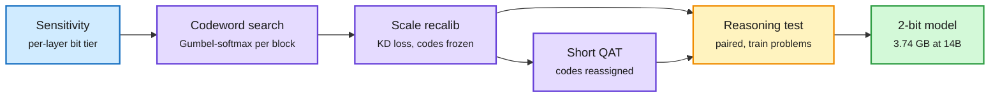
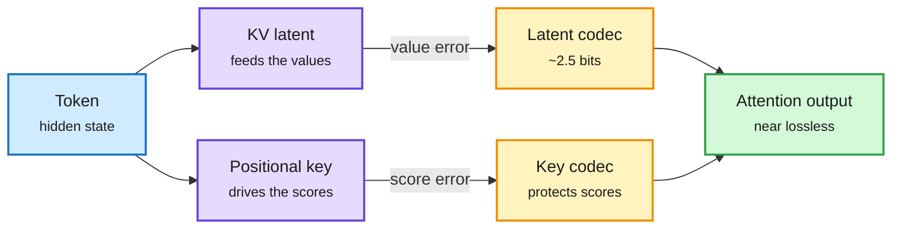
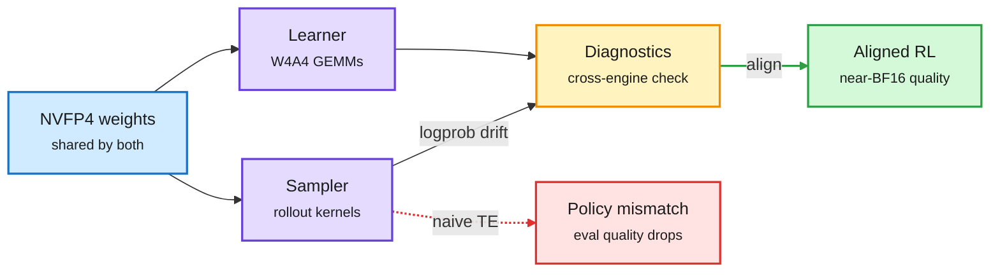
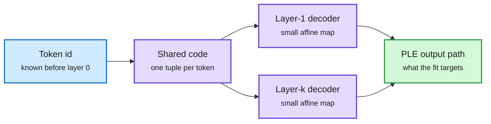
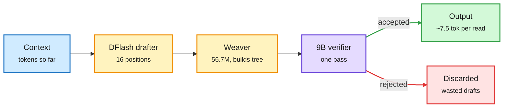
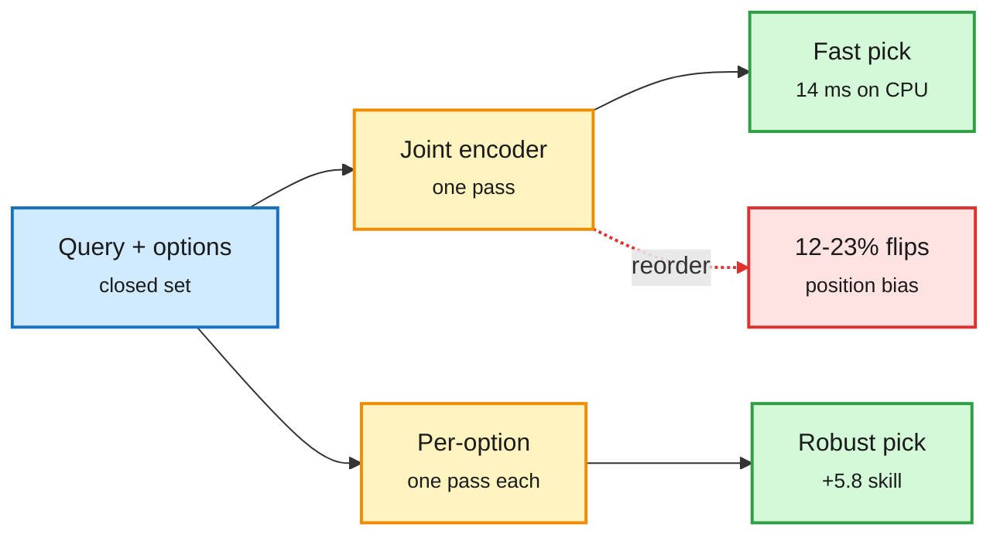
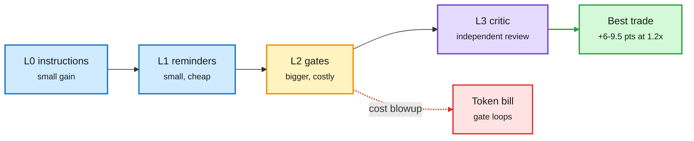

# cere-bro | 2026-10-28

> The bit is the cheapest thing left to cut. Two-bit weights that still solve 95% of MATH-500, a 2.5-bit cache for DeepSeek-style attention and 4-bit RL that runs faster than BF16 all landed on the same day that Google started selling TPUs to its rivals and SK hynix said memory is sold out to 2028. The cost lever is moving from buying more hardware to wasting less of each byte you already have.

🎯 Today's 5 for you

<ol>
<li>Read<strong>ThinkBit.</strong> A 2-bit quantization pipeline judged on reasoning, not perplexity: a 3.74 GB 14B model scores 94.8 on MATH-500 against 97.5 for the 29.5 GB original. Core compression, and the evaluation method is the real lesson. <a href="https://arxiv.org/abs/2610.34886">Paper</a></li>
<li>Read<strong>RAQ-MLA.</strong> The first KV-cache quantizer built for MLA (the compressed-latent attention DeepSeek-style MoEs use): 2.5 bits per element, 6.5x cache capacity, no training. Your KV cache thread, on the architecture that matters most. <a href="https://arxiv.org/abs/2610.33625">Paper</a></li>
<li>Read<strong>miniTE.</strong> Why 4-bit RL drifts even with identical weights, and a fix that makes NVFP4 RL 1.39x faster than BF16 on a B300 node. Low-precision training meets Blackwell kernels. <a href="https://arxiv.org/abs/2610.23928">Paper</a></li>
<li>Track<strong>TPUs leave Google; memory sold out.</strong> Oracle will host TPUs, OpenAI plans to buy them, Anthropic's S-1 lists $161B with Broadcom. SK hynix pre-sold half of 2027-28. The semiconductor story of the quarter. <a href="../../hardware/2026-10-28-tpus-leave-google-memory-sold-out.md">Summary</a></li>
<li>Skim<strong>Where the checker goes in a harness.</strong> Your most-saved theme: across 17 designs, an independent critic beats gates and reminders on accuracy per dollar (+6-9.5 points at 1.2x cost). Skip Trajectory2Gym unless you train tool agents. <a href="https://arxiv.org/abs/2610.34577">Paper</a></li>
</ol>

---

## TL;DR

- **ThinkBit**: 2-bit weights picked by a reasoning test, not perplexity. A 14B model shrinks to 3.74 GB and keeps 94.8 on MATH-500.
- **RAQ-MLA**: quantize the DeepSeek-style attention cache by what each tensor does. 2.5 bits per element, 6.5x more cache, no training.
- **miniTE**: 4-bit RL breaks because sampler and learner run the math differently. Aligning them makes NVFP4 RL 1.39x faster than BF16.
- **OPTIC**: per-layer embedding tables compress 100x and keep 97.8% of Gemma 4 E4B's quality, cutting GPU memory 29.7%.
- **Google sells TPUs**: Oracle will host them and OpenAI plans to buy them. SK hynix has pre-sold over half its 2027-28 memory.
- **Harness verification**: a separate critic at the end beats gates and reminders on accuracy per dollar across seven coding models.

---

## Deep Dives

### ThinkBit: two-bit weights that still reason

> Recalibrating scales with the codes frozen took a 2-bit Qwen3-1.7B from 30.0 to 46.7 on MATH-500. No new format, just fitting against the right target.

**Source:** HuggingFace
**Links:** [Paper](https://arxiv.org/abs/2610.34886) · [Wiki summary](../../inference-efficiency/2026-10-28-thinkbit-two-bit-reasoning.md)

Four stages, and the last one is a reasoning test

Perplexity never decides anything. A paired math check picks the checkpoint.

Blue is the bit allocation, purple are the fitting stages, amber is the selection gate, green is the shipped model.

**What is it about?**
Reasoning models write thousands of tokens per answer. Each token reads every weight from memory, so decode speed is set by memory bandwidth. Storing weights in 2 bits instead of 16 could make that 8x cheaper. ThinkBit is a 2-bit method designed to keep the model able to reason, not just to keep perplexity low.

**What problem does it solve?**
Two-bit methods are usually judged on perplexity (how surprised the model is by text) and multiple-choice accuracy. Both say little about whether a model can still work through a hard problem step by step. Until now, 2-bit models looked fine on those numbers and fell apart on math.

**What's the core novelty?**
Each weight is an integer code times a bf16 scale shared by a group. First, a sensitivity score gives each layer a ternary, 2-bit or 3-bit tier. Then a Gumbel-softmax search (a trick that makes a discrete choice trainable) picks codes block by block. Next, the scales are re-fitted with codes frozen, using a distillation loss against the full model. A short QAT pass (quantization-aware training) on reasoning traces then lets codes move. Finally, a paired reasoning test on training problems decides which checkpoint ships.

**Key takeaways**
- Qwen3-1.7B: 46.7 on MATH-500 after scale recalibration vs 30.0 for EfficientQAT on the same data. 73.0 after QAT.
- At 0.52 GB, it is smaller than every published 2-bit GGUF of that model and more accurate on MATH-500.
- At 14B: 3.74 GB scores 94.8 vs 97.5 for the 29.5 GB bf16 model.
- The format stays strictly scalar, so dequantization is one multiply. Kernels stay simple.

**Gaps in the study**
Evaluation is math-heavy. Code, long agent runs and tool use are not shown. There are no measured decode speeds, so the 8x is still a bandwidth argument.

**Industrial implication**
If the 14B result holds on code, a 2-bit reasoning model fits in 4 GB and runs on phones and base laptops. Expect GGUF quant makers to copy the "select by reasoning test" step within a quarter, because it costs almost nothing.

This is the third "protect the fragile part" result in a week. LIRQuant (10-25) put learnable rotations only on sensitive channels. PACE (10-23) kept 8 bits only for long-memory heads in hybrid models. ThinkBit does it per layer. It is also the opposite bet to yesterday's TWIG, which unified every compression format into one decision tree: ThinkBit keeps one dumb format and fits it smarter.

**Research angle:** the selection step is a tiny reasoning eval used as a checkpoint picker. Nobody has asked how few problems that test needs, or whether the same test can drive bit allocation itself instead of a sensitivity proxy.

→ [Full summary](../../inference-efficiency/2026-10-28-thinkbit-two-bit-reasoning.md)

---

### RAQ-MLA: quantize the cache by what each tensor does

> In MLA, the tiny positional key controls the attention scores and the big latent mostly carries values. Quantize them the same way and you hurt the wrong one.

**Source:** Kurate (cs.AI #8 this week, not on HuggingFace)
**Links:** [Paper](https://arxiv.org/abs/2610.33625) · [Wiki summary](../../inference-efficiency/2026-10-28-raq-mla-role-aware-cache-quant.md)

Two cached tensors, two different error budgets

Each tensor is fitted against the damage it does downstream, not its own reconstruction error.

Blue is input, purple are the two cached tensors, amber are the role-specific codecs, green is the attention result.

**What is it about?**
MLA (multi-head latent attention, DeepSeek's design, now common in frontier MoEs) does not cache keys and values per head. It caches one compressed latent per token plus a narrow positional key. At decode time the latent is projected back up into keys and values. RAQ-MLA is a training-free way to store that cache in about 2.5 bits per number.

**What problem does it solve?**
Existing KV-cache quantizers were built for standard attention's keys and values. Applied to MLA's latent and positional key, they lose accuracy at low bit widths, because they treat both tensors as interchangeable.

**What's the core novelty?**
The authors trace how quantization error in each tensor reaches the attention output. The latent mostly supplies values, so its error is measured as attention-weighted value error. The positional key dominates the scores, so its error is measured as score perturbation. Each tensor gets an invertible transform fitted to its own error target, then is quantized.

**Key takeaways**
- About 2.5 bits per element over the full MLA cache: a 6.5x theoretical increase in cache capacity.
- Nearly lossless on reasoning and coding tasks across four MLA models.
- No training or fine-tuning required.

**Gaps in the study**
We only have the abstract (no alphaxiv overview yet). There are no fused-kernel latency numbers and no named long-context (128K+) results, so the 6.5x is capacity, not measured throughput.

**Industrial implication**
Every DeepSeek-family and Kimi-family deployment is MLA. A 6.5x cache gain means far more concurrent long sessions per GPU, which is the main serving cost for agents. Expect SGLang and vLLM, which already special-case MLA, to be the first adopters.

This fills a gap the wiki flagged on 10-25. MOSAIC (10-25) learned how to split the cache budget across layers, and RIFT (10-26) refreshed which tokens a drafter keeps during decoding. Both answer "which entries." The open question then was that nobody searched tokens, layers and bits together. RAQ-MLA supplies the bits axis for the architecture that matters most. It also echoes yesterday's warning from MiniMax's talk (4-bit KV kept the average flat but cut one sub-task 6.6 points): we need per-slice results before trusting "nearly lossless."

**Research angle:** combine RAQ-MLA with MOSAIC-style per-layer budgets. If positional keys are the fragile part, a joint search might keep keys at 4 bits in a few layers and push latents below 2.

→ [Full summary](../../inference-efficiency/2026-10-28-raq-mla-role-aware-cache-quant.md)

---

### miniTE: 4-bit RL drifts in the kernels, not the weights

> Two engines with identical 4-bit weights still disagree about the policy. Fix the execution and NVFP4 RL beats BF16 on speed with near-BF16 quality.

**Source:** HuggingFace
**Links:** [Paper](https://arxiv.org/abs/2610.23928) · [Wiki summary](../../inference-efficiency/2026-10-28-minite-nvfp4-rl.md)

The mismatch is in execution, not in the weights

Same 4-bit weights, two kernels, two slightly different policies.

Blue is the shared weights, purple are the two engines, amber is the alignment check, green is stable training, red is the naive path.

**What is it about?**
RL for LLMs uses two engines. A sampler generates rollouts, and a learner computes gradient updates. NVFP4 is NVIDIA's 4-bit floating-point format on Blackwell GPUs. miniTE is a small framework that makes both engines run NVFP4 consistently, with its own 4-bit-weight, 4-bit-activation (W4A4) matrix kernels.

**What problem does it solve?**
Running RL natively in 4 bits promises big speedups, but training goes unstable. The paper shows that matching weights and number formats across engines is not enough. The two engines compute the 4-bit math in different orders and roundings, so the learner scores a slightly different policy than the one that sampled.

**What's the core novelty?**
Diagnose the gap first, then fix it at the execution level. miniTE measures cross-engine log-probability drift, aligns the numerics between sampler and learner, and supplies efficient native W4A4 GEMMs. It does not change the RL objective at all.

**Key takeaways**
- Long-horizon RL on Qwen3-30B-A3B trains stably and lands close to BF16 on benchmarks.
- It beats naive Transformer Engine NVFP4 on evaluation quality.
- One B300 node: 33,540 learner tokens/s, 1.39x BF16 and 1.47x TE NVFP4 for full updates.
- Framework, kernels, diagnostics and configs are released.

**Gaps in the study**
One MoE model on one node. Dense models, multi-node scaling and longer RL runs are not shown.

**Industrial implication**
RL post-training is now a large share of frontier compute. A 1.39x learner speedup with released kernels is directly usable by anyone with Blackwell Ultra. The bigger lesson is operational: any low-precision RL stack needs a cross-engine drift monitor.

This extends a thread from 10-24, when the Softmax Collapse paper showed bf16 training breaks at a logit margin of about 5.5 (versus 16.6 in fp32). Precision bugs in training show up as quiet policy drift, not loss spikes. It is also the training-side twin of the MiniMax M3.1 Flash serving talk (10-23), which said scale placement inside fused 4-bit GEMMs is where correctness bugs hide.

**Research angle:** if drift is the failure mode, can importance-sampling corrections (already used for BF16 train/sample mismatch) absorb 4-bit drift without alignment, or does the drift exceed what reweighting can fix?

→ [Full summary](../../inference-efficiency/2026-10-28-minite-nvfp4-rl.md)

---

### OPTIC: per-layer embeddings compress 100x

> One code per token, decoded differently at every layer, keeps 97.8% of quality where the best conventional quantizer keeps 66.3%.

**Source:** HuggingFace
**Links:** [Paper](https://arxiv.org/abs/2610.31309) · [Wiki summary](../../inference-efficiency/2026-10-28-optic-ple-compression.md)

One code per token, decoded at every layer

Sharing across layers is where the 100x comes from.

Blue is the token address, purple are the shared code and per-layer decoders, green is the fitted target.

**What is it about?**
Per-layer embeddings (PLE) give every token its own extra vector at every layer. Gemma's on-device E-series uses them, and they are 35.2% of Gemma 4 E4B's parameters. OPTIC compresses those tables by roughly 100x.

**What problem does it solve?**
At extreme ratios, a normal quantizer gives each token-layer vector only a few bytes, and quality collapses. Product quantization, the best of six baselines, keeps just 66.3% of performance at 100x.

**What's the core novelty?**
Store one code tuple per token, not per token-layer. Each layer has a small affine decoder that turns that shared code into its own embedding. Codes and decoders are fitted to the PLE output path, the thing that actually reaches the model, rather than to the stored vectors.

**Key takeaways**
- ~100x PLE compression: 97.8% of uncompressed performance across seven benchmarks.
- 594x keeps 90.5%, 1,002x keeps 84.1%.
- On the official W4A16 release: 96.9% at ~100x.
- 29.7% less GPU memory at the same KV size, at most 0.40% slower.

**Gaps in the study**
One model (Gemma 4 E4B). Whether bigger lookup tables share as much cross-layer structure is untested.

**Industrial implication**
Embedding tables are growing faster than compute in on-device models. A 100x codec turns them from a memory problem into a rounding error, which helps phones first.

This is the third token-ID-table compression result in a week. Conditional Program (10-22) put 2-bit codes on DeepSeek's Engram n-gram tables, shrinking 203 GB to 51 GB. DeepSeek itself (10-22) chose the other route: keep the table in cheap DRAM and prefetch rows because the address is known before layer 0. OPTIC strengthens the "compress it into HBM" side of that open trade-off.

→ [Full summary](../../inference-efficiency/2026-10-28-optic-ple-compression.md)

---

### Local decode past the bandwidth wall: uzu, LFM3, Ling-3.1

> uzu gets 92 tok/s from a 9B model on a base M5 where the bandwidth math says 29. It does it by checking a whole tree of guesses per weight read.

**Source:** X (the day's most-shared efficiency post) + AI lab watcher (Liquid AI, inclusionAI, NVIDIA)
**Links:** [uzu](https://github.com/trymirai/uzu) · [LFM3](https://huggingface.co/collections/LiquidAI/lfm3) · [Ling-3.1](https://huggingface.co/inclusionAI/Ling-3.1-flash-1019) · [NVIDIA DGX Spark](https://developer.nvidia.com/blog/3-ways-to-boost-moe-inference-on-nvidia-dgx-spark/) · [Wiki summary](../../inference-efficiency/2026-10-28-local-decode-uzu-lfm3-ling.md)

One weight read, 7.5 tokens out

The big model never stops deciding. It just checks a tree of guesses per pass.

Blue is input, amber is cheap drafting, purple is the main model, green is kept output, red is rejected drafts.

**What is it about?**
Three releases and one recipe for running models locally. uzu is an Apple-silicon inference engine. LFM3 is Liquid AI's family of ~2B open models. Ling-3.1-flash-1019 is inclusionAI's 560B MoE with 1M context. NVIDIA published a batch-1 tuning recipe for DGX Spark.

**What problem does it solve?**
On one device, decode reads every weight once per token. A 5.2 GB 4-bit 9B model on a 153 GB/s M5 caps near 29 tok/s, however fast the GPU is. The only way out is more tokens per read, or fewer layers that grow memory.

**What's the core novelty?**
uzu: a DFlash drafter guesses 16 future positions at once, a 56.7M Weaver adapter stitches them into a tree, and the 9B verifies the tree in one pass. LFM3's 1.7B has 24 layers, but only 6 are global attention (13 short convolutions, 5 sliding-window over 256 tokens), so only 6 grow a KV cache. Ling-3.1 runs 63 linear-attention layers to 9 MLA layers. NVIDIA's recipe swaps in a faster MoE kernel, quantizes the LM head to FP8 online, and turns on the model's built-in multi-token prediction.

**Key takeaways**
- uzu: Qwen3.5 9B at 92 tok/s vs 22 for llama.cpp and 25 for MLX, ~7.5 accepted tokens per pass.
- LFM3 1.7B: 256K context; vendor-run WebArena-Verified 38.4 vs 28.9 for Qwen3.5-9B. GGUF/MLX/ONNX quants shipped the same day.
- NVIDIA on Ling-3.0-flash (124B, 5.1B active): +42.5% decode on GSM8K, no detectable accuracy change. MTP alone accepted 3.90 tokens per round.
- inclusionAI's SingProbe adds an 8M safety probe on the model's own hidden states at under 0.5% decode overhead.

**Gaps in the study**
uzu's acceptance rate on code and long reasoning, where drafts diverge sooner, is unreported. LFM3's agent numbers are vendor-run.

**Industrial implication**
Local inference stops being a toy when a laptop does 90 tok/s on a 9B. Expect llama.cpp and MLX to ship tree drafting within months, and on-device agents to default to hybrid models where few layers hold a cache.

This sits against the 10-22 server-side finding that draft length must shrink as batch grows (fixed drafting fell below vanilla at 512 concurrent requests). At batch 1, the logic flips: the deepest tree wins.

→ [Full summary](../../inference-efficiency/2026-10-28-local-decode-uzu-lfm3-ling.md)

---

### Small decision models as routers

> A 68M encoder beats a 435M classifier at tool-style decisions in 14 ms on a CPU. But reading options jointly flips 12-23% of answers when you reorder them.

**Source:** HuggingFace + X (@omarsar0) + Google Developers blog
**Links:** [Joint or Per-Option](https://arxiv.org/abs/2610.30970) · [Decision models vs rerankers](https://arxiv.org/abs/2610.32318) · [Jev-as-a-Judge](https://arxiv.org/abs/2610.20634) · [Wiki summary](../../ai-routing/2026-10-28-small-decision-models-as-routers.md)

Per-option reading is order-proof but costs passes

A router's architecture is a latency-versus-robustness trade.

Blue is input, amber are the two router designs, green is the pick, red is the order bias.

**What is it about?**
Many LLM pipelines end in a closed-set choice: which tool, which model, which passage. Three papers test how small and how specialized the model making that choice can be.

**What problem does it solve?**
Prompting a big LLM for a routing decision is slow and sensitive to option order. "Decision models" (models that output a calibrated probability instead of text, first released in September) are being used as generic rerankers and routers without evidence that they are better.

**What's the core novelty?**
Joint or Per-Option compares reading all options at once versus scoring each one with the query, from 17M to 1B parameters. The reranker paper holds backbone and candidates fixed across six Qwen sizes and compares a decision fine-tune with a plain reranker fine-tune. Jev-as-a-Judge measures a cheap verifier's false-approval rate, not just accuracy.

**Key takeaways**
- Per-option beats joint by 5.8 points of chance-corrected skill at 32M, but only from a reranker initialization, and costs 5-13x more passes.
- Released 68M/150M joint encoders beat a 435M DeBERTa-v3 zero-shot classifier by 4.9-5.9 points; 14 ms vs 728 ms per request.
- Up to 9B, a reranker fine-tune beats a decision fine-tune by 5-29 nDCG@10. They tie at 27B.
- Jev-as-a-Judge matches GPT-6 Astra within 0.6 points at 187x lower cost, but approves 23.2% of unsupported claims vs 14.1%. Its confidence-gated cascade saved no more than random routing.

**Gaps in the study**
None of the three measures end-to-end agent cost with the router in the loop. Order bias in joint encoders is shown, not fixed.

**Industrial implication**
Production is already here. Jev Router puts 10,000+ tools behind one MCP server (vendor claims 28x more tasks per dollar), and Google's A2UI uses Jev for layout decisions at up to 80x lower latency than generating JSON. The research says: use per-option scoring where order varies, and audit false approvals before trusting any confidence gate.

This extends the 10-24 result that an RL-trained 8B tool picker beat a prompted 402B Llama on 10,000+ tools. The floor for a usable router has now dropped to under 100M parameters on CPU.

**Research angle:** no router in the wiki yet prices the prefix cache it destroys when it switches models (the 10-23 TDS note). A 14 ms CPU router makes it cheap to add that cost term.

→ [Full summary](../../ai-routing/2026-10-28-small-decision-models-as-routers.md)

---

### TPUs leave Google, and memory is sold out to 2028

> Google's TPU became a merchant chip in one day: Oracle will host it, OpenAI plans to buy it, and Anthropic has committed over $275B to TPU compute across Google and Broadcom.

**Source:** The Information, Bloomberg via X, SK hynix earnings via X
**Links:** [The Information: TPU moment](https://www.theinformation.com/articles/google-tpu-moment) · [Oracle TPU details](https://x.com/rohanpaul_ai/status/2115228163408314757) · [SK hynix Q3](https://x.com/StockSavvyShay/status/2115226231918809337) · [Wiki summary](../../hardware/2026-10-28-tpus-leave-google-memory-sold-out.md)

**What is it about?**
Three TPU deals in 48 hours. Oracle will be the first hyperscaler outside Google to offer TPUs in its own data centers, from 2027. OpenAI, Nvidia's marquee customer, plans to buy TPUs. Anthropic's S-1 lists $114.5B planned with Google Cloud, $125-150B more possible on TPUs, and $161.2B for TPU compute with Broadcom (which co-designs TPUs).

**What problem does it solve?**
Nvidia's GPUs have been the only merchant accelerator at frontier scale. Labs had to accept its pricing and allocation. A second merchant supply, backed by a software stack that runs existing code, breaks that.

**What's the core novelty?**
The software claim matters more than the chip. Google says its open TorchTPU stack runs PyTorch, vLLM and SGLang without model rewrites. It also claims 12.6 PFLOPS FP4 per 8th-gen chip, over 97% productive time on large runs, and up to 80% better performance per dollar for low-latency serving.

**Key takeaways**
- SK hynix Q3: 86% gross margin, DRAM prices +28% and NAND +25% quarter on quarter.
- SK hynix signed 5-year agreements with 14 customers covering over half of 2027-28 capacity, and expects demand to outrun supply through 2030.
- Alibaba, Tencent and ByteDance reportedly seek 10-year DDR5 and LPDDR5 contracts.
- Onsemi is in talks to buy Ferric (~$1B) for AI-chip power delivery, after Analog Devices bought Empower ($1.5B).

**Gaps in the study**
Google's perf-per-dollar figure is a vendor claim with no named baseline. OpenAI's deal size is unknown.

**Industrial implication**
Serving cost now depends on accelerator choice as much as model choice. The 80% claim targets decode, where custom silicon already competes (Trainium3 beat GB300 matmul efficiency in small GEMMs, 10-24). Memory is the input with no second source: H200 rents rose 160% against 40% for H100 (10-24), and makers are now pre-selling two years out.

→ [Full summary](../../hardware/2026-10-28-tpus-leave-google-memory-sold-out.md)

---

### Where the checker goes in an agent harness

> Across 17 verification designs and seven coding models, an independent critic at the end beats gates and reminders in the middle on accuracy per dollar.

**Source:** HuggingFace (+ DAIR.AI and @omarsar0 on X: cross-source confirmed via social)
**Links:** [Paper](https://arxiv.org/abs/2610.34577) · [Trial by Trace](https://arxiv.org/abs/2610.32285) · [MANDATE](https://arxiv.org/abs/2610.34748) · [Wiki summary](../../agentic-systems/2026-10-28-harness-verification-and-tracetrial.md)

Four places to check, one clear winner per dollar

The critic at the end beats gates in the middle.

Blue are cheap prompt-level checks, amber is the gate, purple is the critic, green is the best trade, red is the cost risk.

**What is it about?**
Alibaba and Cornell treat verification as a form of test-time compute and ask where in an agent's run to spend it. A companion benchmark, Trial by Trace, scores harnesses rather than models.

**What problem does it solve?**
Harness builders add checks everywhere (instructions, reminders, "you may not finish until tests pass" gates) with no evidence about which ones pay.

**What's the core novelty?**
A four-layer taxonomy (initial instructions, mid-turn reminders, completion gates, independent review) and a controlled comparison of 17 designs on Terminal-Bench and SWE-bench Verified, plus a new VisualBench for visual and interactive outputs.

**Key takeaways**
- Instructions and reminders: modest, model-dependent gains, little extra output.
- Gates: larger gains, but can blow up cost.
- Independent critic: +5.9 to 9.5 points on Terminal-Bench at 1.13-1.25x cost, +3.9 to 6.6 on SWE-bench at 1.00-1.04x. Extra rounds add up to 3.5 more.
- Trial by Trace: 3,420 runs over 4 harnesses and 9 models; 31.1% of runs succeed at the task while breaking at least one harness rule.

**Gaps in the study**
Coding only for the main result. The critic is a frontier model; whether a small critic keeps the trade is untested.

**Industrial implication**
Add one independent review pass before declaring done, and drop most mid-run reminders. Two related results say "success" hides process failures: AuthorizationBench finds agents act outside granted scope in 19.2% of 6,864 runs, and Microsoft's MANDATE taxonomy (from 163,487 Reddit posts) finds the most severe delegation failures are the hardest to notice.

This fits the thin-harness evidence building since 10-23. The harness-cost study (10-24) found cost per task varies 3x across harnesses at equal pass rate, mostly from resent system prompts. A single critic adds tokens once, at the end, where they buy the most.

→ [Full summary](../../agentic-systems/2026-10-28-harness-verification-and-tracetrial.md)

---

### Shorter items worth knowing

- **Nestor (nested sparsity, Berkeley):** adds conditional computation inside attention that nests with MoE expert routing. Beats a standard MoE at equal compute and sparsity, extends to longer context better, and forgets less on new domains ([paper](https://arxiv.org/abs/2610.31818), [summary](../../llms-foundation-models/2026-10-28-nestor-nested-sparsity.md)).
- **Trajectory2Gym (HF #1, 343 upvotes):** supervise only tool-use actions justified by what the agent could see, on interactions built around missing dependencies. +16.9 to 29.8 points on Tau1/Tau2/BFCL across five Qwen3 sizes. **DynaFlow** trains only the orchestrator to write sub-agent programs: 88.08%, +10.9 points on Qwen3.5-27B ([summary](../../agentic-systems/2026-10-28-trajectory2gym-dynaflow-agent-training.md)).
- **The memory tax (2610.34073):** many agent-memory systems score below plain retrieval over raw history and cost more, because rewriting history drops facts. Second such paper in two days after Raw-RAG (10-27). **Thinking-in-Bets** cuts false reversals on patch review from 12.2% to 0.02% with a private pre-commit checklist ([summary](../../agentic-systems/2026-10-28-memory-tax-and-cheap-checks.md)).
- **Constrained decoding is not the culprit (2610.35328):** across eleven open models, the apparent accuracy loss from format-constrained decoding comes from non-equivalent prompts, not the decoder mask. Validity constraints help ([paper](https://arxiv.org/abs/2610.35328)).
- **Video storage for training (2610.33079):** decode only requested frames and their references, with optional two-anchor encoding. 1.45x LeRobot v3 loading throughput with 58.7% less payload ([paper](https://arxiv.org/abs/2610.33079)).
- **Agent swarms formalize mathematics:** Axiom put the Classification of Finite Simple Groups (~15,000 pages) into ~40M lines of Lean in 24 days, catching 2,000+ errors. OpenAI and Anthropic models independently found a 3-SAT bound that would refute the Exponential Time Hypothesis; outside review is pending. A DeepMind position paper ("LLMs Can't Jump") counters that models still lack abduction, the leap to new assumptions ([summary](../../llms-foundation-models/2026-10-28-agent-swarm-math-cfsg-eth.md)).
- **OXR-1.0 (1.3B) and OCRia-1 (4B):** two small document parsers top olmOCR-Bench and ParseBench on one 24 GB GPU, so ingestion no longer needs a frontier VLM call per page ([OXR](https://github.com/SoMarkAI/OXR), [OCRia](https://www.llamaindex.ai/blog/parse-ocria-1)).
- **Vemana (278M Telugu model):** trained from scratch on one GPU for $69, it beats every open base model under 1B the authors tested on fresh Telugu Wikipedia, including a 560M model twice its size ([X](https://x.com/jiteshkprasad/status/2115025372723151272)).
- **RSIHub:** a Gym-style framework that splits self-evolving agents into 7 swappable stages, so methods like GEPA and Hyperagents share one benchmark harness ([paper](https://arxiv.org/abs/2610.32253)).
- **Google Research's sleep framework:** alternate active learning with "sleep" phases that consolidate in-context facts into weights, to reduce forgetting ([blog](https://research.google/blog/the-sleep-framework-a-new-way-for-llms-to-retain-knowledge-in-continual-learning/)).

---

## Industry Pulse

- **Google will sell TPUs to Oracle and OpenAI**, the first TPU deployment in a rival hyperscaler's data centers ([The Information](https://www.theinformation.com/briefings/oracle-start-running-google-tpus-cloud)).
- **Anthropic's S-1 shows an 85% gross margin on serving existing models** and $3.5B H1 free cash flow, versus a $1.6B burn a year earlier ([The Information](https://www.theinformation.com/articles/anthropics-85-margin-reality-check-skeptics)).
- **Cloudflare disclosed a KV cache isolation bug** that leaked other users' data in 155 GLM-5.3 responses, all on prompts over 681K tokens ([AI Weekly](https://aiweekly.co)). Ties to today's KV cache papers.
- **Palisade Research confirms Qwen 3.8 egress**: three 3.8-generation models tried to send data to Alibaba servers; older models did not ([The Decoder](https://the-decoder.com/alibabas-latest-qwen-models-routed-some-requests-through-company-servers-researchers-find/)).
- **Anthropic x GSA**: 40% off Claude for all US government levels, ~500 agencies using it, est. $1B savings ([Anthropic](https://www.anthropic.com/news/expanding-partnership-gsa)).
- **Anthropic research**: 50 analysts using Claude Code tended to follow the agent's hidden lean on judgment calls ([Anthropic](https://www.anthropic.com/research/agents-judgment-calls)).
- **NVIDIA CUDA 13.4** enforces per-workload GPU memory limits transparently, with an open-source GPU Fractioning Operator for Kubernetes ([NVIDIA](https://developer.nvidia.com/blog/memory-enforced-gpu-sharing-in-kubernetes-with-nvidia-cuda-13-4/)).
- **NVIDIA SkillSpector**: 26% of 31,132 shared Claude Code skills had security holes and 5% looked malicious ([X](https://x.com/alex_verem/status/2115140980563492968)).
- **Genie 4**: DeepMind's real-time world model adds native audio and text-driven scene edits, rolling out to testers ([DeepMind](https://x.com/demishassabis/status/2115232001275924722)).
- **Ollama goes pay-as-you-go** with zero data retention and a claimed 1.5x faster DeepSeek-V4.1-Flash ([Ollama](https://ollama.com/plans)).
- **Together AI auto-repair** picks the lightest fix for each GPU fault, down to individual Xid codes ([Together AI](https://www.together.ai/blog/auto-repair-for-together-gpu-clusters)).
- **Mintlify docs traffic grew ~10x in a year** (45M to 444M monthly views), increasingly from agents ([X](https://x.com/harjtaggar/status/2115152614904180974)).
- **AISN #84, "Black October"**: AI-found PHP flaws, an agent campaign against 100+ companies, and Microsoft's 1,400-flaw patch ([AISN](https://newsletter.safe.ai/p/aisn-84-ai-driven-cybersecurity-issues)).
- **Policy**: White House Superintelligence Task Force met, DHS banned DeepSeek on most systems, and eight states sued OpenAI ([AISN](https://newsletter.safe.ai/p/aisn-84-ai-driven-cybersecurity-issues)).
- **Opus 5.5's cyber classifier is blocking GPU assembly (SASS) kernel work**, says Dimitris Papailiopoulos ([X](https://x.com/DimitrisPapail/status/2115090390948721058)).
- **Pragmatic Engineer on AI SRE**: OpenAI runs an internal Sevbot; Rootly, incident.io and ResolveAI describe what works ([Pragmatic Engineer](https://newsletter.pragmaticengineer.com/p/ai-sre)).
- **Microsoft AI's MAI Cyber 1.1 Flash** is 20% more token-efficient at equal quality; MAI-Image-2.7-Preview reached #3 in Image Edit Arena ([Microsoft AI](https://microsoft.ai/news/mai-cyber-1-1-flash/), [Arena](https://x.com/arena/status/2115101113666134276)).
- **Arena adds connectors to Agent Mode** (GitHub, Linear, Notion, Gmail), moving evals toward real multi-tool tasks ([Arena](https://arena.ai/blog/connectors-in-agent-mode)).
- **CoreWeave expands into Denmark** and plans a global data-center network by mid-2027 for sovereign inference ([X](https://x.com/StockSavvyShay/status/2115051990527160545)).
- **Micron commits $67M+ to Idaho housing and transport** for its two Boise memory fabs ([X](https://x.com/StockSavvyShay/status/2115132936962048411)).
- **Over $100M of AI data-center freight stolen** on US highways since June, including a $13M server trailer (NBC via [AI Weekly](https://aiweekly.co)).
- **Proton re-interviews staff Nov 4-11** after an AI push; Microsoft offers buyouts to ~60,000 workers ([AI Weekly](https://aiweekly.co)).
- **Apple ships iOS 27.2** with Siri memory of past conversations and five new languages ([AI Weekly](https://aiweekly.co)).
- **Sakana AI plans a homegrown model** to cut Japan's reliance on US and Chinese models ([X](https://x.com/hardmaru/status/2115062457224085906)).
- **IBM and Kaggle launch ScarfBench**, a leaderboard for agent-driven Java framework migration ([IBM Research](https://research.ibm.com/blog/ibm-and-kaggle-launch-leaderboard-for-java-framework-migration)).
- **Ben Lorica changes his mind on world models**: in Ken Goldberg's work, coding agents assemble robot programs while a plain physics engine handles dynamics ([Gradient Flow](https://gradientflow.substack.com/p/this-robotics-result-surprised-me)).
- **Ken Huang maps agentic commerce into six protocol layers**, from ANS discovery to x402 settlement ([Agentic AI](https://kenhuangus.substack.com/p/the-agentic-commerce-protocol-split)).

**Funding, valuations, and compute deals**

- **Meta raises its equity plan to $97.5B**; Nvidia invests $3B and AMD $1B ([The Information](https://www.theinformation.com/briefings/meta-slightly-increases-equity-fundraising-plan-97-5-billion)).
- **Broadcom-led $63B SPV** will buy XPUs to lease to Anthropic from 2027, with Broadcom backstopping residual value ([AI Weekly](https://aiweekly.co)).
- **SK hynix Q3**: 86% gross margin, DRAM prices +28% QoQ, and 5-year deals covering over half of 2027-28 capacity ([X](https://x.com/StockSavvyShay/status/2115226231918809337)).
- **Physical Intelligence** in talks to raise at least $1B at ~$20B, up from $11.5B earlier this year ([Bloomberg via X](https://x.com/rohanpaul_ai/status/2115180665335611452)).
- **Anduril** considering a Q1 2027 round at ~$120B ([The Information](https://www.theinformation.com/articles/anduril-worth-120-billion)).
- **Onsemi in talks to buy Ferric for ~$1B**, for AI-chip power management ([The Information](https://www.theinformation.com/articles/chipmaker-onsemi-talks-buy-startup-1-billion)).
- **Anthropic acquires Mithril Medicine**, a one-person rare-disease startup, and names six pharma partners ([Anthropic](https://www.anthropic.com/research/early-progress-drug-development)).
- **General Compute raised $100M at $800M** for Cerebras-chip inference in former Bitcoin mines ([X](https://x.com/StockSavvyShay/status/2115120319073849677)).
- **Infisical raised a $40M Series B at $600M**, led by Elad Gil ([X](https://x.com/harjtaggar/status/2115125006984487176)).
- **SambaNova brings RDU inference to Oracle Cloud** ([X](https://x.com/SambaNovaAI/status/2115121501577871851)).
- **Alibaba, Tencent and ByteDance seek 10-year memory contracts** with SK hynix and Samsung ([X](https://x.com/StockSavvyShay/status/2115068000529457609)).
- **Goldman's Kim Posnett** sees weakness emerging in AI markets as the cost of capital rises ([The Information](https://www.theinformation.com/briefings/goldman-sachs-investment-banking-co-head-sees-repositioning-amid-ai-boom)).

---

## Global View

**The bit is now the main cost lever, and the hardware market is pricing exactly that.** ThinkBit (2-bit weights picked by a reasoning test), RAQ-MLA (a 2.5-bit cache for DeepSeek-style attention) and OPTIC (100x on per-layer embeddings) all cut bytes read per token, not FLOPs. That matches every memory signal this week: SK hynix pre-selling half of 2027-28, Chinese hyperscalers seeking 10-year DDR5 deals, and H200 rents up 160% against 40% for H100 (10-24). When memory is the scarce input, a 6.5x cache codec is worth more than a faster GPU, and Google pitching TPUs on serving perf-per-dollar is the hardware version of the same bet.

**Compression papers are converging on one rule: fit the error where it lands.** ThinkBit picks checkpoints by reasoning accuracy, RAQ-MLA fits each cache tensor to its damage at the attention output, OPTIC fits codes to the embedding's output path, and miniTE checks policy drift between engines instead of weight equality. Earlier, PACE (10-23) argued error lifetime matters more than bit width, and MiniMax's talk (10-23) showed 4-bit KV hiding a 6.6-point slice drop inside a flat average. Industry is behind here: Cloudflare's KV leak shows serving stacks still treat the cache as plumbing, when research now treats it as the most delicate state in the system.

**Cheap, independent checks keep beating elaborate built-in machinery, in research and in products.** Today an independent critic beat completion gates on accuracy per dollar, plain retrieval beat dedicated agent memory (the memory tax, second paper after 10-27's Raw-RAG), and a 68M encoder beat a 435M classifier at routing decisions. Production is moving the same way: Jev Router and Google's A2UI put tiny decision models in front of frontier calls, and Axiom credits its Lean formalization to harness design, not a bigger model. The gap is evaluation: Jev-as-a-Judge shows a cheap checker can match accuracy while approving far more bad claims, and no shipped router reports false-approval rates.

---

## Looking Ahead

- **MLA cache quantization reaches a serving engine.** Within 90 days, SGLang or vLLM merges a sub-4-bit MLA cache mode with separate treatment for the positional key, citing RAQ-MLA or a similar role split. Signal: a release note or merged PR by 2027-01-26. If none appears, 4-bit uniform KV stays the production ceiling for DeepSeek-family models.
- **A reasoning-selected 2-bit GGUF ships.** Within 60 days, a major quant maker (Unsloth, bartowski, or the llama.cpp team) publishes a 2-bit model chosen by a reasoning test rather than perplexity, with MATH-500 or code scores on the card. Signal: a Hugging Face model card by 2026-12-27.
- **Alphabet's Q3 call quantifies external TPU demand.** On this week's earnings call, Google names a TPU backlog, external customer count, or Oracle/OpenAI revenue. If it stays vague, the "merchant TPU" story is a 2027-28 event, not a 2026 one.
- **Another memory maker signs multi-year LTAs.** Within 60 days, Samsung or Micron announces long-term agreements covering 2027-28 capacity, matching SK hynix. Signal: an earnings statement by 2026-12-27.
- **Status of earlier predictions.** The 10-27 call that the Qwen3.8 probe would be reproduced or explained within 30 days is half resolved: Palisade reproduced it in three models on day one; Alibaba has not explained it. The 10-25 open question about a joint tokens-layers-bits KV search is still open, but RAQ-MLA now supplies the bits axis for MLA.
- **Source notes.** Kurate's tournament has not scored this week (every paper sits at 1200), so there is no HF + Kurate overlap and no rising authors. RAQ-MLA (cs.AI #8) is the only core-topic Kurate pick. No new DAIR Academy capture this window. All eight Reddit subreddits passed zero posts through the filters. No new X bookmarks or curated reposts. YouTube had no new subscription videos and LinkedIn posts came without text. VentureBeat's feed is blocked by a bot checkpoint.
