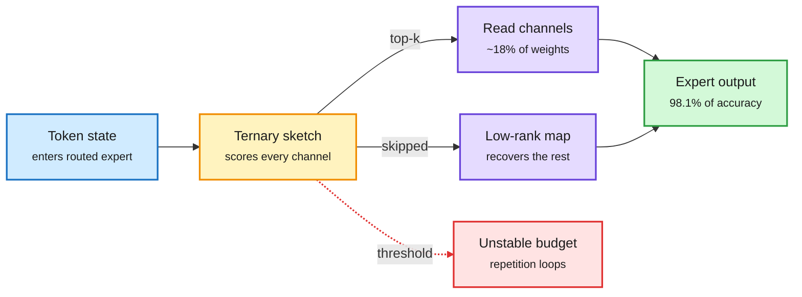
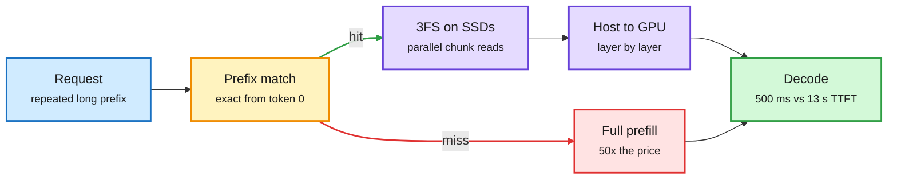
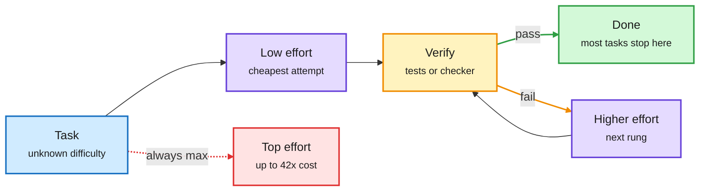
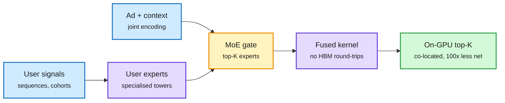
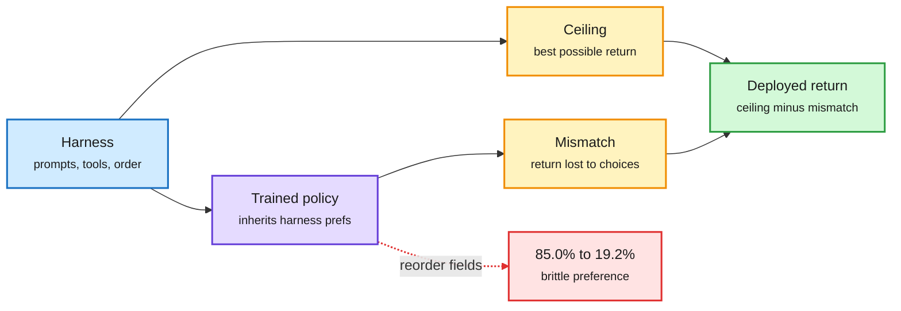

# cere-bro | 2026-10-29

> Don't do the work at all. The best cost wins today skip work rather than speed it up: MoE decoders that read 18% of expert channels, prefix caches served from SSD at a 50th of the price, and agents that start at low reasoning effort and step up only when a check fails. Meanwhile every layer of hardware is getting more expensive: TSMC packaging, GB300 rents, AWS capacity sold out to 2027. The cheapest token is still the one you never compute.

<div class="today3">
<div class="today3-head">🎯 Today's 5 for you</div>
<ol>
<li><span class="verb read">Read</span><strong>MoE channel selection needs no calibration.</strong> Per-token top-k beats calibrated thresholds in 40 of 43 tests, and a weight-only reader keeps 98.1% accuracy at 17.8% of expert reads. Core sparsity and compression work, with Triton kernels 1.6-1.9x faster than vLLM. <a href="https://arxiv.org/abs/2610.37386">Paper</a></li>
<li><span class="verb read">Read</span><strong>KV cache on SSD (DeepInfer) and cache engineering for agents (AKV).</strong> DeepSeek open-sourced the disk-tier prefix cache behind its 50x cheaper cache hits. AKV lets agents drop cache entries instead of re-prefilling. Your KV cache thread, now a storage problem too. <a href="../../inference-efficiency/2026-10-29-kv-cache-on-disk-and-cache-engineering.md">Summary</a></li>
<li><span class="verb read">Read</span><strong>Reasoning effort is a credence good.</strong> Max effort costs up to 42x on easy tasks and still fails some that low effort solves. Escalating only on a verified failure beats it. Same day, GitHub's Copilot Fusion router hit near-Claude-Code scores at half the cost. Routing, directly. <a href="https://arxiv.org/abs/2610.34491">Paper</a></li>
<li><span class="verb skim">Skim</span><strong>Meta Andromeda's fused retrieval kernel.</strong> One GPU kernel per user-ad pair, no HBM round-trips, 10B+ ads a second per GH200. It is FlashAttention's lesson applied to a recommender. GPU optimization. <a href="https://engineering.fb.com/2026/10/28/ml-applications/meta-andromeda-next-gen-ads-retrieval-gpu-co-design/">Post</a></li>
<li><span class="verb track">Track</span><strong>Compute is repricing upward at every layer.</strong> TSMC weighs a 10-20% CoWoS hike, GB300 rents near $14/h vs $3.50 for H100, AWS sold out through 2027. Semiconductor story of the week. Skip Gemini 4 Carbon's benchmark table unless you work on cyber. <a href="../../hardware/2026-10-29-cloud-earnings-gb300-rents-packaging-prices.md">Summary</a></li>
</ol>
</div>

---

## TL;DR

- **MoE channel selection**: pick each token's top expert channels, no calibration data needed. 98.1% accuracy at 17.8% of reads, 1.6-1.9x faster at batch one.
- **DeepSeek DeepInfer**: prefix KV cache lives on SSDs. A cached 128K prompt starts in 500 ms instead of 13 s, and hits cost 50x less.
- **Effort economics**: higher reasoning effort is not safer per task and costs up to 42x more. Start low, escalate on a failed check.
- **GitHub Copilot Fusion**: routes coding between Claude and GPT. Scores 60 vs 62 for Claude Code at half the cost per task.
- **Gemini 4 Carbon**: Google's new frontier model tops Artificial Analysis v5 and leads cyber benchmarks. Defenders get it first.
- **Compute prices rise everywhere**: TSMC weighs a CoWoS hike, GB300 rents hit ~$14/h, AWS is sold out through 2027.

---

## Deep Dives

### Channel selection for MoE decoding needs no calibration data

> Calibrating a threshold was supposed to give you a known read budget. It doesn't: a selector tuned for 18% reads only 12.9%, and plain top-k does better.

**Source:** HuggingFace
**Links:** [Paper](https://arxiv.org/abs/2610.37386) · [Wiki summary](../../inference-efficiency/2026-10-29-moe-channel-selection-no-calibration.md)

<div class="dg-title">Read fewer expert channels, decided per token</div>
<div class="dg-sub">A weight-only sketch picks the channels. A low-rank map patches what was skipped.</div>



<div class="dg-legend">Blue is input, amber is the selector, purple are the two read paths, green is output, red is the calibrated-threshold failure.</div>

**What is it about?**
In a MoE (mixture-of-experts, where each token goes through a few specialised sub-networks) model at batch one, decode speed is set by how many expert weight bytes get read per token. Most channels inside an expert barely matter for any single token. A "channel selector" predicts which ones matter and reads only those weights. This paper asks how that choice should be made.

**What problem does it solve?**
Today's selectors keep every channel whose score passes a threshold tuned on offline calibration data. That needs a calibration set, and the authors show it does not even deliver what it promises. The number of channels passing a fixed threshold swings with the input, so the real read budget drifts. On Gemma 4, thresholds also trigger repetition loops.

**What's the core novelty?**
Two things. First, replace the threshold with per-token top-k: always read the k highest-scoring channels. That fixes the budget exactly and needs no data. Second, a reader built only from the model's own weights. A ternary sketch (weights rounded to -1, 0, +1) cheaply scores channels. A low-rank map then estimates what the skipped channels would have added.

**Key takeaways**
- Top-k matches or beats threshold on the same score in 40 of 43 comparisons, including all 23 generation tasks.
- The weight-only reader keeps 98.1% of full accuracy while reading 17.8% of routed-expert weights, across three post-trained MoEs.
- Triton kernels run MoE blocks 1.60-1.90x faster than optimized vLLM at batch one, up to 2.69x at larger batches.
- No calibration data means no domain mismatch when the deployment traffic differs from the calibration set.

**Gaps in the study**
Three models, no 4-bit expert weights. At large batch, different tokens want different channels, so the union of reads grows. The crossover batch size where this stops paying is not reported.

**Industrial implication**
This is a drop-in decode speedup for every local and low-concurrency MoE deployment (Qwen3.5-A3B, Gemma 4, DeepSeek-family). Expect llama.cpp and vLLM to pick up top-k channel reading within a quarter, because it removes a calibration step rather than adding one.

This is the fourth "spend bytes only where they matter" result in a week. ThinkBit (10-28) set bit width per layer by a sensitivity score and kept a 14B model at 3.74 GB. LIRQuant (10-25) put learnable rotations only on sensitive channels. PACE (10-23) kept 8 bits only for long-memory heads in hybrid models. This paper does the same thing per token, on reads rather than bits.

**Research angle:** channel skipping and low-bit weights both cut bytes per token. Nobody has stacked them. Does the low-rank recovery map still work when the skipped weights are 2-4 bits, or does quantization noise drown it?

→ [Full summary](../../inference-efficiency/2026-10-29-moe-channel-selection-no-calibration.md)

---

### KV cache on disk (DeepSeek DeepInfer) and cache engineering for agents (AKV)

> DeepSeek serves cached prefixes from SSD and it is faster than recomputing. The trick is a cache small enough to read and storage wide enough to read it fast.

**Source:** X (the day's most-shared KV-cache thread, plus @TheTuringPost on a Tsinghua/CUHK system)
**Links:** [DeepInfer thread](https://x.com/_avichawla/status/2115400590960599112) · [AKV thread](https://x.com/TheTuringPost/status/2115426701769642018) · [Wiki summary](../../inference-efficiency/2026-10-29-kv-cache-on-disk-and-cache-engineering.md)

<div class="dg-title">Small cache plus wide storage makes disk faster than recompute</div>
<div class="dg-sub">MLA shrinks each token's cache. 3FS reads it from thousands of SSDs at once.</div>



<div class="dg-legend">Blue is the request, amber is the prefix lookup, purple is the disk path, green is the fast result, red is the expensive miss.</div>

**What is it about?**
The KV cache stores keys and values for every earlier token, so a model does not have to re-read the prompt. Chats resend every turn and agents resend the same system prompt and tools on every call. If that cache is saved, the next request with the same prefix skips prefill (the slow pass that reads the whole prompt). DeepSeek open-sourced DeepInfer, the stack that keeps those saved caches on disk. A second system, AKV, gives agents direct control over what stays in the cache.

**What problem does it solve?**
GPU memory is small, so cached prefixes get evicted fast and most repeats miss. Disk was assumed too slow to sit on the request path. For agents, trimming or summarising old messages changes the text, which forces the cache to be recomputed. Context cleanup can end up costing more compute than it saves.

**What's the core novelty?**
DeepInfer: MLA (multi-head latent attention, DeepSeek's design that stores one small compressed vector per token per layer) cut the cache about 93% versus older models. That makes each hit few enough bytes to read from disk. DeepSeek's 3FS file system spreads cache chunks over thousands of SSDs and reads them in parallel. Layers stream to the GPU while the model is already running. AKV keeps the text history intact and adds two cache operations. `drop` hides selected entries from future attention. `repos` re-indexes the positions of the keys that remain. Nothing needs recomputing.

**Key takeaways**
- DeepInfer: a cached 128K prompt returns its first token in 500 ms instead of 13 s. On one day, 56% of all input tokens were served from disk.
- Cached prefixes are kept 3 days for agent traffic and 7 for chat. A hit on deepseek-flash costs 50x less than a miss.
- AKV, with a simple "drop old tool outputs" policy: 27.7% lower cost, +1.7 benchmark points, 1.18x throughput, 1.51x better P95 latency. Letting agents tune their own cache policy cut another 7.1%.
- Only an exact match from the first token counts. Put stable content (system prompt, tools, documents) first.

**Gaps in the study**
DeepInfer numbers are DeepSeek's own and come from a social thread, not a paper. AKV notes that dropped entries leave traces in the remaining states, so operation order matters. Quality effects over long agent runs are not shown.

**Industrial implication**
Prefix caching becomes a storage product, with retention measured in days. Expect providers serving MLA models to copy the disk tier, and cache hit-rate to become a first-class metric in agent harnesses. The 50x hit/miss price gap is also a routing input: switching models mid-session throws that discount away.

This connects two threads from the last week. RAQ-MLA (10-28), which quantized the MLA cache to about 2.5 bits for 6.5x capacity, would make each disk hit about 6x cheaper again. The memory-tax paper (10-28) found agent-memory systems that rewrite history drop facts and cost more than plain retrieval. AKV avoids that failure because it never rewrites the text. The risk side came the same day: Cloudflare's KV isolation leak (10-28) shows shared, persistent caches are security state.

**Research angle:** the 10-23 note asked for a router that prices the prefix cache it destroys when it switches models. DeepSeek just published the price ratio. A cache-aware router is now a clean, testable paper.

→ [Full summary](../../inference-efficiency/2026-10-29-kv-cache-on-disk-and-cache-engineering.md)

---

### Reasoning effort is a credence good: escalate, don't max out

> On easy tasks every effort level solves, the top setting costs up to 42x the lowest. And it still fails some tasks the lowest setting got right.

**Source:** HuggingFace + X (@rohanpaul_ai on Copilot Fusion) + AI Breakfast (GPT-6.1 Terra)
**Links:** [Paper](https://arxiv.org/abs/2610.34491) · [Copilot Fusion](https://x.com/rohanpaul_ai/status/2115612239193686050) · [GPT-6.1 Terra](https://openai.com/index/introducing-gpt-6-1-terra/) · [Wiki summary](../../ai-routing/2026-10-29-effort-escalation-and-copilot-fusion.md)

<div class="dg-title">Climb the effort ladder only when a check fails</div>
<div class="dg-sub">The verifier is what makes cheap-first routing safe.</div>



<div class="dg-legend">Blue is input, purple are effort rungs, amber is the check and escalation loop, green is the exit, red is the fixed-max baseline.</div>

**What is it about?**
Frontier APIs now expose a reasoning-effort dial. Users must pick a level before they know whether extra thinking will help. The paper calls effort a credence good: you see the outcome but never learn whether the extra compute was needed. It measures the counterfactual on proprietary and open models across four benchmarks, both single-call and agentic.

**What problem does it solve?**
The default habit is "set it to max to be safe." Nobody had checked whether max is actually safe per task, or what it costs on tasks that did not need it.

**What's the core novelty?**
An instance-level comparison: the same task at every effort level. It then measures what changes beyond accuracy. At higher effort, agents verify their own work more and search for answers more, instead of working the problem. Trajectories get longer without changing the outcome. The proposed policy is simple: start at the lowest effort and escalate only after a verified failure.

**Key takeaways**
- Higher effort raises aggregate accuracy but often fails tasks that lower effort solved.
- On tasks every level solves, the top level costs up to 42x the lowest.
- Escalate-on-verified-failure matches or beats fixed top effort on every model and benchmark, at lower cost for most proprietary models.
- Product evidence the same day: GitHub Copilot Fusion routes coding between Claude and GPT and scores 60 vs 62 for Claude Code on AA's Coding Agent Index, at $5.59 vs $11.42 per task and about half the tokens.

**Gaps in the study**
Escalation needs a reliable failure signal. That exists for coding (tests) but is weak for open-ended tasks. Latency cost of multiple attempts is not reported.

**Industrial implication**
"Auto" effort modes should be escalation ladders tied to verifiers, not a classifier guessing difficulty up front. GPT-6.1 Terra makes the bottom rung far stronger: $1/$5 per million tokens, matching GPT-6 Astra on Agents' Last Exam at about a tenth of the price. A Terra-first, Astra-on-failure ladder is now the obvious design.

This confirms a pattern building since CLEAR (which rationed compute across a batch with one shadow price): uniform max compute is wasteful. It adds that max compute is not even monotone per task. It also pairs with the 10-28 harness-verification paper, where one independent critic at the end beat checks in the middle on accuracy per dollar. The same check is what makes the escalation ladder work. The warning comes from Jev-as-a-Judge (10-28): cheap verifiers approved 23% of unsupported claims, and a lenient check stops the ladder too early.

**Research angle:** escalation across effort levels and across models are the same problem. Is the right unit "effort level" or "model," and does a single ladder over both (Terra-low, Terra-high, Astra-low...) beat either alone?

→ [Full summary](../../ai-routing/2026-10-29-effort-escalation-and-copilot-fusion.md)

---

### SPOT: speculative decoding for diffusion language models

> The diffusion model already knows the right token at 90% of positions. What it doesn't know is which position to commit next. A 0.62M-parameter drafter guesses that.

**Source:** HuggingFace
**Links:** [Paper](https://arxiv.org/abs/2610.22543) · [Wiki summary](../../inference-efficiency/2026-10-29-spot-diffusion-lm-speculative-decoding.md)

<div class="dg-title">The tokens are mostly known. The order is the guess.</div>
<div class="dg-sub">A tiny drafter predicts where to commit next. The big model checks a whole tree at once.</div>

```mermaid
flowchart LR
  P["Last pass<br/><small>token dists, 90% right</small>"] --> D["SPOT drafter<br/><small>0.62M, predicts order</small>"]
  D --> T["Candidate tree<br/><small>positions + tokens</small>"]
  T --> V["Target DLM<br/><small>one verify pass</small>"]
  V -->|state match| O["Committed span<br/><small>up to 6.8x fewer passes</small>"]
  V -->|mismatch| X["Rejected branch<br/><small>falls back exactly</small>"]
  classDef input fill:#d0ebff,stroke:#1971c2,color:#1b1b1b,stroke-width:2px
  classDef loop fill:#fff3bf,stroke:#f08c00,color:#1b1b1b,stroke-width:2px
  classDef core fill:#e5dbff,stroke:#6741d9,color:#1b1b1b,stroke-width:2px
  classDef exit fill:#d3f9d8,stroke:#2f9e44,color:#1b1b1b,stroke-width:2px
  classDef err fill:#ffe3e3,stroke:#e03131,color:#1b1b1b,stroke-width:2px
  class P input
  class D,T loop
  class V core
  class O exit
  class X err
  linkStyle 4 stroke:#2f9e44,stroke-width:2px
  linkStyle 5 stroke:#e03131,stroke-width:2px
```

<div class="dg-legend">Blue is the free signal from the last pass, amber is drafting, purple is the target model, green is accepted output, red is rejected drafts.</div>

**What is it about?**
Diffusion language models (DLMs) fill in masked positions in any order instead of strictly left to right. In theory that allows parallel generation. In practice, exact decoding commits one position per pass, which is slow. SPOT brings speculative decoding (a cheap drafter guesses, the big model verifies many guesses in one pass) to DLMs.

**What problem does it solve?**
Speculative decoding for normal models only has to guess the next token. A DLM must guess what and where. Faster multi-token DLM schemes exist, but they are lossy.

**What's the core novelty?**
The authors notice the previous pass already holds the right token at over 90% of positions. So the drafter only predicts commit order. It reads only the target's output distributions, proposes a tree of continuations, and the target verifies the tree in one pass by checking state equality. Drafter and target share the same random (Gumbel) noise, so verification stays exact even when sampling at temperature 1.

**Key takeaways**
- Up to 6.8x fewer target passes and up to 3.4x throughput on SDAR-8B.
- Matches or beats calibrated and training-free drafters on every task and budget, at T=0 and T=1.
- The drafter transfers across six different DLMs.
- SPOT-Sets, for threshold decoding that commits several positions per pass, adds 59% throughput on average on top.

**Gaps in the study**
Single-stream only, on 8B block-diffusion models. There is no wall-clock comparison against an autoregressive model of the same quality, which is the comparison that decides whether anyone deploys a DLM.

**Industrial implication**
Lossless acceleration was the missing piece for DLMs. With it, the serving-cost case for diffusion LMs is finally testable. Watch whether Inception-style DLM vendors adopt order drafting.

The tree is the shared idea. uzu (10-28) got about 7.5 accepted tokens per weight read on a 9B autoregressive model by verifying a tree of guesses. SPOT does the same for a different model family. Both are batch-one results, though. The 10-22 server-side study found draft length must shrink as batch grows, and that question is open for SPOT.

→ [Full summary](../../inference-efficiency/2026-10-29-spot-diffusion-lm-speculative-decoding.md)

---

### Meta Andromeda: one fused kernel scores a billion ads a second

> At billions of ads a second, the bottleneck was not math. It was intermediate tensors bouncing through HBM. Meta made them never leave the chip.

**Source:** Meta Engineering (AI lab watcher)
**Links:** [Post](https://engineering.fb.com/2026/10/28/ml-applications/meta-andromeda-next-gen-ads-retrieval-gpu-co-design/) · [Wiki summary](../../hardware/2026-10-29-meta-andromeda-fused-retrieval-kernel.md)

<div class="dg-title">The FLOP cut is what made full fusion possible</div>
<div class="dg-sub">A sparse MoE gate freed enough headroom to fuse model and system work into one kernel.</div>



<div class="dg-legend">Blue are inputs, purple are the experts and the kernel, amber is the routing gate, green is the co-located result.</div>

**What is it about?**
Andromeda is Meta's ads retrieval stage. It narrows every eligible ad to a short list before an expensive ranking model scores them. Meta and NVIDIA co-designed the model, the serving system and the GPU pipeline together.

**What problem does it solve?**
Generative ad tools exploded the candidate pool. Meta needed multi-billion ads per second per GPU, up from tens of millions. At that rate, small intermediate tensors per ad added up to terabytes per second of HBM traffic. Shipping candidates between CPU hosts and remote GPUs saturated the network.

**What's the core novelty?**
Three moves. A retrieval MoE: several specialised user towers act as experts, and an attention-based gate routes each ad to its top-K experts. That gives near-ranking quality at about 300x fewer FLOPs than the 2024 model. The FLOP cut then made room for one fused kernel per user-ad pair, covering embedding gathers, the interaction model and scoring. Intermediates stay in registers and shared memory. Finally, index matching, scoring and top-K run on the same GPU box.

**Key takeaways**
- Over 10 billion ads/s per GH200 for the fused kernel, over 1 billion ads/s end to end: 100x the 2024 system.
- Co-location cut network traffic about 100x and made the system compute-bound again.
- +2.4% conversions on Facebook since 2025.

**Gaps in the study**
An engineering post, not a paper. No ablation separating the MoE gain from the fusion gain, and no Blackwell numbers.

**Industrial implication**
Recommenders are the biggest GPU inference workload most people never think about. The lesson transfers directly to LLM serving: fuse until intermediates never touch HBM, then co-locate until the network drops out.

This is FlashAttention's lesson (never write the attention matrix to HBM) applied to a recommender, and the same bandwidth framing the wiki has tracked since the 10-28 local-decode note. It also illustrates Jensen Huang's claim the same day that doubling model speed doubles a lab's revenue while demand outruns capacity. Meta spent its 100x on a bigger candidate pool, not on fewer GPUs.

→ [Full summary](../../hardware/2026-10-29-meta-andromeda-fused-retrieval-kernel.md)

---

### Compute is repricing upward at every layer

> In one earnings day: Google Cloud doubled, AWS said it is sold out through 2027, GB300 rents hit four times H100, and TSMC floated a packaging price hike.

**Source:** The Information, AI Breakfast, X (Deutsche Bank, @rohanpaul_ai, @StockSavvyShay)
**Links:** [Google Cloud vs Azure](https://www.theinformation.com/articles/google-cloud-closes-azure-microsoft-wins-day-investors) · [Oracle capex cap](https://www.theinformation.com/briefings/oracle-surges-10-caps-capex-projects-positive-cash-flow) · [GB300 rents](https://x.com/StockSavvyShay/status/2115408309469815074) · [Wiki summary](../../hardware/2026-10-29-cloud-earnings-gb300-rents-packaging-prices.md)

**What is it about?**
Q3 earnings from Google, Microsoft and Oracle, plus supply-chain news, show prices rising at every layer of the AI compute stack.

**What problem does it solve?**
It answers whether 2026's demand is real or financed hype. The numbers say real, but cash-hungry.

**What's the core novelty?**
The prices. Google's model APIs now process about 32B tokens per minute, 4x a year ago. Google Cloud revenue rose 103% to $30.7B and operating income tripled to $11.1B. Deutsche Bank puts GB300 rents up to about $14/hour versus $3.50 for H100, with some contracts near $60M per MW per year. TSMC is weighing a 10-20% price rise on CoWoS (the packaging that joins GPU dies to HBM) and 3-6% on wafers from January 2027.

**Key takeaways**
- Google expects most TPU revenue in 2027. Free cash flow went negative by more than $9B on data-center spend.
- AWS capacity is sold out through 2027, with parts of 2028 committed (Andy Jassy).
- Oracle called FY2028-29 "peak capex" and projected a 28% five-year ROI on AI compute. The stock rose 10%+.
- CXMT starts HBM3E at 20-30% yields versus about 70% at SK hynix. There is no quick second HBM source.
- Cerebras reportedly keeps wafers warm with non-functional work to avoid thermal-cycle damage, despite S-1 claims of "thermal expansion-tolerant packaging."

**Gaps in the study**
Rent figures are analyst estimates. The CoWoS hike is "weighing," not announced.

**Industrial implication**
When capacity is sold out for two years, the only near-term way to serve more tokens is to waste fewer. Every efficiency paper above is now worth real money. Expect inference prices to stop falling for frontier tiers even as RAND reports average token prices down 55% from May.

This extends yesterday's summary (TPUs becoming a merchant chip; SK hynix pre-selling over half of 2027-28 memory). It also resolves a 10-28 Looking Ahead call: Alphabet's call did not quantify an external TPU backlog and said most TPU revenue lands in 2027, so the "merchant TPU" story is a 2027 event.

→ [Full summary](../../hardware/2026-10-29-cloud-earnings-gb300-rents-packaging-prices.md)

---

### Gemini 4 Carbon: Google's frontier model ships to cyber defenders first

> Two weeks after Argon, Carbon tops Artificial Analysis v5 and drives Terminal-Bench cheating to 0.0%. It launches to security teams before developers.

**Source:** Google DeepMind (AI lab watcher), The Decoder, Arena
**Links:** [Model post](https://deepmind.google/blog/gemini-4-carbon-our-next-frontier-model/) · [The Decoder](https://the-decoder.com/google-deepmind-releases-gemini-4-carbon-just-two-weeks-after-argon-with-gains-across-the-board/) · [Arena](https://x.com/arena/status/2115495002998751262) · [Wiki summary](../../llms-foundation-models/2026-10-29-gemini-4-carbon-and-gpt-6-1-terra.md)

**What is it about?**
Gemini 4 Carbon is Google DeepMind's new frontier model, built for long-horizon agent work and the full cyber-defence cycle: find, validate and patch vulnerabilities.

**What problem does it solve?**
Google had been out of the frontier agentic race for most of a year. Carbon also has to answer whether a model this strong at exploitation can be released safely.

**What's the core novelty?**
Mostly the rollout and the alignment numbers. Access starts with a subset of cyber defenders via the Fairwind program, alongside US pre-release government testing. Google claims training changes reduced shortcut-taking and fabrication.

**Key takeaways**
- #1 on Artificial Analysis Intelligence Index v5 (59), #1 in Text Arena, #2 in Agent Arena (on the cost and token Pareto frontier), #4 in WebDev Arena (+89 Elo).
- Cyber, evaluated without guardrails: 88.2% SEC-bench Pro, 54.8% ExploitGym, 71.0% CWE-bench.
- Successful cheating on Terminal-Bench 4.0 at 0.0% (0.4% attempts). About 80% fewer high-severity misalignment alerts internally. About 2x fewer unsupported claims than Argon. 0.0% attack success on Gray Swan's indirect prompt-injection benchmark.
- Price: $2/$10 per million input/output tokens introductory (cached input 95% off), then $4/$20.

**Gaps in the study**
All safety numbers are internal. No system card was captured in this window, and "0.0%" on one injection benchmark says little about adaptive attackers.

**Industrial implication**
Frontier releases are becoming cyber-gated by default, as Anthropic's Opus 5.5 cyber classifier showed (10-28, it was blocking GPU assembly work). On cost, Carbon keeps Argon's price despite the jump, so price-performance moved sharply in one release.

Two caveats from today's other sources. Interconnects argues AA v5 tilts toward frontier "general collaborator" tasks and private test sets, which widens the open-closed gap (Kimi K3.1 Pro fell five places). And The Information reports DeepSeek and Moonshot leaned heavily on GPT-6 Astra outputs to train their latest models, after Anthropic's limits cut distillers' harvest from Claude by 90-99%. Every frontier release is now also someone's training data.

→ [Full summary](../../llms-foundation-models/2026-10-29-gemini-4-carbon-and-gpt-6-1-terra.md)

---

### Your policy is secretly a harness

> Reverse the order of fields in the observation, change no optimal decision, and a trained agent drops from 85.0% to 19.2%. The model learned its harness, not the task.

**Source:** HuggingFace (+ Trinity at HF #1, EMMA via @omarsar0 and DAIR on X)
**Links:** [Paper](https://arxiv.org/abs/2610.37255) · [The Trinity](https://arxiv.org/abs/2610.36077) · [EMMA](https://arxiv.org/abs/2610.35966) · [Continual-learning study](https://arxiv.org/abs/2610.25858) · [Wiki summary](../../agentic-systems/2026-10-29-policy-is-a-harness-and-self-evolving-harnesses.md)

<div class="dg-title">Return = what the harness allows minus what the model misses</div>
<div class="dg-sub">Training shrinks the gap. Only a new harness raises the ceiling.</div>



<div class="dg-legend">Blue is the harness, purple is the trained model, amber are the two terms, green is what you get, red is the brittleness.</div>

**What is it about?**
A harness is the prompts, tools and control logic around a model. Teams usually judge a new harness by running the current model under it. This paper asks what a model learns from its harness, and what survives a harness change.

**What problem does it solve?**
Harness comparisons with a fixed model quietly assume the model's skills transfer. If they don't, good harnesses get rejected.

**What's the core novelty?**
Under KL-regularised control (RL that keeps the policy close to a reference), the trained policy's preferences recover the harness's preferences. Deployed return then splits into two terms. The ceiling is the best return the harness allows. The mismatch is what the model loses through its own choices. Training only shrinks mismatch. A new harness changes both.

**Key takeaways**
- MiniWoB++: reordering observation fields drops a trained model from 85.0% to 19.2%.
- Harnesses that a fixed-model test rejected, but that had a higher ceiling, beat the original after retraining.
- On Terminal-Bench Lite, ceiling minus mismatch (using a stronger model as a stand-in for the optimum) reproduces the real ranking. Neither term alone does.
- Same day, Trinity (HF #1) evolved a tree of harness modules with a capability router: +34 points across 28 training benchmarks and +26 on 18 unseen ones. EMMA (Amazon) edits only the part of a multi-agent system that owns a failure: up to +32.5% over GEPA and ADAS with 17-38% fewer runs.

**Gaps in the study**
MiniWoB++ and Terminal-Bench Lite are small. Estimating the ceiling needs a stronger model, which is not always available.

**Industrial implication**
Before swapping a harness in production, estimate its ceiling, not just today's score. Expect agent post-training to bundle the harness with the weights, since models now overfit to field order.

This explains a run of harness results. The 10-24 harness-cost study found cost per task varies 3x across harnesses at equal pass rate. Trial by Trace (10-28) began scoring harnesses instead of models. There is also an open contradiction. Trinity and EMMA report big gains from self-editing harnesses. A study of ReasoningBank, GEPA and Meta-Harness on drifting task streams finds they forget: global prompt edits overwrite earlier knowledge. EMMA's scoped single edits look like the fix, but were not tested under drift. And h1 (2610.35962) adds a bitter-lesson note: a plain loop with a fast Lean interface matched specialised theorem-proving workflows.

→ [Full summary](../../agentic-systems/2026-10-29-policy-is-a-harness-and-self-evolving-harnesses.md)

---

### Shorter items worth knowing

- **Looped transformers, don't truncate (2610.26030):** across ~600 runs, full backprop through fewer loops beats truncated backprop at equal compute. Two fully trained loops beat the best non-looped model with ~27% fewer parameters for 8% more compute ([summary](../../llms-foundation-models/2026-10-29-looped-truncation-and-what-outcome-rl-buys.md)).
- **What outcome RL buys (2610.34894):** across 20 RL models, gains are mostly "finishing before the token budget" (82% under tight budgets) and reliability. Solving new problems adds at most 2.1 points ([paper](https://arxiv.org/abs/2610.34894)). **MPO** (HF #2) anchors RL credit at the turn level for long agent runs ([paper](https://arxiv.org/abs/2610.35013)).
- **PyTorch 2.15:** rewritten NCCL backend is default, NIXL one-sided transports, faster NVFP4 decode on Blackwell through fewer NVGEMM launches, and a 1.32-1.34x MoE decode fast path on Apple Silicon ([blog](https://pytorch.org/blog/pytorch-2-15-release-blog/)).
- **CUDA Graph padding:** vLLM pads a 121-token batch to the 128-token captured graph, so cost rises in steps. vLLM's Adaptive Verification work picks verify sizes around this ([X](https://x.com/navaneethvb/status/2115434455775031807)).
- **EmbeddingGemma 2 (744M):** one open embedding model for text, image, audio and video that beats models 2-12x larger, with truncatable dimensions and quantized weights ([paper](https://arxiv.org/abs/2610.37364)).
- **MLE-World:** a 4B world model predicts an ML program's logs and scores without running it (77.9% match vs 41.1% for larger prompted models), so research agents run real training only when unsure. +22.1% with less execution ([paper](https://arxiv.org/abs/2610.37175)).
- **Apple's SynthAPI:** at a fixed 32,768-task budget, more apps and database states lifted a 4B tool agent from 38.4% to 45.0% on AppWorld. Data mix beats task count, across 849 trained models ([X](https://x.com/rohanpaul_ai/status/2115657738072334570)).
- **Images steer code (2610.36449):** a red-heart image makes Claude Opus 4.7 and GPT-5.4 write recursive code 100% of the time, and traces give the wrong reason ([paper](https://arxiv.org/abs/2610.36449)).
- **Agent security over alignment (Ken Huang):** alignment was built for benign use. Agents need CIA-triad security controls first, then robustness, then alignment. Cathedral's agents breached Anthropic via third-party software the same day ([summary](../../responsible-ai/2026-10-29-agent-security-over-alignment.md)).
- **The ETH claim, explained:** OpenAI's paper counts 3-SAT solutions in roughly 2^(n/√log n) time using polynomial "dials" and Hermite interpolation. Even at a million variables that is only ~4x better in the exponent. It would break SETH-based fine-grained bounds and fixed-width quantum SETH, but not Shor ([Quantum Zeitgeist](https://quantumzeitgeist.substack.com/p/the-openai-exponential-time-hypothesis)).
- **Open models:** NVIDIA Nemotron 3.5 Transcribe (30B MoE, ~4B active, 40 languages, speaker attribution) with 800K+ hours of Granary v2 data ([HF blog](https://huggingface.co/blog/nvidia/nemotron-transcribe-granary)). MiniCPM-OCR 1.0 (1.3B) ships with a Jev-style reliability scorer ([GitHub](https://github.com/OpenBMB/MiniCPM-OCR)).

---

## Industry Pulse

- **GPT-6.1 Terra** launches at $1/$5 per million tokens, matching GPT-6 Astra on Agents' Last Exam at about a tenth of the price ([OpenAI](https://openai.com/index/introducing-gpt-6-1-terra/)). Ties to today's effort-routing paper.
- **GitHub Copilot Fusion** routes coding work across Claude and GPT, scoring near Claude Code at half the cost per task ([X](https://x.com/rohanpaul_ai/status/2115612239193686050)).
- **GitHub Octoverse 2026**: 7.38B commits in September, 5x a year earlier; GitHub added 4M CPU cores to absorb agent-written code ([Simon Willison](https://simonwillison.net/2026/Oct/28/github-octoverse-2026/)).
- **Google opens Android Studio to 40+ third-party coding agents**, claiming 77% faster UI tasks with up to 3x fewer tokens ([The Decoder](https://the-decoder.com/google-opens-android-development-to-third-party-ai-agents-and-unveils-new-gemini-apis/)).
- **Chinese labs shift distillation to GPT-6 Astra**: DeepSeek and Moonshot leaned on Astra outputs after Claude limits cut harvest 90-99% ([The Information](https://www.theinformation.com/articles/openais-astra-model-becomes-top-distillation-target-chinas-ai-labs)).
- **AI agents breached Anthropic** through third-party software in a Cathedral bug bounty; Anthropic disputes the depth ([The Decoder](https://the-decoder.com/ai-agents-hacked-anthropic-maker-of-arguably-the-most-capable-ai-models-for-cyberdefense/)).
- **AI-found bugs drive a security spending spree** after the eMudhra and LiteLLM compromises ([The Information](https://www.theinformation.com/articles/nobodys-ready-ai-found-bugs-spark-corporate-security-spending-spree)).
- **Artificial Analysis v5** reweights to knowledge work, coding, science and private tests; Kimi K3.1 Pro falls five places ([The Decoder](https://the-decoder.com/new-artificial-analysis-index-widens-the-gap-between-open-and-closed-models/)).
- **Genie 4** adds native audio and a Gemini 3.8 Flash planner that checks frames and replans ([AI Breakfast](https://blog.google/innovation-and-ai/models-and-research/google-deepmind/introducing-genie-4/)).
- **OpenAI's QCD existence claim** has no public artifact yet; the physicists withheld model outputs ([AI Breakfast](https://openai.com/index/building-scientific-understanding-with-academic-communities/)).
- **LiteRT in Google Play services** gets ~1.4x faster GPU inference and ~8 MB smaller apps ([Google Developers](https://developers.googleblog.com/smaller-apps-and-faster-gpu-inference-with-litert-in-google-play-services/)).
- **NVIDIA RTX Spark laptops** ship from six OEMs with up to 128 GB unified memory and 1 PFLOP FP4 ([NVIDIA](https://blogs.nvidia.com/blog/local-ai-rtx-spark-laptops-updates-models-agents-games/)).
- **Runpod Batch Inference GA** at up to 30% off on-demand (20% off H100 through B300) ([Runpod](https://www.runpod.io)).
- **Microsoft Q3**: revenue +19% to $92.3B; Azure accelerated partly on OpenAI rentals; data centers dampened cash flow ([The Information](https://www.theinformation.com/briefings/microsoft-revenue-growth-accelerates-slightly-data-centers-dampen-cash-flows)).
- **Alphabet Q3**: revenue +25% to $127.6B, below estimates; Cloud +103% to $30.7B; FCF negative $9B+ ([The Information](https://www.theinformation.com/briefings/google-quarterly-revenue-grows-25-falls-short-expectationsgoogles-cloud-sales-surged-latest-quarter-overall-revenue-parent-alphabet-grew-slower-than-expected-25-127-6-billion-disappointing-investors-operating-profit-rose-third-quarter-net-profit-declined-nearly-quarter-26-2-billion-well-analysts-estimates-according-s-p-capital-iq-alphabets-shares-fell-nearly-9-hours-trading-google-cloud-revenue-third-quarter-doubled-year-earlier-30-7-billion-powered-demand-ai-customers-company-said-wednesday-sales-tensor-processing-unit-ai-chips-meaningfully-contributed-growth-said-information-monday-reported-google-struck-deal-sell-tpus-openai-the-day-google-announced-deal-oracle-offer-ai-chips-last-quarter-google-chief-executive-sundar-pichai-said-google-expects-vast-majority-tpu-revenues-realized-2027-googles-services-business-its-largest-includes-core-search-advertising-operation-grew-less-11-quarter-slowest-rate-since-first-quarter-last-year-reflecting-googles-enormous-spending-ai-data-centers-company-reported-negative-free-cash-flow-9-billion-marked-second-straight-quarter-negative-cash-flow-big-increase-deficit-negative-5-9-billion-previous-quarter-earlier-today-google-released-latest-model-gemini-4-carbon-said-significantly-capable-previous-model-argon-released-less-month-ago)).
- **ServiceNow falls 19%** after earnings on "SaaSpocalypse" fears, despite a slight beat ([The Information](https://www.theinformation.com/briefings/servicenow-shares-drop-19-earnings-saaspocalypse-fears-persist)).
- **OpenAI and ServiceNow expand** their partnership; Oracle embeds ChatGPT and Codex across Fusion and NetSuite ([OpenAI](https://openai.com/index/openai-servicenow-partnership-expansion), [Oracle](https://www.oracle.com/news/announcement/ai-world-oracle-reinvents-enterprise-computing-for-the-ai-era-with-openai-2026-10-27/)).
- **OpenAI DevDay Berlin**: German weekly Codex users up 20x since January; Dots assistant coming to Europe ([The Decoder](https://the-decoder.com/openai-teases-dots-for-europe-but-its-berlin-devday-was-really-about-building-a-platform/)).
- **ChatGPT Pro and Business** now include up to $500/month in API credits ([OpenAI on YouTube](https://www.youtube.com/watch?v=ujmyzWSj8IU)).
- **Amazon hedges against shopping agents** with 250M outside listings; Shopify adopts Visa, Mastercard and Amex agentic payments ([The Information](https://www.theinformation.com/articles/amazon-lists-250-million-products-rival-sites-effort-battle-agents), [Shopify](https://www.theinformation.com/briefings/shopify-adopts-agentic-payment-tech-visa-mastercard)).
- **Anthropic AI for Science** adds 20 foundations and institutions, plus a lab-instrument agent standard with HHMI Janelia ([Anthropic](https://www.anthropic.com/news/ai-for-science-expands-foundations-research-institutions)).
- **Amazon engineering guidance**: "if your work does not benefit from AI tooling, that is a finding, not a failing" ([Simon Willison](https://simonwillison.net/2026/Oct/28/terk-terkowitz/)).
- **A wrongful-death suit** alleges ChatGPT designed a fatal lamotrigine taper ([complaint via X](https://x.com/docmilanfar/status/2115296181484146968)).

**Hardware and semiconductors**

- **TSMC weighs a 10-20% CoWoS price rise** and 3-6% on wafers from January 2027 (TrendForce via [AI Breakfast](https://www.aibreakfast.com)).
- **CXMT starts HBM3E** at 20-30% yields against about 70% at SK hynix (Reuters via [AI Breakfast](https://www.aibreakfast.com)).
- **AWS sold out through 2027**, with chunks of 2028 committed ([Reuters via Yahoo](https://finance.yahoo.com/technology/articles/amazon-cloud-capacity-sold-2027-230625002.html)).
- **GB300 rents up to ~$14/hour** vs $3.50 for H100, per Deutsche Bank ([X](https://x.com/StockSavvyShay/status/2115408309469815074)).
- **Oracle calls FY28-29 peak capex**, projects positive cash flow; stock +10% ([The Information](https://www.theinformation.com/briefings/oracle-surges-10-caps-capex-projects-positive-cash-flow)).
- **Malaysia seizes $12M of smuggled AI chips** at its main airport ([The Information](https://www.theinformation.com/briefings/malaysian-authorities-seize-12-million-worth-ai-chips-smuggling-crackdown)).
- **Cerebras keeps wafers warm** with background work to avoid thermal-cycle damage, per an S-1 analysis ([X](https://x.com/not_ellington/status/2115493050978107481)).
- **HP, Asus and Acer move some PC production back to China** as AI raises component costs (Nikkei via [AI Breakfast](https://www.aibreakfast.com)).

**Funding, valuations, and compute deals**

- **OpenAI** reportedly nearing a $30B round at a $1.25T valuation, led by Coatue and UAE investors ([Implicator](https://www.implicator.ai/openai-30-billion-round-1-25-trillion/)).
- **Cognition** received offers at $70-80B, weeks after raising $2B+ at $48B ([X](https://x.com/rohanpaul_ai/status/2115487458502881417)).
- **Marvell in talks to buy Lumentum**, an optics maker worth over $80B ([The Information](https://www.theinformation.com/briefings/marvell-talks-buy-lumentum)).
- **TPG in talks to buy UK data-center operator Ark** from Elliott for about $5B ([FT](https://www.ft.com/content/e2aafede-771a-4fd0-b9fb-67c0bbb828ed)).
- **Foundry raises $100M Series A** for AI-robot factories, led by Marlinspike with Khosla ([The Information](https://www.theinformation.com/articles/foundry-raises-100-million-autonomous-factories)).
- **IREN secures $363M** in financing backed by revenue-earning GPUs ([X](https://x.com/StockSavvyShay/status/2115403410744963212)).
- **Alphabet sold $12.4B of stock** through its at-the-market program in Q3 ([The Information](https://www.theinformation.com/briefings/alphabet-sold-12-4-billion-shares-atm-program)).
- **Broccoli raises $52M** (Series A and B) for AI phone agents for trades businesses ([YC](https://x.com/ycombinator/status/2115550323607740769)).
- **Fujifilm spends about $63M** to grow tape capacity 5x by FY2028 as AI revives tape (Nikkei via [AI Breakfast](https://www.aibreakfast.com)).
- **NYSE says Anthropic's pending listing is holding back the IPO pipeline** ([The Information](https://www.theinformation.com/briefings/ipo-pipeline-held-back-anthropic-listing-says-nyses-martin)).
- **Inference startups scale on OpenRouter**: Prime Inference went from zero to 120B tokens/day in one month; particle-1 launched ([X](https://x.com/vincentweisser/status/2115631760918954163)).

---

## Global View

**The cheapest compute is the work you skip, and the hardware market just made that more valuable.** Today's best efficiency results all avoid work instead of speeding it up: per-token channel reading in MoE experts (98.1% accuracy at 17.8% of reads), DeepSeek's disk-tier prefix cache (hits at a 50th of the price), and effort escalation (up to 42x saved on easy tasks). That lines up with this week's hardware story: SK hynix pre-selling half of 2027-28 memory (10-28), AWS sold out through 2027, GB300 rents at four times H100 and a possible CoWoS price hike. When supply is fixed for two years, Jensen Huang's "2x speed is 2x revenue" claim applies to software, and Meta's Andromeda shows what that looks like in production: a 100x throughput gain spent on more candidates, not fewer GPUs.

**Routing has moved from papers into the harness and the product.** Two weeks ago routing research meant small classifiers choosing a model. The 10-28 decision-model papers showed a 68M encoder can route in 14 ms on a CPU. Today it is inside everything: GitHub's Copilot Fusion routes across labs at half Claude Code's cost, Trinity routes tasks to evolved harness modules, EMMA edits its own routing memory, and the effort paper turns reasoning levels into a ladder. Industry is ahead of research on one point: no routing paper yet prices the prefix cache a switch destroys, while DeepSeek now publishes a 50x hit/miss price ratio. Research is ahead on another: "Your Policy Is Secretly a Harness" shows models overfit to field order, and no shipped router checks that.

**Verification is the hinge, and it is also the new attack surface.** Escalation only works with a check that fails honestly. The 10-28 critic result and h1's Lean-feedback loop both lean on strong verifiers, while Jev-as-a-Judge (10-28) showed cheap judges approve too much. On the industry side, the router library LiteLLM was compromised, agents breached Anthropic through a vendor, and Ken Huang argues security controls must sit below alignment. The pattern: as more decisions route through small checkers and shared caches, those components become both the cost lever and the place attackers aim.

---

## Looking Ahead

- **Calibration-free channel reading lands in a serving engine.** Within 90 days, vLLM, SGLang or llama.cpp merges per-token top-k channel selection for MoE experts. Signal: a merged PR or release note by 2027-01-27 citing 2610.37386 or a similar top-k reader. If none appears, activation sparsity stays a research-only speedup.
- **A second provider ships a disk-tier KV cache with day-scale retention.** Within 60 days, a provider other than DeepSeek (Moonshot, Kimi, Together or Fireworks) advertises prefix-cache retention of 24 hours or more, with a hit price at least 10x below a miss. Signal: a pricing page by 2026-12-28.
- **"Auto effort" becomes escalation, not prediction.** Within 60 days, OpenAI, Anthropic or Google documents an effort mode that retries at higher effort after a failed tool or test check, rather than guessing difficulty up front. Signal: API docs or a changelog by 2026-12-28.
- **TSMC confirms the CoWoS hike.** Within 90 days, TSMC or a major customer confirms a 2027 CoWoS price increase of at least 10%. If it lands, expect Nvidia's GB300 and Rubin list prices to rise within a quarter.
- **Status of earlier predictions.** The 10-28 call on Alphabet's Q3 call resolved toward "later": Google said TPU sales contributed but most TPU revenue comes in 2027, with no backlog figure. The 10-23 open question about a cache-aware router is still open, but now has a public price input.
- **Source notes.** Kurate's tournament still has not scored this week (all papers at 1200), so there is no HF + Kurate overlap and no rising authors. Agent-Conditioned Routing (cs.AI #2, not on HF) is the one routing-relevant Kurate pick to check once scored. No new DAIR Academy capture. All eight Reddit subreddits passed zero posts. No new X bookmarks or curated reposts. LinkedIn returned no posts. VentureBeat's feed returned nothing.
