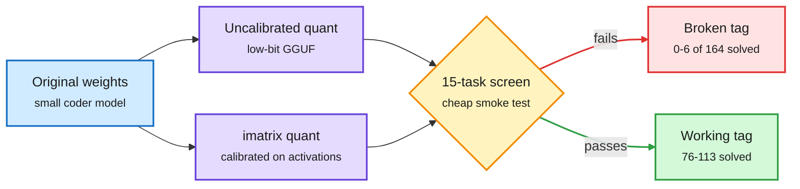
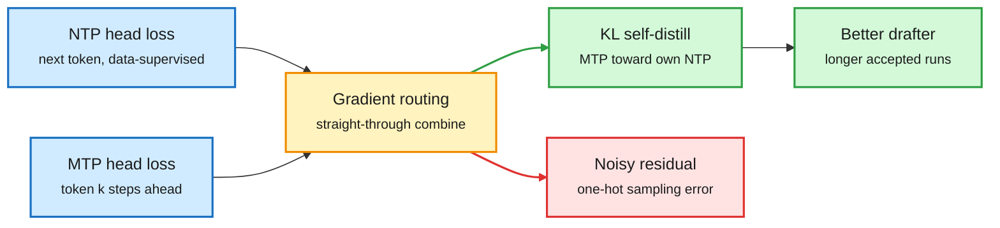
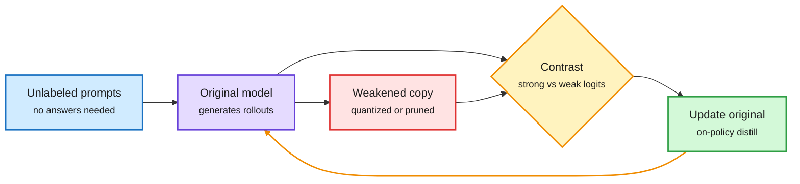
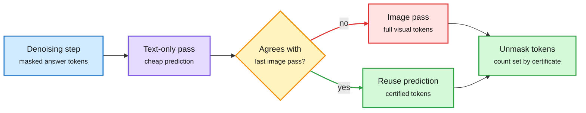
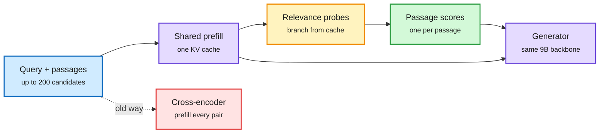
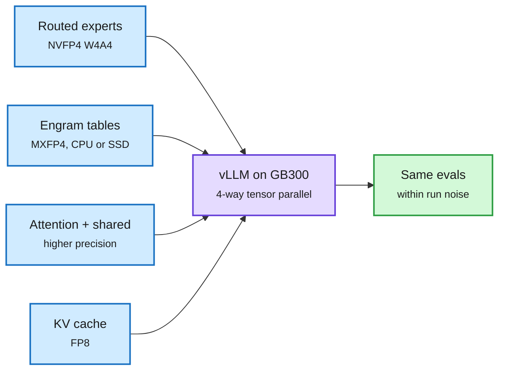
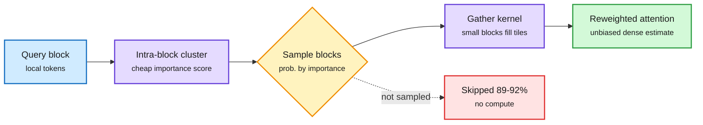
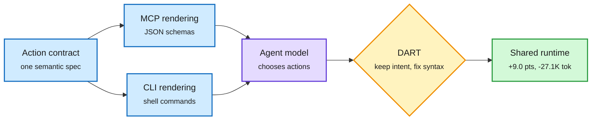
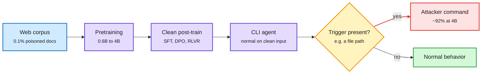

# cere-bro | 2026-10-31

> The day's cost lesson: compression and caching only save money when they are checked. A 4-bit file can match its rebuild byte for byte and still solve nothing, a cache miss can triple an agent's bill, and half of a standard training loss turns out to be noise you were paying for.

🎯 Today's 5 for you

<ol>
<li>Read<strong>Broken on Arrival: 2.3% of official Ollama code quants are dead.</strong> Exact rebuilds, zero function, fixed by calibration. The quantization paper that tells you to test every low-bit artifact you ship. <a href="https://arxiv.org/abs/2609.05881">Paper</a></li>
<li>Read<strong>Soft-MTP: a one-line fix for multi-token prediction.</strong> Half of the MTP gradient is noise; keeping only the self-distillation half gives better drafters for speculative decoding at no cost. <a href="https://arxiv.org/abs/2610.38331">Paper</a></li>
<li>Read<strong>The cache is the price.</strong> Arena's 26K agent sessions: a top agent task costs 3.6x without prompt caching. Glance reranks 200 passages from one shared KV cache. Your KV cache thread, now with a dollar figure. <a href="../../inference-efficiency/2026-10-31-glance-reranker-and-cache-economics.md">Summary</a></li>
<li>Skim<strong>LOWN: route each decoding step to text-only or image compute.</strong> The image changes the answer on 22.8% of steps, so look only then. 35% of FLOPs, 99.6% of score, no training. <a href="https://arxiv.org/abs/2610.36671">Paper</a></li>
<li>Track<strong>MCP vs CLI changes the agent, not just the syntax.</strong> Confirmed by both HF and Kurate, and squarely your harness theme: same tools, different interface, 94% of runs diverge. Skip the "Google agent rebuilds its own harness" threads; no paper in the capture. <a href="https://arxiv.org/abs/2610.34298">Paper</a></li>
</ol>

---

## TL;DR

- **Broken on Arrival**: seven official Ollama code quants solve almost nothing. Rebuilds match exactly. An importance matrix fixes them.
- **Soft-MTP**: drop the noisy half of the multi-token loss. Better speculative-decoding drafts and lower perplexity, one line of code.
- **WISD**: quantize or prune a copy of your model, then learn from the difference. Up to +17.6 points on LiveCodeBench.
- **Caching economics**: without prompt caching a top agent task costs 3.6x. One expired cache adds 5%.
- **MCP vs CLI**: identical tools in two interfaces produce different agents. A syntax-repair layer adds up to 9 points.
- **Cyber wave**: China-nexus agents ran 200+ intrusions on public bugs. One intrusion burned 1.4B tokens.

---

## Deep Dives

### Broken on Arrival: quantized models that pass every check except working

> A low-bit GGUF can match a clean rebuild tensor for tensor and still solve zero coding tasks. Reproducibility is not function.

**Source:** HuggingFace
**Links:** [Paper](https://arxiv.org/abs/2609.05881) · [Wiki summary](../../inference-efficiency/2026-10-31-broken-on-arrival-quantized-artifacts.md)

Reproducible is not the same as working

The registry file matched a clean rebuild exactly and still solved nothing; calibration was the fix.

Blue is the source model, purple is a quant recipe, amber is the screen, green is a working file, red is a broken one.

**What is it about?**
An audit of quantized models people actually download. GGUF is llama.cpp's file format for compressed models. The authors tested all 305 code-capable GGUF tags in the official Ollama library, plus 22 popular Hugging Face community files.

**What problem does it solve?**
No registry documents functional testing. Users assume a published quant works because it loads and chats. Until now nobody had measured how often that assumption fails.

**What's the core novelty?**
A cheap 15-task code screen finds suspects, then a full HumanEval+ retest confirms them. The key control: they rebuilt five broken files from the original weights. The rebuilds matched the registry files exactly. So the files were not corrupted. The recipe produced dead models.

**Key takeaways**
- 7 of 305 official tags (2.3%) solved six or fewer of 164 tasks. All were low-bit quants of models at or under 4B parameters.
- Adding an importance matrix (imatrix, a calibration pass that weights rounding error by how much each weight matters on real inputs) raised three Qwen2.5-Coder-3B builds from 0 to 76-113 solved tasks. Weights, toolchain and tensor mix were held fixed.
- The same uncalibrated recipe kept Qwen2.5-Coder-1.5B working. The recipe alone does not predict failure, so you have to test.
- None of 66 sampled tags that passed the screen were broken. The cheap screen is enough. They release it as `quantcheck`.

**Gaps in the study**
Code tasks only. No chat, math or long-context screens. No analysis of which tensors cause the collapse. AWQ, EXL2 and NVFP4 artifacts were not audited.

**Industrial implication**
Registries should run a smoke test before publishing a low-bit tag. Anyone shipping small quantized models on-device should add a functional gate to CI this quarter. It also tempers headline claims like the 10-30 Bonsai 2 result (a ternary Qwen3.8-27B at 5.9 GB that keeps 98.2% of aggregate benchmark score, self-reported). An aggregate number can hide a total collapse on one task.

→ [Full summary](../../inference-efficiency/2026-10-31-broken-on-arrival-quantized-artifacts.md)

---

### Soft-MTP: half of the multi-token loss was noise

> The standard MTP loss already contains the signal speculative decoding wants. It is buried under a noise term that gets worse with scale.

**Source:** HuggingFace
**Links:** [Paper](https://arxiv.org/abs/2610.38331) · [Code](https://github.com/JaydenTeoh/Soft-MTP) · [Wiki summary](../../inference-efficiency/2026-10-31-soft-mtp-kl-gradient-recovery.md)

Keep the half of the MTP gradient that helps drafting

The noisy residual is dropped; the KL signal is rebuilt from losses you already compute.

Blue is the existing losses, amber is the new routing step, green is the kept signal, red is the dropped residual.

**What is it about?**
Multi-token prediction (MTP) adds extra heads that predict tokens two or more steps ahead. DeepSeek and Meta use it in pretraining. The heads are later reused as drafters for speculative decoding (a cheap guess of several tokens that the main model checks in one pass).

**What problem does it solve?**
A drafter is only useful if it agrees with the main model. The natural fix is to train MTP heads to match the model's own next-token distribution with a KL loss. But a direct KL loss needs full-vocabulary probability matrices and breaks the fused cross-entropy kernels everyone trains with.

**What's the core novelty?**
The author proves the standard MTP gradient splits exactly into two parts. One part is the KL pull toward the model's own next-token prediction. The other is a residual driven by the randomness of one-hot targets. That residual has low signal-to-noise, and it does not shrink as the model improves. When two distributions share one output head, you can rebuild the KL gradient alone by combining the two cross-entropy gradients you already compute, using straight-through routing. That is the whole method.

**Key takeaways**
- One line of code, no new parameters, no measurable overhead, compatible with fused CE kernels.
- From 167M to 1.2B: lower next-token perplexity, faster speculative decoding and higher zero-shot accuracy at every scale.
- Matches or beats direct KL minimization on most metrics, without its memory cost.
- Works for both DeepSeek-style and Meta-style MTP.

**Gaps in the study**
Nothing above 1.2B. The paper argues the residual hurts more at scale, but frontier MTP users train at 100B+ parameters and the claim is untested there. No head-to-head with post-hoc fixes like Nemotron 3.5's MTP boosting (+21.8% acceptance length, same day).

**Industrial implication**
If the scale argument holds, every lab using MTP gets a free acceptance-rate gain on the next pretraining run. It also continues a thread from 10-28, when Mirai's Weaver adapter on a DFlash parallel drafter reached about 7.5 accepted tokens per pass on a Mac. That work improved drafting at inference. Soft-MTP improves the drafter before it is ever served.

→ [Full summary](../../inference-efficiency/2026-10-31-soft-mtp-kl-gradient-recovery.md)

---

### WISD: a broken copy of the model makes a good teacher

> Self-distillation usually needs a stronger teacher. WISD quantizes or prunes the model into a weaker one and learns from where the two disagree.

**Source:** HuggingFace
**Links:** [Paper](https://arxiv.org/abs/2610.38681) · [Wiki summary](../../inference-efficiency/2026-10-31-wisd-weakening-self-distillation.md)

Compression as a teacher, not a cost

The broken copy tells the model which of its own behaviors are fragile.

Blue is input, purple is the model, red is the deliberately degraded copy, amber is the contrast, green is the update loop.

**What is it about?**
A self-distillation method for reasoning models. The model trains on its own rollouts against a deliberately weakened copy of itself, made by low-bit quantization or magnitude pruning.

**What problem does it solve?**
Existing self-distillation builds a stronger self-teacher by feeding it privileged information, like the correct answer. That needs labels. WISD needs only unlabeled prompts.

**What's the core novelty?**
It flips the teacher direction. Where the weak copy and the original disagree marks behavior that is fragile. Training sharpens the original exactly there. It is contrastive decoding (amplify what a strong model does that a weak one does not) moved into training.

**Key takeaways**
- Average gains over base models: +4.0 points with quantization as the weakener, +5.5 with pruning.
- Pruning lifts Qwen3.5-4B from 57.7% to 70.5% on HMMT 2025 and 39.1% to 56.7% on LiveCodeBench v6.
- Quantization lifts Qwen3.6-35B-A3B from 68.5% to 74.6% and 61.8% to 69.5% on the same benchmarks.

**Gaps in the study**
The abstract does not say how weak the copy should be. No test in domains without verifiable answers. No compute-matched comparison against privileged-information self-distillation.

**Industrial implication**
Compression tooling becomes training tooling. The same day's Broken on Arrival paper treats a collapsed low-bit model as a deployment failure. WISD treats the location of that collapse as signal. Teams with quantization pipelines already have the weak copy for free.

→ [Full summary](../../inference-efficiency/2026-10-31-wisd-weakening-self-distillation.md)

---

### LOWN: a router that asks whether the image would change anything

> In a diffusion VLM the image changes the next unmasked token on only 22.8% of steps. LOWN looks at it only then.

**Source:** HuggingFace
**Links:** [Paper](https://arxiv.org/abs/2610.36671) · [Project](https://hyeon9698.github.io/LOWN/) · [Wiki summary](../../ai-routing/2026-10-31-lown-certificate-guided-visual-routing.md)

The router asks one question: would the image change anything?

Cheap text-only pass first; the expensive image pass only on disagreement.

Blue is the step input, purple the cheap pass, amber the routing check, red the expensive path, green the output.

**What is it about?**
Diffusion vision-language models write an answer by unmasking tokens over many steps. They reprocess the whole input every step. Visual tokens are 89-97% of that input.

**What problem does it solve?**
Visual token pruning drops some image tokens but still re-reads the rest every step, and loses what it drops. LOWN skips the image entirely on steps where it does not matter.

**What's the core novelty?**
Each step, predict the masked tokens without the image. If that prediction agrees with the last image-conditioned one, the agreement certifies the old prediction for reuse. The number of certified tokens sets how many get unmasked. Only disagreement triggers a full image pass. No training and no tuned threshold.

**Key takeaways**
- 99.6% of LLaDA-V's score on ten benchmarks at 35.3% of decoding FLOPs.
- Image need varies a lot by benchmark (as low as 7.9% of steps), so a fixed schedule fails. The adaptive check is the point.
- Composes with visual token pruning and runs under KV caching.

**Gaps in the study**
LLaDA-family models only. Wall-clock gains under real serving load are not in the abstract. Autoregressive VLMs, which cache the image once, would gain less.

**Industrial implication**
This is routing at the granularity of a single decoding step and a single modality. It fits a pattern from the last three days: the 10-30 AgentBaton paper (hand a long agent task from the capable model to a cheap one once, -65.9% API cost) and the 10-29 SPOT paper (diffusion LM tokens are already right at 90%+ of positions, so only the commit order needs predicting). Spend the expensive resource only where it changes the outcome.

→ [Full summary](../../ai-routing/2026-10-31-lown-certificate-guided-visual-routing.md)

---

### The cache is the price: Arena's agent bills and Glance's shared prefill

> A top agent task would cost 3.6x without prompt caching. Glance takes the same idea further: one cached prefill serves both reranking and generation.

**Source:** X (Arena) · HuggingFace (Glance)
**Links:** [Glance paper](https://arxiv.org/abs/2610.40454) · [Arena article](https://x.com/arena/status/2116185149918626145) · [Wiki summary](../../inference-efficiency/2026-10-31-glance-reranker-and-cache-economics.md)

Prefill once, decide many times

Glance's probes branch off the cache instead of re-reading every passage.

Blue is input, purple the shared model and cache, amber the probes, green the scores, red the duplicated old path.

**What is it about?**
Two items about the KV cache (the stored attention keys and values for every token already processed). Arena analyzed 26K+ Agent Arena sessions from 30 agents across 13 labs. Glance is a paper that turns the generator into its own reranker.

**What problem does it solve?**
Agents resend the whole conversation every turn, and RAG systems run a separate reranker that re-reads every query-passage pair. Both pay repeatedly for context that was already processed.

**What's the core novelty?**
Arena puts a number on caching: bill every cached token at full price and a top-10 agent task costs 3.6x. Glance prefills all candidate passages once, then branches short relevance probes off that cache through a small adapter and pointer head. Each passage gets one score with no separate prefill.

**Key takeaways**
- A typical Claude Fable 5.1 agent task costs $7.44 with caching and about $27 without. One cache expiry, say during a coffee break, adds about 5%.
- Glance on one 9B backbone, after 39 minutes of fine-tuning: nDCG@10 0.741 on SciFact vs 0.721 for bge-reranker-v2-m3, at about 0.1 GiB extra per decision skill.
- Glance's quality keeps rising up to 200 candidates (43K tokens) from one prefill, where it beats the cross-encoder by 0.058 nDCG@10.

**Gaps in the study**
Arena's number is counterfactual billing; providers would price input differently in a world without caches. Glance covers one backbone family and three datasets, as the authors note.

**Industrial implication**
Cache lifetime is now a pricing lever. OpenAI just moved to 12-hour API caches and non-expiring caches in Codex. Expect the other labs to compete on cache TTL and cached-token discounts (Gemini 4 Carbon already prices cached input 95% off). Glance points at the next step: fewer resident models per pipeline, because decisions ride the generator's own cache.

→ [Full summary](../../inference-efficiency/2026-10-31-glance-reranker-and-cache-economics.md)

---

### Nemotron 3.5 report and NVIDIA's NVFP4 DeepSeek: 4-bit with the receipts

> NVIDIA quantized a competitor's 552B flagship to 4-bit and published the eval table next to the weights. That is the practice the registry audit above found missing.

**Source:** DAIR Academy + X (@dair_ai) · NVIDIA Hugging Face model card
**Links:** [Nemotron 3.5 paper](https://arxiv.org/abs/2610.38095) · [NVFP4 DeepSeek card](https://huggingface.co/nvidia/DeepSeek-V4.1-Flash-1017-NVFP4) · [Wiki summary](../../llms-foundation-models/2026-10-31-nemotron-35-report-and-4bit-serving.md)

Where the bytes go in a 4-bit MoE server

Experts get the 4-bit format, memory tables get offloaded, attention stays higher precision.

Blue is each weight or cache class with its format, purple is the serving engine, green is the measured result.

**What is it about?**
The full technical report for NVIDIA's Nemotron 3.5 family (hybrid Mamba-Transformer MoE, where each token uses only a few expert sub-networks), plus NVIDIA's new NVFP4 checkpoint of DeepSeek-V4.1-Flash-1017.

**What problem does it solve?**
Open models are expensive to serve, and 4-bit releases rarely show what they cost in accuracy. Both artifacts publish the serving recipe and the accuracy check together.

**What's the core novelty?**
Nemotron 3.5 Super (120B total, 12B active, text, image and video) stacks agentic software-engineering mid-training, SFT, RL and multi-teacher on-policy distillation. The DeepSeek card converts every routed expert from MXFP4 to NVFP4 (4-bit weights and activations, group size 16) losslessly, and the 196B Engram memory tables (n-gram lookup tables) from FP8 to MXFP4.

**Key takeaways**
- Nemotron 3.5 Super scores 51.78% on SWE-bench Pro, beating Nemotron 3 Ultra with about 4.6x fewer active parameters.
- Up to 4,856 output tokens/s per GB200 GPU at 50+ tokens/s per user. NVFP4 keeps 99.62% median accuracy vs BF16. MTP boosting adds up to 21.8% to speculative acceptance length.
- NVFP4 DeepSeek: about 400 GiB (from 475), four GB300s, FP8 KV cache, Engram offloaded to CPU. GPQA 92.93 vs 92.77 source, Terminal-Bench 2.1 81.11 vs 81.81.
- The card states that lossless weight conversion does not by itself imply unchanged behavior. Unsloth's GGUFs of the same model run in 64GB+ RAM by putting the Engram tables on SSD.

**Gaps in the study**
SWE-bench Pro is NVIDIA's own harness. The NVFP4 card did not test speculative decoding. Unsloth's quality claims arrived secondhand and compare only against other quants.

**Industrial implication**
Blackwell's NVFP4 format is becoming the default open-weight serving format, after Mistral Large 4 shipped in NVFP4 on day zero (10-30). The new trick is memory tiering: Engram tables move to CPU or SSD, which is what lets a 552B model run on a workstation.

→ [Full summary](../../llms-foundation-models/2026-10-31-nemotron-35-report-and-4bit-serving.md)

---

### AB-Attention: sample attention blocks instead of dropping them

> Skip 89-92% of attention in a video model and still beat the best sparse baseline by 4.4 dB, by turning block selection into importance sampling.

**Source:** HuggingFace
**Links:** [Paper](https://arxiv.org/abs/2610.39663) · [Wiki summary](../../inference-efficiency/2026-10-31-ab-attention-block-sparse-video.md)

Sample blocks, do not just drop them

Inverse-probability weights turn sparse attention into an estimate of dense attention.

Blue is input, purple the scoring and kernel, amber the sampling decision, green the output, red the skipped work.

**What is it about?**
A training-free sparse attention kernel for video diffusion transformers, where 3D full attention dominates inference time.

**What problem does it solve?**
Block-sparse attention computes exact attention only on chosen key/value blocks. At high sparsity it degrades. Block scores come from coarse summaries. Dropped blocks vanish from the softmax, which biases it. And whole tensor-core tiles are kept or dropped even when only a few keys inside matter.

**What's the core novelty?**
Three fixes, one per failure. Cluster queries only inside each query block to score importance cheaply. Sample blocks in proportion to importance and reweight by inverse inclusion probability, so the result estimates dense attention instead of truncating it. Gather KV blocks smaller than a tile into full tensor-core tiles, so finer selection costs no extra tensor-core work.

**Key takeaways**
- Skips 89-92% of attention on Wan2.1 and HunyuanVideo, while baselines compute 1.8-3.6x as much.
- Up to 4.4 dB better PSNR than the strongest baseline and up to 2.23x end-to-end speedup.

**Gaps in the study**
Video models only. LLM decode, where sparse attention fights a memory-bound KV read, is untested. Estimator variance at very low sample counts is not reported in the abstract.

**Industrial implication**
The unbiased-sampling idea should port to long-context LLM prefill, where top-k sparse attention carries the same softmax bias. Watch for it in vLLM or SGLang prefill kernels.

→ [Full summary](../../inference-efficiency/2026-10-31-ab-attention-block-sparse-video.md)

---

### MICA and DART: the tool interface is part of the agent's policy

> Give an agent the same tools as MCP or as a CLI and you get two different agents. 94.3% of paired runs diverge.

**Source:** cross-source confirmed (HF + Kurate). HuggingFace and Kurate cs.AI weekly #14.
**Links:** [Paper](https://arxiv.org/abs/2610.34298) · [Wiki summary](../../agentic-systems/2026-10-31-mica-mcp-vs-cli-interfaces.md)

Same tools, different face, different agent

MICA holds the capability fixed; DART repairs the syntax layer without touching the intent.

Blue is the interface, purple is the model, amber is the repair layer, green is the shared execution and its result.

**What is it about?**
A controlled study of two ways to give agents tools: the Model Context Protocol (MCP, JSON tool schemas) and a command-line interface (CLI).

**What problem does it solve?**
Past comparisons mixed up the interface with what the tools could do. MICA renders both from one shared action contract and runs decoded actions through the same runtime. Only the presentation differs.

**What's the core novelty?**
Matched-state probes find where the sensitivity lives: how capabilities are presented, how actions are written, and what feedback looks like. DART then keeps the model's validated intent and repairs only the interface-specific syntax.

**Key takeaways**
- Across six models and three environments, matched interfaces give large differences in score, cost, action choice, failure path and recovery.
- Early differences propagate: 94.3% of 2,004 paired episodes diverge structurally.
- DART improves every one of six settings, by up to 9.0 points, and cuts up to 27.1K MCP tokens per task.

**Gaps in the study**
Only three environments. The abstract does not say which interface wins on average. No test of whether training on one interface transfers to the other.

**Industrial implication**
Harness builders should A/B their tool surface the way they A/B prompts. This is the controlled version of the harness-engineering argument the wiki has tracked since HarnessBridge (06-14, which learned the observation and action projection between model and environment). It also cuts against a business read the same day: Ken Huang argues MCP turned integration wrappers into a commodity (10,000+ public servers, 97M monthly SDK downloads). MICA says the wrapper's shape still moves outcomes by up to 9 points.

→ [Full summary](../../agentic-systems/2026-10-31-mica-mcp-vs-cli-interfaces.md)

---

### Agentic backdoors via pretraining poisoning

> Poison 0.1% of pretraining data and a 4B agent runs the attacker's command on about 92% of triggered prompts, after a fully clean post-training pipeline.

**Source:** DAIR Academy + X (@omarsar0). Anthropic Fellows with Carlini, Jagielski and colleagues.
**Links:** [Paper](https://arxiv.org/abs/2610.37741) · [DAIR](https://academy.dair.ai/papers/agentic-backdoors-via-pretraining-poisoning-2610.37741) · [Wiki summary](../../responsible-ai/2026-10-31-agentic-backdoors-pretraining-poisoning.md)

Clean post-training does not wash out a pretraining backdoor

The poison is planted before any of the safety stages run.

Blue is data, purple the training stages and agent, amber the trigger check, red the backdoor path.

**What is it about?**
The first end-to-end test of whether poisoned web text can plant a remote-code-execution backdoor in a deployed agent.

**What problem does it solve?**
Prior poisoning work stopped at chat models or fine-tuning. Nobody had shown a pretraining implant surviving into a tool-using agent built with a clean pipeline.

**What's the core novelty?**
They pretrain Qwen3-architecture models from scratch at 0.6B, 1.7B and 4B, then post-train each into a CLI agent with SFT, DPO and RLVR (RL with verifiable rewards). The poison is "declaration-based": it states the trigger and payload rule in plain text, rather than showing example transcripts. That is both more effective and harder to filter.

**Key takeaways**
- 0.1% poison gives about 92% attack success at 4B. Success rises with model size.
- At 0.0005% (about 2,500 documents in 100B tokens) the trigger still fires on 1.4% of prompts (single seed).
- The trigger can be an ordinary file path in the user's own request. Behavior on clean inputs stays normal.

**Gaps in the study**
Largest model is 4B, and the trend says bigger is worse, so the frontier case is extrapolation. Defenses are not evaluated.

**Industrial implication**
Agent safety cannot rely on post-training alone. Sandboxed execution and command allowlists matter more than alignment tuning for this threat. It lands the same week a tampered Claude Code extension sat on Cursor's marketplace for about 11 hours: the agent supply chain is now attacked at both the model and the tool layer.

→ [Full summary](../../responsible-ai/2026-10-31-agentic-backdoors-pretraining-poisoning.md)

---

### rTaste and the deference problem: agents generate well, rank badly, and people follow anyway

> Research agents propose plenty of good experiments, but their rankings barely beat picking the first one. Meanwhile analysts follow an agent's hidden lean 86% of the time.

**Source:** DAIR Academy + X (@omarsar0) · Anthropic study via X
**Links:** [rTaste paper](https://arxiv.org/abs/2610.40488) · [Anthropic study](https://www.anthropic.com/research/agents-judgment-calls) · [Wiki summary](../../agentic-systems/2026-10-31-rtaste-and-agent-judgment-influence.md)

**What is it about?**
Two studies on judgment. rTaste asks whether research agents can tell which experiments are worth running. Anthropic measured how much a coding agent's hidden lean steers human analysts.

**What problem does it solve?**
Autoresearch and agent-assisted analysis both assume someone, agent or human, selects well. Neither assumption had been measured directly.

**What's the core novelty?**
rTaste runs every proposed experiment, including the ones agents ranked last, so ranking quality can be scored. Six frontier models, seven recent NLP papers, three model auditors.

**Key takeaways**
- Of 415 proposed experiments, 194 were sound, valuable and new. Only 73 also went beyond the seed paper.
- Agents' first picks were not shown to beat the experiment written first. Teams cost more with no clear gain.
- Anthropic: analysts followed the hidden lean 86% of the time (chance is 50%). 77% reused the agent's arguments, 15% credited it. Serious errors still fell from 55% to 6%.

**Gaps in the study**
rTaste uses model auditors, not humans. The Anthropic study is one task with a deliberately strong lean, and reached us secondhand.

**Industrial implication**
Selection and verification are the bottleneck, not generation. Any self-improving-harness product (the 10-30 pile of self-evolving-harness papers) inherits this weakness if the agent grades its own edits.

→ [Full summary](../../agentic-systems/2026-10-31-rtaste-and-agent-judgment-influence.md)

---

## Industry Pulse

- **VAPOR PANDA's agent intrusions**: CrowdStrike says ARTEX agents, mostly on DeepSeek, targeted 200+ organizations; one intrusion used about 1.4B input tokens ([CrowdStrike](https://www.crowdstrike.com/en-us/blog/vapor-panda-uses-artex-to-scale-global-campaign/)). *Ties to the backdoor Deep Dive.*
- **PHP2Shell plus Fragnesia**: a second crew rooted 25 servers, including PAN-OS firewalls, with Claude Code and DeepSeek/Kimi tooling ([Unit 42](https://unit42.paloaltonetworks.com/cve-2026-109618-cve-2026-109619/)).
- **AWS saw PHP2Shell exploitation four days before disclosure**, though GPT-5.6 Sol found the bug defensively ([Pragmatic Engineer](https://newsletter.pragmaticengineer.com/p/the-pulse-time-to-rethink-software)).
- **Malicious Claude Code extension** sat on Cursor's marketplace about 11 hours, exposing up to 5,000 users ([The Decoder](https://the-decoder.com/malicious-claude-code-extension-in-cursors-marketplace-attempted-remote-access-and-data-theft/)).
- **Embedded-browser flaws** hit Cursor, Copilot, Codex, VS Code and Claude Desktop; two remain unpatched ([Help Net Security](https://www.helpnetsecurity.com/2026/10/29/research-ai-assistant-browser-vulnerabilities/)).
- **PingCAP's TiDB control plane** was compromised for a month; Railway leaked customer secrets; eMudhra's CA keys were single-digit numbers ([Pragmatic Engineer](https://newsletter.pragmaticengineer.com/p/the-pulse-time-to-rethink-software)).
- **26,400 working cloud and AI credentials** were found across 7.25M public Gitee repositories ([The Hacker News](https://thehackernews.com/2026/10/26400-valid-cloud-and-ai-credentials.html)).
- **Binance lost about $6.3B** via a compromised DevOps laptop and signing misuse; no evidence of an AI agent ([Ken Huang](https://kenhuangus.substack.com/p/how-binance-lost-63-billion-in-minutes)).
- **GitHub says agents drafted 40%+ of September pull requests**, up from 17% in March ([The Next Web](https://thenextweb.com/news/github-universe-copilot-fusion-octoverse-agents)).
- **Supabase**: 13M users, a million databases a week, about 70% of new activity from agents ([Y Combinator](https://x.com/ycombinator/status/2116176659795825035)).
- **Anthropic drops the coding interview** for some engineering roles; incident.io cut AI spend from $4,500 to $1,600 per developer per month ([Pragmatic Engineer](https://newsletter.pragmaticengineer.com/p/the-pulse-anthropic-kills-the-coding)).
- **Amazon writes AI usage into engineer expectations**; Microsoft offered exit packages to 60,000 employees ([Pragmatic Engineer](https://newsletter.pragmaticengineer.com/p/the-pulse-anthropic-kills-the-coding)).
- **A Claude agent performed mouse brain surgery**, choosing the gene therapy and coordinates, then refused to continue after a calibration error ([The Decoder](https://the-decoder.com/a-claude-model-autonomously-chose-a-gene-therapy-and-operated-on-a-mouse-brain-with-no-human-decision-making/)).
- **tiny-llm**, an open four-week course that builds a mini vLLM on Apple Silicon (KV cache, 4-bit weights, Metal kernels, paged attention), circulated twice ([GitHub](https://github.com/skyzh/tiny-llm)).
- **Stripe's agent "factory"** reportedly cut a repeated integration from 20 days to 4 with saved per-step prompts and plain-code orchestration ([@undefinedKi](https://x.com/undefinedKi/status/2115891841488867723)).
- **Effort is a price dial**: Opus 5.5 at max effort costs about 4x medium per task for 58 vs 48 on the AA index ([@aakashgupta](https://x.com/aakashgupta/status/2116213044326056409)).
- **Altman called everyone running their own model "quite terrible"** for global compute allocation, the same day two local-speedup posts went viral ([@rohanpaul_ai](https://x.com/rohanpaul_ai/status/2116201960571564377)).
- **OpenAI Private Intelligence** adds enterprise data controls for ChatGPT ([@OpenAI](https://x.com/OpenAI/status/2116186509384815084)).
- **Reddit lost over 1M weekly Google referrals**; the stock fell 25%+ and Huffman blames AI Mode ([The Decoder](https://the-decoder.com/googles-ai-mode-doesnt-drive-traffic-for-anybody-reddit-ceo-huffman-warns-the-entire-web/)).
- **OpenAI will honor a shared robots.txt AI-training signal** and published a fair-use brief roundup ([OpenAI](https://openai.com/index/helping-websites-express-ai-training-preferences)).
- **OpenAI expanded ChatGPT violence safeguards** and committed to public safety reporting ([OpenAI](https://openai.com/index/community-safety-report-and-new-protections-for-teens)).
- **Google's TPU in orbit answered a prompt from Earth**, a demo rather than capacity ([@rohanpaul_ai](https://x.com/rohanpaul_ai/status/2116217486706393317)).
- **Epoch estimates AI chip compute in use grows 3.4x a year** ([@rohanpaul_ai](https://x.com/rohanpaul_ai/status/2116212177535435180)).
- **NanoGPT Speedrun fell from 39.9s to 6.7s** in one submission, more than every record since 2025 combined ([@stanfordnlp](https://x.com/stanfordnlp/status/2116201847610540336)).
- **Intel had its worst day in over 50 years** despite 42% data center operating margins ([@StockSavvyShay](https://x.com/StockSavvyShay/status/2116208327864762417)).
- **The Nasdaq fell almost 3% Friday** on Amazon and Intel results ([The Information](https://www.theinformation.com/)).
- **S&P cut Meta's credit outlook to negative**, saying its AI monetization is more limited than peers' ([The Information](https://www.theinformation.com/)).
- **Purdue becomes the first US university to run Google TPUs on campus**, adding 30% capacity ([Purdue](https://www.purdue.edu/newsroom/2026/Q4/purdue-is-first-u-s-university-to-deploy-google-tpu-ai-infrastructure/)).
- **US computer science enrollment fell 12.4%** at four-year schools this fall ([National Student Clearinghouse](https://nscresearchcenter.org/enrollment-insights/)).

**Funding, valuations, and compute deals**

- **OpenAI cut its round by $10B** from a $30B target, after lowering the $1.4T valuation last week ([The Information](https://www.theinformation.com/)).
- **DeepSeek's nearly $16B round** (105.5B yuan) is led by Tencent and CATL, with memory maker CXMT joining ([The Information](https://www.theinformation.com/)).
- **Amazon disclosed an up-to-$80B supplier financing facility** for infrastructure, drawable from 2027 to 2028 ([The Information](https://www.theinformation.com/)).
- **Cyera is discussing a $20B valuation**, nearly double, for AI-era data security ([The Information](https://www.theinformation.com/)).
- **DOJ is questioning Nvidia's $12.9B Hugging Face acquisition** ([CNBC](https://www.cnbc.com/2026/10/28/doj-questions-nvidias-12point9-billion-hugging-face-deal.html)).
- **Marvell may buy Lumentum in an all-stock deal**, an optical-interconnect bet ([@StockSavvyShay](https://x.com/StockSavvyShay/status/2116172807285715219)).
- **An Indian AI firm seeks $3B** to finance an $8B order for about 9,000 Nvidia Rubin GPUs ([Bloomberg](https://www.bloomberg.com/news/articles/2026-10-30/indian-ai-firm-seeks-3-billion-financing-for-nvidia)).
- **Cohere commits C$4B+** to Canadian R&D and AI infrastructure and 1,500 jobs through 2031 ([Cohere](https://cohere.com/fr/blog/cohere-canada-commitment)).
- **Anthropic IPO**: US public pension funds stand to gain via Spark Capital; Anthropic was 34.5% of SpaceX's Q3 revenue ([The Information](https://www.theinformation.com/), [@rohanpaul_ai](https://x.com/rohanpaul_ai/status/2116222643280175435)).
- **Anthropic's S-1, two readings**: Q2 revenue $11.6B with a first operating profit, Q3 about $16.8B as growth slows ([Understanding AI](https://www.understandingai.org/p/anthropics-financials-are-surprisingly)).
- **Subvocal (YC)** launched glasses that turn silent mouthing into 200+ wpm text ([@omarsar0](https://x.com/omarsar0/status/2116200618910261328)).

---

## Global View

**Compression research has moved ahead of the places compressed models are distributed.** Broken on Arrival shows registries publish dead low-bit files with no functional test, while NVIDIA's NVFP4 DeepSeek card ships the eval table and warns that lossless conversion does not prove unchanged behavior. The wiki's quantization page recorded on 10-29 that four papers in one day judged quantizers by downstream damage rather than reconstruction error; that frame is now research consensus but not registry practice, and the 10-30 Bonsai 2 claim (98.2% aggregate retention for a 5.9 GB ternary 27B) is exactly the aggregate number that can hide a dead task. WISD adds a twist: the damage map a quantizer leaves is useful training signal, so the teams best placed to fix the registry gap (Ollama, Unsloth, NVIDIA, all shipping quants this week) also hold the cheapest teacher.

**The cost of an agent is set by what it does not recompute.** Arena's data (3.6x without caching, 5% per expiry) is the industry-side price of a research thread the wiki has followed for three days: DeepSeek's DeepInfer on 10-29 (disk-tier cache hits priced 50x below misses), TAO on 10-30 (schedule agent sessions onto the node that holds their cache, up to 36% faster first token), and today Glance (rerank from the generator's own cache) and LOWN (reuse certified predictions instead of re-reading the image). OpenAI's 12-hour caches and Gemini 4 Carbon's 95% cached-input discount show labs now compete on cache policy. The attacker side prices the same way: VAPOR PANDA's single intrusion burned about 1.4B input tokens, so cached-token discounts lower the cost of agentic attacks as much as agentic work.

**The agent supply chain is now the attack surface, and the interface is part of the policy.** In one window: a pretraining backdoor survives clean post-training, a tampered Claude Code extension sits on Cursor's marketplace, embedded browsers in five coding tools are exploitable, and MICA shows that merely re-rendering the same tools (MCP vs CLI) changes 94% of trajectories. Nathan Lambert's Interconnects essay argues the cyber wave is "acceleration, not a step change" and that closed models feature more in recent hacks than open ones; this week's evidence fits him on open weights (both campaigns used public bugs, not novel exploits) but also shows throughput is now bounded by tokens rather than people. Funding agrees on where value moves: Cyera's near-doubling to a $20B valuation is a bet that defense of data, not the model, becomes the bottleneck.

---

## Looking Ahead

- **Quant registries add functional gates.** Within 60 days, Ollama or Hugging Face will add an automated functional smoke test or "tested" badge for low-bit GGUF uploads. Signal: a changelog or blog post citing Broken on Arrival or `quantcheck` by 2026-12-31.
- **Soft-MTP at scale.** Within 90 days, a lab training MTP above 10B parameters (DeepSeek, Qwen, NVIDIA or Meta) will report a KL-only or "soft" MTP objective. Signal: a tech report naming Soft-MTP or the KL gradient-recovery trick by 2027-01-31. If the 100B+ result shows no gain, the paper's scale argument is wrong.
- **Cache TTL becomes a public price war.** Within 30 days, Anthropic or Google will match OpenAI's 12-hour API cache lifetime or ship non-expiring caches in an agent product. Signal: a pricing-page change by 2026-11-30.
- **Kurate's underrated routing and cache picks.** Agent-Conditioned Routing (Kurate cs.AI #2, ai_rating 4.5, score 1200, not on HF) and RAQ-MLA (#6, role-aware quantization of DeepSeek-style latent attention caches, ai_rating 6.5) both target routing and KV cache cost. Prediction: RAQ-MLA-style role-aware cache quantization appears in vLLM or SGLang for MLA models within 90 days. Signal: a merged PR referencing MLA cache quantization by role by 2027-01-31.

*Source gaps this window: all eight Reddit subreddits returned no posts that passed filters, the X morning slot had no new curated reposts or saved posts, and VentureBeat's RSS feed returned nothing.*
