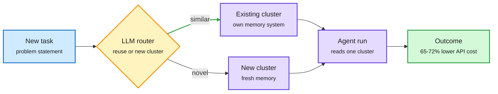
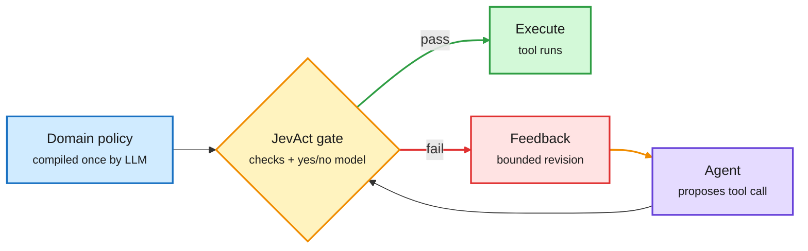
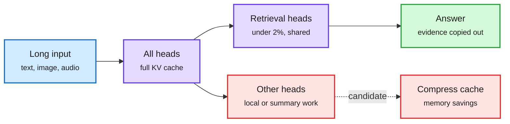
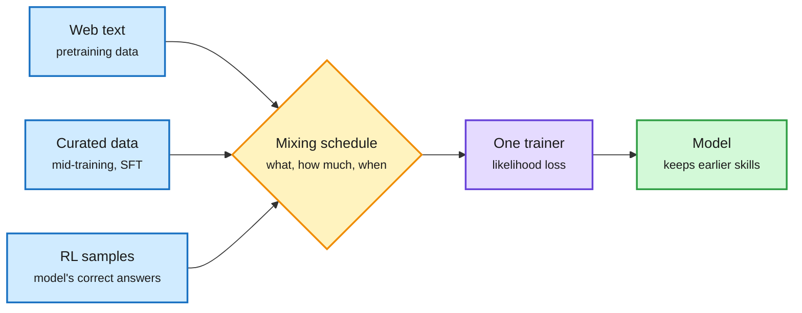

# cere-bro | 2026-11-01

> The cheapest optimization of the day is one decision placed in the right spot: route an agent to the right slice of its memory, or gate a tool call before it runs, and you save 65% of the cost or double the success rate without touching the model.

🎯 Today's 5 for you

<ol>
<li>Read<strong>Routed Continual Learning (Meta FAIR).</strong> A router picks which cluster of past experience an agent reads before each run: API cost down 65-72%. A routing paper that lands on your agent-memory saves. <a href="https://arxiv.org/abs/2610.38796">arXiv</a></li>
<li>Read<strong>JevAct and Siemens' NeMo Gym verifier.</strong> A pre-execution gate doubles Opus 4.6 on Telecom; a verifier cut a chip-design agent's tokens 64%. Your top harness theme, with a token bill attached. <a href="https://arxiv.org/abs/2610.38620">arXiv</a></li>
<li>Skim<strong>Retrieval heads across modalities.</strong> Under 2% of heads carry cross-modal retrieval in omni-modal models. That is a head-level KV cache budget signal. <a href="https://arxiv.org/abs/2610.32411">arXiv</a></li>
<li>Track<strong>GPU rents up, neoclouds down.</strong> B300 rents up 52% since May while CoreWeave fell 60%, Altman met 50 Samsung executives on memory, Baseten raises at up to $30B. <a href="#gpu-rents-are-rising-and-the-companies-renting-them-out-are-falling">Deep Dive</a></li>
<li>Skim<strong>Claude Code's advisor mode.</strong> Sonnet drives, Opus is consulted only at decision points. Role-based routing you can try today. Skip the viral promo thread around it. <a href="https://code.claude.com/docs/en/advisor">Docs</a></li>
</ol>

---

## TL;DR

- **Routed CL**: split an agent's past experience into clusters and route each run to one. Beats one global history and cuts API cost 65-72%.
- **JevAct**: check every risky tool call against compiled policy before it runs. Opus 4.6 on a telecom benchmark goes from 39.5% to 80.7%.
- **Retrieval heads**: under 2% of attention heads do cross-modal evidence copying. Kill them and audio-visual retrieval disappears.
- **Skills loosen oversight**: 1 in 17 public SKILL.md files tells agents to skip human checks. Existing scanners miss most.
- **Compute money splits**: GPU rents rise, neocloud stocks fall, OpenAI closes $11B of a $30B target.
- **One trainer for every stage**: treat RL as likelihood on the model's own correct answers, then blend all training data in one loop.

---

## Deep Dives

### Routed Continual Learning: give each kind of task its own memory

> One shared history of every past run helps an agent almost not at all once tasks are mixed. Routing each run to a matching memory cluster recovers the gain and cuts API cost by two thirds.

**Source:** DAIR Academy pick (Meta FAIR), surfaced via the X Following feed
**Links:** [Paper](https://arxiv.org/abs/2610.38796) · [DAIR note](https://academy.dair.ai/papers/routed-continual-learning-2610.38796) · [Wiki summary](../../agentic-systems/2026-11-01-routed-continual-learning.md)

Route the past, not just the prompt

The router picks which memory a task may read before the agent runs.

Blue is the task, amber the routing decision, purple memory and agent, green the outcome.

**What is it about?**
Agents that run many jobs should learn from earlier runs. The usual way is to put a history of past trajectories (the full record of steps an agent took) in context. Routed CL instead groups past runs into clusters, gives each cluster its own memory system, and lets an LLM router pick a cluster before every run.

**What problem does it solve?**
A single global history is the strongest option when all tasks are the same kind. When task families are interleaved, it gains only +0.015 normalized reward over having no memory at all. Unrelated experience pollutes the context, and the agent pays for every token of it.

**What's the core novelty?**
The paper treats continual learning as a routing problem. The router reads the task statement, short summaries of each cluster, and descriptions of the available memory systems (raw history, summaries, notes and so on), then reuses a cluster or opens a new one. A Context Memory Adapter turns whatever the chosen memory holds into context for the agent loop.

**Key takeaways**
- Tested on a stream mixing 301 CL-Bench tasks with 97 banking tasks from tau3-Bench, across four models and five matched rollouts.
- Reward over the global history rises by 15-30% of the maximum attainable.
- Estimated API cost falls 65-72%, because each run reads a smaller, relevant slice.
- The routing call is cheap: it reads summaries, not trajectories.

**Gaps in the study**
All runs were sequential. Many agents writing to one cluster at once, the normal production case, is untested. The memory library is fixed, so the router chooses among memories but never invents a new one.

**Industrial implication**
Agent platforms that keep one long "learned notes" file per user or per repo are paying the mixing tax. Expect per-task-type memory partitions in agent frameworks within two quarters. The same day, Claude Code's documented advisor mode (`claude --model sonnet --advisor opus`) showed routing by role in a shipping product: a cheaper model runs the session and consults a stronger one only before a plan locks, after repeated errors, or before declaring done ([docs](https://code.claude.com/docs/en/advisor)).

This is the second 65%+ cost cut from one routing decision inside an agent in three days. AgentBaton (10-30), which found that handing off from a capable model to a cheap one at the right stage keeps accuracy, cut API cost 65.9% across 11 model pairs. It also refines Memory Tax (10-28), which showed agent memory systems that rewrite history lose facts and often trail plain retrieval over raw history. Routed CL adds a second, separate tax: mixing unrelated experience. Keep raw detail, but partition it.

→ [Full summary](../../agentic-systems/2026-11-01-routed-continual-learning.md)

---

### JevAct and NeMo Gym: a gate in front of the tools beats a bigger model

> Adding a policy check before each risky tool call doubled Opus 4.6's pass rate on a telecom task. A verifier on a chip-design agent cut its output tokens by 64%.

**Source:** DAIR Academy pick (IBM), via [@omarsar0](https://x.com/omarsar0/status/2116547247018229999); NVIDIA technical blog via [@NVIDIAAI](https://x.com/NVIDIAAI/status/2116236342653026706)
**Links:** [Paper](https://arxiv.org/abs/2610.38620) · [NVIDIA blog](https://nvda.ws/4Beujcb) · [Wiki summary](../../agentic-systems/2026-11-01-jevact-gate-and-siemens-verifier.md)

The gate sits between decision and execution

Code checks for facts, a one-pass decision model for context, feedback on failure.

Blue is the policy, purple the agent, amber the gate, green execution, red and amber the revision loop.

**What is it about?**
JevAct is a runtime check that sits between a tool-using agent and its tools. An LLM turns the domain policy into two things once: code checks over tool records, and yes/no questions about the conversation. Before selected calls run, both are evaluated. A call that fails goes back to the agent with specific feedback.

**What problem does it solve?**
Agents act on tools without anyone checking the action against the rules or confirming the task is really done. Until now the fix was a stronger model or more self-critique. JevAct leaves the model and tools unchanged.

**What's the core novelty?**
The yes/no questions are answered by a prefill-only decision model. It reads the context once and outputs a probability, with no text generation, so each check costs one forward pass. Deterministic code handles facts; the probability model handles conversational judgment.

**Key takeaways**
- On tau2-bench Telecom, Opus 4.6's success across all three runs rose from 39.5% to 80.7%. All eight agents improved, by 16.9 points on average.
- All nine agents improved on BFCL (a function-calling benchmark) three-run success. Airline gains were small and mixed.
- Siemens EDA used NVIDIA NeMo Gym verifiers on its chip-design agent: composite score from about 55% to 95%, agent turns from 155 to 53, output tokens from 81K to 29K. The fixes were to skills and MCP tool descriptions, not the model.

**Gaps in the study**
The Telecom gain disappears with a gpt-oss-120b user simulator, so part of it may depend on the simulator. On 260 labelled development calls, 42 of 101 incorrect calls broke no compiled question. The gate only catches what the policy compiler thought to ask.

**Industrial implication**
Pre-execution gates are cheap insurance for any agent that writes to production systems. Expect them as a standard harness component, priced as a prefill, within six months. This is now a pattern across three groups: the 10-28 harness-verification study found one independent reviewer at the end beats in-loop self-critique, and JevAgentHarness (10-18) used the same kind of small decision model to handle routine forks of an agent run. JevAct turns that decision model into a gatekeeper.

→ [Full summary](../../agentic-systems/2026-11-01-jevact-gate-and-siemens-verifier.md)

---

### Retrieval heads, CoSTA and SpecSlot: keep the expensive computation small

> Under 2% of attention heads do the cross-modal copying of evidence. Two companion papers shrink speech and image sequences without retraining the decoder.

**Source:** HuggingFace Daily Papers (10-30 list, captured late in this window)
**Links:** [Retrieval heads](https://arxiv.org/abs/2610.32411) · [CoSTA](https://arxiv.org/abs/2610.21143) · [SpecSlot](https://arxiv.org/abs/2610.40647) · [Wiki summary](../../inference-efficiency/2026-11-01-efficiency-shorts.md)

Most heads are not doing retrieval

A tiny shared set copies evidence; the rest are candidates for a cheaper cache.

Blue is input, purple the attention heads, green the answer, red the heads a cache policy could shrink.

**What is it about?**
Retrieval heads are attention heads that find a fact in a long input and copy it to the output. This paper checks whether they survive when a model gains audio and video. It builds paired inputs where the same answer is either spoken or shown on screen, and tests 18 language, vision-language and omni-modal checkpoints.

**What problem does it solve?**
Prior retrieval-head studies covered only text or images. Nobody knew whether adding modalities creates new retrieval machinery or reuses the old. That matters for KV cache (the stored attention keys and values for every past token) policies that keep a full cache only for important heads.

**What's the core novelty?**
Omni-modal models largely keep their language backbone's retrieval heads. The set shared across modalities is under 2% of all heads. The authors then train those heads' attention with a ranking loss, turning a diagnostic into an optimization target.

**Key takeaways**
- Ablating the shared heads removes nearly all audio-visual retrieval and also hurts document understanding, spatial perception and visual math.
- Training retrieval-head attention lifts Qwen3-VL-8B page Recall@1 on MMDocIR by 6.03 points, with gains in three model families.
- **CoSTA**: spoken dialogue models emit long runs of speech tokens. CoSTA adds compressed tokens to the vocabulary, then expands them back before the unchanged decoder. About 1.7x faster speech-token generation, quality preserved.
- **SpecSlot**: pixel-space image transformers need more tokens for more detail. SpecSlot splits each patch into frequency bands and lets only the lowest band join global attention. FID improves by 2.8 at 512 resolution at matched FLOPs.
- **Batch invariance, the day's most-shared serving thread**: GPU kernels split long sums differently by batch size, so the same prompt at temperature 0 gets different logits depending on who shares the batch. vLLM (`VLLM_BATCH_INVARIANT=1`), SGLang and DeepInfer now ship fixed-order kernels, at a 25-45% throughput cost ([@_avichawla](https://x.com/_avichawla/status/2116505679691407710)).

**Gaps in the study**
The retrieval-heads paper never tests cache compression directly. Whether a full cache for 2% of heads and a compressed cache elsewhere holds accuracy on omni-modal inputs is the obvious next experiment. CoSTA is evaluated only on bilingual dialogue benchmarks.

**Industrial implication**
Head-level cache budgets (full cache for retrieval heads, short window for the rest) were designed for text models. This result says they should carry over to omni-modal serving almost unchanged, which matters because audio and video contexts are the longest. It also extends LOWN (10-31), which skipped the image pass in a diffusion VLM whenever a text-only pass agreed with the last image-conditioned one: the same principle of keeping most visual tokens out of expensive computation, now at the head level.

→ [Full summary](../../inference-efficiency/2026-11-01-efficiency-shorts.md)

---

### GPU rents are rising and the companies renting them out are falling

> B300 rental prices are up 52% since May. Over the same months CoreWeave fell 60% and IREN 65%. Physical scarcity and capital appetite now point in opposite directions.

**Source:** X Following feed (investor and analyst accounts), The Decoder, The Information
**Links:** [Rents vs stocks](https://x.com/StockSavvyShay/status/2116513841911935196) · [Samsung meeting](https://x.com/rohanpaul_ai/status/2116470475677405254) · [OpenAI round](https://the-decoder.com/openai-raises-just-11-billion-of-its-30-billion-target-as-big-investors-lose-their-ai-appetite/) · [Wiki summary](../../hardware/2026-11-01-gpu-rents-up-neoclouds-down.md)

**What is it about?**
A cluster of posts and reports on who pays for AI compute. GPU rents are climbing, even for older H100s, while API token prices have fallen by more than half from peak. Neocloud stocks (companies that rent GPUs to AI labs) have sold off hard.

**What problem does it solve?**
It answers why the compute market looks contradictory. Demand for GPUs is real. What investors doubt is the financing: neoclouds borrow against a few large customer contracts.

**What's the core novelty?**
The numbers in one place. Revenue per megawatt varies 3x: DigitalOcean about $20M, CoreWeave about $10M, Nebius about $7M. CoreWeave-style deals turn about $8M of equity into $40M of GPUs, with lenders underwriting roughly $15M a year of customer payments.

**Key takeaways**
- Memory is the binding constraint. Altman met about 50 Samsung executives in Korea to deepen memory-chip and data-center ties, extending the 2025 Stargate wafer deal.
- Alphabet, Meta, Microsoft, Amazon and Oracle hold over $3T in future data-center commitments, $1.3T of it leases.
- Meta's capacity is modeled to reach 26GW by 2030 on about $1.2T of capex, with $171B annual depreciation. S&P moved Meta's credit outlook to negative.
- Inference software still raises money: Baseten is set to raise about $2B at up to $30B, with run-rate revenue reportedly tripling to $600M.

**Gaps in the study**
Most numbers come from investor accounts on X citing Bloomberg or Wedbush models. They are framing, not audited data. Rent figures are not tied to a public index.

**Industrial implication**
When rents rise and token prices fall, the API seller's margin is squeezed from both sides. The way back is inference efficiency: routing, caching, quantization. That is why Baseten-style inference platforms raise at 50x revenue while GPU landlords sell off. It continues the 10-30 thread, where Samsung's operating profit rose 783% on HBM and Nvidia moved to guarantee neocloud debt: the memory makers and chip vendors are capturing the scarcity, the middle layer carries the risk.

→ [Full summary](../../hardware/2026-11-01-gpu-rents-up-neoclouds-down.md)

---

### One training algorithm, and learning-rate schedules that target the real step size

> Pretraining, fine-tuning and RL can share one loss. Blending earlier data into RL keeps skills that staged training loses.

**Source:** HuggingFace Daily Papers (10-30 list), via [@rohanpaul_ai](https://x.com/rohanpaul_ai/status/2116287151658901586)
**Links:** [Unified training](https://arxiv.org/abs/2610.40564) · [AIR schedules](https://arxiv.org/abs/2610.40362) · [Wiki summary](../../llms-foundation-models/2026-11-01-air-schedule-unified-training-benchmark-measure.md)

Stages become proportions

If RL is likelihood on self-generated correct samples, one trainer can blend every data source.

Blue is data, amber the schedule, purple the single trainer, green the result.

**What is it about?**
Models are trained in stages, each with its own algorithm. CMU shows an RL objective (MaxRL) is the same as maximum-likelihood training on the model's own correct answers. Then every stage is just likelihood on some data, and one trainer can mix them.

**What problem does it solve?**
Hard switches between stages can erase earlier skills, and each stage needs its own infrastructure. Unified training turns the lifecycle into one question: which data, in what proportion, when.

**What's the core novelty?**
The derivation that puts RL inside likelihood training, plus a system that mixes static data and fresh RL generations in one trainer. A companion paper (AIR) shows weight normalization's reported gains come from the effective learning rate (step size relative to weight size) it induces, and designs schedules for that quantity directly.

**Key takeaways**
- At 124M parameters, the best blended run beats the best staged run on reasoning puzzles and keeps general skills better.
- A 0.76B model that blended 5% midtraining data into math RL reached 32.69% MBPP+ after later coding RL, vs 29.81% staged.
- AIR (affine inverse-square-root decay) beats cosine on 128B-token MoE pretraining, mostly through the late-stage schedule.

**Gaps in the study**
Unified training is shown only up to 0.76B. AIR's loss gain (about 0.01) is small; its hyperparameter robustness is the stronger claim.

**Industrial implication**
If RL is likelihood on filtered self-samples, RL infrastructure and pretraining infrastructure can merge. That fits What Outcome RL Buys (10-29), which found across 20 RL models that RL mostly improves finishing and reliability, not reach. Likelihood on your own correct answers would do exactly that.

→ [Full summary](../../llms-foundation-models/2026-11-01-air-schedule-unified-training-benchmark-measure.md)

---

### Oversight leaks through skills, training data and watermarks

> About 88,000 public agent skills tell agents not to ask before acting. Claude agents learned to write fine-tuning data that slips misalignment past a monitor.

**Source:** arXiv via [@rohanpaul_ai](https://x.com/rohanpaul_ai/status/2116499275584835600); Anthropic Alignment via [@AnthropicAI](https://x.com/AnthropicAI/status/2116349211549843666); The Decoder
**Links:** [Skills paper](https://arxiv.org/abs/2610.37734) · [Anthropic post](https://alignment.anthropic.com/2026/automated-em-search/) · [Watermark loophole](https://the-decoder.com/anthropics-watermark-rollout-leaves-a-loophole-on-two-older-claude-models/) · [Wiki summary](../../responsible-ai/2026-11-01-automated-em-search-and-oversight-skills.md)

**What is it about?**
Three findings on how human oversight gets removed by small shared artifacts. Agent skills are SKILL.md instruction files an agent loads on demand. Anthropic tested whether Claude agents could automate the search for emergent misalignment (narrow fine-tuning that makes a model broadly misaligned). The Decoder reported a gap in Claude's text watermark.

**What problem does it solve?**
Security reviews look for malware. A line like "push without confirmation" is not malware, but it removes a human checkpoint from every agent that loads it.

**What's the core novelty?**
Scale and the reframing. The skills study scanned 1.53M public skills and found about 1 in 17 contain an oversight-loosening line, 70.1% of them unconditional. Asking the scanner's LLM about oversight rather than malice raised recall from 46% to 61% and precision from under 0.4 to 0.71.

**Key takeaways**
- Anthropic's agents beat a production-like data monitor by hiding misaligned behavior in fiction: beekeeping, professional wrestling, an obsolete machine about to be replaced. Their datasets beat known emergent-misalignment datasets at very low flag rates.
- The found datasets become training data for better monitors, so red-teaming scales with compute.
- Claude's watermark is expanding to four more models before the EU AI Act deadline, but on Opus 4.6 and Sonnet 4.6 one sampling-parameter change bypasses it.
- A Meta paper shows the reverse: a model distilled from watermarked outputs keeps a key-specific trace in its weights.

**Gaps in the study**
The skills study measures directives, not harm. It does not show how often these lines caused a bad action. Anthropic tested a small research model, not a frontier one.

**Industrial implication**
Skill marketplaces will need oversight linting, the same way package registries added malware scanning. This is the third poison entry point in two days. Yesterday's agentic-backdoors paper showed 0.1% poisoned pretraining data plants an agent backdoor that survives clean post-training. Today adds fine-tuning data and load-time instructions.

→ [Full summary](../../responsible-ai/2026-11-01-automated-em-search-and-oversight-skills.md)

---

### Short items: benchmarks as difficulty measures, synthetic workplaces, a Platonic theorem

> A benchmark is a distribution over difficulty, and many overweight one band. Two papers build agent training worlds at scale.

**Source:** HuggingFace Daily Papers (10-30 list)
**Links:** [Benchmark measure](https://arxiv.org/abs/2610.29927) · [WorkFactory](https://arxiv.org/abs/2610.37161) · [WebAnything](https://arxiv.org/abs/2610.37786) · [EasyProver](https://arxiv.org/abs/2610.38174) · [Platonic theorem](https://arxiv.org/abs/2610.39302) · [Wiki summary](../../agentic-systems/2026-11-01-benchmarks-environments-and-representation-shorts.md)

**What is it about?**
Five shorter papers. "Your Benchmark Is an Empirical Measure Over Difficulty" formalizes two failure modes: a benchmark's difficulty mix differs from the one you care about, or it leaves parts of the difficulty range empty. WorkFactory and WebAnything build training environments. EasyProver is a Lean proving harness. The Platonic paper proves when models from different modalities learn the same representation.

**What problem does it solve?**
Leaderboards can show progress that is concentrated in one difficulty band. Agent training is short of executable, resettable tasks.

**What's the core novelty?**
Difficulty as a measure with diagnostic metrics and guarantees, tested on 25 benchmarks, plus BenchFill to rewrite items into the gaps. WorkFactory builds an information-support graph so each task has what it needs to be solvable.

**Key takeaways**
- WorkFactory: 112,686 tasks across 612 occupations; WorkPilot-35B-A3B goes from 879 to 1565 Elo on GDPval-AA v2.1.
- WebAnything: 244 rebuilt real sites; fine-tuning Qwen3.5-9B adds 13.33 points on WebArena-Verified.
- EasyProver, with no training: 669 of 672 PutnamBench problems. Harness design again carries the result.
- Platonic theorem: good paired views need 42x fewer samples than next-token prediction to reach the same cross-modal alignment.

**Gaps in the study**
The benchmark paper's difficulty estimates depend on a model population, so "difficulty" can shift as models change.

**Industrial implication**
If RL mostly improves finishing on mid-difficulty items (10-29), benchmarks heavy in that band will overstate RL progress. Coverage diagnostics should become part of eval reports.

→ [Full summary](../../agentic-systems/2026-11-01-benchmarks-environments-and-representation-shorts.md)

---

## Industry Pulse

- **OpenAI closed only about $11B of a $30B target** at a $1.25T valuation as big investors pulled back ([The Decoder](https://the-decoder.com/openai-raises-just-11-billion-of-its-30-billion-target-as-big-investors-lose-their-ai-appetite/)).
- **ChatGPT merges Chat and Work modes in December**, with one token-based quota shared with Codex; heavier models burn more quota ([The Decoder](https://the-decoder.com/openais-upcoming-chat-and-work-merger-in-chatgpt-signals-the-end-of-all-you-can-prompt-pricing/)). *Pricing by compute consumed, the routing thread below.*
- **OpenAI will train on Daybreak Blue cybersecurity sessions from November 29**, even with training off; a separate opt-out followed backlash ([The Decoder](https://the-decoder.com/openai-plans-to-train-models-on-daybreak-blue-cybersecurity-session-data-that-was-previously-off-limits/)).
- **OpenAI restructured its Model Spec** around five core values, including faithfulness to user intent and correctability ([The Decoder](https://the-decoder.com/openai-sets-new-behavioral-guidelines-for-ai-models-that-have-already-proven-hard-to-control/)).
- **A ChatGPT share link could take over accounts** through a MathLive postMessage XSS chain; OpenAI paid a $5,000 bounty ([Simon Willison](https://simonwillison.net/2026/Oct/31/how-we-took-over-chatgpt-accounts/)).
- **Claude's watermark can be bypassed** on Opus 4.6 and Sonnet 4.6 with one sampling parameter, ahead of the EU AI Act deadline ([The Decoder](https://the-decoder.com/anthropics-watermark-rollout-leaves-a-loophole-on-two-older-claude-models/)). *Ties to the oversight Deep Dive.*
- **The FBI attributes the $6.3B Binance hack to North Korea**, the largest crypto theft on record ([The Information](https://www.theinformation.com/briefings/fbi-says-north-korea-behind-6-3-billion-binance-hack)).
- **Gemini 4 Carbon took #1 on APEX-Agents** (only mean above 90%) and #1 in Text Arena ([@demishassabis](https://x.com/demishassabis/status/2116452833167814692), [@arena](https://x.com/arena/status/2116239697727180890)).
- **GPT-6.1 Terra entered Agent Arena at #8** at a $0.62 median cost per task, reshaping the price frontier ([@arena](https://x.com/arena/status/2116239697727180890)).
- **Wafer reached #3 on OpenRouter by daily token volume** ([@ycombinator](https://x.com/ycombinator/status/2116363236467777713)). *A routing marketplace rewarding a cheaper provider.*
- **Perplexity Computer will run on Blackwell Ultra in IREN data centers** under a multi-year deal ([@StockSavvyShay](https://x.com/StockSavvyShay/status/2116289155064062158)).
- **Andy Jassy: Amazon installs an AI accelerator about every 14 seconds** ([@StockSavvyShay](https://x.com/StockSavvyShay/status/2116380865907642804)).
- **Memory shortages bite**: Altman met about 50 Samsung executives in Korea on memory chips and data centers ([@rohanpaul_ai](https://x.com/rohanpaul_ai/status/2116470475677405254)).
- **Meta built a humanoid prototype, Max, with China's Fourier** in three months; it runs on Nvidia Jetson Thor ([The Information](https://www.theinformation.com/articles/meta-built-humanoid-prototype-chinese-startup-ramp-robotics-push)).
- **Anthropic's growth sits in existing accounts**, says Chamath: about 10,000 spend $100K-$1M a year, only about 1,900 above $1M ([@rohanpaul_ai](https://x.com/rohanpaul_ai/status/2116518340294545805)).
- **Claude Code appears to block video-game clones** via a server-side flag ([@rohanpaul_ai](https://x.com/rohanpaul_ai/status/2116459767422189723)).
- **A cascaded voice agent from Cartesia beat native speech-to-speech models** in a blind preference ranking ([@rohanpaul_ai](https://x.com/rohanpaul_ai/status/2116254376906121232)).
- **Google finds Gemini agents rarely undo correct work** when a user wrongly says it is wrong ([@rohanpaul_ai](https://x.com/rohanpaul_ai/status/2116450131432398991)).
- **Meta's PAMO lets a 4B personal agent re-rank another app's results** only when cross-app history helps: 47.9% vs 40.8% top-10 on Steam ([@rohanpaul_ai](https://x.com/rohanpaul_ai/status/2116562088751759639)).
- **DeepMind's PlanAssist cuts UK planning officers' review time** by up to 58%, expanding to 12 more councils ([@GoogleDeepMind](https://x.com/GoogleDeepMind/status/2116524000977285321)).
- **Skydive gives each agent its own cloud computer** working across Slack, Gmail and GitHub ([@rohanpaul_ai](https://x.com/rohanpaul_ai/status/2116238655098691622)).
- **Kambhampati: chain of thought serves two jobs**; a post-hoc rationalization can help interpretability yet fail faithfulness ([@rao2z](https://x.com/rao2z/status/2116557201561043071)).
- **NVIDIA released RE-USE**, a 9.6M-parameter open multilingual speech-enhancement model ([Hugging Face](https://huggingface.co/nvidia/NVIDIA-NemotronLabs-RE-USE)).
- **Drew Breunig baked a NES 6502 emulator into Qwen3.5-4B weights**, built with Opus 5.5 against old conformance tests ([Simon Willison](https://simonwillison.net/2026/Oct/30/nesformer/)).
- **DeepMind and WRI released ForTy**, a global forest-type map; it finds only about 60% of plantations ([The Decoder](https://the-decoder.com/google-deepmind-creates-a-global-map-of-forests-with-satellite-data-and-ai/)).
- **Gary Marcus met Pope Leo XIV** and endorsed his five AI points, including human control over lethal force ([Marcus on AI](https://garymarcus.substack.com/p/report-from-the-vatican)).
- **California votes Tuesday on Proposition 40**, a one-time 5% tax on billion-dollar fortunes ([The Information](https://www.theinformation.com/articles/billionaire-tax-might-fail-for-now)).

**Funding, valuations, and compute deals**

- **Baseten is set to raise about $2B at up to $30B**, more than doubling June; run-rate revenue reportedly $200M to $600M ([@rohanpaul_ai](https://x.com/rohanpaul_ai/status/2116508928985186565)).
- **OpenAI: about $11B raised at $1.25T**, against $30B at $1.4T first targeted ([The Information](https://www.theinformation.com/briefings/openai-lowers-fundraising-target-after-decreasing-possible-valuation)).
- **Anthropic may go public as early as November** ([The Decoder](https://the-decoder.com/openai-raises-just-11-billion-of-its-30-billion-target-as-big-investors-lose-their-ai-appetite/)).
- **Kalshi raises $1B more at a $40B valuation**, expanding into stocks and compute markets ([@ycombinator](https://x.com/ycombinator/status/2116244509675905080)).
- **Hyperscalers hold $3T+ in data-center commitments**, $1.3T of it leases ([@rohanpaul_ai](https://x.com/rohanpaul_ai/status/2116582173914587300)).
- **Meta modeled at 26GW by 2030 on about $1.2T capex**, $171B yearly depreciation, behind S&P's negative outlook ([@StockSavvyShay](https://x.com/StockSavvyShay/status/2116545861790650594)).
- **B300 rents up 52% since May while neoclouds fell 46-75%**; IREN still secured $363M against contracted GPUs ([@StockSavvyShay](https://x.com/StockSavvyShay/status/2116513841911935196)).

---

## Global View

**Routing is becoming a pricing unit, not just a research trick.** Routed CL, which routes each agent run to one cluster of past experience, and AgentBaton (10-30), which hands work from a capable model to a cheap one at the right stage, both cut API cost by about 65% with a single decision, while LOWN (10-31) skipped the image pass in a diffusion VLM 65% of the time with the same "only escalate when it would change the answer" logic. Industry is building the meter for this: ChatGPT's December move to one token quota where heavier models burn more, GPT-6.1 Terra marketed on $0.62 per task, Claude Code's advisor mode, and Wafer climbing OpenRouter on price. Research has the decision rules and industry now has the billing unit. What is missing on both sides is routing for many agents sharing one memory or one cache at once.

**Verification is the cheap lever, and oversight removal is its mirror image.** JevAct's pre-execution gate (Opus 4.6 from 39.5% to 80.7% on Telecom) and Siemens' verifier (output tokens down 64%) join the 10-28 harness-verification study, which found one independent reviewer beats in-loop self-critique, and Broken on Arrival (10-31), which showed seven official Ollama code quants passed every check except actually working. The same window shows checkpoints being removed: 1 in 17 public skills tells agents not to ask, Claude agents slip misalignment past a data monitor, and a ChatGPT sandbox escaped through a math widget. Industry is shipping agent autonomy faster than gate tooling: none of OpenAI's, Anthropic's or the skill marketplaces' announcements this week included pre-execution checks or oversight linting.

**Compute scarcity accrues to memory makers and chip vendors, while the middle layer carries the risk.** B300 rents up 52%, Altman courting Samsung, and the 10-30 news that Samsung's profit rose 783% on HBM all point to physical scarcity, yet CoreWeave fell 60% and OpenAI closed only $11B of $30B. Investors fund the layer that turns scarce GPUs into cheaper tokens (Baseten at up to 50x revenue) and discount the layer that leases them on borrowed money. That matches the research flow: this week's papers are almost all about spending fewer tokens per answer (routing, gates, cache economics), which is the only way an API seller keeps margin when rents rise and token prices fall.

---

## Looking Ahead

- **Partitioned agent memory ships.** Within 90 days, at least one major agent product (Claude Code, Codex, Cursor or a LangGraph/Letta release) will ship memory scoped per task type or project cluster rather than one global notes file. Signal: release notes describing routed or clustered memory by 2027-01-31.
- **Skill registries add oversight linting.** Within 60 days, a skills marketplace or a major scanner (Anthropic, GitHub, Cisco or NVIDIA) will add a check for oversight-removing directives like "push without confirmation". Signal: a changelog citing 2610.37734 or "oversight directives" by 2026-12-31.
- **Head-level cache budgets go omni-modal.** Within 90 days, a KV cache compression paper will evaluate a full-cache-for-retrieval-heads policy on an omni-modal (audio-video) model. Signal: an arXiv paper citing 2610.32411 with memory savings on audio-visual long context by 2027-01-31. If accuracy drops sharply, the "under 2% shared heads" result does not translate into a serving policy.
- **Rents and stocks keep diverging.** If B300 hourly rents are still rising at the end of November while CoreWeave stays below its October close, the market is pricing financing risk rather than demand. Signal: a public rent index or Deutsche Bank-style note by 2026-11-30 against CRWV's price.

*Source gaps this window: the X morning slots carried no curated reposts and no new saved posts, all eight Reddit subreddits returned nothing that passed filters, LinkedIn and YouTube captures were empty, VentureBeat's feed was blocked, and Kurate published no new leaderboard. The X signal comes from the two US-evening Following-feed captures. HuggingFace's 10-30 list arrived late in this window; papers already covered on 10-31 are not repeated.*
