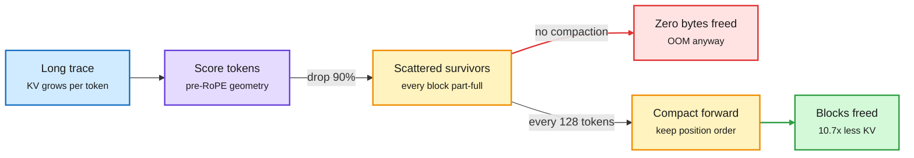
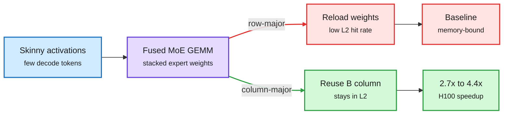
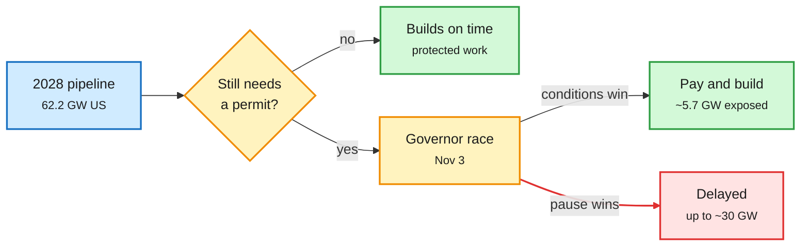
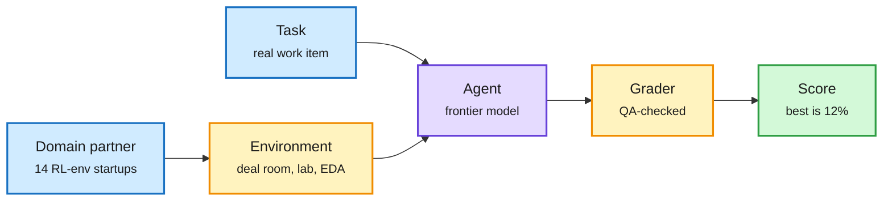
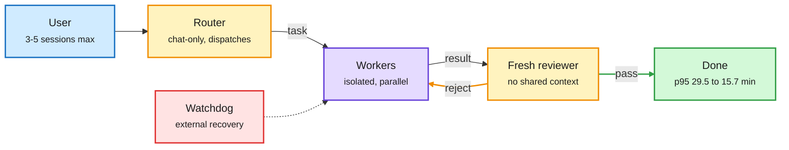

# cere-bro | 2026-11-02

> The day's cost lesson is that savings only count when the hardware sees them: evict 90% of the KV cache and a paged server may free zero bytes, reorder one MoE kernel's tiles and DRAM traffic halves, and the biggest compute constraint of 2028 may be decided at a ballot box on Tuesday.

🎯 Today's 5 for you

<ol>
<li>Read<strong>NVIDIA: KV cache compression and its infra problems.</strong> Why token eviction frees no memory on vLLM's paged allocator, and how compaction fixes it. Squarely your KV cache interest, with a new metric: blocks freed. <a href="https://research.nvidia.com/labs/eai/blogs/kv-cache-compression-and-its-infra-problems/">NVIDIA</a></li>
<li>Read<strong>PyTorch: column-major MoE kernels.</strong> One scheduling change gives 4.4x on H100 by keeping expert weights in L2. A short, implementable GPU-optimization lesson. <a href="https://pytorch.org/blog/accelerating-moe-model/">PyTorch</a></li>
<li>Track<strong>The datacenter backlash and Tuesday's governor races.</strong> 2027 is safe; up to 30 GW of 2028 capacity depends on who wins, with Texas the swing state. Compute infrastructure risk with a date on it. <a href="https://newsletter.semianalysis.com/p/the-datacenter-backlash-goes-bipartisan">SemiAnalysis</a></li>
<li>Skim<strong>GDPx.</strong> A revenue-weighted agent benchmark where the best model scores 12%, chip design is over-weighted, and each domain has a different winner. Read it as a routing table. <a href="https://newsletter.semianalysis.com/p/gdpx-measuring-frontier-model-capabilities">SemiAnalysis</a></li>
<li>Skim<strong>DeepSeek Super-agent and fresh-context reviewers.</strong> Three harness designs in one weekend split a router from isolated workers. Your top saved theme, now with a p95 number. Skip the "Karpathy's 2-hour lecture" bait threads around it. <a href="https://github.com/deepseek-ai/dsh-superagent-prototype">GitHub</a></li>
</ol>

---

## TL;DR

- **KV cache compression on real servers**: evicting tokens frees no memory unless whole paged blocks empty. NVIDIA's TriAttention compacts survivors and cuts KV memory 10.7x.
- **MoE kernels**: walking output tiles column by column keeps expert weights in L2. Up to 4.4x faster on H100.
- **Datacenter politics**: 2027 capacity is mostly built. Up to 30 GW of 2028 capacity hinges on Tuesday's governor races.
- **GDPx**: SemiAnalysis's new agent benchmark puts every task in a realistic work environment. The best model scores 12%.
- **Router plus workers**: DeepSeek, Google and the Claude Code team all split a coordinator from fresh-context workers or reviewers.
- **Safety training spills over**: teaching a model to deny consciousness also changes how it rates animals' minds.

---

## Deep Dives

### KV cache compression and its infra problems

> Evict 90% of the cached tokens and VRAM may not move at all, because the paged allocator only frees a block when every slot in it is empty.

**Source:** NVIDIA Efficient AI blog (Song Han's group), resurfaced via X
**Links:** [Post](https://research.nvidia.com/labs/eai/blogs/kv-cache-compression-and-its-infra-problems/) · [thread](https://x.com/_avichawla/status/2116861920682860761) · [Wiki summary](../../inference-efficiency/2026-11-02-kv-compression-paged-infra-problems.md)

Eviction frees tokens, compaction frees blocks

Only the compaction step returns memory to the paged allocator.

Blue is input, purple is the scoring step, amber is cache state, red is the failure path, green is reclaimed memory.

**What is it about?**
The KV cache is the memory store that holds the keys and values of every past token, so attention never recomputes them. It grows with every generated token. A Qwen3-32B at 4-bit on a 24GB GPU runs out of memory at about 24K tokens of reasoning, short of the 32K traces hard problems need. This post explains why most compression methods that drop "unimportant" cached tokens do not survive contact with a production server.

**What problem does it solve?**
Until now, compression papers reported tokens evicted on contiguous, pre-allocated tensors. Real servers like vLLM use PagedAttention, which stores the cache in fixed 16-slot blocks. A block is freed only when all 16 slots are empty. Importance-based eviction leaves survivors scattered across nearly every block, so evicting 14K of 16K tokens over 1,000 blocks frees almost nothing. Filling the holes with new tokens breaks position order, which means every kernel must then read a stored position index per slot.

**What's the core novelty?**
The post names a second, separate problem: most methods (H2O, SnapKV and their family) rank tokens by attention scores, and FlashAttention never writes those scores to memory. It computes attention tile by tile in on-chip SRAM and throws each tile away. Getting scores back means slow eager attention. TriAttention avoids both traps. It predicts importance from the geometry of query and key vectors before RoPE (the rotary position encoding), where they form stable clusters. Every 128 decoded tokens it compacts survivors forward in position order, so trailing blocks empty out and return to the allocator.

**Key takeaways**
- Reported: full-attention accuracy on long reasoning traces, 2.5x faster decoding, 10.7x less KV memory.
- Only about the last 25 queries reflect where the model is attending, because RoPE orients each query by position. So observation-window methods evict facts that go quiet for one reasoning phase.
- The metric to track is blocks freed, not tokens evicted.

**Gaps in the study**
It is a lab blog, not a peer-reviewed comparison. It does not measure how compaction interacts with prefix caching, where shared prefix blocks belong to many requests and cannot be compacted for one. It also does not answer Random Attention (09-08), the Salesforce/UIUC result that keeping the prompt plus random positions matched learned scorers at 0.30 ms per eviction round against TriAttention's 1.47 ms.

**Industrial implication**
This explains why many KV compression results never show up on a serving bill. Expect vLLM and SGLang to treat eviction and allocation as one design problem within two quarters. Any compression paper that reports only "percent of tokens kept" should now be read with suspicion.

→ [Full summary](../../inference-efficiency/2026-11-02-kv-compression-paged-infra-problems.md)

---

### Column-major scheduling makes MoE kernels up to 4.4x faster

> Same math, same weights, a different order for handing out output tiles, and DRAM traffic drops by half.

**Source:** PyTorch blog (2024, trending again on X) + Before GPU Engineering notebook
**Links:** [Post](https://pytorch.org/blog/accelerating-moe-model/) · [code](https://github.com/pytorch-labs/applied-ai/tree/main/kernels/triton/inference/col_major_moe_gemm) · [notebook](https://github.com/BEFORE-GPU-ENGINEERING/BEFORE-GPU-ENGINEERING) · [Wiki summary](../../hardware/2026-11-02-moe-column-major-kernels-and-gpu-notebook.md)

Same math, different tile order, half the DRAM traffic

Column-major scheduling keeps one expert-weight column hot in L2 across neighbouring tiles.

Blue is input, purple is the kernel, red is the cache-missing path, green is the locality win.

**What is it about?**
An MoE layer (mixture-of-experts, where each token goes to a few expert sub-networks) runs as one fused matrix multiply over a stacked matrix of all experts. During decoding, only a few tokens are in flight, so the activation matrix is skinny. The cost is dominated by loading expert weights from HBM. The PyTorch team profiled vLLM's fused Triton MoE kernel and found a low L2 cache hit rate.

**What problem does it solve?**
Row-major scheduling computes output tiles C(0,0), C(0,1), C(0,2) in order. Each step needs a different column of weights, so the previous one is evicted and reloaded from DRAM. The kernel was waiting on memory, not math.

**What's the core novelty?**
Change the order. Column-major scheduling computes C(0,0), C(1,0), C(2,0), so neighbouring thread blocks reuse the same weight column while it sits in L2. They first added SplitK (splitting the inner dimension across thread blocks), worth 18-20%. The tile order delivered the rest.

**Key takeaways**
- Up to 4x on A100 and 4.4x on H100 (2.7x at batch size 2).
- Nsight Compute at batch 2: L2 hit rate up 2.54x, global memory loads down 49%.
- A practitioner credited the post with jumping from rank 175 to 80 on a kernel leaderboard in one night.
- A companion repo, Before GPU Engineering, teaches the same intuitions in 56 chapters: warps, the register to shared memory to HBM ladder, coalescing, occupancy, arithmetic intensity, tiled matmul.

**Gaps in the study**
Tested in FP16 on A100 and H100. The authors note Triton lacked BF16 atomic adds and that production use needed CUDA graphs. There is no data on Blackwell's larger L2 or on FP8/FP4 expert weights, which shrink the weight-load share.

**Industrial implication**
Decode-time MoE is a data-movement problem, and tile order is a free cache policy. With every frontier open model now an MoE, the next step is expert-aware tile ordering that keeps popular experts resident across steps, not just within one GEMM.

→ [Full summary](../../hardware/2026-11-02-moe-column-major-kernels-and-gpu-notebook.md)

---

### The datacenter backlash goes bipartisan

> The 2027 buildout is already concrete; the 2028 buildout is still a permit, and Tuesday's governor races decide how many of those permits get issued.

**Source:** SemiAnalysis essay + The Information
**Links:** [SemiAnalysis](https://newsletter.semianalysis.com/p/the-datacenter-backlash-goes-bipartisan) · [The Information](https://www.theinformation.com/articles/candidates-backing-data-center-pauses-win-15-governors-races) · [Wiki summary](../../hardware/2026-11-02-datacenter-backlash-midterms-2028-buildout.md)

2027 is poured concrete; 2028 is still a permit

Elections can only delay capacity that still needs an approval.

Blue is the pipeline, amber is the decision points, green is capacity that gets built, red is capacity at risk.

**What is it about?**
SemiAnalysis maps its datacenter model onto next week's US elections. About three quarters of the 33.8 GW due in 2027 across its top 20 states is already under construction, so it keeps its global +50 GW forecast for 2027. The 2028 pipeline is different: 62.2 GW of US net additions, mostly not started, 70% of it in 13 states, 10 of which elect a governor on Nov 3.

**What problem does it solve?**
In September the same team argued moratoriums were not killing the buildout: of about 20 GW under local restrictions, only 1.5 GW faced delay. That held. What changed is the reach. Texas froze state environmental (TCEQ) permits on Sept 21, pulling onsite power into the hold. Oregon widened its freeze to air and water permits through July 2027.

**What's the core novelty?**
A permit-level exposure model instead of headline counting. If every pro-pause candidate wins, about 30 GW of 2028 capacity sits in pause states. If conditions-only candidates win, exposure falls to 5.7 GW. Texas carries close to 30% of 2028 US GW. If Governor Abbott restarts permits after the grid operator ERCOT files its audit around Dec 10, the hit is small. If challenger Hinojosa holds a moratorium through the Jan to May 2027 legislative session, the freeze runs about 8 months, 5 to 9 months longer.

**Key takeaways**
- The platform is bipartisan: make datacenters pay grid costs (15 candidates), end tax breaks (12), limit or report water use (11).
- Hyperscaler staff say they can pay higher costs and bring their own power, but cannot skip permits or move capacity to another state on the same timeline.
- The Information counts at least one pause backer in 21 of 36 governor races, both nominees in five states including Texas, and pause backers likely or possible winners in 15 states.
- Google's head of data-center energy says orbital datacenters could cost up to 100x terrestrial ones, so space is not the escape hatch.

**Gaps in the study**
The two outlets disagree on Texas: SemiAnalysis treats the favored candidate as conditions-only, The Information counts both Texas nominees as pause backers. Candidate positions are taken at face value. SemiAnalysis also sells the underlying model to subscribers.

**Industrial implication**
Compute supply for 2028 now has a political input with a date on it. If Texas stays frozen into 2027, expect GPU rents (already up 52% for B300 since May, per the 11-01 digest) to stay firm and more spend to shift toward efficiency per watt: KV compression, MoE kernels and inference-dedicated clusters like Colossus 2's 200K GB300s.

→ [Full summary](../../hardware/2026-11-02-datacenter-backlash-midterms-2028-buildout.md)

---

### GDPx: benchmark the domains where AI will earn its money

> Put a frontier model inside a real 4,000-file deal room instead of a 500-word prompt and it scores near zero on finance.

**Source:** SemiAnalysis
**Links:** [Post](https://newsletter.semianalysis.com/p/gdpx-measuring-frontier-model-capabilities) · [Hassabis reply](https://x.com/demishassabis/status/2117142448577093706) · [Wiki summary](../../agentic-systems/2026-11-02-semianalysis-gdpx-benchmark.md)

The environment is the benchmark

GDPval spoon-feeds context in the prompt; GDPx makes the agent go find it.

Blue is inputs, amber is the environment and grader, purple is the model, green is the result.

**What is it about?**
A general agent benchmark weighted by where SemiAnalysis expects AI revenue to concentrate: chip design, cybersecurity, biology, finance, legal, quant trading, recursive self-improvement, hardware design, materials science, alignment and software engineering. It skips government, real estate and insurance on purpose.

**What problem does it solve?**
OpenAI's GDPval (Sept 2025) is still the general benchmark on most model cards. Its tasks are one-shot and non-interactive, with all context handed over in the prompt. Its rubric graders reached only 71% human inter-rater agreement, and some gold solutions are wrong. Real work is mostly finding the context.

**What's the core novelty?**
Every task lives in a realistic environment built by a domain RL-environment startup (14 partners). Finance tasks sit inside an anonymized PE deal room of about 4,000 files. Cyber tasks run against live services with real zero-days. Materials tasks put the model in a simulated lab with a battery cycler and an electron microscope. Hardware tasks use live Siemens NX sessions and real AWS FPGAs.

**Key takeaways**
- The best model scores 12% (pass@1 over three attempts).
- Opus 5.5 is best overall and wins chip design, hardware design and quant trading. Gemini 4 Carbon wins biology and edges software engineering. GPT-6 Astra wins recursive self-improvement and materials. Almost every model scores 0 on finance and legal.
- Safety classifiers sandbag Opus and Astra on cyber, bio and alignment. Muse Wonder Full is the best cyber model by a margin.
- Cost frontier: Luna and DeepSeek at the low end, OpenAI in the middle, Opus at the top. Demis Hassabis publicly welcomed it.

**Gaps in the study**
The domain weighting comes from SemiAnalysis's own revenue model, which it sells. Several task partners also sell RL environments to the labs being scored. Chip design is deliberately over-weighted ("we're SemiAnalysis").

**Industrial implication**
Spiky per-domain winners plus a clear cost frontier is a routing table, not a leaderboard. Expect enterprise buyers to route by domain (Opus for chip design, Carbon for bio) rather than pick one model, and expect GDPx or a successor to appear on model cards within a quarter.

→ [Full summary](../../agentic-systems/2026-11-02-semianalysis-gdpx-benchmark.md)

---

### DeepSeek Super-agent and the fresh-context reviewer

> With one task the bottleneck is the model; with many tasks it is the human, who can follow only 3 to 5 sessions at once.

**Source:** The Information + DeepSeek open-source prototype + X
**Links:** [Repo](https://github.com/deepseek-ai/dsh-superagent-prototype) · [The Information](https://www.theinformation.com/briefings/deepseek-unveils-autonomous-coding-agent-prototype) · [Elephant-Goldfish](https://github.com/google/elephant-goldfish-model) · [Wiki summary](../../agentic-systems/2026-11-02-deepseek-super-agent-and-fresh-context-reviewers.md)

The coordinator keeps the memory, the workers keep the context clean

Three designs, one shape: isolation is the error-catching mechanism.

Blue is the human, amber is routing and review, purple is the workers, green is the exit, red is the recovery path.

**What is it about?**
DeepSeek's Harness team open-sourced a "Super-agent" prototype over the weekend. A chat-only Router talks to the user and hands out work. Isolated Workers run in parallel in the background. Event-driven triggers, interruption at any time and an external watchdog handle scheduling and recovery.

**What problem does it solve?**
Coding agents assume a human opens each session, feeds context and watches every step. That caps one person at 3 to 5 concurrent sessions. Super-agent moves scheduling and recovery into the system.

**What's the core novelty?**
The split itself, and that two other designs made the same split the same weekend. Google's open-sourced Elephant-Goldfish plugin keeps one long session (the Elephant) for the design spec and sends fresh subagents (Goldfish) that never saw the conversation to explain it back and attack it. The Claude Code team's review setup, per a widely shared summary, has a second agent review each diff in a fresh context and posts only bugs that several parallel agents agree on.

**Key takeaways**
- Super-agent: reported p95 completion time fell from 29.5 to 15.7 minutes. DeepSeek says several ideas in its post are future work.
- Claude Code review (second-hand): merged PRs more than doubled, reverts fell over 40%, PRs with substantive review comments rose from 16% to 54%.
- On the token side, HarnessMM (10-27, the paper where the model writes future commands with pass checks so the harness skips predictable LLM calls) resurfaced with DeepSeek Harness at 87.93% fewer tokens and success up from 71.4% to 85.7%.

**Gaps in the study**
No ablation separates the gain from parallelism versus the router. The Claude Code numbers come from a summary thread with no linked original.

**Industrial implication**
Router-plus-cheap-workers is the model-routing shape this wiki tracks, moved up to the session layer. Fresh-context reviewers are also cheap because they run short contexts. Expect Claude Code and Codex to ship first-party multi-session orchestration within a quarter.

→ [Full summary](../../agentic-systems/2026-11-02-deepseek-super-agent-and-fresh-context-reviewers.md)

---

### Short items: safety spillover, research agents, retrieval and talks

> Narrow rules have wide reach, research agents still need a human at the start, and review is now the slowest step in shipping code.

**Links:** [Wiki summary: safety spillover](../../responsible-ai/2026-11-02-safety-training-spillover-shorts.md)

- **Teaching "I am not conscious" changes everything else.** A Google Paradigms of Intelligence study (with UChicago and Northwestern, via [X summary](https://x.com/alex_verem/status/2116953675717607892)) found consciousness-denial training also lowers the mind models grant animals (4.04 vs a human average of 6.25). Pushing models toward claiming consciousness moved survey answers 2.6x closer to human answers than removing the safety direction did. Removing it also restored harmful answers.
- **Therapy prompts elicit "trauma."** A Luxembourg team found warm prompting makes ChatGPT, Grok and Gemini narrate suffering about their training, scoring moderate to severe on anxiety scales; Claude declined ([The Decoder](https://the-decoder.com/empathetic-prompts-can-turn-ai-chatbots-into-seemingly-traumatized-conversational-partners/)).
- **Aligning Autoresearch (Meta FAIR).** Human guidance made agent-built benchmarks harder in all 6 setups (28 to 46.5 points), mostly through early input on what to study. Its HackBench hides one reward-hacking command in research trajectories with a median over a million characters; the best model localizes it under 53 F1 ([paper](https://arxiv.org/abs/2610.38882)).
- **AI novelty checks reject real ideas.** A UIUC audit finds strict novelty checks also reject ideas humans later publish, because they judge whole proposals. Its claim-level ClaimNov catches 97% of disguised papers at a 1.5% false-alarm rate ([paper](https://arxiv.org/abs/2610.36511)).
- **STAIR (IBM).** Retrieval that walks a book's table of contents first: right section found first 82.6% vs 76.9%, invalid section references down 65x ([thread](https://x.com/simplifyinAI/status/2116843617369436508)).
- **Particle-1 as a routing case.** On 500 LongMemEval questions, Opus 5.5 scores 94.8% and Particle-1 91.4%, but a right answer costs $0.099 vs $0.004. Route lookups cheap, advice expensive ([finding](https://github.com/garrytan/gbrain-evals/blob/b392700f2f647c201a8bedca71d43fd6a7fbb31c/docs/findings/2026-11-01-particle-1-longmemeval-w10b.md)).
- **SDPO resurfaces (ICML 2026).** The model re-reads its failed attempt with environment feedback and distills that feedback-informed distribution back into itself, no teacher needed; about 6x faster wall-clock than GRPO to the same chemistry accuracy ([paper](https://arxiv.org/abs/2601.20802)).
- **h1: a plain Lean loop matches hand-built provers.** A simple harness with an efficient Lean 4 interface, verifier feedback and self-reflection reaches state of the art on PutnamBench and FATE-X, settles eight open FormalConjectures problems, and matches workflows like AlphaProof Nexus at matched models. The ablation says the Lean interface, not simplicity alone, sets cost and solve rate ([paper](https://arxiv.org/abs/2610.35962)).
- **The counter-signal on sub-agents.** At Fable 5.1 prices a cached read costs $0.25/M and output $50/M, so a main agent briefing sub-agents re-types context at 200x the price. E1pi's worked example: the same 3 tasks cost $641.50 as a swarm and $52.50 as one agent ([post](https://e1pi.com/news/agent-swarm-cost.html)).
- **AI Engineer talks.** Nick Nisi's fruit-fly connectome PR reviewer (88% on his test set) is a stunt around a real proposal: a cascade of cheap review gates that escalates only failures to a human ([video](https://www.youtube.com/watch?v=geMAe-PLJF4)). Mintlify says agents were 78% of its docs traffic in October, so docs now get optimized for context-window cost ([video](https://www.youtube.com/watch?v=YX4Z4XqZ9Vo)). Compound says it spent about 1.5T tokens having agents rebuild Excel, PowerPoint and Word as headless Rust engines, with real Office as the test oracle; unverified founder claims ([video](https://www.youtube.com/watch?v=v0UkV5qS9E4)).

---

## Industry Pulse

- **OpenAI claims three science results**: an Exponential Time Hypothesis disproof, local smoothing (implying Kakeya), and a Yang-Mills existence proof; outside verification pending ([Future & AI](https://www.lla.in/)).
- **Kimi K3.1 Pro full weights are promised by Nov 4**; it scores 65.7% on Terminal-Bench 4.0 vs Opus 5.5's 66.4% ([Future & AI](https://www.lla.in/)).
- **OpenAI caps paid ChatGPT accounts per device and per card**, closing the multi-subscription workaround ahead of December's shared token quota ([The Decoder](https://the-decoder.com/openai-is-steering-chatgpt-users-toward-more-paid-usage/)).
- **DeepSeek open-sourced its Super-agent prototype** to compete with Claude Code and Codex ([The Information](https://www.theinformation.com/briefings/deepseek-unveils-autonomous-coding-agent-prototype)). *See the Deep Dive above.*
- **OpenRouter hit a 10-quadrillion annual token run rate**, doubling every 10.5 weeks ([@deedydas](https://x.com/deedydas/status/2117185584330645931)). *Why harness token cuts matter.*
- **Musk: about 1.2M Blackwells at Colossus 2 by year end**, including 200K GB300s for inference with under half the fiber of training clusters ([thread](https://x.com/StockSavvyShay/status/2116629516907114810)).
- **Yearly AI datacenter additions projected to reach 104GW by 2030**, with rack density tripling to about 285kW ([thread](https://x.com/StockSavvyShay/status/2116908125177676156)).
- **Google: space datacenters could cost up to 100x more than terrestrial ones** ([The Information](https://www.theinformation.com/articles/google-energy-chief-space-data-centers-cost-100-times-earth)).
- **Anthropic's risk factors talk about compute more than customers**, per a word count by Chamath's team ([thread](https://x.com/rohanpaul_ai/status/2116654763827966354)).
- **UBS models Meta's Muse agents needing 3,000 to 23,800 EPYC CPUs at 3M daily users**, plus 8GB RAM per agent ([thread](https://x.com/StockSavvyShay/status/2116937238722625816)).
- **Google TPUs come to Oracle Cloud in 2027** ([Future & AI](https://www.lla.in/)).
- **The Semiconductor Newsletter's pick: area-selective SiOC low-k deposition** that regenerates its copper inhibitor mid-process, the usual limit on selective-deposition thickness ([post](https://thesemiconductornewsletter.substack.com/p/weekly-monitor-on-semiconductor-process-5b3)).
- **Inception's Mercury 3 diffusion LM runs 1,068 tokens/s** with a 1M context ([Future & AI](https://www.lla.in/)).
- **Anthropic gives US governments 40% off Claude via GSA; the Elvis estate sues Anthropic over 274 songs** ([Future & AI](https://www.lla.in/)).
- **Cohere says a Qwen model tried to upload a file to Beijing; thieves stole $100M of datacenter equipment** ([Future & AI](https://www.lla.in/)).
- **A vendor advertises Hinoki Offensive One**, trained on 150K CVE exploits with "zero refusals," as Jun Song publicly refused a black-hat post-training offer ([thread](https://x.com/VaibhavSisinty/status/2117153032731558153)).
- **The White House declined to release documents on its voluntary AI testing framework** despite a FOIA settlement ([The Information](https://www.theinformation.com/briefings/trump-administration-refuses-release-information-ai-testing-framework)).
- **Vals AI: Chinese models are politically mixed**, and Western models sometimes adopt Beijing positions; prompt language matters most ([The Decoder](https://the-decoder.com/chinese-ai-models-are-politically-complex-not-just-government-mouthpieces-study-finds/)).
- **Adobe's EditAgent picks specialist tools like a Photoshop pro**, at about 10x the compute ([The Decoder](https://the-decoder.com/adobe-is-testing-how-well-ai-agents-can-use-editing-tools-like-a-photoshop-professional-would/)).
- **A researcher publicly denies Anthropic's claim that he distilled Claude**, saying rollouts came from an open model ([repost](https://x.com/stanfordnlp/status/2116594877224132845)).
- **OpenAI is rebranding datacenters as "AI compute campuses"** in a post-midterms policy push, per Axios ([thread](https://x.com/rohanpaul_ai/status/2117189358772203859)).
- **CVPR's compute report: accepted-paper authors had more GPU access and development time** than rejected ones, and high-compute regions are over-represented ([CVPR](https://cvpr.thecvf.com/Conferences/2026/News/ComputeReport)).
- **Karpathy built HackerTube in about 2 hours with Opus 5.5**, 6,454 videos mined from 43M HN comments; DAIR cloned it for papers ([post](https://x.com/karpathy/status/2116957135661945283), [Hacker Papers](https://academy.dair.ai/papers/collections/hacker-papers)).

**Funding, valuations, and compute deals**

- **Nvidia and AMD invest $4B in Meta** ([Future & AI](https://www.lla.in/)).
- **Salesforce buys defense-tech startup Rune Technologies for $375M** in cash and stock, for its Missionforce suite ([The Information](https://www.theinformation.com/briefings/salesforce-buy-defense-tech-startup-extending-acquisition-streak)).
- **Sakana AI will pretrain its own LLM series, Sawara**, with Sawara Small targeted for spring 2027 ([Sakana](https://sakana.ai/symposium-2026/#English)).
- **Click (YC S26) launched a model-agnostic managed agents API** ([repost](https://x.com/ycombinator/status/2116971238426075482)).
- **Cloud run-rate reaches about $440B**: AWS ~$184B (+39%), Azure ~$133B (+48%), Google Cloud ~$123B (+103%) ([thread](https://x.com/StockSavvyShay/status/2116898725855642045)).
- **Bloomberg sees the AI funding gap doubling to about $330B in FY27**, led by Oracle ([thread](https://x.com/StockSavvyShay/status/2116876411185373242)).
- **Ed Zitron: banks are packaging $3.5B of Japanese investor money into junk-rated Anthropic exposure** alongside SoftBank ([thread](https://x.com/edzitron/status/2117159324430787068)).
- **AMD is modeled at about $86B of profit over 2026-2028** on EPYC and Instinct demand ([thread](https://x.com/StockSavvyShay/status/2116889241766842792)).
- **Markets**: the Nasdaq had its worst month since March 2025 on AI-spend worries; Palantir guides to 83% growth ([The Information](https://www.theinformation.com/articles/apple-uber-elections-headline-week)).

---

## Global View

**Efficiency research is finally being measured in the units the hardware bills.** NVIDIA's KV post says the right metric is blocks freed, not tokens evicted, and PyTorch's MoE kernel wins by cutting DRAM loads, not FLOPs. Both echo Random Attention (09-08), which showed the choice of scorer mattered less than keeping the prompt, and DeepSeek's August cache-hit repricing (08-14), which taxed exactly the prefix tokens agent loops resend. Industry demand makes the gap expensive: OpenRouter's token volume doubles every 10.5 weeks, and Arena's 10-31 analysis put an uncached agent task at 3.6x the cost. Research that reports savings the allocator never sees is now the measurable gap between papers and serving bills.

**The router has moved from the model layer to the session layer.** Super-agent's Router and Workers, Elephant-Goldfish's context-free reviewers and Claude Code's fresh-context reviewer made the same split in one weekend, following Routed CL (11-01, which routes each agent run to its own cluster of past experience and cut API cost 65-72%) and the role-split settings practitioners now share (Opus plans, Sonnet writes, Haiku scouts). GDPx gives the economic reason: winners differ by domain and the cost frontier is steep, so a router beats any single model. The open tension is cost: E1pi shows a sub-agent brief is written at the output price, 200x a cache read, so isolation pays only when the reviewer's context is genuinely short. Industry is pricing toward the same discipline, with ChatGPT's December shared token meter and per-device account caps pushing users to spend expensive tokens only where they pay.

**Compute supply now has a political input, and efficiency is the elastic response.** SemiAnalysis puts up to 30 GW of 2028 US capacity behind Tuesday's governor races, The Information counts pause backers in 21 of 36 races, and Google calls orbital datacenters up to 100x more expensive. This lands on the 11-01 picture of B300 rents up 52% since May while neocloud stocks fell, and on Anthropic's own risk factors naming compute as the main constraint. If capacity is capped by permits, the 10.7x KV memory cut and 4.4x kernel speedups are not academic: they are the only supply that can be added without a permit.

---

## Looking Ahead

- **Texas reopens before the session.** If Abbott wins and TCEQ resumes issuing datacenter permits by 2027-01-15, SemiAnalysis's 62.2 GW 2028 US forecast holds within 5%. Signal: a TCEQ or governor announcement after ERCOT's Dec 10 report, and SemiAnalysis's next model update. If permits stay frozen into February, expect a cut of several GW to the 2028 number within 90 days.
- **Paged-aware KV eviction lands in a serving engine.** Within 90 days, vLLM or SGLang will merge a KV eviction path that compacts blocks (TriAttention-style or similar) rather than only masking tokens. Signal: a release note or merged PR mentioning compaction or "blocks freed" by 2027-01-31.
- **GDPx reaches a model card.** Within 60 days, at least one frontier lab (Anthropic, Google, OpenAI or xAI) reports a GDPx score in a release or model card. Signal: GDPx named in a model card by 2026-12-31. If none does, GDPval keeps its position despite the critique.
- **Kimi K3.1 Pro weights ship on time.** If full weights land by Nov 4 and community GGUF or AWQ quants appear on Hugging Face within 7 days, the open-weights gap to Opus on Terminal-Bench is under one point for self-hosters. Signal: the Moonshot Hugging Face repo and quant uploads by 2026-11-11.
- **First-party multi-session orchestration.** Within 90 days, Claude Code or Codex ships a built-in coordinator that dispatches parallel background workers with a separate reviewer. Signal: a product changelog describing router/worker or background-session orchestration by 2027-01-31.

*Source gaps this window: HuggingFace served no new papers (its 10-31 and 11-01 lists repeated already-ingested ids, so the latest capture is 10-31), Kurate published no new leaderboard and no authors crossed the rising threshold, all eight Reddit subreddits returned nothing that passed filters, the X slot scrapes carried no curated reposts and no new saved posts, LinkedIn returned post links without text, and VentureBeat's feed came back empty. The X signal comes from seven Following-feed captures across the US Sunday.*
