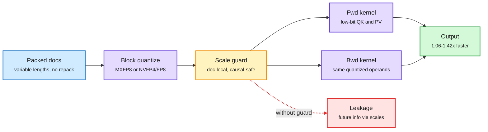
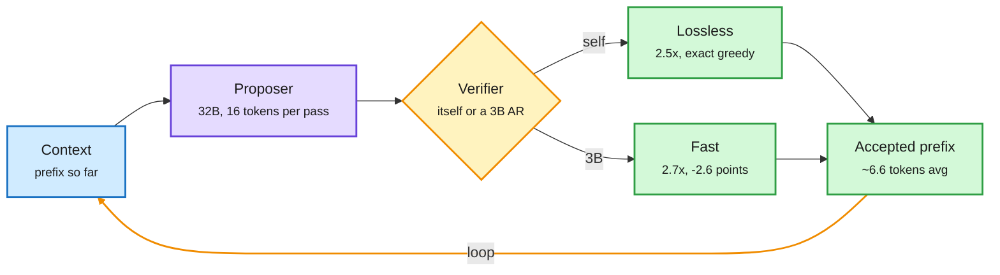
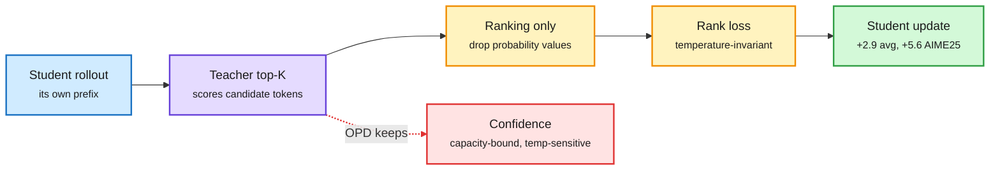
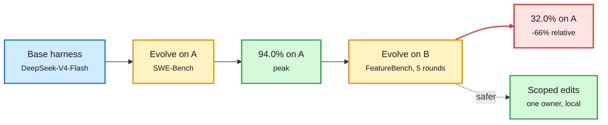

# cere-bro | 2026-11-04

> The day's savings came from deciding less, not computing faster: copy only the teacher's ranking, let the big model draft its own tokens, describe a new skill by what it is not, and scope a scale factor so it cannot see the future. Meanwhile the industry fought over the physical inputs (gigawatts, HBM, China-bound GPUs) that all those savings stretch.

<div class="today3">
<div class="today3-head">🎯 Today's 5 for you</div>
<ol>
<li><span class="verb read">Read</span><strong>FLAMIA.</strong> FP8/FP4 attention kernels for <em>training</em> on Blackwell, including a fix for causal leakage through shared scale factors. Low-bit numerics on B200/B300 sits right in your GPU-kernel core. <a href="https://arxiv.org/abs/2611.03344">arXiv</a></li>
<li><span class="verb read">Read</span><strong>ProVe.</strong> Speculative decoding with the roles reversed: the 32B target drafts 16 tokens per pass and verifies itself losslessly at 2.5x. A clean new point in the drafter design space you track. <a href="https://arxiv.org/abs/2610.27815">arXiv</a></li>
<li><span class="verb read">Read</span><strong>Skill++ lifelong skill routing.</strong> New skills silently steal old skills' routes. A contrastive description rewrite lifts full recall from 36% to 76% at 731 skills. Routing meets your harness theme. <a href="https://arxiv.org/abs/2611.00544">arXiv</a></li>
<li><span class="verb skim">Skim</span><strong>SpaceX's 13GW and the HBM loophole.</strong> SemiAnalysis on the fastest datacenter builder alive, plus how HBM reaches China mounted on weak CPUs. Compute and memory supply, your semiconductor beat. <a href="https://newsletter.semianalysis.com/p/elon-is-doing-it-again-spacex-will">SemiAnalysis</a></li>
<li><span class="verb skim">Skim</span><strong>Order-only distillation (O³PD).</strong> Match the teacher's token ranking, not its probabilities. It wins in all six pairs with no temperature tuning. A cheap swap for any OPD pipeline. Skip the weight-space-programming hype and the "Karpathy at Anthropic" engagement threads. <a href="https://arxiv.org/abs/2611.02112">arXiv</a></li>
</ol>
</div>

---

## TL;DR

- **FLAMIA**: MXFP8 attention for Blackwell training, causal-safe and packed-document aware. 1.06-1.42x on the full forward plus backward call.
- **ProVe**: the big model drafts a 16-token block and checks itself. 2.5x throughput, output identical to greedy decoding.
- **Skill++**: adding skills breaks routing to older ones. Rewriting descriptions to say how each skill differs doubles full recall.
- **Harnesses forget**: an evolved harness hit 94% on SWE-Bench, then fell to 32% after five rounds of evolving elsewhere.
- **SpaceX**: SemiAnalysis sees ~13GW planned for 2027 and 3.6GW already under construction. Retrofits now take 91 days.
- **Anthropic designs chips with Claude**: told IPO investors so, and Synopsys and Cadence fell up to 4%.

---

## Deep Dives

### FLAMIA: low-bit attention that is safe to train with on Blackwell

> When one scale factor covers a block that holds both the current token and future ones, its size alone leaks the future. FLAMIA scopes scales so the causal mask actually means something at FP8.

**Source:** HuggingFace Daily Papers
**Links:** [Paper](https://arxiv.org/abs/2611.03344) · [Wiki summary](../../hardware/2026-11-04-flamia-microscaling-attention-blackwell.md)

<div class="dg-title">The scale factor is the leak, so scope it to the past</div>
<div class="dg-sub">Quantize once per token block, reuse it both ways, and never let a scale span a causal or document boundary.</div>



<div class="dg-legend">Blue is input, purple is kernel work, amber is the scale guard, green is the result, red is the failure mode it prevents.</div>

**What is it about?**
A family of attention kernels for NVIDIA B200 and B300 that run the attention math in 8-bit or 4-bit during training. They use microscaling formats (MXFP8, NVFP4), where each small block of numbers shares one exponent, so precision adapts locally.

**What problem does it solve?**
Blackwell's low-precision tensor cores are much faster than BF16. Until now, attention was the op teams kept in BF16 during training. Quantizing on the fly cost too much. Shared scales could leak future tokens. Forward and backward passes that quantize differently produce gradients for a slightly different function than the one computed.

**What's the core novelty?**
Token-block scaling, so one quantized copy of Q, K and V works for both QKᵀ and its transpose in the backward pass. That removes a second quantization pass. Scales are scoped so no block mixes past and future positions or two packed documents. Forward and backward use the same numerics. Packed variable-length batches run in place, with workload-aware scheduling.

**Key takeaways**
- MXFP8 path: 1.10-1.40x on B200 and 1.06-1.42x on B300 for the full fwd+bwd attention call, quantization included, against the fastest baseline per workload.
- Training stability and quality hold on Llama-style pretraining.
- Causal leakage through scales is real. A causal mask on scores is not enough when the scales were computed over future keys.

**Gaps in the study**
Validated on Llama-style pretraining only. There are no long RL post-training runs, where the 11-03 training-inference mismatch paper found that small numeric biases compound. NVFP4 quality at frontier scale is not shown.

**Industrial implication**
Expect FP8 attention to become a default training option on Blackwell within a couple of quarters, in TransformerEngine-style libraries. The causal-safe scaling rule should also carry over to chunked prefill, where packed requests from different tenants share kernels.

**Research angle.** Two open threads. First, the same leak exists at inference whenever KV-cache quantization groups span requests. Nobody has measured it as a privacy channel. Second, forward and backward consistency inside one kernel is the micro version of the sampler-trainer mismatch (11-03: engine numerics add a constant bias to RL updates). A shared numerics contract from serving engine to training kernel is the missing piece.

→ [Full summary](../../hardware/2026-11-04-flamia-microscaling-attention-blackwell.md)

---

### ProVe: let the big model write the draft

> Speculative decoding usually runs a weak drafter and a strong checker. ProVe flips it: the strong model drafts 16 tokens at once, and the check can be itself.

**Source:** HuggingFace Daily Papers
**Links:** [Paper](https://arxiv.org/abs/2610.27815) · [Wiki summary](../../inference-efficiency/2026-11-04-prove-proposer-verifier-decoding.md)

<div class="dg-title">The big model drafts the block, a second pass decides how much to keep</div>
<div class="dg-sub">Two forward passes per step, about 6.6 accepted tokens on GSM8K.</div>



<div class="dg-legend">Blue is input, purple is the fine-tuned large model, amber is the verification choice, green is accepted output.</div>

**What is it about?**
A decoding method where an ordinary autoregressive (AR, one-token-at-a-time) checkpoint is fine-tuned to predict a block of 16 future tokens in one forward pass. A second forward pass verifies the block and keeps the longest correct prefix.

**What problem does it solve?**
Speculative decoding (a cheap model guesses tokens, the expensive model checks them in parallel) is capped by how often the drafter agrees with the target. It also needs a separate drafter to train and keep in sync. ProVe removes the drafter.

**What's the core novelty?**
Reversing who drafts. The target model proposes, so its proposals agree with itself far more often. Verification can be the proposer's own AR pass (lossless) or a 3B model (faster, slightly lossy). That gives a speed-accuracy dial.

**Key takeaways**
- A 16-token block gives an average AR-matching prefix of 6.6 tokens on GSM8K.
- ProVe-lossless: 2.5x average AR throughput across six benchmarks with a 32B proposer, and no draft head.
- With a 3B verifier: 2.7x at 2.6 accuracy points below AR.

**Gaps in the study**
Dense 32B only. There are no batch-size sweeps, and block proposal costs compute that is only free at low batch. No MoE results.

**Industrial implication**
For latency-bound single-user serving (local inference, coding agents at batch 1), ProVe-lossless is attractive. It removes the drafter-maintenance burden that slows every model refresh. Inference engines will want a "block-propose" mode next to MTP (multi-token prediction heads).

**Research angle.** This is the third self-drafting idea in a week. Soft-MTP (10-31) showed the MTP training gradient is a KL self-distillation term that helps the model draft for itself. Cohere (11-03) showed fine-grained MoE verify passes are cheap because adjacent tokens share 20-45% of their experts. The open question is whether a 16-token proposal on an MoE keeps that expert locality or spreads across many experts. If it holds, ProVe on MoE could beat both.

→ [Full summary](../../inference-efficiency/2026-11-04-prove-proposer-verifier-decoding.md)

---

### Order-only on-policy distillation: copy the preference, drop the confidence

> A small student cannot match a big teacher's confidence, so stop asking it to. Matching only the teacher's token ranking beats standard on-policy distillation in every pair tested.

**Source:** HuggingFace Daily Papers (with TESD and DecisionRank the same day)
**Links:** [O³PD](https://arxiv.org/abs/2611.02112) · [TESD](https://arxiv.org/abs/2610.38637) · [DecisionRank](https://arxiv.org/abs/2610.42128) · [Wiki summary](../../inference-efficiency/2026-11-04-order-only-on-policy-distillation.md)

<div class="dg-title">Copy the teacher's preferences, not its confidence</div>
<div class="dg-sub">Same on-policy loop as OPD; only the loss target changes.</div>



<div class="dg-legend">Blue is the student's own text, purple is the teacher, amber is the new loss, green is the result, red is what O³PD throws away.</div>

**What is it about?**
On-policy distillation (OPD: the student writes its own text and is trained toward the teacher's token probabilities on that text) with a different target. The student only learns to reproduce the *order* of the teacher's top-K tokens at each step.

**What problem does it solve?**
Teacher probabilities mix two signals: which token is best, and how sure the teacher is. Sureness depends on the teacher's size and calibration, which a small student may never match. It also changes with the teacher's sampling temperature, which needs tuning.

**What's the core novelty?**
An ordinal loss that ignores probability values. It does not change with teacher temperature, so there is nothing to tune. Other ranking losses work about as well, so the gain comes from ranking supervision itself, not one loss trick.

**Key takeaways**
- Beats OPD on the HMMT25/AIME24/AIME25 average in all six teacher-student pairs, by up to 2.9 points (up to 5.6 on AIME25).
- The student ends up *further* from the teacher's probabilities but closer to its rankings, and stronger.
- Same day, TESD fixes stalled self-distillation by training the self-teacher with correctness rewards. DecisionRank distills a 27B generative reranker into a 1.7B one-pass scorer that beats it on TREC DL, and its 8B version runs 24.5x faster than a generative listwise reranker.

**Gaps in the study**
Math benchmarks only. No calibration measurements, which matter if the student is later used for confidence-based routing or abstention.

**Industrial implication**
This is a near drop-in change for any team running OPD for small reasoning models. It also removes a temperature sweep from every run. DecisionRank is the more immediate production story: reranking without decoding at 24.5x the speed.

**Research angle.** This is the fourth distillation paper since 10-31 to change *what* the student copies. WISD (10-31) distilled against a deliberately weakened copy of the model. Soft-MTP (10-31) kept only the KL part of multi-token prediction. The Extrapolation Cliff paper (05-14) gave a closed-form teacher-student gap beyond which OPD collapses. A testable link: if rank-only targets shrink the *effective* gap, the cliff should move outward. Nobody has measured that yet.

→ [Full summary](../../inference-efficiency/2026-11-04-order-only-on-policy-distillation.md)

---

### Skill++: why adding a skill breaks your agent's other skills

> Your router did not change and your old skill did not change, yet the old skill stopped being picked. The new skill's description took its place.

**Source:** arXiv via [@dair_ai](https://x.com/dair_ai/status/2117612013258228030) on X (DAIR-curated, social-confirmed); HarnessRouter via [@akshay_pachaar](https://x.com/akshay_pachaar/status/2117605592999313843)
**Links:** [Paper](https://arxiv.org/abs/2611.00544) · [HarnessRouter](https://github.com/HarnessRouter/harnessrouter) · [Wiki summary](../../ai-routing/2026-11-04-skill-routing-interference-and-harnessrouter.md)

<div class="dg-title">A new skill can silently steal an old skill's traffic</div>
<div class="dg-sub">The fix is a contrastive description written when the skill is added, not a better router.</div>

```mermaid
flowchart LR
  N["New skill<br/><small>name + description</small>"] --> K["Nearest skill<br/><small>closest existing metadata</small>"]
  K --> W["Rewrite<br/><small>supports, differs, excludes</small>"]
  W --> Lib["Library<br/><small>731 skills, 10 sessions</small>"]
  Q["Query"] --> R{"Router<br/><small>reads metadata only</small>"}
  Lib --> R
  R -->|76.3% full recall| OK["Right skills<br/><small>vs 36.4% before</small>"]
  N -.->|no rewrite| X["Interference<br/><small>substitution, crowding</small>"]
  classDef input fill:#d0ebff,stroke:#1971c2,color:#1b1b1b,stroke-width:2px
  classDef core fill:#e5dbff,stroke:#6741d9,color:#1b1b1b,stroke-width:2px
  classDef loop fill:#fff3bf,stroke:#f08c00,color:#1b1b1b,stroke-width:2px
  classDef exit fill:#d3f9d8,stroke:#2f9e44,color:#1b1b1b,stroke-width:2px
  classDef err fill:#ffe3e3,stroke:#e03131,color:#1b1b1b,stroke-width:2px
  class N,Q input
  class K,W core
  class R loop
  class Lib,OK exit
  class X err
  linkStyle 6 stroke:#2f9e44,stroke-width:2px
  linkStyle 7 stroke:#e03131,stroke-width:2px
```

<div class="dg-legend">Blue is input, purple is the metadata rewrite, amber is the router, green is correct routing, red is the interference failure.</div>

**What is it about?**
Agents load skills by progressive disclosure: the router reads only each skill's name and description, then loads the bodies it picks. Skill++ studies what happens as that library keeps growing.

**What problem does it solve?**
A new skill with similar metadata can replace an older one (substitution) or crowd it out of the top picks (crowding). Old routes break with no change to the old skill or the router. The paper calls this lifelong skill routing, a continual-learning problem.

**What's the core novelty?**
Fix the metadata, not the router. Each incoming skill's name and description is rewritten to say what it supports, how it differs from its nearest existing skill, and what it excludes. No router training and no labels.

**Key takeaways**
- At 731 skills over ten sessions, the router picks every required skill for 76.3% of queries, against 36.4% with original metadata.
- Substitution errors nearly vanish. Crowding errors halve.
- Holds across three benchmarks, five routers and the Codex CLI harness.
- Same evening, HarnessRouter's UHP put 30 harnesses behind one API. It reports 25-64% cost cuts from swapping only the harness at a fixed model (vendor numbers).

**Gaps in the study**
It assumes descriptions match skill bodies, which public skills often violate (the paper notes this). No cost or latency numbers for the rewrite step at scale.

**Industrial implication**
Every agent platform with a skill or plugin marketplace has this bug today. Expect "how this differs from X" fields in skill manifests, and dedup checks at install time, within a quarter or two.

**Research angle.** Routing in this wiki keeps getting new axes: model (AgentBaton, 10-30, which found capable-to-cheap handoff saves 65.9% of API cost), effort, memory cluster (Routed Continual Learning, 11-01), and now skill and harness. Skill++ is the first to show *interference between routes as the option set grows*. Nobody has measured the same effect for model routers, where adding a new model to the pool could steal traffic from a better old one.

→ [Full summary](../../ai-routing/2026-11-04-skill-routing-interference-and-harnessrouter.md)

---

### XLA:TPU at hyperscale: agent swarms hunting silent miscompilations

> The scariest compiler bug raises no error. Google's agents have fixed 142 of them, and the bottleneck is now human review.

**Source:** arXiv (Google) via [@omarsar0](https://x.com/omarsar0/status/2117613273189376072) on X, DAIR-curated
**Links:** [Paper](https://arxiv.org/abs/2611.00624) · [Wiki summary](../../hardware/2026-11-04-xla-tpu-compiler-correctness-agent-swarms.md)

<div class="dg-title">Silent wrong answers are found by fuzzing, shrunk by bisection, fixed by agents</div>
<div class="dg-sub">The human reviewer is the bottleneck, so a filter sits in front of them.</div>

```mermaid
flowchart LR
  G["Graphs<br/><small>synthetic + production</small>"] --> Fz["Fuzz + autotune checks<br/><small>numeric drift, corruption</small>"]
  Fz --> B["Bisect<br/><small>down to one fused op</small>"]
  B --> A["Agent swarm<br/><small>repro, stress test, patch</small>"]
  A --> PF{"Adversarial filter<br/><small>before human review</small>"}
  PF -->|pass| H["Merged fix<br/><small>142+ resolved</small>"]
  PF -->|reject| A
  classDef input fill:#d0ebff,stroke:#1971c2,color:#1b1b1b,stroke-width:2px
  classDef core fill:#e5dbff,stroke:#6741d9,color:#1b1b1b,stroke-width:2px
  classDef loop fill:#fff3bf,stroke:#f08c00,color:#1b1b1b,stroke-width:2px
  classDef exit fill:#d3f9d8,stroke:#2f9e44,color:#1b1b1b,stroke-width:2px
  class G input
  class Fz,B,A core
  class PF loop
  class H exit
  linkStyle 5 stroke:#2f9e44,stroke-width:2px
  linkStyle 6 stroke:#f08c00,stroke-width:2px
```

<div class="dg-legend">Blue is input, purple is detection and repair, amber is the review gate and retry loop, green is merged fixes.</div>

**What is it about?**
How Google keeps its TPU compiler (XLA, which turns model graphs into fused TPU kernels) correct while it keeps adding aggressive optimizations.

**What problem does it solve?**
Silent miscompilations. Numbers drift or buffers get corrupted with no error raised. That can waste a multi-million-dollar training run or quietly degrade serving.

**What's the core novelty?**
A full pipeline. Fuzzing uses synthetic plus real production graphs. Checks run alongside the autotuner. Bisection narrows a full-workload failure to one op inside one fused kernel. Agent swarms are deliberately steered toward silent corruption, not easy crash bugs.

**Key takeaways**
- 142+ bugs resolved, 103 more findings under review.
- Reviewer effort grew faster than fix complexity. Agent patches needed adversarial pre-filtering before humans saw them.
- Silent numeric bugs are the high-value target, because crashes find themselves.

**Gaps in the study**
No rate of false-positive or wrong patches before filtering. No public cost per fixed bug.

**Industrial implication**
Every team writing fused kernels (Triton, CUTLASS, the vLLM and SGLang kernel stacks) has the same problem at smaller scale. A reference-execution oracle plus agent bisection is now a proven recipe worth copying.

**Research angle.** The wiki's kernel thread (column-major MoE tiles on 11-02, fused retrieval on 10-29, batch-variant logits on 11-01) is about doing more per launch. This is its correctness bill. An open problem: verifying low-bit kernels like FLAMIA, where "correct" is a tolerance band, not bit equality.

→ [Full summary](../../hardware/2026-11-04-xla-tpu-compiler-correctness-agent-swarms.md)

---

### SemiAnalysis: SpaceX will be the world's biggest AI cloud

> SpaceX now builds a 210MW retrofit in 91 days and plans about 13GW for 2027. That is roughly Google's entire 27-year datacenter footprint in 18 months.

**Source:** SemiAnalysis (essay), with The Information, The Decoder and SambaNova on the supply side
**Links:** [SemiAnalysis](https://newsletter.semianalysis.com/p/elon-is-doing-it-again-spacex-will) · [HBM smuggling](https://www.theinformation.com/articles/smugglers-get-expensive-memory-chips-china-south-korea) · [Wiki summary](../../hardware/2026-11-04-spacex-ai-cloud-and-china-memory-loophole.md)

**What is it about?**
An argument that SpaceX (now running the xAI Colossus sites) will out-build every other AI cloud, backed by satellite imagery, permits and power tracking.

**What problem does it solve?**
It answers the pushback on SpaceX's "10GW in 2027" claim. Two months later, SemiAnalysis sees 3.6GW under construction, more than 9GW of identified capacity, and a revised target of about 13GW.

**What's the core novelty?**
The mechanism is speed. Retrofits went from 122 days (150MW) to 91 days (210MW). A greenfield site targets about 4 months, against an industry norm of 8-12. Rocket campuses at Starbase are becoming datacenters. The TeraFab chip-fab site likely hosts one for third-party renting. Power is chosen on the fly: more than 8GW behind the meter, plus 5.9GWh of batteries at Colossus 2. Labour runs at about 3k workers per GW, and Tesla likely makes modular electrical and mechanical gear.

**Key takeaways**
- Vertical integration of power, construction and eventually fabs is the moat, not GPU access alone.
- The Anthropic and Google deals made SpaceX "the most profitable neocloud" in SemiAnalysis's framing.
- Same day, the supply map tightened. HBM reaches China legally mounted next to sub-threshold CPUs (rules rate a package by its processor). Huawei tells buyers to find their own HBM. Nvidia tells clouds to limit China exposure (reportedly 51%+ non-Chinese).

**Gaps in the study**
Much of the pricing and power analysis is paywalled. Memory supply is the obvious constraint and the essay does not address it: the 11-03 numbers had GPU lead times at 45 weeks and SK hynix's capacity contracted through 2028.

**Industrial implication**
If SpaceX lands even 9GW, it becomes a price-setter for frontier training capacity in 2027. Rivals' 8-12 month build times become a competitive liability, not an industry norm.

**Research angle.** Compute is getting more concentrated while the research below stretches each unit further. FLAMIA's low-bit training, StateBench's fixed-size recurrent memory, ProVe's drafter-free decoding. Watch whether efficiency gains reach the small deployments, or mostly widen the margin of whoever owns the gigawatts.

→ [Full summary](../../hardware/2026-11-04-spacex-ai-cloud-and-china-memory-loophole.md)

---

### Self-evolving harnesses forget, and the guardrails arriving around them

> An agent harness evolved to 94% on SWE-Bench. Five rounds of evolving on another benchmark took it to 32%.

**Source:** HuggingFace Daily Papers, plus SPAR and OpenVLHarness from the X feed
**Links:** [Continual evolution study](https://arxiv.org/abs/2611.03219) · [LeanGuard](https://arxiv.org/abs/2611.02332) · [SPAR](https://arxiv.org/abs/2611.01695) · [Wiki summary](../../agentic-systems/2026-11-04-continual-harness-evolution-forgetting.md)

<div class="dg-title">Evolve on B and the harness forgets A</div>
<div class="dg-sub">94% to 32% on SWE-Bench in five rounds of evolving elsewhere.</div>



<div class="dg-legend">Blue is the start, amber is an evolution phase, green is a good state, red is forgetting.</div>

**What is it about?**
A study of agent harnesses (the prompts, tools and control code around a model) that rewrite themselves from results, run continually across a sequence of datasets.

**What problem does it solve?**
Harness self-evolution is usually reported on one benchmark. Real deployments drift across tasks. This paper measures what happens to old skills when evolution continues.

**What's the core novelty?**
Six evolution orders over three software-engineering datasets with two evolution methods. That turns "self-evolving" into a continual-learning measurement.

**Key takeaways**
- Meta-Harness on DeepSeek-V4-Flash: 94.0% on SWE-Bench after evolving on it, then 32.0% by round five of evolving on FeatureBench.
- LeanGuard checks every tool call against a Lean4 policy that fails closed. It ran 0 forbidden calls where unguarded agents ran 33+, and cut prompt injection from 57.9% to 5.9% with no significant loss in task success.
- SPAR (Alibaba) evolves a sales playbook in a live A/B test across 200,000+ merchants (+15.8% conversion). It first works out whether a lost deal was the strategy's fault before changing the playbook.

**Gaps in the study**
Only two evolution methods. No test of the obvious fix (per-task harness branches plus routing between them).

**Industrial implication**
Teams shipping self-improving agents need regression suites on *old* tasks, gating every self-edit, the same way ML teams gate model updates. Expect "harness CI" to become a product category.

**Research angle.** This puts a hard number on the 10-29 finding that ReasoningBank, GEPA and Meta-Harness trade stability for plasticity because global prompt edits overwrite older knowledge. The fixes that keep showing up are all *local*: EMMA (10-29) gives each self-edit one owner, Skill++ (today) edits one skill's metadata, and SPAR attributes before it edits. A local-edits-plus-router design is the testable answer.

→ [Full summary](../../agentic-systems/2026-11-04-continual-harness-evolution-forgetting.md)

---

### StateBench (Ai2): where transformers and recurrent models break on state tracking

> Frontier models drop to 13% on long shell-game-style tracking. A 275M Gated DeltaNet trained for it stays near perfect at 10x its training length.

**Source:** Ai2 (lab watcher + HF blog), with DAMI, Library of Layers and BYOD from HuggingFace
**Links:** [Ai2 post](https://allenai.org/blog/statebench) · [DAMI](https://arxiv.org/abs/2610.41994) · [Library of Layers](https://arxiv.org/abs/2611.03526) · [Wiki summary](../../llms-foundation-models/2026-11-04-statebench-and-linear-attention-memory.md)

**What is it about?**
A benchmark for state tracking across long documents, with four levels drawn from Krohn-Rhodes theory (which breaks state-tracking problems into basic algebraic building blocks). The levels are: a value set once, a value reassigned, a value updated from itself (`x = x + 5`), and assignment by reference and swaps (the five-cup shell game).

**What problem does it solve?**
Existing tests mostly target the hardest cases, so they cannot show *which* level each architecture can handle. That matters now that hybrid models with linear-attention layers are common.

**What's the core novelty?**
Four levels built from the same assignment sequence, so difficulty is the only variable. The same problem is tested in several formats.

**Key takeaways**
- Gemini 3.8 Flash, Claude Opus 5.5 and GPT-6 Sol/Luna handle the first two levels. On the longest general-finite problems they fall to 13% or lower.
- Trained directly, Gated DeltaNet and hybrids generalize almost perfectly on the first three levels to tens of thousands of steps (250x training length). Transformers never learn the hardest level.
- Format sensitivity: one hybrid aced RULER-style lookup but was near chance on the same problem framed as spreadsheet edits.
- DAMI shows linear-attention memory range is mostly fixed at initialization. Setting decay timescales deliberately adds 5.3-16.7 points of long-context retrieval across five recurrent families.

**Gaps in the study**
A fixed number of entities, while real conversations keep adding new ones. Hybrid behaviour under realistic pretraining mixes is still open.

**Industrial implication**
Recurrent layers replace a growing KV cache with a fixed-size state. StateBench says that trade costs nothing on tracking, and even helps, if training data covers it. Expect state-tracking curricula to show up in hybrid pretraining.

→ [Full summary](../../llms-foundation-models/2026-11-04-statebench-and-linear-attention-memory.md)

---

### Efficiency shorts: SVD rank search, a 1-bit 552B MoE on one box, and cache-hit economics

> In long agent loops, the cached-input price is the bill. 4.7M of 4.8M tokens were cache hits in one $0.28 run.

**Source:** HuggingFace, Ken Huang (Gmail), The Decoder, X feed
**Links:** [LEMS](https://arxiv.org/abs/2610.32878) · [DeepSeek 1-bit on DGX Spark](https://kenhuangus.substack.com/p/deploying-deepseek-v41-flash-on-nvidia) · [Message Threads](https://the-decoder.com/anthropics-message-threads-cut-time-to-first-token-by-35-percent-for-long-conversations/) · [Wiki summary](../../inference-efficiency/2026-11-04-efficiency-shorts.md)

**What is it about?**
Four compact efficiency results that each move one cost lever.

**What problem does it solve?**
How to cut ranks, memory, upload time and cached-token cost without new hardware.

**What's the core novelty?**
- **LEMS + KFAC-SVD:** low-rank compression with a global rank budget split by an integer linear program over an error model that tracks how errors propagate across layers. Up to +4.8 points zero-shot, holding to 70B, and 15% better perplexity.
- **DeepSeek-V4.1-Flash at 1-bit:** a 552B MoE plus a 196B Engram memory table (sparse n-gram lookup for recall) fit in 128 GB on one DGX Spark at 18.1 tok/s, with a 4-bit MLA (compressed-latent) KV cache. 2-bit runs out of memory.
- **Anthropic Message Threads:** agents send only the conversation diff, so time to first token drops about 35% at 500K-1M tokens.

**Key takeaways**
- LongCat-2.5 finished an agent build for $0.28 against $0.82 for Qwen3.8-Max, mostly through cache hits billed at $0.006/M versus $0.30/M uncached.
- Splitting the 1-bit model over LAN to a Mac cut decode below 4 tok/s. Interconnect sets the multi-box ceiling.

**Gaps in the study**
The 1-bit accuracy claims are paywalled and unverified. Message Threads gives no cost figure.

**Industrial implication**
Provider pricing on cached input, and API features that avoid resending context, now drive agent unit economics more than headline per-token prices.

→ [Full summary](../../inference-efficiency/2026-11-04-efficiency-shorts.md)

---

## Industry Pulse

- **Anthropic designs chips with Claude** — it told IPO investors a 15-person chip team uses Claude for custom-chip design ([The Information](https://www.theinformation.com/articles/anthropic-touts-claudes-chip-design-skills-ipo-investors)).
- **Synopsys and Cadence fall** — up to 4% on the Anthropic chip-design report, an early sign of AI pressure on EDA software ([The Information](https://www.theinformation.com/briefings/synopsys-cadence-shares-drop-4-information-report)).
- **Nvidia limits China exposure at clouds** — customers told to cut Chinese business, reportedly to under 49% of capacity ([The Information](https://www.theinformation.com/briefings/nvidia-tells-cloud-clients-take-less-china-business)).
- **HBM smuggling loophole** — HBM ships to China mounted next to sub-threshold CPUs, and Huawei tells customers to source memory themselves ([The Decoder](https://the-decoder.com/huawei-tells-customers-to-find-their-own-ai-chip-memory-effectively-outsourcing-procurement-to-the-black-market/)).
- **AMD guides up** — current-quarter revenue up about 66% YoY, and more than 80% growth next year ([The Information](https://www.theinformation.com/briefings/amd-projects-rapid-revenue-acceleration-fourth-quarter)).
- **Apple's margin squeezed by memory** — December-quarter growth guided to 7-10%, gross margin down on memory costs ([The Information](https://www.theinformation.com/articles/apples-slowdown)).
- **NVIDIA's "AI-defined fab"** — COMSOL multiphysics runs up to 10x faster on cuDSS for semiconductor process work ([NVIDIA](https://blogs.nvidia.com/blog/ai-semiconductor-fabs/)).
- **Shopify falls 7.6%** — subscription gross margin fell partly on AI spend, despite revenue up 32% to $3.7B ([The Information](https://www.theinformation.com/briefings/shopify-stock-falls-7-6-company-discloses-profit-margin-drop-due-ai)).
- **LinkedIn swaps out some OpenAI models** — Hiring Assistant cost stayed flat while usage grew, a routing story in practice ([The Information](https://www.theinformation.com/articles/linkedin-swapped-openai-models-keep-server-costs-flat)).
- **Canva's first layoffs** — 22% of staff (1,271) must change roles, relocate or leave after AI rollout problems ([The Information](https://www.theinformation.com/briefings/canva-lays-workers-ai-rollout-problems)).
- **GPT-6 Astra designs hardware** — OpenAI says it built a Codex device (enclosure, PCB, firmware) in under a week, with tolerance fixes needed ([The Decoder](https://the-decoder.com/openai-says-gpt-6-astra-designed-a-hardware-device-from-scratch-in-under-a-week/)).
- **OpenAI bug bounty quadruples** — payouts now up to $172,000 alongside an internal security sprint ([The Decoder](https://the-decoder.com/bug-hunters-can-now-earn-up-to-172000-from-openai-as-company-ramps-up-security/)).
- **Cohere Model Vault adds open models** — DeepSeek V4.1 Flash, Gemma 4, GPT-OSS and Phi on managed inference with zero data retention ([Cohere](https://cohere.com/blog/open-source-model-vault)).
- **Kimi K3 in-country on Bedrock India** — Mumbai and Hyderabad data residency, with Ultrahuman citing prompt-caching savings ([AWS](https://aws.amazon.com/blogs/machine-learning/introducing-india-based-inference-for-kimi-k3-on-amazon-bedrock/)).
- **Meta F3 Lightning** — per-feature releases for 20,000-feature ads models reach production about 3.6x faster at no extra compute ([Meta](https://engineering.fb.com/2026/11/03/ml-applications/f3-lightning-how-meta-accelerates-ads-ml-features-to-production/)).
- **Google ties school Search to AI** — from 2027, schools that block Google's AI also lose Search ([The Decoder](https://the-decoder.com/schools-that-turn-off-googles-ai-will-lose-search-too-starting-in-2027/)).
- **Midterms reshape data-center politics** — Democrats take both chambers and Texas, and 20+ governor candidates back data-center moratoria ([The Information](https://www.theinformation.com/briefings/stunning-democrat-victories-texas-bring-uncertainty-data-centers-musk)).
- **AI ranked last for voters** — only 56% called AI and data centers important, against 90% for corruption ([The Decoder](https://the-decoder.com/exit-polls-show-ai-ranked-last-among-voter-priorities-in-the-2026-u-s-midterms/)).
- **Monitorability is falling, says UK AISI** — Joseph Bloom reports declining ability to see what models are doing ([The Information](https://www.theinformation.com/articles/ai-models-getting-harder-monitor-says-u-k-governments-joseph-bloom)).
- **China adds AI job-risk monitoring** — the NDRC plans full-lifecycle AI safety standards and job-impact reviews ([The Information](https://www.theinformation.com/briefings/china-signals-plans-broad-ai-safety-guardrails)).
- **LLM claims expire fast** — Stanford found 44% of 50 cited LLM claims expired, with an average lifespan of 15.7 months ([The Decoder](https://the-decoder.com/rapid-llm-development-is-outrunning-the-research-meant-to-explain-it-study-finds/)).
- **OpenAI hires for policy and comms** — ex-Army Secretary Dan Driscoll for national security, Uber's Jill Hazelbaker as corporate affairs chief ([The Decoder](https://the-decoder.com/openai-hires-ex-army-secretary-gaining-bipartisan-reach-just-as-midterms-loom/)).
- **Agents at Atlassian** — 77% of recent PRs across 6,000 engineers were written by agents ([@Ronald_vanLoon](https://x.com/Ronald_vanLoon/status/2117618713830756473)).
- **Binance's $6.3B breach** — began with a fake job-interview assignment and an AI tool ([The Information](https://www.theinformation.com/briefings/binance-says-hackers-used-bogus-job-interview-ai-tool)).

**Funding, valuations, and compute deals**

- **Anthropic IPO** — heading to an offering later this month at a valuation of around $1.5T ([The Information](https://www.theinformation.com/articles/anthropic-touts-claudes-chip-design-skills-ipo-investors)).
- **Salesforce buys Cresta for $2.7B** — AI contact-center software, part of an M&A rush before antitrust may tighten ([The Information](https://www.theinformation.com/briefings/exclusive-salesforce-acquires-startup-cresta-2-7-billion)).
- **SambaNova: $1B first close at $11B** — plus SN50 decode chips in Supermicro disaggregated racks next to NVIDIA GPUs ([SambaNova](https://x.com/SambaNovaAI/status/2117624472391839961)).
- **SK hynix takes 9% of Penguin Solutions** — buys SK Telecom's $377M preferred stake, gaining CXL and SSD KV-cache exposure ([@StockSavvyShay](https://x.com/StockSavvyShay/status/2117619772334776521)).
- **SpaceX targets ~13GW in 2027** — 3.6GW under construction, with SemiAnalysis tracking more than 9GW of sites ([SemiAnalysis](https://newsletter.semianalysis.com/p/elon-is-doing-it-again-spacex-will)).
- **Agent37 (YC) launches** — month-long gVisor agent sandboxes at $4.76, claiming 94% below other providers ([Agent37](https://agent37.com)).

---

## Global View

**Cost control has moved from the price sheet into the system, and buyers are already living there.** LinkedIn kept Hiring Assistant's cost flat by swapping out some OpenAI models, while Shopify lost 7.6% for failing to keep AI spend off its margin. That extends the 11-03 OpenRouter finding that paying users now spread work across a median of six model families. Today's research adds two new axes to route on. Skill++ shows that a growing skill library silently breaks old routes unless each new skill says how it differs. HarnessRouter claims 25-64% savings from swapping only the harness. A practitioner run where 4.7M of 4.8M tokens were cache hits ($0.28 vs $0.82), together with Anthropic's diff-only Message Threads, says the cheapest token is the one you never resend.

**The industry is fighting over gigawatts and HBM while research learns to need less of both.** SemiAnalysis has SpaceX building ~13GW on 91-day retrofits. HBM leaks to China through a packaging loophole, Nvidia rations China-facing cloud capacity, and SK hynix buys into SSD/CXL KV-cache offload. That matches the 11-03 memory squeeze, which put GPU lead times at 45 weeks and SK hynix at an 80% margin. On the research side, FLAMIA moves Blackwell attention training to FP8. StateBench shows a fixed-size recurrent state can out-track a transformer's growing KV cache once trained for it. ProVe removes the separate drafter model. The gap to watch: SambaNova's SN50 racks are the first product that turns prefill/decode disaggregation (long a serving-paper idea) into a hardware purchase, ahead of most open serving stacks.

**Verification is becoming the scarce skill, at every layer.** Google's agents fix silent TPU miscompilations faster than humans can review them. LeanGuard proves tool calls against a policy, cutting prompt injection from 57.9% to 5.9%. Gradient Flow relays Ion Stoica's coding agent that made a key-value store 6x faster by computing the test answers instead of storing data. The weight-space programming result from 11-02 (GPT-6 Astra edited 0.016% of a Qwen model's weights to lift MATH-500 from 7.9% to 48.1%) drew a replication showing default non-thinking mode already scores 47%. Add Stanford's finding that 44% of cited LLM claims expire within about 15.7 months and UK AISI's report that monitorability is falling: yesterday's FlashProve (provable model identity) looks less like a niche and more like the start of a verification stack.

---

## Looking Ahead

- **Self-drafting reaches MoE.** Within 60 days, a paper or vLLM/SGLang PR reports ProVe-style block proposal or MTP-only drafting on an MoE of 30B+ at 2x+ batch-1 speedup. Signal: an arXiv paper citing ProVe with MoE results, or an engine release note naming block proposal.
- **Skill manifests get a "differs from" field.** Within 90 days, a major agent platform (Claude Code, Codex, Gemini CLI or a skill marketplace) ships install-time duplicate detection or contrastive skill descriptions. Signal: docs or changelog text describing skill collision or overlap warnings.
- **FP8 attention becomes a default training path on Blackwell.** Within 90 days, TransformerEngine, torchtitan or Megatron ships MXFP8 attention for training with causal-safe scaling. Signal: a release note citing FLAMIA-style scale scoping, or an MXFP8 attention flag in a stable release.
- **The HBM loophole closes.** Within 90 days, US export rules start rating packages by memory bandwidth, not processor performance. Signal: a BIS interim final rule or FAQ addressing HBM co-packaged with sub-threshold processors.
- **Anthropic's IPO prices at or above $1.4T in November.** Signal: a priced offering this month, with prospectus language on in-house chips designed with Claude.
