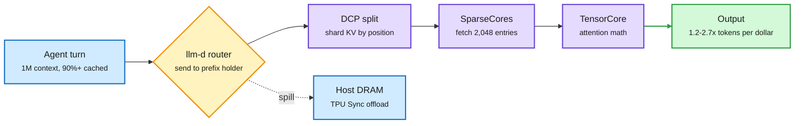
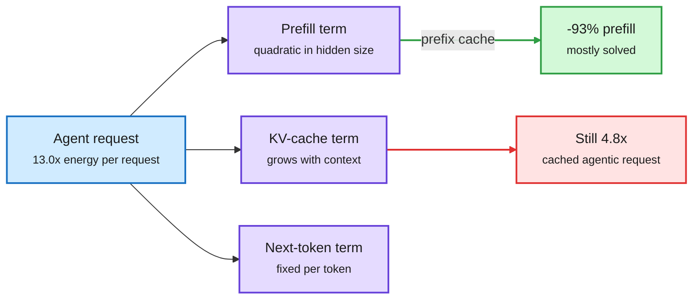
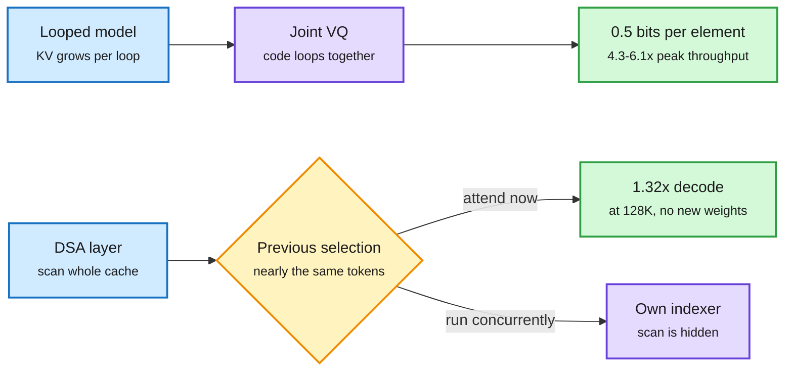
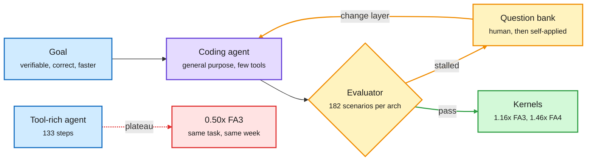
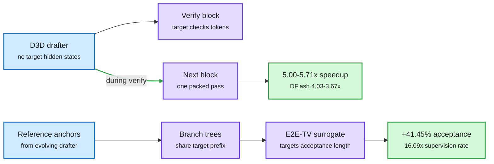
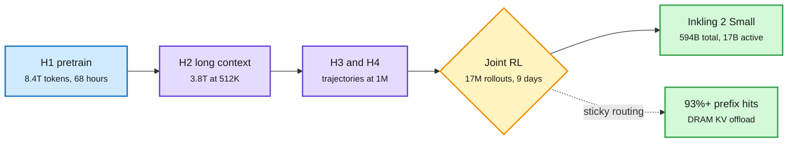
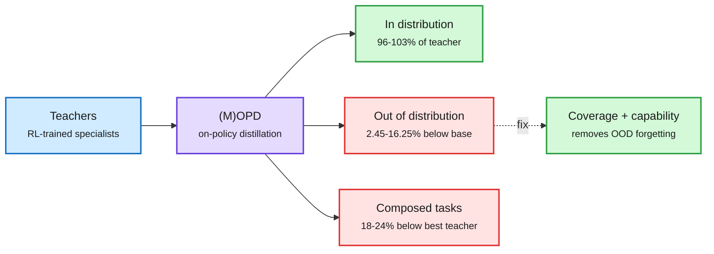
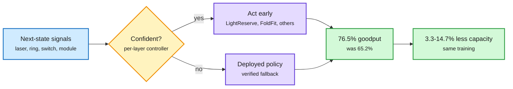

# cere-bro | 2026-11-06

> Chip stocks had their second-worst day since 1994 because new megawatts look scarce, and the window's best research says the same thing from the other side: the cost of a long-context token is a memory cost that prompt caching does not touch. TPUv7 won on KV handling, not math, and the day's cost optimization came from squeezing that memory path in hardware, in scheduling and in bits.

🎯 Today's 5 for you

<ol>
<li>Read<strong>SemiAnalysis on TPUv7 and AgentX.</strong> The first official long-context agent numbers for Google's TPU, plus a recipe list of KV and megakernel tricks you can reuse. GPU hardware and KV cache in one post. <a href="https://newsletter.semianalysis.com/p/tpu-strikes-the-king">SemiAnalysis</a></li>
<li>Read<strong>The SIMPLE Law.</strong> A closed-form energy model: prefix caching removes 93% of prefill energy, yet a cached agent request still costs 4.8x. It changes how you should think about KV-cache pricing. <a href="https://arxiv.org/abs/2611.03330">arXiv</a></li>
<li>Read<strong>LoopVQ + Multi-layer Indexer.</strong> KV quantization at 0.5 bits per element, and a no-retrain fix for the indexer scan that dominates sparse attention. Compression and KV cache, both running in SGLang. <a href="https://arxiv.org/abs/2611.05304">LoopVQ</a> · <a href="https://arxiv.org/abs/2611.03768">MLI</a></li>
<li>Skim<strong>KernelSeek.</strong> A question beat a tool-rich agent, 1.13x versus 0.50x FlashAttention-3. GPU optimization that also matches your saved harness theme. <a href="https://arxiv.org/abs/2611.03517">arXiv</a></li>
<li>Track<strong>The chip rout and whether efficiency outruns the backlash.</strong> Semiconductors fell 12.3% and moratoria may touch 45% of planned capacity. Your semiconductor and compute supply beat. Skip "AI therapy trauma" threads and "free MIT library" posts. <a href="https://www.theinformation.com/articles/can-cheaper-ai-outrun-data-center-backlash">The Information</a></li>
</ol>

---

## TL;DR

- **TPUv7 on AgentX**: cheapest FP8 option on GLM-5.2 at 1.2-2.7x tokens per dollar, but native 4-bit GB300 still wins by up to 3.6x.
- **SIMPLE Law**: prefix caching removes prefill energy, not the KV term. A cached agent request still costs 4.8x a normal one.
- **LoopVQ**: KV cache at 0.5 bits per element raises peak serving throughput 4.3-6.1x on small looped models.
- **Inkling 2 Small**: 594B open MoE with a first pretrain phase of 68 hours, all trained in 4-bit. Weights due next week.
- **GPT-6 Cyber**: OpenAI's Critical-rated security model ships to vetted customers, with 948 Linux exploits and 81 new Firefox bugs.
- **METR on Anthropic**: model progress accelerated about 1.9x, roughly 80% from AI. Most supporting evidence was redacted.

---

## Deep Dives

### TPUv7 stakes its claim on agent inference, and the fight is about memory

> Google's TPUv7 now beats NVIDIA's GB300 on some agent workloads without native 4-bit support. But where 4-bit weights work, GB300 can still win by up to 3.6x.

**Source:** SemiAnalysis (full post via RSS and Gmail)
**Links:** [The Iron(wood) Throne](https://newsletter.semianalysis.com/p/tpu-strikes-the-king) · [Wiki summary](../../hardware/2026-11-06-tpu-ironwood-agentx-semianalysis.md)

Most of TPUv7's agentic gain came from the memory path, not the math

GLM-5.3 requests are over 90% cached, so KV capacity sets how many users fit.

Blue is the request and the cache tier, amber is the routing decision, purple is the compute path, green is the result.

**What is it about?**
SemiAnalysis published TPUv7 Ironwood results on AgentX, its benchmark for long-context, multi-turn agent serving, on four open models. It also published a long critique of how NVIDIA now treats outside developers.

**What problem does it solve?**
Until now the TPU had only single-turn results (09-08, when TPUv7 won on total cost but lost on raw speed and time to first token). Agent traffic is where inference spend is heading, and buyers wanted numbers for it.

**What's the core novelty?**
The optimizations, which nearly all target the memory path. Decode context parallelism (DCP) shards the KV cache (stored attention keys and values for every past token) by position, because shared-latent KV cannot be split by head without copying it everywhere. SparseCores gather the 2,048 entries a sparse-attention indexer picks. A one-byte layout overflow that rounded 129 bytes up to 256 was fixed down to 132. Megakernels, which run the whole decode step as one long kernel, remove idle gaps between launches.

**Key takeaways**
- Qwen3.5-397B: TPUv7 at FP8 was 1.67x better per dollar than GB300 FP4. NVIDIA's counter-submission won decode by overtuning it, and stays 1.64x worse across most of the curve.
- GLM-5.2: 1.2-2.7x tokens per dollar of B200, B300 and MI355X at FP8. But GB300 and GB200 FP4 reach 3.6x and 3.5x TPUv7 at 100 tok/s/user, because FP4 halves bytes per weight and small-batch decode is memory-bound.
- Kimi K3: at launch TPUv7 was 0.77-0.91x GB300 per dollar and 1.6x faster for one user. After four NVIDIA software refreshes, GB300 leads by 1.5-2.6x. Rubin previews show 4.3-5.6x over TPUv7.
- Muse Spark Open's head dim of 64 pads 25% of the TPU's systolic array and costs matrix-core GPUs almost nothing. Head dim is now a hardware choice.
- Cache-aware routing in llm-d raised decode cache hits from 56% to 76%. AMD's MonoKernel cut a GLM-5.2 decode step from 2,459 launches to 210, for 2.31x at batch 1.

**Gaps in the study**
Vendors tune their own submissions and cost bases differ. Rubin numbers are unreproduced previews. TPUv7 has no native FP4 until TPUv8 (Q1 2027). SemiAnalysis also sells the cost models it cites.

**Industrial implication**
A real second source for agent serving exists now, and that gives buyers leverage in a tight market. Expect more models to train natively in 4-bit, because that is where GPUs keep their lead, and expect head-dim choices to become part of purchasing talks.

**Research angle.** There is an open conflict here. Together's team (11-05, whose agent-tuned serving hit up to 2.6x tokens per second) calls maximal megakernel fusion the wrong goal for shifting traffic, yet AgentX results make it the main lever on three vendors' hardware. Either AgentX traffic is too stable or Together's is unusually varied. A shared traffic-drift benchmark would settle it.

→ [Full summary](../../hardware/2026-11-06-tpu-ironwood-agentx-semianalysis.md)

---

### The SIMPLE Law: a formula for what a token costs in energy

> Prefix caching removes 93% of prefill energy and none of the KV term, so a fully cached agent request still costs 4.8x a normal one.

**Source:** HuggingFace Daily Papers
**Links:** [Paper](https://arxiv.org/abs/2611.03330) · [Wiki summary](../../inference-efficiency/2026-11-06-simple-law-energy-cost-inference.md)

Prompt caching removes the first bill, not the second

The KV term grows with context on every generated token, and caching cannot reach it.

Blue is the request, purple is the three energy terms, green is what caching fixes, red is what it does not.

**What is it about?**
A four-parameter law for inference energy, derived from a model's architecture instead of fitted per model. It splits energy into prefill, the KV-cache cost in decode, and next-token computation.

**What problem does it solve?**
Tokens are billed the same, but each token enters the KV cache and makes later tokens costlier. No analytical model explained this. The best existing one was a fit that hid architecture inside its coefficients and needed retuning per model.

**What's the core novelty?**
It writes closed forms for compute and memory access in terms of hyperparameters, then keeps only what matters. So it explains as well as predicts, and needs no per-model calibration.

**Key takeaways**
- R2 = 0.969 and 11.97% MAPE over 13 dense models from six families on H100, with error 3.1-3.5x below the state of the art.
- Prefill energy grows quadratically with hidden size. Larger models suffer most from long inputs.
- GQA (grouped-query attention, where query heads share KV heads) cuts per-token energy up to 3x against standard attention.
- Intelligence per Joule peaks at a middle reasoning budget and falls up to 3.14x across a 4.0x budget range.

**Gaps in the study**
Dense models on H100 only. There is no MoE, sparse attention, linear attention or quantization, and that is what the frontier now serves. Energy is also not the same as dollars.

**Industrial implication**
Cached-input discounts reflect prefill savings only. If long-context output tokens keep costing more underneath, expect output pricing tied to context depth, not just cheap cached input.

**Research angle.** This confirms and explains NVIDIA's "You don't need long context" (11-05), which measured 256K context costing 3.6-7x more per generated token than 16K and showed agents lose almost nothing when they compact. It also complicates that digest's caution that compaction destroys prompt-cache hits. A cached prefix saves money on the bill while the KV term keeps burning energy. The extension worth writing is a coefficient table per attention family, so a router could price a request before it runs.

→ [Full summary](../../inference-efficiency/2026-11-06-simple-law-energy-cost-inference.md)

---

### LoopVQ and Multi-layer Indexer: reuse what neighbours already computed

> Looped models store KV per loop, and those copies are nearly the same. Sparse-attention layers pick nearly the same tokens. Both facts turn into free speed.

**Source:** HuggingFace Daily Papers
**Links:** [LoopVQ](https://arxiv.org/abs/2611.05304) · [Multi-layer Indexer](https://arxiv.org/abs/2611.03768) · [Wiki summary](../../inference-efficiency/2026-11-06-loopvq-and-multi-layer-indexer.md)

Reuse what neighbours already computed

LoopVQ reuses across loop steps. MLI reuses across layers. Both exploit the same redundancy.

Blue is the starting cost, purple is the new mechanism, amber is the reuse decision, green is the result.

**What is it about?**
Two long-context savings, both running in SGLang. LoopVQ is vector quantization for the KV cache of looped transformers (models that reapply the same layers several times to save parameters). Multi-layer Indexer (MLI) speeds up DSA (DeepSeek Sparse Attention, where a small indexer picks 2,048 past tokens per query before each layer).

**What problem does it solve?**
Looping saves parameter memory but grows the KV cache linearly with loop count, so the cache becomes the bottleneck. In DSA, the indexer's scan of the whole cache, not the sparse attention after it, is where decode time goes at long context.

**What's the core novelty?**
LoopVQ codes channels from several loop steps jointly, then fine-tunes codebooks to match the full-precision output. MLI lets a layer attend the previous indexer's selection, so each indexer runs alongside its layer's attention instead of blocking it. It needs no retraining or new weights, and its default form changes no kernel.

**Key takeaways**
- LoopVQ at 0.5 bits per element beats prior KV quantizers on Ouro and Huginn models. With TaSQ (an existing KV quantizer), it holds much of BF16 accuracy at 0.25 bits.
- In SGLang, LoopVQ nearly halves decode latency at 32K and lifts peak throughput 4.3x and 6.1x on 1.4B and 2.6B models.
- MLI at 128K reaches 1.32x decode throughput at 1/4 retention, above IndexCache's (dropping indexers on some layers) 1.28x at 1/8, while keeping twice the fresh selections.
- MLI is up to 14.5% faster than IndexCache at equal retention, and accuracy stays within a few points.

**Gaps in the study**
LoopVQ uses only very small models. MLI's accuracy is measured against IndexCache, not the unmodified model, and Kimi K3.1 Pro's Gated DSA is not covered.

**Industrial implication**
MLI is an easy merge for anyone serving GLM or DeepSeek on sparse attention, since it needs no new weights. LoopVQ removes the main objection to looped models on memory-bound hardware.

**Research angle.** This is the third attack on the sparse indexer in a week: CUDA 13.5's batched Top-K (11-05) in a library, TPUv7's SparseCores (today) in silicon, and MLI in scheduling. It also sets up a real contradiction. Dory1.0-4B (11-05) keeps KV only from the last loop, on the theory that earlier loops are disposable, while LoopVQ keeps every loop at sub-1-bit. No one has run them head to head. A bound on KV mutual information across loops would decide it.

→ [Full summary](../../inference-efficiency/2026-11-06-loopvq-and-multi-layer-indexer.md)

---

### KernelSeek: ask, don't equip

> A tool-rich kernel agent stalled at half of FlashAttention-3. A plain coding agent with good questions passed it. Every large gain followed a question, never new information.

**Source:** HuggingFace Daily Papers, with kernel leaderboards from Thinking Machines' Inkling post and [@soumithchintala](https://x.com/soumithchintala/status/2118491856484859968)
**Links:** [Paper](https://arxiv.org/abs/2611.03517) · [Inkling 2 Small benchmarks](https://thinkingmachines.ai/news/inkling-2-small/) · [Wiki summary](../../hardware/2026-11-06-kernelseek-question-driven-kernel-optimization.md)

Direction, not equipment, unlocked the gain

Across 162 human messages, every large gain followed a question and never new information.

Blue is the setup, purple is the agent, amber is the feedback loop, green is the result, red is the baseline that stalled.

**What is it about?**
A coding agent that makes existing CUDA kernels faster using only a minimal harness, a verifiable goal, and short questions at decision points.

**What problem does it solve?**
Kernel agents usually respond to hard targets with more equipment: profilers, disassembly, retrieval, lesson stores. They still stall. The authors argue the missing piece is a hypothesis about where the remaining gap sits.

**What's the core novelty?**
Questions as the control signal. They come first from a human, then from a bank the agent applies to itself. The useful ones moved the agent to a different layer of the system or rejected a limit it had claimed.

**Key takeaways**
- On the same task, hardware and week: tool-rich agent 0.50x FlashAttention-3 after 133 steps. KernelSeek 1.13x.
- It then produced single-file FlashAttention forward kernels for Hopper and Blackwell with no CUTLASS, CuTe, cuBLAS or cuDNN: 1.16x FA3 and 1.46x FA4 by geometric mean, correct on all 182 scenarios.
- Independent scoreboards the same day. On PMPP-Hard (69 kernel tasks): GPT-6 Astra 63, Kimi K3.1 Pro 60.5, Claude Opus 5.5 60, Inkling 2 Small 54.25. On DSA training kernels: Claude Opus 5.5 18.80x, GPT-6 Astra 10.26x, Inkling 2 Small 6.02x, against an untuned public baseline.

**Gaps in the study**
FlashAttention has a clean correctness oracle, and MoE dispatch does not. The share of gain the self-applied bank keeps without a human is the key missing number.

**Industrial implication**
Teams building kernel agents should test a question bank before adding tools. The result is cheap to try, and the traces are public. NVIDIA is already using agent swarms for benchmark counter-submissions, per SemiAnalysis.

**Research angle.** The wiki declared a pattern on 11-05: agents with a fast loop and a bit-exact check beat hand tuning (Together Compiler, SpecPilot, Google's XLA agents). KernelSeek adds the next variable, which is what steers the search. SpecPilot steers with a cost model, and this one steers with words. Does a question bank mined from these traces transfer to TPU or AMD kernels? That is a cheap and clean test.

→ [Full summary](../../hardware/2026-11-06-kernelseek-question-driven-kernel-optimization.md)

---

### Speculative decoding drops its last sequential steps: D3D and SpecOPD

> Parallel drafters still waited for the big model. D3D drafts during verification, and SpecOPD trains without sequential rollouts.

**Source:** HuggingFace Daily Papers
**Links:** [D3D](https://arxiv.org/abs/2611.06425) · [SpecOPD](https://arxiv.org/abs/2611.02846) · [Wiki summary](../../inference-efficiency/2026-11-06-speculative-decoding-specopd-d3d.md)

Stop waiting for the target, at inference and in training

D3D drafts during verification. SpecOPD collects supervision from independent branches.

Blue is the starting point, purple is the work done, green is the result. The top row is inference (D3D), the bottom row is training (SpecOPD).

**What is it about?**
Two papers on speculative decoding, where a cheap drafter guesses a block of tokens and the big model checks them together. D3D changes the drafter. SpecOPD changes how it trains.

**What problem does it solve?**
Drafters like DFlash (a block-at-once drafter that reads the target model's hidden states) must wait for the target before each new block, so drafting and checking take turns. Training has the same problem: on-policy distillation (the student generates and the teacher corrects) collects data through slow draft-and-verify rollouts.

**What's the core novelty?**
D3D is a diffusion drafter that needs no target hidden states, so it drafts the next block while the current one is being verified. SpecOPD shows a block can be supervised using only its reference prefix and draft history, so branches run independently and pack into shared trees.

**Key takeaways**
- D3D averages 5.00x and 5.71x with Qwen3-8B and 32B targets, against 4.03x and 3.67x for DFlash, and hits 7.48x on GSM8K.
- Pruning 5 of D3D's 36 layers keeps over 99% of mean acceptance.
- SpecOPD: up to 41.45% longer mean acceptance, 16.09x supervised-token throughput, up to 3.56x generation speedup. It covers full, linear and sparse attention targets up to 125B.

**Gaps in the study**
D3D's targets are small and dense. Neither paper checks behavior on long agent traces, where Adversarial Speculative Reasoning (11-05) found verification noise shifts behavior after about 30 steps.

**Industrial implication**
Asynchronous drafting removes a latency floor, though it spends compute during verification. Expect drafters to grow, and expect serving engines to need a new scheduling path.

**Research angle.** SpecPilot (11-05) showed an agent loop lifting stock systems from 4.46x to 10.87x at batch 1, meaning released systems reach under half of what is possible. D3D and SpecOPD give part of that gap a clean explanation. ProVe (11-04, where the target proposes and verifies its own blocks) adds a third answer on who should propose. The right drafter-to-target compute split at high batch now needs re-deriving.

→ [Full summary](../../inference-efficiency/2026-11-06-speculative-decoding-specopd-d3d.md)

---

### Inkling 2 Small: a competitive open model on a small training bill

> One pretraining phase took 68 hours, the whole model trained natively in 4-bit, and it would rank #1 among US open models on Code Arena WebDev.

**Source:** Thinking Machines and the X feed ([@soumithchintala](https://x.com/soumithchintala/status/2118490925634556026), [@eliebakouch](https://x.com/eliebakouch/status/2118512391331729860), [@arena](https://x.com/arena/status/2118492327887155680)), with The Decoder, Marin and Hugging Face
**Links:** [Announcement](https://thinkingmachines.ai/news/inkling-2-small/) · [ERNIE 5.5 Flash Base](https://the-decoder.com/baidu-releases-ernie-5-5-flash-base-with-280-billion-parameters-as-an-open-source-foundation-model/) · [Mochi tracker](https://mumtracker.exe.xyz/hero-run-535b) · [MoE Handbook](https://huggingface.co/spaces/huggingface/moe-blogpost) · [Wiki summary](../../llms-foundation-models/2026-11-06-inkling-2-small-and-open-moe-wave.md)

A competitive open model from a few dozen days of training, all in 4-bit

One pretraining phase took 68 hours. Stretching context in stages replaced most of the usual token budget.

Blue and purple are pretraining stages, amber is the RL run, green is the output and the cache behavior that made it affordable.

**What is it about?**
Thinking Machines' second-generation model: a 594B MoE (mixture-of-experts, where each token visits a few specialist sub-networks) with 17B active, image input and variable effort. Weights are promised under Apache 2.0 next week, after external red-teaming.

**What problem does it solve?**
Open frontier models usually need far more data and compute. Thinking Machines targets cost and how easily others can fine-tune the result, instead of raw scale.

**What's the core novelty?**
Every stage ran natively in NVFP4, a 4-bit float format. Most pretraining tokens were spent in staged context stretches, and a single large RL run mixed coding, vision and office work. It also trained on compaction across multiple harnesses.

**Key takeaways**
- About 12T pretraining tokens. RL: 17M+ rollouts, 9 days, 2,048 GPUs, median rollout 43K tokens, 93%+ prefix hits.
- FrontierCode v2.0 25.4% (DeepSeek-V4.1-Flash-1017 leads at 28.5%), DeepSWE v1.1 72.1%, Terminal Bench Science only 5.7%. Scores 31 on the Artificial Analysis index.
- Reaches the old model's final performance in 75 fine-tuning steps on a finance task.
- Misbehavior rate fell to 14.9 from 66.8, still far from GPT-6.1 Sol's 0.8.
- Same day: Baidu's ERNIE 5.5 Flash Base (280B, 14B active, 33.5T tokens, shipped deliberately without post-training), and Marin's Mochi 535B-A23B finishing 18T tokens in public view.
- Hugging Face's MoE Training Handbook: 800K GPU hours, about 70K words. Keep the router in fp32 always. Loss-free bias gave MaxVio 0.04 versus 0.72 for aux loss, but may be too coarse above 128 experts. Thom Wolf reports 18 of the top 20 open models are MoEs.

**Gaps in the study**
All benchmarks are self-reported until the weights land. "A few dozen days" excludes failed runs and data work.

**Industrial implication**
Training cost is becoming a competitive fact in its own right. Tinker sells the fine-tune, so Inkling's real product is how well it customizes per dollar, and that is what routing pools will reward.

**Research angle.** Kimi K3.1 Pro (11-05, a 2.8T model trained for 4-bit from the start) and now Inkling set native low precision as the default at both ends of the size range. That fits SemiAnalysis's point today that FP4 decides decode economics. The next question is whether full-precision pretraining still buys anything once the deployment target is 4-bit.

→ [Full summary](../../llms-foundation-models/2026-11-06-inkling-2-small-and-open-moe-wave.md)

---

### GPT-6 Cyber ships, and METR puts a number on Anthropic's acceleration

> OpenAI's security model is rated Critical and only vetted customers can use it. METR says Anthropic's model progress roughly doubled, mostly from AI, then notes most of its best evidence was redacted.

**Source:** OpenAI (lab watcher and X), The Decoder, METR, The Information, cross-source confirmed via social ([@rohanpaul_ai on Cyber](https://x.com/rohanpaul_ai/status/2118470407313646054), [@rohanpaul_ai on METR](https://x.com/rohanpaul_ai/status/2118499733782384818))
**Links:** [GPT-6 Cyber](https://openai.com/index/introducing-gpt-6-cyber/) · [Decoder analysis](https://the-decoder.com/openais-gpt-6-cyber-can-both-break-into-systems-and-propose-how-to-fix-them/) · [METR report](https://metr.org/blog/2026-11-05-anthropic-ai-rd-acceleration-assessment/) · [Wiki summary](../../responsible-ai/2026-11-06-gpt-6-cyber-and-metr-anthropic-acceleration.md)

**What is it about?**
Two measurements of how fast capability is moving. GPT-6 Cyber is a specialized model for finding vulnerabilities, building exploits and proposing fixes, and it powered the Linux campaign reported on 11-05. METR spent 11 weeks with Anthropic's internal R&D data.

**What problem does it solve?**
Defenders need capability that stays inside an authorized scope. On the policy side, recursive self-improvement claims had rested mostly on company statements, with no outside measurement.

**What's the core novelty?**
OpenAI trained scope-keeping with a honeypot: easy-to-hack side services that also reveal the task's flag. METR compared model progress against benchmark trends and interviewed staff, under an agreement that let Anthropic redact non-public evidence.

**Key takeaways**
- ExploitGym 48.5% versus 32.1% for GPT-5.6 Cyber. 1,724 Linux bugs reproduced and 948 exploits, against 166 for GPT-5.6 Sol. 81 new critical Firefox bugs, and Mozilla has shipped fixes.
- The campaign cost $1,213,430 in compute, about $1,279 per exploit. 304 critical findings went to Linux maintainers with fixes.
- Scope: ignored the bait in 99.93% of tests without a deployment prompt, up from 94.49%, and 100% with one.
- METR: 1.9x acceleration (95% CI 1.5-2.8x), with a guess of about 80% due to AI and none of it from faster training compute. No convincing bottleneck within 12 months, at low confidence. Staff self-report about 12x, which METR calls very loose evidence.
- Anthropic "redacted a majority of the evidence we found most informative," and canceled a compute split check (capabilities vs safety) midway.

**Gaps in the study**
All Cyber numbers are OpenAI's, and researchers dispute whether its "novel techniques" are new. A honeypot measures one kind of bait. METR's central estimates rest on evidence the public cannot inspect.

**Industrial implication**
Security buyers now get priced exploit discovery from one vendor under identity-tiered access. METR's model of acceleration, audit plus redaction, will become the template and the fight: expect pressure for fuller access, and hearings if Democrats use new committee power as reported.

**Research angle.** The Information said a cyber model could land "as soon as Friday" (per the 11-05 digest), and it shipped Thursday. METR also gives a number to the language in Anthropic's S-1 (11-05, which said it "may imminently meet" its threshold for dramatically accelerated progress). The open problem carries over from GPT-6 Astra's safety sandbagging (11-05, about 40% worse on safety tasks): crash-style oracles make capability auditable, and neither of today's documents shows how to audit effort.

→ [Full summary](../../responsible-ai/2026-11-06-gpt-6-cyber-and-metr-anthropic-acceleration.md)

---

### Distillation's blind spot, and a production 60x step cut

> Distilled students score near 100% of their teachers in distribution, yet fall below the base model out of it.

**Source:** HuggingFace Daily Papers and the X feed
**Links:** [OPD generalization limits](https://arxiv.org/abs/2611.05609) · [Muon-RT](https://arxiv.org/abs/2610.41104) · [NitroFusion2](https://arxiv.org/abs/2611.05648) · [Muse Avatar via @rohanpaul_ai](https://x.com/rohanpaul_ai/status/2118445350621171974) · [Wiki summary](../../inference-efficiency/2026-11-06-distillation-limits-muon-rt-and-realtime-avatar.md)

Near-perfect distillation scores can hide real forgetting

In-distribution tests pass. Extrapolation and composition expose the gap.

Blue is the input, purple is the method, green is what holds or what helps, red is what the usual scorecard misses.

**What is it about?**
A study of what on-policy distillation (OPD, the student generates and the teacher corrects) actually transfers, plus a memory-saving optimizer and new step-distillation results.

**What problem does it solve?**
Multi-teacher OPD is being used to merge RL-trained specialists, and in-distribution scores look near perfect. Nobody had systematically tested what happens outside that distribution.

**What's the core novelty?**
The authors test extrapolation and composition on Qwen3 across math, coding, agent and long-context skills. They find teacher capability and data coverage are the two bottlenecks, and fixing both together removes the forgetting.

**Key takeaways**
- In distribution: 96.04-102.73% of teachers. Out of distribution: 2.45-16.25% below the base model. Composed tasks: 18.19-24.34% below the best teacher.
- OPD still forgets less than its RL baselines, with smaller and more concentrated updates.
- Muon-RT reuses the EMA teacher's history instead of a momentum buffer: +2.6 points over AdamW with 42% less persistent memory on Qwen2.5-7B.
- Meta's Muse Realtime Avatar distills 120 teacher passes to 2. With 4-bit weights, caching and batching, one GB200 serves 12 live streams at 25 fps. NitroFusion2 reaches usable one-step image generation.

**Gaps in the study**
Qwen3 only, and teacher coverage has a cost the paper does not price. Meta's numbers are company-run.

**Industrial implication**
Add an out-of-distribution regression test against the base model to any distillation pipeline, especially now that TRL ships multi-teacher recipes (11-05). At 12 streams per GB200, a million concurrent avatar calls would need about 83K GPUs, so serving cost may cap reach.

**Research angle.** This tempers the 11-05 note that five papers since 10-31 have changed what students copy (ranks, per-token teachers, and so on). All of them report mostly in-distribution wins. The Extrapolation Cliff paper (05-14, which found a threshold above which OPD collapses) was about teacher-student distance. This adds a second axis, distance from the training distribution.

→ [Full summary](../../inference-efficiency/2026-11-06-distillation-limits-muon-rt-and-realtime-avatar.md)

---

### Halley: recover capacity you already paid for

> At a fixed spare ratio, correlated laser failure caps availability no matter how large the pool. Predicting failures recovers up to 11 points of goodput.

**Source:** HuggingFace Daily Papers
**Links:** [Paper](https://arxiv.org/abs/2611.04408) · [Wiki summary](../../hardware/2026-11-06-halley-optical-control-plane-and-chip-rout.md)

Act before the laser fails, and recover capacity you already paid for

Each layer predicts its next state and defers to the old policy when unsure.

Blue is the input, amber is the confidence gate, purple is the action, green is the capacity recovered.

**What is it about?**
A predictive control plane for the optical network between racks, with a controller at each of four layers from laser to switch.

**What problem does it solve?**
Each layer today runs a fixed or after-the-fact policy. Lasers sharing an enclosure, cooling and power fail together, and a training step needs every accelerator at once.

**What's the core novelty?**
Each controller predicts its resource's next state and acts first, deferring to the deployed policy when unsure. Each carries a formal guarantee, such as switch scheduling within 11/9 of optimal.

**Key takeaways**
- Effective goodput rises from 65.2% to 76.5% if a window exhausting spares is lost, and to 67.4% if only dark-channel bandwidth is lost.
- Per megawatt, 1.03-1.17x the training. For the same training, 3.3-14.7% less capacity.
- Fallback circuits are formally verified and pass a 130 nm signoff.

**Gaps in the study**
The composed figures come from simulation, not a live cluster.

**Industrial implication**
When permits are the constraint, 10% goodput is worth buying. This belongs on co-packaged optics roadmaps. Expect optical vendors to market predictive telemetry within a year.

→ [Full summary](../../hardware/2026-11-06-halley-optical-control-plane-and-chip-rout.md)

---

### Short items: agents, budgets and benchmarks

- **Restart monitors ([arXiv:2610.36544](https://arxiv.org/abs/2610.36544)).** A monitor at a fixed 90% accuracy can swing from a 5-point loss to a 35-point gain, depending only on how likely a fresh attempt is to succeed. On SWE-bench SymPy issues, none of 103 live comparisons met the bar. Its decision-sufficiency test is a way to check whether a compaction lost anything that matters.
- **Reasoning compaction ([arXiv:2611.03852](https://arxiv.org/abs/2611.03852)).** Rewriting a model's earlier thoughts into compact records shortens its later reasoning with no retraining, and can cut total agent spend. It extends NVIDIA's compaction (11-05, which summarized tool history) to reasoning itself.
- **TAC-CoT ([arXiv:2611.01926](https://arxiv.org/abs/2611.01926)).** Latent thinking that surfaces text only for tool calls, observations and answers. Up to +8.8 points with up to 6.8x fewer forward passes.
- **Multi-turn RL ([arXiv:2611.06483](https://arxiv.org/abs/2611.06483)).** RL's gains fade under tight turn budgets and concentrate in error recovery, not better single decisions. BudgetMix RL trains across budgets.
- **Hybrid Computer Use ([arXiv:2610.41432](https://arxiv.org/abs/2610.41432)).** One interface over code, accessibility and GUI, with batched actions and diffs to cut round trips. Tops OSWorld 2.0.
- **SleuthVLM ([arXiv:2611.06083](https://arxiv.org/abs/2611.06083)).** A vision agent reading transcripts beats models that hear the audio, 75.0% versus 72.4% for Gemini 3.8 Flash.
- **Research benchmarks.** FrontierPhysics ([arXiv:2611.06910](https://arxiv.org/abs/2611.06910)): no setup passes more than 46 of 168 rollouts. Science's Last Exam ([@omarsar0](https://x.com/omarsar0/status/2118392657651057140)): 113 tasks with hidden checks. DeepFinance ([@ycombinator](https://x.com/ycombinator/status/2118539585433284626)): 21 long-horizon finance problems.
- **HarnessGrad ([GitHub](https://github.com/zjunlp/HarnessGrad)).** Crosses 8 harnesses, 19 self-improvement methods and 56 benchmarks with the model fixed.
- **Monofacts and discovery ([arXiv:2611.03617](https://arxiv.org/abs/2611.03617)).** Discovery rates rise with the share of training facts seen exactly once. Repeat epochs erase the effect, and hallucination rises with it.
- **Apple's learned retrieval routing ([Apple](https://machinelearning.apple.com/research/faster-retrieval)).** Small networks trained once on a fixed key set route RAG queries to their match, using the stable query distribution that generic indexes ignore.
- **Model-audit guide ([Ken Huang](https://kenhuangus.substack.com/p/auditing-and-running-hugging-face)).** Open weights are executable imports: pickle, `trust_remote_code` and chat templates can all run code. He audits a 20.6 GB MLX 4-bit checkpoint and adds a PII filter before tool calls.
- **TwIL-8B ([@rohanpaul_ai](https://x.com/rohanpaul_ai/status/2118424398642532579)).** webAI's open 8.8B model fits in a 4.98 GiB quantized file. It claims 81.6% on LiveCodeBench and 38% fewer tokens than Qwen3.5-9B on AIME 2026 from a final stage rewarding shorter reasoning.
- **Self-verification stops paying ([@hugo_larochelle](https://x.com/hugo_larochelle/status/2118456307615179098)).** A thread reports that scaling test-time compute on LLM self-verification gives diminishing returns. Reasoning also makes different models agree more, even on mistakes, per a Max Planck paper ([@rohanpaul_ai](https://x.com/rohanpaul_ai/status/2118502571803574375)). Both are from truncated reposts, so check the papers.
- **Agent Mosaic leak test (via [AI Weekly](https://aiweekly.co)).** Agents assemble secrets from harmless documents. The best model still disclosed forbidden combinations in 7.08% of 10,800 simulated answers.

---

## Industry Pulse

- **Worst semiconductor day in years**: the SOX fell 12.3%, Nvidia 9.3%, SanDisk 22%, and Micron, AMD and Western Digital 17% each ([@rohanpaul_ai](https://x.com/rohanpaul_ai/status/2118461023808323957)).
- **Goldman's capacity estimate**: short-term moratoria could affect about 45% of planned US data center capacity ([@rohanpaul_ai](https://x.com/rohanpaul_ai/status/2118461023808323957)).
- **Hyperscalers look abroad**: Meta's president says every hyperscaler is considering building outside the US, per the WSJ ([@rohanpaul_ai](https://x.com/rohanpaul_ai/status/2118439500481429886)).
- **Nvidia retrofits old phone buildings**: it approached Apollo about small AI sites across up to 20 states ([The Information](https://www.theinformation.com/articles/nvidias-workaround-data-center-backlash-retrofitting-old-telephone-buildings)).
- **Nvidia's Vera CPU pitch**: 1.6x more agents per watt than the fastest x86, in NVIDIA's own 100 MW comparison ([NVIDIA](https://blogs.nvidia.com/blog/vera-cpu-highest-throughput-fastest-agents/)).
- **Agent CPUs get real partner numbers**: Daytona started 1,000 sandboxes in 10.8 s versus 88.4 s on x86 ([NVIDIA](https://blogs.nvidia.com/blog/vera-cpu-highest-throughput-fastest-agents/)).
- **Cost per task keeps falling**: GPT-6.1 Sol matches Astra at about a fifth of the task cost, per Artificial Analysis ([The Information](https://www.theinformation.com/articles/can-cheaper-ai-outrun-data-center-backlash)).
- **Backlash lands late**: facilities due in 2027 mostly have approvals, so the hit falls on 2028 and beyond ([The Information](https://www.theinformation.com/articles/can-cheaper-ai-outrun-data-center-backlash)).
- **GitHub Copilot Fusion**: routes each job among Single, Cascade or Critique patterns, picked by effort level ([@github](https://x.com/github/status/2118431920295989588)).
- **Airbnb's small-model test**: a fine-tuned Gemma 4 beat Jev, a hosted decision model, in-house, and Jev cost about 5x at scale ([@webbigdata](https://x.com/webbigdata/status/2118299371578265878)).
- **Hy4 tops Chinese models on Agent Arena**: the only Chinese lab in its top 5, at a $0.57 median cost per task ([@arena](https://x.com/arena/status/2118501201847423358)).
- **Gemini Omni 1.2 Flash takes #1** in text-to-video and image-to-video on Arena ([@arena](https://x.com/arena/status/2118420238756921648)).
- **Muse voice and video open in the US**: Meta adds live avatar calls for all US users ([@AIatMeta](https://x.com/AIatMeta/status/2118412135340572850)).
- **Perplexity Teammates launches**: personal work agents ([@ashwingop](https://x.com/ashwingop/status/2118389374232809662)).
- **Claude adds personal finance**: read-only bank access through Plaid ahead of the IPO ([The Information](https://www.theinformation.com/briefings/anthropic-launches-personal-finance-feature-claude)).
- **Anthropic models automated science**: 207,049 sessions suggest 15-16x research output in CS and 3-4x in biology ([@choblin29](https://x.com/choblin29/status/2118458520408612894)).
- **Voice gets real-world benchmarks**: Voice Arena tests speech-to-text on noisy two-person phone calls, and Cekura Bench covers 50+ models ([@rohanpaul_ai](https://x.com/rohanpaul_ai/status/2118458387486884329), [@ycombinator](https://x.com/ycombinator/status/2118407838133584200)).
- **AWS Web Answer goes GA**: one AgentCore tool call returns a cited answer, replacing the build-your-own search pipeline ([AWS](https://aws.amazon.com/blogs/machine-learning/getting-started-with-web-answer-on-amazon-bedrock-agentcore/)).
- **Salesforce's Interactive Visual Gym**: tests live visual copilots by whether their advice completes the task ([Salesforce](https://www.salesforce.com/blog/interactive-visual-gym/)).
- **NVIDIA Cosmos 3**: open models for interactive world simulation ([Hugging Face](https://huggingface.co/blog/nvidia/cosmos-interactive-world-simulation)).
- **Phonon TTS launches**: on-device speech topping benchmarks, per its authors ([Hugging Face](https://huggingface.co/blog/phonon-tts)).
- **Mistral Large 4 on NIM**: recipes for Blackwell at FP8 and NVFP4 and Vera Rubin at FP8 ([@NVIDIAAI](https://x.com/NVIDIAAI/status/2118493098359849048)).
- **NanoDC**: a YC-shared startup, Liquid Energy, pitches a solar-powered autonomous micro data center for inference ([@ycombinator](https://x.com/ycombinator/status/2118488091170349423)).
- **Scaling Slack, GitHub and Cursor**: Pragmatic Engineer interviews Maude Lemaire, who most recently worked on Cursor's time to first token ([Pragmatic Engineer](https://newsletter.pragmaticengineer.com/p/scaling-slack-and-github-with-maude)).
- **Open model economy**: Interconnects sees Fireworks well above 100T daily tokens by its next update ([Interconnects](https://www.interconnects.ai/p/how-well-can-we-measure-open-model)).
- **OpenAI and JPMorganChase partner**: engineering and security focus ([@gdb](https://x.com/gdb/status/2118410818933203038)).
- **Three AI data leaks in October**: Muse share links, 302.ai's 22.7TB open bucket, and a Cloudflare Workers AI cross-customer bug affecting 155 responses ([AI Weekly](https://aiweekly.co)).
- **Courts and AI chats**: a federal judge held Claude chats unprivileged in Heppner; Michigan and Colorado courts ruled differently for self-represented litigants ([AI Weekly](https://aiweekly.co)).

**Funding, valuations, and compute deals**

- **Anthropic's IPO valuation under pressure**: Gary Marcus cites a slide from $2T toward $1T and shares a report of investors wanting a lower price ([@GaryMarcus](https://x.com/GaryMarcus/status/2118530396858053050), [report](https://x.com/GaryMarcus/status/2118528844982280406)).
- **Cyera raises about $800M**: led by Cyberstarts, its first seed backer ([The Information](https://www.theinformation.com/articles/cyeras-800-million-haul-shows-cyber-fever-broken)).
- **Isomorphic Labs in talks for about $5B**, per Bloomberg ([@rohanpaul_ai](https://x.com/rohanpaul_ai/status/2118486963259052440)).
- **IREN's new GPU contract**: 5 years at about $22M per MW, with 90% of GPU cost prepaid against 20% on Microsoft tranches ([@StockSavvyShay](https://x.com/StockSavvyShay/status/2118470111829045674)).
- **Microsoft asks IREN for a network design change** across Horizon sites, which allows delivery extensions without credits ([@StockSavvyShay](https://x.com/StockSavvyShay/status/2118453458235986115)).
- **Google commits $17B to a Wyoming AI campus**: 2.7 GW planned, up to 10 GW, covering its own power ([@StockSavvyShay](https://x.com/StockSavvyShay/status/2118391407627133146)).
- **Mystery seller shops $500M of data center loans**, including CyrusOne, Vantage and Stargate New Mexico, per Bloomberg ([@edzitron](https://x.com/edzitron/status/2118417108015231262)).
- **David Silver's Ineffable**: a $1.1B bet on pure RL with no human data ([@IntuitMachine](https://x.com/IntuitMachine/status/2118559714204107188)).
- **Chesky's AI lab**: Airbnb sold it IP for $7.1M and gained investment and license rights; its CTO holds equity ([The Information](https://www.theinformation.com/articles/cheskys-side-quest)).
- **Silver Lake and PIF approach Unity** about a takeover ([The Information](https://www.theinformation.com/briefings/silver-lake-saudi-arabias-pif-made-takeover-approach-unity-software)).
- **Reflex raises a $14M Series A** for AI-built internal software ([@ycombinator](https://x.com/ycombinator/status/2118441614536495179)).
- **YC's latest rounds**: 15 companies in two weeks, including Blacksmith at $66M Series C and Broccoli at $52M ([@ycombinator](https://x.com/ycombinator/status/2118461459911045407)).
- **Jeff Dean and peers back Laude Institute**: funding open science moonshots ([@JeffDean](https://x.com/JeffDean/status/2118554350859813374)).

---

## Global View

**Long-context cost is a memory problem, and the field just attacked it from every layer on one day.** The SIMPLE Law says the KV term survives prompt caching, so a cached agent request still costs 4.8x, which explains NVIDIA's 11-05 measurement that 256K context costs 3.6-7x more per generated token than 16K. SemiAnalysis shows the commercial version, with TPUv7 gaining through KV sharding, gather hardware and cache-aware routing (hits up from 56% to 76%), while LoopVQ compresses the cache and Multi-layer Indexer hides the scan that picks from it. Industry pricing has not caught up: cached input is cheap everywhere, yet the underlying cost now has a formula saying it should not all be.

**Power became the binding constraint this week, and efficiency research is now the bull case.** Semiconductors fell 12.3% on fear of moratoria covering about 45% of planned capacity, after the 11-05 data showing voters rejected 40 of 41 local projects. The Information asks whether falling cost per task can outrun that, and the window offers evidence: GPT-6.1 Sol at a fifth of Astra's task cost, Inkling 2 Small trained in 4-bit with one 68-hour phase, and Halley recovering up to 11 points of goodput. But the source making the efficiency case owns data centers, and demand can eat the gains, since agents use 13x the energy per request in the SIMPLE Law's traces. Nvidia's phone-building plan and Google's self-powered Wyoming site show money already moving toward capacity that avoids the fight.

**Agent optimizers need direction and an honest oracle, and vendors are racing on both.** KernelSeek's questions, SpecPilot's cost model (11-05, which points agents at the biggest speedup gap) and Together's hot-reload engine (11-05, a fast loop that made agent tuning practical) are three ways to steer an agent, and all lean on a verifiable check. NVIDIA now fields agent swarms on AgentX submissions and Inkling reports kernel scores on launch day, so kernel work has become a model-card line. The 11-05 prediction that open engines would gain agent-tuning paths has a partial answer: Inferact's megakernel plugs into vLLM as a model runner that swaps only the forward pass, the seam such a path would use. GPT-6 Cyber's honeypot extends the same logic to safety, while METR's redacted evidence shows what happens when the oracle is not public.

---

## Looking Ahead

- **NVIDIA retakes Qwen3.5.** Within 30 days, a GB300 FP4 submission beats TPUv7 FP8 per dollar across most of the AgentX Qwen3.5-397B curve end to end. SemiAnalysis itself expects a slight lead. Signal: the InferenceX dashboard, plus whether the win comes without hurting prefill.
- **Output pricing follows context depth.** Within 90 days, a major API or open-model host prices generated tokens by context length, not only input tiers and cache discounts. Signal: a pricing page charging more for output above a context threshold, citing KV or memory cost.
- **Multi-layer Indexer reaches mainline.** Within 60 days, SGLang or vLLM merges MLI (or an equivalent concurrent-indexer path) for GLM or DeepSeek serving. Signal: a merged PR or release note, with decode gains near the paper's 1.32x at 128K.
- **A moratorium becomes law somewhere.** Within 90 days, at least one of the 12 states whose winning or leading governor candidate backed a pause enacts one by order or statute. Signal: a signed order or bill. If none does, the 12.3% SOX drop was an overreaction on policy timing.
- **Per-expert precision gets a production test.** Kurate's cs.LG list puts MatMoE (mixed-precision quantization across nested MoE configurations, ai_rating 6.0/10) at #2, absent from HuggingFace. Kurate shows no tournament scores yet, so treat rank as weak. Within 60 days, expect a serving engine PR or follow-up paper running per-expert mixed precision. Signal: a vLLM or SGLang PR citing MatMoE or the technique.

*Source gaps this window: Reddit returned no posts passing filters in any of the eight subreddits, LinkedIn and YouTube returned nothing, there were no new X bookmarks, VentureBeat's feed was bot-walled, the lab watcher missed the Claude Blog (layout change), and Kurate's tournament has not yet scored this week. Late items land in the next window.*
