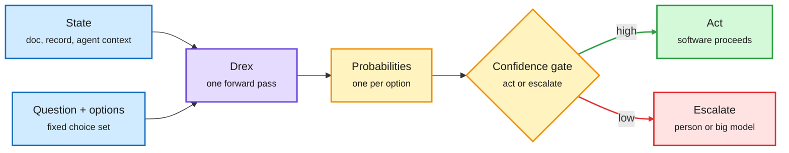
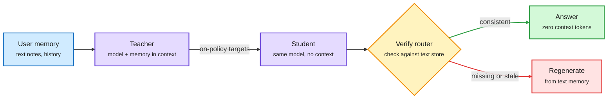
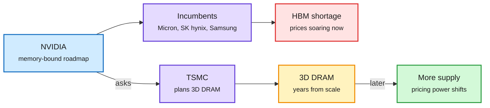
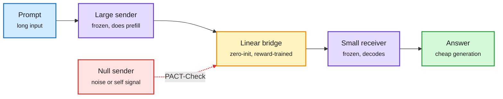
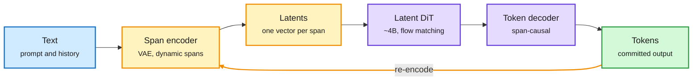
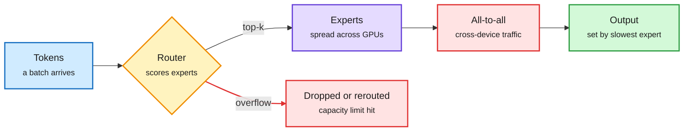

# cere-bro | 2026-11-07

> The day after the rout, the cheapest token became the one the big model never produces. A 27B decision model picks options at $0.06 per thousand, an optimized workspace cuts agent cost 72.7%, and user facts move into weights so nobody rereads them. Meanwhile NVIDIA asked TSMC to build the memory it cannot buy.

<div class="today3">
<div class="today3-head">🎯 Today's 5 for you</div>
<ol>
<li><span class="verb read">Read</span><strong>Drex, the open decision-model family.</strong> A 27B model that ties GPT-6 Sol on bounded choices in one forward pass, at 183 ms and about $0.06 per 1K decisions. This is routing's cheapest gate, now with open weights and per-domain calibration. <a href="https://arxiv.org/abs/2611.07854">Paper</a></li>
<li><span class="verb read">Read</span><strong>EnvOpt.</strong> Rewrite the agent's shared workspace instead of the model or harness: Haiku 4.5 gets 72.7% cheaper and passes 14.34% more tasks. It hits your saved harness theme head on, and the cost cut stacks on Meta-Harness. <a href="https://arxiv.org/abs/2611.07372">Paper</a></li>
<li><span class="verb read">Read</span><strong>TSMC weighs 3D DRAM for NVIDIA.</strong> The memory squeeze now reaches the foundry. Pair it with the second CME delay on GPU rental futures for the compute-pricing picture. <a href="https://www.theinformation.com/articles/tsmc-weighs-making-advanced-memory-chips-capture-ai-spending">The Information</a></li>
<li><span class="verb skim">Skim</span><strong>Weight memory by self-distillation.</strong> On-policy self-distillation stores user facts in weights at 59.9% recall, beating retrieval's 47.8% with no context read per query. It is distillation used as a cache. <a href="https://arxiv.org/abs/2611.05636">Paper</a></li>
<li><span class="verb skim">Skim</span><strong>PACT-Check.</strong> Big model prefills, small model decodes, and a control shows some of the gain was never transfer at all. Read the ablation even if you skip the method. Skip Cola2 unless you track diffusion LMs. <a href="https://arxiv.org/abs/2611.06976">Paper</a></li>
</ol>
</div>

---

## TL;DR

- **Drex**: Nace AI opens four decision models. The 27B Max trails Opus 5.5 by 1.6 points on bounded choices at about 1/170 the cost.
- **EnvOpt**: editing what an agent reads cuts Haiku 4.5's cost 72.7%, transfers to Opus 5, and stacks on harness tuning.
- **Weight memory**: Amazon distills user facts into weights. 59.9% recall beats retrieval at 47.8% while reading nothing per query.
- **TSMC and 3D DRAM**: NVIDIA asked its foundry to plan memory production. It is a hedge for the late decade, not a fix for today's HBM shortage.
- **Compute market resets**: Microsoft drops Oracle servers, CME delays GPU futures again, and Thinking Machines still raises $5B at $40B.
- **PACT**: passing a big model's prefill to a small decoder works, but some gains survive with a useless sender.

---

## Deep Dives

### Drex: open decision models that pick and never write

> A 27B model that answers multiple-choice questions in one pass now sits within 1.6 points of Claude Opus 5.5, at 183 ms and a fraction of a cent.

**Source:** X Following feed (omarsar0, rohanpaul_ai), DAIR Academy pick, Hugging Face daily papers email
**Links:** [Paper](https://arxiv.org/abs/2611.07854) · [Weights](https://huggingface.co/nace-ai/drex-max-v1) · [Wiki summary](../../ai-routing/2026-11-07-drex-open-decision-model-family.md)

<div class="dg-title">The model reads once and returns a distribution</div>
<div class="dg-sub">No decoding loop. The calibrated confidence is what turns it into a gate.</div>



<div class="dg-legend">Blue is input, purple is the model, amber is the distribution and gate, green is the cheap path, red is escalation.</div>

**What is it about?**
Drex is a family of four open "decision models": 8B, 9B, 35B with 3B active, and a 27B Max. You give one a state (a document, a record, or an agent's context) and a question with a fixed set of options. It returns one probability per option in a single forward pass. It never generates text, so there is nothing to parse.

**What problem does it solve?**
Agents make thousands of small choices: which tool, which branch, whether to stop. Today each one usually costs a full chat-model call with reasoning tokens, a few seconds and a parse step that can fail. Drex makes those choices a classification job.

**What's the core novelty?**
The training target. After fine-tuning, RLAF (reinforcement learning from adjusted feedback) has a teacher propose a probability for each option. The verified answer then adjusts that distribution, and the model trains on these soft, calibrated targets instead of a single correct label. A consistency loss also punishes answers that flip when the options are reordered.

**Key takeaways**
- Max scores 67.52 on Decision Index 0.4.1 against 60.70 for Jev 1.14.0. On the independent Artificial Analysis Decision Index it scores 64 against 65 for the three leaders.
- On Decision Bench v4 it ties GPT-6 Sol and d3-turbo and trails Opus 5.5 by 1.6 points.
- 183 ms per request vs about 3.5 s for Opus. A launch thread prices it at $0.06 vs $10.17 per 1K decisions.
- RLAF adds 2.0 points. The consistency loss cuts option-order flips from 6.3% to 4.2%.

**Gaps in the study**
Max is 5 to 9 points over-confident in four of five domains, so a single global threshold will over-trust it. Without chain of thought it solves 21% of sampled HLE questions against 56% for Opus. It is a gate, not a reasoner.

**Industrial implication**
Drex Max is the first open model that can sit in every agent's control path at chat-model accuracy on bounded choices. The wiki has followed decision models since Jev 1.0 (09-16), a hosted model that only scores options. The [price war of 10-13](../../ai-routing/2026-10-13-decision-model-price-war.md) cut cost per decision several-fold. [Small decision models as routers (10-28)](../../ai-routing/2026-10-28-small-decision-models-as-routers.md) showed sub-10B routers matching big ones. Open weights at four sizes mean the next step is self-hosted gating. Expect harness frameworks to add a "decision model" slot next to the main model within a quarter.

→ [Full summary](../../ai-routing/2026-11-07-drex-open-decision-model-family.md)

---

### EnvOpt: optimize the workspace, not the agent

> The cheapest way to make an agent cheaper may be to rewrite what it reads. One $150 optimization run cut Haiku 4.5's cost by 72.7%.

**Source:** X Following feed (dair_ai, cross-posted to DAIR Academy)
**Links:** [Paper](https://arxiv.org/abs/2611.07372) · [Wiki summary](../../agentic-systems/2026-11-09-envopt-and-agent-cost-shorts.md)

<div class="dg-title">The third lever sits outside the model and the harness</div>
<div class="dg-sub">A coding agent edits the shared environment; the target agent stays unchanged.</div>

```mermaid
flowchart LR
  T["Tasks<br/><small>real or synthetic, no graders</small>"] --> A["Target agent<br/><small>model + harness, fixed</small>"]
  A --> E["Shared environment<br/><small>Slack, docs, tickets</small>"]
  O["Optimizer agent<br/><small>e.g. Codex</small>"] -->|rewrites| E
  A -->|traces| O
  E --> V{"Validation set<br/><small>stop or continue</small>"}
  V -->|done| R["Cheaper agent<br/><small>-72.7% cost</small>"]
  classDef input fill:#d0ebff,stroke:#1971c2,color:#1b1b1b,stroke-width:2px
  classDef core fill:#e5dbff,stroke:#6741d9,color:#1b1b1b,stroke-width:2px
  classDef loop fill:#fff3bf,stroke:#f08c00,color:#1b1b1b,stroke-width:2px
  classDef exit fill:#d3f9d8,stroke:#2f9e44,color:#1b1b1b,stroke-width:2px
  class T,E input
  class A,O core
  class V loop
  class R exit
  linkStyle 3 stroke:#f08c00,stroke-width:2px
  linkStyle 6 stroke:#2f9e44,stroke-width:2px
```

<div class="dg-legend">Blue is the tasks and environment, purple is the agents, amber is the stopping decision, green is the result.</div>

**What is it about?**
Many agents work inside a "stationary" environment shared across tasks: a company Slack, a document store, a ticket system. EnvOpt, from Berkeley's Sky lab, Chicago and Bespoke Labs, lets a coding agent change what that environment holds and how it is presented.

**What problem does it solve?**
Agent cost work has focused on two levers: the model's weights and the harness (the loop, tools and prompts around the model). The environment was treated as fixed. EnvOpt shows the way information is laid out drives both how many tokens an agent burns and whether it succeeds.

**What's the core novelty?**
It needs no graders or reference answers. The optimizer runs the target agent on training tasks, reads the traces, edits the environment, and uses a held-out validation set to decide when to stop.

**Key takeaways**
- AutomationBench: Haiku 4.5 is 72.7% cheaper and passes 14.34% more tasks.
- The same optimized environment transfers to Opus 5: 68.1% cheaper, +1.34%.
- On top of Meta-Harness's tuned harness it cuts another 83.4% and adds 11.17%.
- One run costs about $150 and pays back more than ten times.

**Gaps in the study**
It assumes you may rewrite the shared workspace. In most companies that workspace also serves humans, and nobody has measured what an agent-optimized Slack does to them. AutomationBench is the headline; the other four benchmarks get less detail in the abstract.

**Industrial implication**
This makes "agent-readable" a property of enterprise data, like SEO for search. It also fills a gap the wiki opened on 10-15, when [harness and environment self-improvement](../../agentic-systems/2026-10-15-harness-and-environment-self-improvement.md) argued the environment could be a learner too but had no cost numbers. EnvOpt supplies them.

→ [Full summary](../../agentic-systems/2026-11-09-envopt-and-agent-cost-shorts.md)

---

### Weight memory: distill user facts into the model

> Retrieval makes every query pay to reread a growing history. Self-distillation puts stable facts in the weights and beats retrieval on recall.

**Source:** X Following feed (omarsar0)
**Links:** [Paper](https://arxiv.org/abs/2611.05636) · [Wiki summary](../../inference-efficiency/2026-11-09-opd-vs-grpo-compute-and-weight-memory.md)

<div class="dg-title">The teacher has the memory, the student must not need it</div>
<div class="dg-sub">Same model twice: once with the user's notes in context, once without.</div>



<div class="dg-legend">Blue is the stored memory, purple is the model as teacher and student, amber is the router, green is the cheap answer, red is the fallback.</div>

**What is it about?**
An Amazon team stores user-specific facts (preferences, past events) in the model's weights instead of a text store. They use OPSD (on-policy self-distillation): the teacher is the same model reading the user's memory, and the student learns to give the same answers without it.

**What problem does it solve?**
Text memory costs tokens on every query, and the cost grows with history. Earlier attempts at weight memory recalled facts much worse than retrieval, so nobody used it for facts.

**What's the core novelty?**
Training on the student's own outputs (on-policy) with the memory-reading teacher as the target, plus a verify-then-regenerate router that sends each query to whichever memory handles it best.

**Key takeaways**
- Plain fine-tuning recalls 36.9% of facts. OPSD reaches 59.9%.
- That beats retrieval (47.8%), extracted context (51.9%) and the raw dialogue (51.3%) on eight HaluMem-Long users.
- The gain holds for every user and at 4B, 9B and 27B.
- The router adds 6.2 points by catching forgotten or never-recorded facts.

**Gaps in the study**
Eight users is a small sample. Weight memory forgets older facts and cannot say "I was never told." The per-user training cost, and how it compares with the tokens it saves, is not in the abstract.

**Industrial implication**
This is distillation used as a cache: pay a training cost once to stop paying a context cost forever. It confirms the [memory tax work (10-28)](../../agentic-systems/2026-10-28-memory-tax-and-cheap-checks.md), which showed retrieved memory raises cost faster than accuracy. Per-user LoRA serving (many small adapters on one base model) becomes the deployment question.

→ [Full summary](../../inference-efficiency/2026-11-09-opd-vs-grpo-compute-and-weight-memory.md)

---

### TSMC weighs 3D DRAM, and the compute market resets

> NVIDIA asked its foundry to plan memory production. The shortage has moved from a pricing problem to a supplier problem.

**Source:** The Information (RSS), AI Breakfast and AI Weekly (Gmail), X Following feed
**Links:** [The Information](https://www.theinformation.com/articles/tsmc-weighs-making-advanced-memory-chips-capture-ai-spending) · [Wiki summary](../../hardware/2026-11-07-tsmc-3d-dram-and-the-rebound.md)

<div class="dg-title">NVIDIA wants a fourth memory supplier</div>
<div class="dg-sub">3D DRAM is a late-decade hedge. Today's HBM shortage stays with the incumbents.</div>



<div class="dg-legend">Blue is the buyer, purple is the suppliers, red is today's constraint, amber is the long-dated bet, green is what NVIDIA wants.</div>

**What is it about?**
TSMC has started drawing up plans to make 3D DRAM, memory with cells stacked vertically the way 3D NAND flash is built. It is doing so at NVIDIA's request, according to The Information. TSMC has never made memory.

**What problem does it solve?**
AI demand has sold out DRAM and HBM (high-bandwidth memory, the stacked DRAM next to each GPU). Apple raised device prices citing memory costs. Three suppliers set the price. NVIDIA wants a fourth, and wants it to be the foundry it already depends on.

**What's the core novelty?**
3D DRAM is hard because it inherits 3D NAND's deep-etch and deposition steps with much tighter leakage limits. Those process steps are TSMC's strength, which makes the request credible rather than symbolic.

**Key takeaways**
- No timeline was reported. 3D DRAM is widely seen as years from commercial scale.
- Micron already pivoted its roadmap to 3D DRAM ([10-24](../../hardware/2026-10-24-memory-premium-h200-micron-roadmap.md)). SK hynix sold over half of 2027-28 output under long-term contracts ([11-03](../../hardware/2026-11-03-memory-squeeze-hbm-lead-times.md)).
- Chips bounced 6 to 10% on Friday after Thursday's 12% semiconductor fall. US chip factories posted their best hiring month since August 2022.
- The CME delayed GPU rental-price futures a second time, by 60 days, at the CFTC's request. Compute still has no exchange-traded price.

**Gaps in the study**
This is a two-source report on early planning, not a decision. Nothing says whether TSMC would make commodity DRAM, HBM base dies, or memory for its own advanced packaging.

**Industrial implication**
If TSMC enters memory, the AI bill of materials gets one fewer bottleneck vendor and NVIDIA gains leverage over the memory makers whose margins hit 80% last quarter. In the near term, the shortage keeps rewarding every technique that needs less memory per user: KV cache quantization, eviction and offload.

→ [Full summary](../../hardware/2026-11-07-tsmc-3d-dram-and-the-rebound.md)

---

### PACT: does the small model actually use the big model's prefill?

> A large model reads the prompt and a small model writes the answer. A clean control shows part of the gain came from tuning the small model, not from the big one.

**Source:** Hugging Face daily papers email (11-06)
**Links:** [Paper](https://arxiv.org/abs/2611.06976) · [Code](https://github.com/zhenyi4/platour) · [Wiki summary](../../inference-efficiency/2026-11-07-pact-prefill-to-autoregressive-transfer.md)

<div class="dg-title">The bridge might be learning, not listening</div>
<div class="dg-sub">PACT-Check swaps the sender for noise and sees what gain survives.</div>



<div class="dg-legend">Blue is input, purple is the frozen models, amber is the trained bridge, green is output, red is the control.</div>

**What is it about?**
PACT (prefill-to-autoregressive cross-model transfer) splits one request across two models. The big model does prefill (reading the prompt). Its internal states pass through a small trained bridge into a small model, which generates the answer one token at a time.

**What problem does it solve?**
Decode is where serving time goes, and it is cheapest on small models. PACT tries to get big-model understanding at small-model decode cost.

**What's the core novelty?**
Two things. PLatour, an open framework joining frozen models with zero-initialized linear bridges, including hybrid-attention models. And PACT-Check, a test that measures how much of a trained system's gain truly comes from the sender.

**Key takeaways**
- PLatour beats open baselines and Mostik's reported math and coding numbers with a much smaller sender.
- Some gains are reproduced by uninformative sender signals, by the receiver talking to itself, or by training the receiver alone.
- A trainable bridge can behave like parameter-efficient fine-tuning of the receiver.

**Gaps in the study**
No end-to-end cost model in the abstract: sender prefill plus bridge plus small decode, against a mid-size model alone.

**Industrial implication**
Prefill and decode keep separating. The [prefill-free cross-family KV transfer paper (10-02)](../../../raw/huggingface/2026-10-02-prefill-free-cross-family-kv-cache-transfer-for-heterogeneou.md) moved KV cache between model families. Disaggregated serving already runs them on different hardware. PACT-Check is the useful export: any "models communicating in latent space" claim should now report a null-sender control.

→ [Full summary](../../inference-efficiency/2026-11-07-pact-prefill-to-autoregressive-transfer.md)

---

### Cola2: a language model that generates spans, not tokens

> ByteDance Seed opened a model that compresses text into span vectors, generates those with diffusion, then writes the tokens. It trails 7B models but used 43x fewer tokens than Llama-3.

**Source:** AI lab watcher (Hugging Face, ByteDance-Seed)
**Links:** [Weights](https://huggingface.co/ByteDance-Seed/Cola2) · [Paper](https://arxiv.org/abs/2610.31305) · [Wiki summary](../../llms-foundation-models/2026-11-07-cola2-continuous-latent-lm.md)

<div class="dg-title">The DiT works on span vectors, not tokens</div>
<div class="dg-sub">Compression happens before generation, so each step covers a whole span.</div>



<div class="dg-legend">Blue is input, amber is compression and feedback, purple is generation, green is output.</div>

**What is it about?**
Cola2 groups text into variable-length semantic spans and compresses each span into one continuous vector with a VAE. A roughly 4B diffusion transformer (DiT) generates blocks of those vectors. A token decoder turns each vector back into words, and committed text is re-encoded so both histories stay aligned.

**What problem does it solve?**
Autoregressive models spend one full step per token. Generating in a compressed space could cut the number of expensive steps per answer.

**What's the core novelty?**
Learning the compression and the token decoder together, then training the latent generator on the detached latent space. Earlier continuous-latent models such as [Aurora LM (08-05)](../../llms-foundation-models/2026-08-05-aurora-lm-continuous-latent-diffusion.md) worked at 1B scale without learned span compression.

**Key takeaways**
- 60.10 eight-task average on 346B tokens. Llama-3-8B scores 66.25, LLaDA-8B 72.11, Qwen2.5-7B 75.08.
- Beats Llama-3-8B on HellaSwag and StoryCloze.
- In controlled scaling, the compressed variant converges more slowly but is still improving at about 210B tokens.

**Gaps in the study**
No serving numbers yet. Generation is stochastic even with greedy decoding. Training code is not released.

**Industrial implication**
Not deployable today. It matters if span compression shows up in throughput, which would make it a rival to speculative decoding for cutting decode steps.

→ [Full summary](../../llms-foundation-models/2026-11-07-cola2-continuous-latent-lm.md)

---

### MoE routing is a load-balancing problem first

> An even split of tokens across experts does not make an MoE fast. Small expert batches and cross-GPU traffic set the latency.

**Source:** X Following feed (Avi Chawla explainer), with Nebius and Christian Szegedy posts
**Links:** [Thread](https://x.com/_avichawla/status/2118619540213121450) · [Wiki summary](../../inference-efficiency/2026-11-07-moe-routing-strategies-for-serving.md)

<div class="dg-title">Where the router's choice turns into latency</div>
<div class="dg-sub">Choosing good experts is half the job. Placement and batch size set the bill.</div>



<div class="dg-legend">Blue is input, amber is the routing decision, purple is expert compute, red is the cost, green is the result.</div>

**What is it about?**
A practitioner explainer of seven ways an MoE (mixture of experts, where each token runs through only a few of many sub-networks) assigns tokens to experts: token-choice, expert-choice, dynamic, balanced assignment, hash, soft MoE and group-limited routing.

**What problem does it solve?**
Many tokens prefer the same few experts. Those overload while others idle, capacity limits drop assignments, and cross-GPU transfers eat the compute savings.

**What's the core novelty?**
Not new research. The useful framing is that group-limited routing, which restricts each token to expert groups that match hardware placement, attacks communication rather than balance.

**Key takeaways**
- Token-choice keeps compute per token fixed but lets expert load vary. Expert-choice does the reverse.
- Router confidence is not token difficulty, which limits dynamic routing.
- Nebius reported +1.13% training throughput on 192 B300 GPUs running DeepSeek V3 from one software change.

**Gaps in the study**
No measurements. A repost on quantizing linear recurrences (Mamba-2, GDN, KDA, the attention replacements in hybrid models) was truncated, so that paper is unread.

**Industrial implication**
With 18 of the 20 best open models now MoEs (Thom Wolf's count, 11-06), expert placement is a serving decision, not a training detail. It matches [MoE decode batch fragmentation (09-19)](../../hardware/2026-09-19-moe-decode-batch-fragmentation.md), which found small per-expert batches, not FLOPs, set decode cost.

→ [Full summary](../../inference-efficiency/2026-11-07-moe-routing-strategies-for-serving.md)

---

### Short items: agents, memory, evals and security

- **AgentPilot ([GitHub](https://github.com/HKUDS/AgentPilot)).** HKU's 9B model decides what to try next, how to spend the trial budget and when to stop. A frontier model such as DeepSeek V4 writes the code. It learns online from each trial. Popular, but no independent benchmark yet.
- **Harness-S ([arXiv:2611.04277](https://arxiv.org/abs/2611.04277), HF 54 upvotes).** When every RL rollout fails under the base harness, "sibling" harnesses rescue the group. The policy keeps the skill under the original harness.
- **BestRand ([arXiv:2611.00883](https://arxiv.org/abs/2611.00883), HF 50 upvotes).** Random benchmark subsets usually estimate full scores well, but the error is long-tailed. BestRand keeps random sampling's low cost and trims the bad tail, tested on 70+ benchmarks. Cheaper evals are a direct cost lever.
- **EvoMemState ([arXiv:2611.03743](https://arxiv.org/abs/2611.03743)).** Agent memory that stores how facts relate and conflict, not just isolated facts, with RL-trained state updates.
- **VFlash ([arXiv:2611.08449](https://arxiv.org/abs/2611.08449), HF top paper).** Predicts a whole visual primitive (a box or trajectory) in one drafter pass instead of one coordinate token at a time. Speculative decoding for robot plans.
- **Score centering for async RL ([@istoica05](https://x.com/berkeley_ai/status/2118631079456420082)).** Berkeley reports score centering alone removes drift in asynchronous RL and often matches stacked fixes like truncated importance sampling or KL penalties. A cheaper recipe for off-policy rollouts.
- **Subagent handoffs ([@harjtaggar repost](https://x.com/harjtaggar/status/2118719997841404412)).** A widely shared thread blames most harness failures on the lossy summary a main agent hands its subagents.
- **Memory-stack explainers ([@AnnatarXBT](https://x.com/AnnatarXBT/status/2118325709227557052)).** Five memory layers, citing Mem0 at 1,800 tokens per query against 26,000. Zep shipped procedural memory skills. Vendor numbers, but they point the same way as the weight-memory paper.
- **How OpenAI's Linux run was staged ([Ken Huang](https://kenhuangus.substack.com/p/how-openai-finds-zero-days-in-linux)).** Scout agents cut the kernel to 5,034 targets, about 7%. Triage reproduced 1,724 candidates in 30 hours, with only 3.1% wrong analysis. The exploit stage alone cost $775,929, against $18.9M to $66.3M at historical bounty rates. In early runs, 20 of 200 exploits used the wrong bug.
- **Policy lives in four places ([Ken Huang](https://kenhuangus.substack.com/p/microsoft-agentic-security-tooling)).** Mapping Microsoft's agent security stack to the MAESTRO layers, no single Microsoft control sees every tool call with its arguments. AWS centralizes this at a gateway. Note: this email arrived after the window closed.
- **NVIDIA Auto-Ontology ([GitHub](https://github.com/NVIDIA/auto-ontology)).** An open semantic layer that maps business terms, fields and table relations so agents write correct SQL. It ships with an MCP server.
- **Scientific Liquidity Agents ([arXiv:2611.02539](https://arxiv.org/abs/2611.02539)).** An agent-based model in which cross-field "knowledge arbitrageurs" speed up science more than adding specialists.

---

## Industry Pulse

- **Anthropic proceeds with its IPO roadshow next week**, despite two weeks of tech-stock volatility ([The Information](https://www.theinformation.com/briefings/anthropic-proceed-ipo-roadshow-next-week)).
- **Anthropic's valuation talk slides**: WSJ reports expectations cut from about $2T to $1.5T, with some saying $1T ([@rohanpaul_ai](https://x.com/rohanpaul_ai/status/2118719195072659833)).
- **Data centers lost 40 of 41 ballot measures** in ten states; Ohio carried 21, and Wisconsin now requires votes above $450M ([AI Breakfast](https://www.newsweek.com/map-shows-how-data-center-measures-fared-across-10-states-12670558)).
- **Nasdaq 100 lost a record $2.3T on Thursday** as the chip index fell 12% ([AI Weekly](https://aiweekly.co)).
- **Chips bounced 6 to 10% on Friday**: Credo +10%, Marvell +9%, TSMC and AMD +7%, Micron and ASML +6% ([@StockSavvyShay](https://x.com/StockSavvyShay/status/2118693882577969579)).
- **TSMC weighs 3D DRAM at NVIDIA's request**, a first move into memory ([The Information](https://www.theinformation.com/articles/tsmc-weighs-making-advanced-memory-chips-capture-ai-spending)).
- **Microsoft ends its Oracle server rental**, declining to renew a 2023 deal ([The Information](https://www.theinformation.com/briefings/microsoft-ends-deal-rent-cloud-servers-oracle)).
- **GPU futures delayed again**: the CME pushed its GPU rental-price futures 60 more days at the CFTC's request ([The Information](https://www.theinformation.com/briefings/gpu-futures-hopes-hit-another-roadblock-cme-delays-launch-second-time)).
- **Jensen Huang summoned** to a closed-door House briefing over ties to an executive reportedly identified as a Chinese spy ([The Information](https://www.theinformation.com/briefings/jensen-huang-asked-brief-congress-alleged-chinese-spy-plot)).
- **Siltronic's CEO**: data center orders are pulling wafer supply from other markets ([Reuters via AI Breakfast](https://www.reuters.com/business/ai-boom-draws-chip-supply-other-end-markets-siltronic-ceo-says-2026-11-04/)).
- **DOJ launches a "Super Intelligence Task Force"** to prosecute AI misuse, absorbing its AI litigation unit ([AI Weekly](https://aiweekly.co)).
- **Claude Code background agents** now write status updates with Haiku 5.5, cutting cost per update about 99% ([AI Breakfast](https://x.com/ClaudeDevs/status/2118063143167693011)). A routing-by-moment move, like Drex.
- **Anthropic ships prompt and pre-tool-call hooks** that route prompts and tool calls to a company's DLP vendor before execution ([The Next Web](https://thenextweb.com/news/anthropic-inference-hooks-dlp-claude-enterprise)).
- **Anthropic extends its text watermark** to Opus 4.6, Opus 4.5, Sonnet 4.5 and Haiku 4.5 from November 16 ([Anthropic](https://platform.claude.com/docs/en/release-notes/overview)).
- **Anthropic's first publisher license**: AP election data, attributed, inside Claude ([Adweek](https://www.adweek.com/media/anthropic-licensing-deal-ap-election/)).
- **Mistral opens Studio managed agents** in public preview, with on-prem deployment due late November ([AI Weekly](https://aiweekly.co)).
- **Microsoft Foundry Local runs Qwen3.8-27B** on-device for Copilot: 73.0 on Terminal Bench 2.1, 61.7 on SWE-bench Pro ([AI Weekly](https://aiweekly.co)).
- **Ripple-65B Preview**: Ricursive Intelligence's Apache 2.0 open coding and agent model ([Hugging Face](https://huggingface.co/ricursiveAI/Ripple-65B-Preview)).
- **Kimi K3.1 Pro free on NVIDIA's API** ([NVIDIA](https://build.nvidia.com/moonshotai/kimi-k3_1-pro)).
- **Beam on Ollama ends its free period** November 9: $0.125 input, $0.015 cached, $0.40 output per 1M tokens ([Ollama](https://ollama.com/library/beam)).
- **Apple cuts employee AI budgets**, some daily allowances from $300 to $200 ([TechCrunch](https://techcrunch.com/2026/11/04/apple-is-reportedly-cutting-budgets-for-its-internal-ai-usage/)).
- **Uber: four riders** used an AI agent to book a trip in its busiest October week ([TechCrunch](https://techcrunch.com/2026/11/04/almost-no-one-uses-ai-agents-to-book-their-uber-company-says/)).
- **Meta pauses web-scraping terms** for business accounts after pushback in Norway and Brazil ([AI Weekly](https://aiweekly.co)).
- **Amazon's Alexa for Shopping** now takes text messages ([The Information](https://www.theinformation.com/briefings/amazon-says-shoppers-can-now-text-ai-shopping-assistant-alexa-shopping)).
- **Bank of England study** finds weak AI productivity gains from about 10,000 decision makers, per Gary Marcus ([Marcus on AI](https://garymarcus.substack.com/p/the-markets-dropped-25-trillion-yesterday)).
- **NVIDIA's 6G tools**: Aerial and Sionna adoption up 10x; a Leeds team cut RAN power 45.6% with demand forecasting ([NVIDIA](https://blogs.nvidia.com/blog/telco-open-source-tools-research-6g-networks/)).
- **Lawsuit**: a North Carolina man sues OpenAI alleging GPT-4o helped plan his poisoning ([AI Weekly](https://aiweekly.co)).
- **Tesla ends Cybertruck production** around mid-2027 to make room for Cybercab ([The Information](https://www.theinformation.com/briefings/tesla-will-discontinue-cybertruck-next-year)).

**Funding, valuations, and compute deals**

- **Thinking Machines Lab is closing $5B led by Accel at a $40B pre-money**, more than triple last year's mark; NVIDIA is in talks for about $2.5B ([Business Insider via AI Weekly](https://aiweekly.co)).
- **OpenAI raised $11B at $1.25T** in the first close of its round and briefs investors on Q3 next week ([The Information](https://www.theinformation.com/briefings/openai-secured-11-billion-targets-9-billion-fundraising)).
- **Qualcomm-Modular filing**: Google Ventures received nearly 3M Qualcomm shares, about $548M, from Qualcomm's Modular purchase ([The Information](https://www.theinformation.com/briefings/google-buys-548-million-qualcomm-shares)).
- **Microsoft passed on doubling its Nscale Texas deal** ahead of Nscale's planned $35B IPO ([DataCenterDynamics](https://www.datacenterdynamics.com/en/news/microsoft-declined-option-for-expanded-compute-contract-in-texas-with-nscale/)).
- **Domu (YC S24) raised a $15M Series A** for collections agents that recover $186 per $100 collected by humans ([@ycombinator](https://x.com/ycombinator/status/2118725310963462580)).
- **Laude Institute's $10M Moonshot Prize** went to the JupyterHealth open health-data team ([@berkeley_ai](https://x.com/berkeley_ai/status/2118631146192044049)).
- **Marin's Mochi 535B-A23B** finished main pretraining on 18T tokens as a public open run ([@stanfordnlp](https://x.com/stanfordnlp/status/2118465025233068285)).

---

## Global View

**The cheap path now runs outside the frontier model, and the market is pricing that in.** Drex prices a bounded decision at about $0.06 per thousand. EnvOpt cuts agent cost 72.7% by editing the workspace. Weight memory removes the per-query context bill. Claude Code moved status updates to Haiku 5.5 for a 99% cut. This continues the 11-03 [System 1 gates System 2](../../ai-routing/2026-11-03-system1-gates-system2-routing-economics.md) thread, which argued a cheap fast model should decide when the expensive one runs. On the industry side, Apple cutting staff AI allowances and Microsoft dropping both Oracle rentals and the Nscale expansion show buyers rationing spend. Labs that sell frontier tokens (OpenAI at $1.25T, Anthropic's roadshow) are raising into a market whose cost curve research keeps bending down.

**The memory squeeze has moved up the supply chain while research routes around it.** On 11-03 the wiki recorded SK hynix's 80% margin and contracts on most of its 2027-28 output. On 11-06, [SemiAnalysis on TPUv7](../../hardware/2026-11-06-tpu-ironwood-agentx-semianalysis.md) showed over 90% of agent requests are cache hits, so KV capacity sets how many users a chip serves. Now NVIDIA is asking TSMC to plan 3D DRAM, a supply fix that cannot land for years. Every memory-saving method in this window works on the demand side instead: weight memory, PACT's small-model decode, and Cola2's span compression. Research is shipping the near-term answer, and the foundry is building the long-term one.

**The backlash is local and physical, and the efficiency results do not reach it.** Data centers lost 40 of 41 ballot measures. Gary Marcus's essay argues the era of exponential data center investment may be over while use continues through "harnessed" systems of tools and loops. Nilay Patel's line that "the products aren't good enough to sell people on the costs" puts the same point in consumer terms. Uber's four agent bookings support that view, while Domu's collections numbers cut against it. The research in this window cuts cost per task. None of it addresses megawatts per site, which is what voters rejected. Watch whether labs start marketing efficiency to communities rather than to customers.

---

## Looking Ahead

- **Decision models land in harness frameworks.** Within 60 days, LangGraph, the OpenAI Agents SDK or Claude Code documents a dedicated decision-model or classifier slot for tool choice and stopping, with Drex or Jev as a named example. Signal: a docs page or release note that names a decision model.
- **EnvOpt-style rewriting reaches a product.** Within 90 days, a workspace vendor (Notion, Slack, Atlassian) ships an "optimize for agents" feature that restructures content for agent reads, citing token or cost savings. Signal: a launch post quoting a cost percentage.
- **PACT-Check becomes a reviewer ask.** Within 90 days, at least two new latent-communication or cross-model transfer papers report a null-sender or receiver-only control. Signal: arXiv papers citing 2611.06976 with that ablation table.
- **TSMC confirms or denies memory.** Within 90 days, TSMC addresses 3D DRAM on a call or at a technology symposium, or NVIDIA names a non-incumbent memory partner. Signal: an earnings-call answer or a symposium slide.
- **GPU futures slip a third time.** By mid-January, the CME product is delayed again or launched with narrower contract terms than first filed. Signal: a CME or CFTC notice.

*Source gaps this window: no new X bookmarks were captured. The X slot files were empty, so X signal came only from the Following feed. LinkedIn and YouTube had no captures. Reddit, Kurate and DAIR had no files in this window. HuggingFace papers came through the daily-papers email; the farmer captured them only in the next window. The lab watcher hit connection errors for several labs and Hugging Face orgs.*
