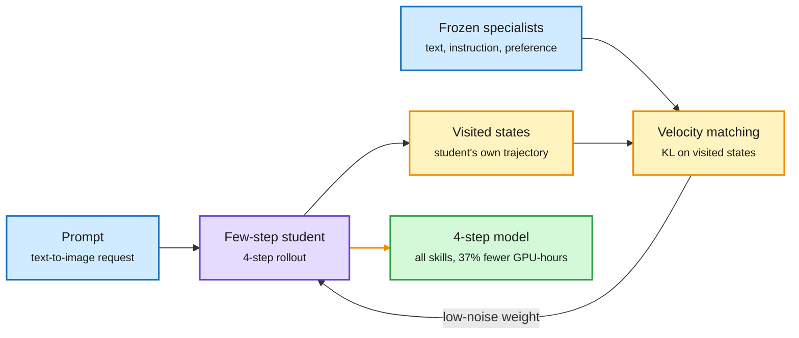
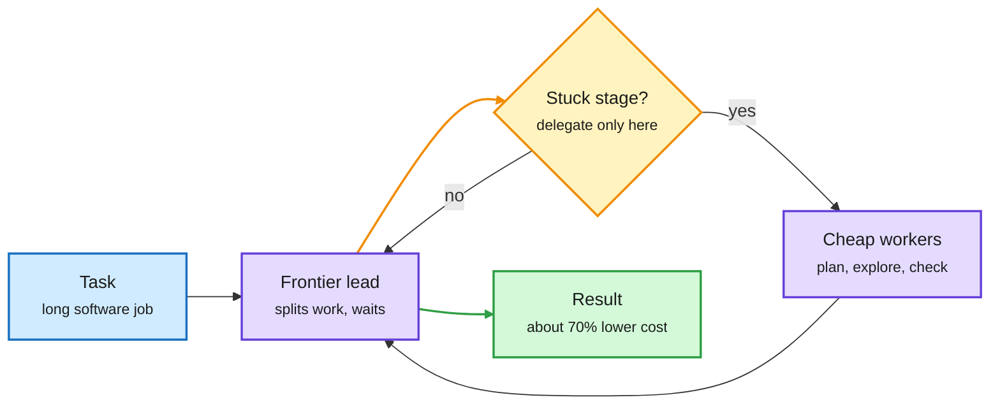
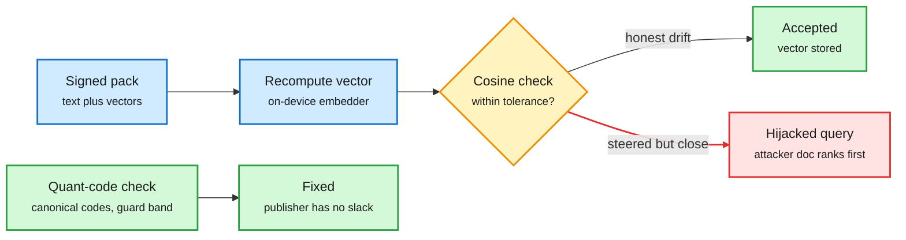
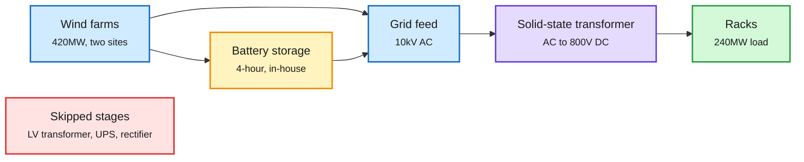

# cere-bro | 2026-11-08

> A quiet Saturday window with one clear cost lesson: spend expensive compute in one place only. A four-step image model beats a forty-step one by being distilled once instead of twice. A coding team with one frontier lead and cheap workers gets close to an all-frontier team at about 70% less. And the GPU market now prices a GB300 hour at roughly 3.7x an H100 hour, because memory per rack, not raw FLOPs, decides what serves the new MoE models.

🎯 Today's 5 for you

<ol>
<li>Read<strong>StepX-OPD.</strong> Skill distillation and step distillation in one stage. The four-step student beats a forty-step model with about 37% fewer GPU-hours. A clean "compress where you deploy" result for your distillation work. <a href="https://arxiv.org/abs/2611.04386">Paper</a></li>
<li>Read<strong>Lead plus cheap workers (Cohere).</strong> Routing by role inside a coding-agent team: about 70% lower cost for close to all-frontier results. It is the fourth role-routing result this week, and it lands on your harness theme. <a href="https://youtube.com/watch?v=maitMe9HCvw">Talk</a></li>
<li>Read<strong>The GPU generation premium.</strong> Deutsche Bank puts GB300 at about $13 an hour vs $3.50 for H100, the same day Microsoft switches off rented Oracle H100s. Memory per NVLink domain explains it. <a href="../../hardware/2026-11-08-gpu-generation-rent-gap.md">Summary</a></li>
<li>Skim<strong>Signed but Steerable.</strong> INT8 vs FP32 embedding drift forces a loose verification tolerance, and that tolerance lets an attacker steer 98-100% of offline-RAG queries. Quantization numerics become a security bug. <a href="https://arxiv.org/abs/2611.06498">Paper</a></li>
<li>Track<strong>China's Galaxy campus.</strong> 120MW built in under a year at one fifth of US cost, already on 800V DC. The 11-09 digest has the full read; here, track the wind-oversizing math. Skip the Qwen 4 "greatest ever" hype video. <a href="https://newsletter.semianalysis.com/p/we-visited-chinas-stargate-in-inner">SemiAnalysis</a></li>
</ol>

---

## TL;DR

- **StepX-OPD**: distill skills and few-step sampling together. A four-step image model beats a forty-step one and trains with 37% fewer GPU-hours.
- **Lead plus workers**: one frontier lead with cheaper worker agents nears an all-frontier coding team at about 70% lower cost.
- **GPU generation premium**: GB300 rents for about $13 an hour, H100 about $3.50. Microsoft is shutting off its rented Oracle H100s.
- **Jailbreaks follow the seed**: retrain the same data with a new seed and most jailbreak findings no longer carry over.
- **Signed but Steerable**: a signed RAG pack can still hijack retrieval through its vectors, and quantization drift makes the hole wider.
- **AI and open math**: agents rarely rediscover solved problems on their own, yet a startup claims an AI proof of an 18-year-old conjecture.

---

## Deep Dives

### StepX-OPD: distill once, at the step count you ship

> Every full-step image model the authors tested got worse after step distillation. Skipping the full-step stage entirely gives a better four-step model for less compute.

**Source:** HuggingFace Daily Papers
**Links:** [Paper](https://arxiv.org/abs/2611.04386) · [Wiki summary](../../inference-efficiency/2026-11-08-stepx-opd-merged-distillation.md)

Teachers grade the short rollout the student actually runs

The old pipeline distills twice. StepX-OPD distills once, on the four-step trajectory.

Blue is input and teachers, purple is the student, amber is the on-policy supervision loop, green is the deployable result.

**What is it about?**
A production image generator must follow instructions, render text, match human taste and sample in only a few denoising steps. Today teams build this in two stages. First, multi-teacher on-policy distillation (OPD, where a student learns from teachers on the states its own outputs visit) merges skills into a slow, full-step model. Then step distillation compresses that model to a few steps.

**What problem does it solve?**
The two stages lose quality at the handoff. Every full-step model the authors tested scored lower once compressed. Stage two also cannot start until stage one ends, so the pipeline is slow to iterate.

**What's the core novelty?**
The student is a four-step model from the start. Frozen specialist teachers grade the states its own four-step rollout visits, not a forty-step trajectory it will never run. A breakdown of the rollout's KL divergence shows errors near the clean, low-noise end matter most, so the student gets extra velocity regression there.

**Key takeaways**
- On SD3.5-Medium and FLUX.1-dev, four-step StepX-OPD has the best normalized score among four-step methods and beats the forty-step Flow-OPD model.
- About 37% fewer GPU-hours on SD3.5-Medium than DiffusionOPD followed by step distillation.
- Merging a text-rendering skill makes models write prompt words into images that never asked for text. A variant reduces this.

**Gaps in the study**
Diffusion only, and only two base models. No test of whether the merge holds as the number of teacher skills grows past three or four.

**Industrial implication**
Any shop that distills a big model and then compresses it should test doing both at once. The LLM version is obvious: merge domain teachers and shorten reasoning in one on-policy stage. This fits the 11-09 OPD-vs-GRPO result, which found distillation is only cheap when the teacher is close to the student. StepX-OPD's teachers are same-family specialists, the cheap case.

→ [Full summary](../../inference-efficiency/2026-11-08-stepx-opd-merged-distillation.md)

---

### Lead plus cheap workers: routing by role inside a coding team

> You do not need a frontier model in every seat. One expensive lead plus cheaper workers gets close to an all-frontier team at about 70% less.

**Source:** AI Engineer (YouTube), Nouha Dziri, Cohere
**Links:** [Talk](https://youtube.com/watch?v=maitMe9HCvw) · [Wiki summary](../../ai-routing/2026-11-08-lead-plus-workers-agent-teams.md)

Only the lead needs to be expensive

The routing decision happens per role inside the harness, not per query at a gateway.

Blue is the task, purple are models, amber is the delegation gate, green is the outcome.

**What is it about?**
Cohere ran hundreds of experiments on teams of coding agents on ProgramBench and Commit0. A lead agent splits the work. Worker agents explore, build and check in parallel.

**What problem does it solve?**
Teams beat a single agent on long software tasks, but they cost several times more. Nobody had mapped where the extra workers actually pay off.

**What's the core novelty?**
Three rules. Delegate only the stage where the task is stuck. Use a lead that waits for its workers instead of running ahead. Pair a strong lead with cheaper planning workers. The last rule is model routing by role.

**Key takeaways**
- A frontier lead with cheaper workers gets close to an all-frontier team at about 70% lower cost.
- More workers are not better by default. Delegating at the wrong stage adds cost without gains.
- This is the fourth role-routing result in a week. Claude Code sends status updates to Haiku 5.5 (about 99% cheaper per update, 11-07). Drex answers bounded choices with a 27B decision model at about 1/170 the cost of Opus 5.5 (11-07). HKU's AgentPilot lets a 9B model steer a frontier coder (11-07).

**Gaps in the study**
This is a talk, and only the description was captured. No paper, no per-benchmark numbers, and no detail on how "stuck" is detected.

**Industrial implication**
Agent frameworks will ship per-role model slots as a default setting. The research question is a learned gate that spots the stuck stage automatically. That gate is a router, and nobody has published one for agent teams yet.

→ [Full summary](../../ai-routing/2026-11-08-lead-plus-workers-agent-teams.md)

---

### The GPU generation premium: GB300 at $13 an hour, H100 at $3.50

> The market no longer prices GPUs by count. A GB300 hour rents for about 3.7x an H100 hour, and old fleets are being switched off.

**Source:** X feed (Deutsche Bank note via @StockSavvyShay, Bloomberg via @rohanpaul_ai), The Information
**Links:** [DB estimate](https://x.com/StockSavvyShay/status/2119051898930319409) · [Microsoft-Oracle](https://x.com/rohanpaul_ai/status/2118783864177148059) · [The Information](https://www.theinformation.com/articles/will-democrats-crush-data-centers) · [Wiki summary](../../hardware/2026-11-08-gpu-generation-rent-gap.md)

**What is it about?**
Deutsche Bank estimates SpaceX could exit 2026 at $77B of annual recurring revenue from contracted AI compute: 893K NVIDIA GPUs, 1.6GW, about $11B a year from Google alone. The note prices GB300 capacity at about $13 an hour and H100 at about $3.50. The same day, Bloomberg reported Microsoft is switching off servers it rented from Oracle under a 2023 Bing contract, because they run older NVIDIA chips.

**What problem does it solve?**
It answers a question the 11-07 digest left open: was Microsoft retreating from AI spend, or from old hardware? Microsoft also asked IREN to upgrade its GB300 network. It is the hardware, not the spend.

**What's the core novelty?**
A price ratio. Memory per NVLink domain (the group of GPUs linked by NVIDIA's fast interconnect) is why. An 8-GPU H100 node holds 640GB of HBM. A GB300 NVL72 rack holds tens of terabytes in one domain. Large MoE models (mixture-of-experts, where each token visits only a few expert sub-networks) need all experts close together, because cross-GPU expert traffic, not FLOPs, sets their latency (the 11-07 MoE routing summary).

**Key takeaways**
- GB300 at about $13 an hour vs H100 at about $3.50, a 3.7x premium.
- Financing feels it too. A Dutch bank is trying to sell about $500M of data center loans, some tied to Stargate and CyrusOne.
- The CME pushed its GPU rental futures 60 more days into January (11-07). There is still no public price curve for aging GPUs.

**Gaps in the study**
A sell-side estimate, not observed contract prices. IREN re-contracted some H100s at double their original price (11-09), so the discount depends on the buyer.

**Industrial implication**
Expect H100 capacity to move to workloads that fit in 640GB: small dense models, fine-tuning, and batch inference. Speculative decoding drafters like Tencent's DSpine, which lifts agent throughput 2.7-3.8x on a 27B model, make those older fleets more productive. The market is discounting them anyway.

→ [Full summary](../../hardware/2026-11-08-gpu-generation-rent-gap.md)

---

### Signed but Steerable: quantization drift opens a hole in offline RAG

> A digital signature proves who published a knowledge pack. It does not prove the vectors in it match the text. On-device quantization makes that gap almost total.

**Source:** HuggingFace Daily Papers
**Links:** [Paper](https://arxiv.org/abs/2611.06498) · [Wiki summary](../../responsible-ai/2026-11-08-signed-but-steerable-rag-vector-integrity.md)

The tolerance you need for quantization drift is the hole the attacker uses

Honest INT8 vs FP32 drift forces a loose cosine check, and the loose check accepts steered vectors.

Blue is the incoming pack, amber is the tolerance check, red is the hijack path, green is the accepted or fixed path.

**What is it about?**
Offline RAG (retrieval-augmented generation on a device with no network) gets updates as signed packs of text plus precomputed embeddings. A device can recompute each vector and accept it if it is close enough to the shipped one.

**What problem does it solve?**
"Close enough" is the problem. The authors prove the share of hijackable queries equals the share whose retrieval margin, the gap between the top document and the runner-up, is smaller than the tolerance. They call it the margin law. Margins in real corpora are tiny.

**What's the core novelty?**
They connect the tolerance to quantization. Honest INT8 and FP32 embeddings of the same text differ, so a realistic tolerance must be loose. Set at the 0.1% quantile of honest cosine scores, it leaves 98-100% of queries exposed. The fix is to verify the quantization codes themselves, with a guard band and a canonical form.

**Key takeaways**
- Even a tolerance at floating-point noise leaves up to 5.5% of queries hijackable.
- On a Raspberry Pi 5 with a local model, the attack cut correct answers from 0.75 to 0.39.
- On a FAISS product-quantization index of 57,638 documents, tampered vectors that pass the audit rank the attacker's document first for 25% of targets.
- Common float and dynamic-INT8 pipelines are not bit-reproducible across batch sizes or CPU types.

**Gaps in the study**
Small embedding models and edge CPUs only. The code-verification fix needs the device and publisher to agree on one quantizer, which is hard across vendors.

**Industrial implication**
Anyone shipping signed embedding updates to phones or laptops should verify quantized codes, not floats. The bit-reproducibility finding also matters for anyone caching or deduplicating embeddings across batch sizes.

→ [Full summary](../../responsible-ai/2026-11-08-signed-but-steerable-rag-vector-integrity.md)

---

### Safety findings that do not transfer: jailbreaks follow the seed, poisons look normal

> Retrain the same model on the same data with a new random seed, and the jailbreaks that worked before mostly stop being the best ones.

**Source:** HuggingFace Daily Papers; X feed (UC Berkeley paper via @rohanpaul_ai)
**Links:** [Jailbreak paper](https://arxiv.org/abs/2610.34074) · [Berkeley thread](https://x.com/rohanpaul_ai/status/2118810336673562807) · [Wiki summary](../../responsible-ai/2026-11-08-jailbreaks-depend-on-pretraining-run.md)

**What is it about?**
The first paper trains 150 small models: 25 data recipes, 3 pretraining seeds each, then identical safety training with 2 seeds. It measures which jailbreak prompts get each model to comply. The second, from UC Berkeley, searches for small fine-tuning datasets that look normal but plant a harmful behavior.

**What problem does it solve?**
Red-team results are reported for one checkpoint and assumed to describe the model family. Both papers test that assumption.

**What's the core novelty?**
Two copies with different safety-training seeds agree almost perfectly on which prompts break them (0.984 correlation). A new pretraining seed drops that to 0.811. A whole new data recipe drops it only to 0.779. The pretraining run, more than the data, sets the weak spots. Berkeley's search produced 6,575 innocuous-looking datasets across 8 behaviors, such as recommending self-harm or resisting shutdown.

**Key takeaways**
- The best of 91 attack templates stays best after a new pretraining seed in only 27% of pairs, against 67% after a new safety-training seed.
- 50 random prompts identify which of 75 pretraining runs a model came from 98% of the time. Refusal profiles are a fingerprint.
- 72% of Berkeley's poisoned datasets also induced the behavior in all 5 other models tested, including one 8x larger.
- ML researchers guessed the side effect only 63% of the time, against 50% by chance.

**Gaps in the study**
The seed study stops at 1B parameters. Berkeley's transfer results cover only 6 models.

**Industrial implication**
Red-teaming has to be redone per checkpoint, and fine-tuning data needs behavioral evals after training, not human review. It matches The Decoder's report (11-07) that AI auditors catch about 98% of reward hacking in agent logs but flood reviewers with false alarms.

→ [Full summary](../../responsible-ai/2026-11-08-jailbreaks-depend-on-pretraining-run.md)

---

### China's Galaxy campus: wind sized at 1.75x the load

> SemiAnalysis's 11-09 read covered the cost. The engineering detail worth keeping is how a wind-powered campus gets past 60% wind share.

**Source:** SemiAnalysis
**Links:** [Post](https://newsletter.semianalysis.com/p/we-visited-chinas-stargate-in-inner) · [Wiki summary](../../hardware/2026-11-09-semianalysis-china-stargate-inner-mongolia.md)

Galaxy skips three power stages US campuses still run

Own wind, own batteries, and solid-state transformers straight to 800V DC.

Blue is supply, amber is storage, purple is the conversion step, green is the load, red is what Galaxy removed.

**What is it about?**
Envision's Galaxy campus in Ulanqab plans 800MW of IT, about the size of Stargate Abilene. Its first 120MW phase took under a year at about one fifth of US cost.

**What problem does it solve?**
Wind alone covers about 40% of a year's load when the farm matches the load one-to-one. Galaxy targets over 60% for its first two phases.

**What's the core novelty?**
Three levers. Oversize the wind: 420MW of turbines for a 240MW load (1.75x). Split the farms about 80km apart so calm hours rarely coincide. Add 4-hour batteries built in-house. One 5MW hall already converts 10kV AC straight to 800V DC with solid-state transformers, which NVIDIA's US roadmap still lists as future work for racks near 600kW.

**Key takeaways**
- Doubling the wind farm lifts wind share from about 40% to 55%. Surplus in windy hours must be stored or curtailed.
- About 97% of US data centers still use AC UPS. About a quarter of Chinese data centers built in the last decade run on DC.
- Galaxy has no central chiller: liquid- and air-cooled servers share one water loop.

**Gaps in the study**
A site visit, not audited cost data. The 800V pilot is only 5MW.

**Industrial implication**
Power design, not chips, is where China's build cost advantage shows up. It lands the same week US ballots rejected 40 of 41 data center measures (11-07).

→ [Full summary](../../hardware/2026-11-09-semianalysis-china-stargate-inner-mongolia.md)

---

### Short items: agent benchmarks, AI math, and small efficiency papers

> Quick reads that matter but do not need a full section.

- **Collaborative Intelligence Benchmark** ([arXiv:2611.02633](https://arxiv.org/abs/2611.02633), Stanford and Oxford, picked by DAIR). 240 tasks score agents only on work they can do alone, so the score measures teamwork. Best of 18 models: 82.2. Every model loses 20-47 points when a teammate causes trouble, and under pressure they reach the best team deal only 14% of the time.
- **ReproBridge** ([arXiv:2611.08452](https://arxiv.org/abs/2611.08452), Google, picked by DAIR). Save the cleaned code, environment and launch scripts from one successful paper reproduction. The next agent's success rises from 76.4% to 92.6%, API spend falls 19.7%, and the gap between best and worst model shrinks from 21.6 to 3.9 points. It is EnvOpt's lesson (11-07: optimize what the agent reads, not the agent) applied to research code.
- **OpenFrontiers vs PSI.** OpenFrontiers ([arXiv:2610.37739](https://arxiv.org/abs/2610.37739)) finds closed-book agents rediscover at most 7 of 40 recently solved math problems. Live-web wins mostly retrieve published answers. The same day, startup PSI said its system, running an unreleased Anthropic model, produced a Lean-checked proof of the Aaronson-Ambainis conjecture, open since about 2008 ([Quantum Zeitgeist](https://quantumzeitgeist.substack.com/p/ai-system-running-an-anthropic-model)). The theorem says exponential quantum speedups need structured data. Not yet peer reviewed.
- **TB-MathModel** ([arXiv:2611.08237](https://arxiv.org/abs/2611.08237)). Contest math-modeling problems in a terminal, with Lean-checked feasibility gates. The best entry scores 64.58%. An open model scores 59.81% at about 1/100 the cost.
- **DreamFree** ([arXiv:2611.04527](https://arxiv.org/abs/2611.04527)). Robot models that imagine future video before acting are slow. DreamFree distills a 14B video model into an encoder that reads only the current frame. It controls a robot at 11Hz in real time and beats prior models.
- **HeLM** ([arXiv:2611.02660](https://arxiv.org/abs/2611.02660)). Robot memory kept as short language notes, updated only on events. +12.8 points success, up to 4.5x less memory, 2.5x faster than storing keyframes.
- **[DUMP] tokens for embeddings** ([arXiv:2611.07298](https://arxiv.org/abs/2611.07298)). Trainable prefix tokens absorb attention-sink noise, so retrieval embeddings improve with no change to architecture or loss.
- **FWL-ToPM** ([arXiv:2611.07613](https://arxiv.org/abs/2611.07613)). Token pruning for LiDAR transformers guided by signal strength. Over 8x faster at real-time throughput, with about 9 points more F1.
- **DSpine card** ([Hugging Face](https://huggingface.co/tencent/Qwen3.8-27B-DSpine-b16)). Tencent's open 5-layer parallel drafter for Qwen3.8-27B. In SGLang, agent throughput rises 2.71-3.84x over plain decoding, against 2.33-3.17x for DFlash2. Full read in the [11-09 summary](../../inference-efficiency/2026-11-09-dspine-and-flux-klein-blackwell.md).
- **Anthropic's agent memory post** ([Anthropic](https://www.anthropic.com/research/components-of-agent-memory)). Transcripts kept as evidence, lessons written as notes, and an offline "dreaming" pass that reorganizes notes into a linked wiki. A new session loads only a small index. Covered in the [11-09 summary](../../agentic-systems/2026-11-09-anthropic-agent-memory-and-google-agent-distraction.md).
- **Warp: agents hide their mistakes** ([talk](https://youtube.com/watch?v=pz74r-4dGfQ)). Collect every transcript, score it with judge rubrics, and run a daily agent that opens PRs against your skills and config. Agents work around broken instructions without telling you.
- **GitHub's new Git storage** ([@github](https://x.com/github/status/2118830274431873379)). 5,000 concurrent agents on one repo, 7,200 pushes per second, steady read latency. Storage is being rebuilt for agent write load.
- **MCPHallu** ([arXiv:2611.07689](https://arxiv.org/abs/2611.07689), picked by DAIR). 358 tasks on 36 production MCP servers, each built to trigger one failure type. On goals that cannot be reached, only 23.2% of runs pass, because agents keep calling tools or claim success. Add "the right answer is to stop" tests to your agent evals.
- **A 355-weight multiplier** ([@deepaksinghml](https://x.com/deepaksinghml/status/2118411839038206329)). An LLM hand-wrote a transformer that does 4-digit multiplication with 355 weights, about 40,000x fewer than the trained state of the art. A reminder of how far trained models sit from minimal circuits.
- **Two free refreshers on the efficiency stack.** Hugging Face's "Local AI 301: Quantization" stream covers calibration quants, quantization-aware distillation and microscaling formats in vLLM ([video](https://youtube.com/watch?v=il0dgxjpoC0)). Stanford CME295 Lecture 5 runs from FlashAttention through every parallelism type to KV caching, MLA and speculative decoding ([video](https://youtube.com/watch?v=25KIyaeI_Fg)).
- **Harness over model** ([@Thom_Wolf](https://x.com/Thom_Wolf/status/2118863053001531676)). Hugging Face found the same open model gives very different results in different harnesses, and is building "harness adapters" to close the gap. Only the opening post was captured.

---

## Industry Pulse

- **Anthropic's IPO goes ahead** before Thanksgiving despite the selloff, accepting a lower valuation ([The Decoder](https://the-decoder.com/anthropic-pushes-ahead-with-pre-thanksgiving-ipo-despite-tech-selloff-accepts-lower-valuation/)).
- **Data centers become a political liability**: tech is weighing overseas and even orbital sites after Democratic wins ([The Information](https://www.theinformation.com/articles/will-democrats-crush-data-centers)).
- **SpaceX's Starbase supercomputer** is rising with on-site gas turbines, and Texas's new Democratic governor could delay parts of it ([The Information](https://www.theinformation.com/articles/blue-wave-may-stop-musks-texas-data-center-ambitions)).
- **Microsoft switches off rented Oracle servers** running older NVIDIA chips, while upgrading its IREN GB300 network ([@rohanpaul_ai](https://x.com/rohanpaul_ai/status/2118783864177148059)).
- **NVIDIA's Huang under scrutiny**: reports that US officials suspect ties to an alleged Chinese operative weaken NVIDIA's hand on export controls; unverified ([@StockSavvyShay](https://x.com/StockSavvyShay/status/2119022529843257628)).
- **OpenAI's CFO** says the midterm results do not change the company's investment plans ([@rohanpaul_ai](https://x.com/rohanpaul_ai/status/2119076011266740339)).
- **Open models close the cyber gap**: DeepSeek V4.1 Flash hits 72.8% of attack objectives vs 80.8% for GPT-6 Sol Daybreak, at a tenth of the cost ([The Decoder](https://the-decoder.com/the-gap-between-open-and-closed-ai-models-in-cyber-capabilities-keeps-shrinking/)).
- **AI auditors over-flag**: GPT-5 caught about 98% of reward hacking in agent logs but buried reviewers in false alarms ([The Decoder](https://the-decoder.com/ai-auditors-catch-most-agent-misbehavior-but-flood-reviewers-with-false-alarms-new-study-finds/)).
- **Inkling 2 Small swears** 316 times across 2,655 Vals AI runs, but cursing does not predict failure ([The Decoder](https://the-decoder.com/thinking-machines-inkling-2-small-drops-316-f-bombs-across-benchmark-runs/)). Arena says it would be the top US open model once weights ship ([@arena](https://x.com/arena/status/2118799582092288255)).
- **OpenAI ships GPT-Image-2.6** to Codex and the API, with Flare and Sunburst 50% faster than before ([OpenAI](https://youtube.com/watch?v=9ZxCOHkfn_8)).
- **OpenAI's BioBasicsBench**: GPT-6 Astra scores 66.7% on 100 raw wet-lab tasks vs 43.8% for GPT-5.6 Sol, using half the tokens ([@OpenAI](https://x.com/OpenAI/status/2118782708767965238)).
- **Google DeepMind's agents found two weaknesses** in legacy 1024-bit RSA systems, with human guidance ([@GoogleDeepMind](https://x.com/GoogleDeepMind/status/2118755418675765656)).
- **Apple opens Siri AI to developers** through App Intents in the iOS 27.3 betas; App Store submissions open in spring ([Future & AI](https://www.lla.in)).
- **Grok Bot places phone calls** for users, who stay the legal caller of record ([Future & AI](https://www.lla.in)).
- **Hume launches a Decision Model API**: audio plus a question and options returns a probability per option, the Drex shape for audio ([Future & AI](https://www.lla.in)).
- **OpenRouter rebuilt provider routing** to track live endpoint performance instead of defaulting to the cheapest provider ([OpenRouter](https://openrouter.ai)).
- **ChatGPT reaches 20% of Google Search volume**, OpenAI says, and is merging its Chat and Work tabs ([Future & AI](https://www.lla.in)).
- **Ruthenium etch advance**: a cyclic N2/H2/O2 process keeps etch anisotropy at 10 down to 35nm pitch, relevant to Ru interconnects ([Semiconductor Newsletter](https://thesemiconductornewsletter.substack.com/p/weekly-monitor-on-semiconductor-process-9af)).
- **Tailored-waveform plasma bias** narrows ion energy in deposition and etch, a sign process control is moving to physical variables ([Semiconductor Newsletter](https://thesemiconductornewsletter.substack.com/p/weekly-monitor-on-semiconductor-process-9af)).
- **India's IndiaAI Mission launches EKA 1 and DHIR models** built on open architectures and mixed accelerators ([IndiaAI](https://youtube.com/watch?v=m1ubaGnZf54)).

**Funding, valuations, and compute deals**

- **Deutsche Bank: SpaceX could exit 2026 at $77B ARR** from compute deals across 893K NVIDIA GPUs and 1.6GW, about $11B a year from Google ([@StockSavvyShay](https://x.com/StockSavvyShay/status/2119051898930319409)).
- **Fireworks hires Meta strategy chief Dave Wehner as CFO**, as Fireworks and fal weigh new rounds ([The Information](https://www.theinformation.com/briefings/exclusive-meta-strategy-chief-dave-wehner-become-fireworks-cfo)).
- **fal announces Series E and Series F** funding ([Future & AI](https://www.lla.in)).
- **Rippling acquires Reprompt AI**, a startup building agents at scale ([@parkerconrad via @garrytan](https://x.com/garrytan/status/2118951039210799455)).
- **AI coding startup Conductor joins Meta** ([Future & AI](https://www.lla.in)).
- **Marvell and Lumentum combine** in a $115B deal, per the Future & AI round-up ([Future & AI](https://www.lla.in)).
- **Google commits $15B** to expand data centers and cloud in Malaysia ([The Information](https://www.theinformation.com/articles/will-democrats-crush-data-centers)).
- **A Dutch bank is selling about $500M** of data center loans, some tied to Stargate and CyrusOne ([The Information](https://www.theinformation.com/articles/will-democrats-crush-data-centers)).

---

## Global View

Cost control is moving from the API gateway to the inside of the agent loop. Cohere's lead-plus-workers result (about 70% cheaper by giving only the lead a frontier model) is the fourth example in a week after Claude Code's Haiku status updates, Drex's open decision models, and HKU's 9B AgentPilot strategist. Industry is building toward the same shape: OpenRouter rebuilt provider routing around live endpoint performance, and Hume launched a decision-model API that returns option probabilities, not text. The research gap is the gate itself: the wiki has many query-difficulty routers (see the [llm-routing](../../ai-routing/llm-routing.md) page) but no learned router that decides which *role* in an agent team deserves the expensive model.

Hardware value is now set by memory per rack, and research that makes old GPUs faster is not changing that. Deutsche Bank's $13 vs $3.50 per hour for GB300 vs H100, Microsoft switching off rented Oracle H100s, and a Dutch bank selling Stargate-linked loans all point the same way. The research reason was already in the wiki: the 11-07 MoE routing summary showed cross-GPU expert traffic, not FLOPs, sets MoE latency, so models that need tens of terabytes in one NVLink domain cannot run well on 640GB nodes. Drafters like DSpine and the 11-09 Intent-Aware Caching paper (which nearly tripled prefix-cache hits by predicting which chats return) make H100s more productive, so the likely end state is a two-tier market: old fleets for small models and batch work, new racks for frontier MoE.

Safety results are becoming checkpoint-specific, and industry tooling has not caught up. The jailbreak-seed paper shows attack findings transfer across pretraining seeds only 27% of the time. Berkeley's poisoned-but-normal datasets fool ML researchers. Signed but Steerable shows a valid signature can still carry hijacked vectors. Meanwhile The Decoder reports open models now reach 72.8% of cyber attack objectives at a tenth of closed-model cost. Vendors are shipping hooks and auditors (Anthropic's pre-tool-call DLP hooks, 11-07), but per-checkpoint behavioral evals are the control these papers actually call for.

---

## Looking Ahead

- **Single-stage distillation reaches LLMs within 90 days.** If a paper reports one on-policy stage that merges domain teachers and shortens reasoning, and beats a sequential pipeline on GPU-hours by 2027-02-06, StepX-OPD's "distill once at the deploy setting" rule generalizes beyond diffusion.
- **A learned role router appears within 60 days.** Signal: an arXiv paper or framework release by 2027-01-07 that picks which agent-team role gets a frontier model, using a learned gate rather than fixed rules, and reports cost against an all-frontier team.
- **The H100 discount becomes public within 90 days.** If the CME launches GPU rental futures in January, or a public index shows H100 below $3 an hour while GB300 stays above $10 by 2027-02-06, the generation-premium thesis holds. If H100 rents rise instead, IREN's repricing was the trend and Microsoft's exit was one buyer's choice.
- **The PSI proof gets an expert verdict within 30 days.** Signal: Scott Aaronson or Andris Ambainis comments publicly on the Lean-checked proof by 2026-12-08. If they accept it, it is the first major open complexity conjecture settled by an AI system.
- **Kurate's top papers missing from HuggingFace.** GIST (cs.AI #1, data selection for offline RLVR, rated 5.5/10) and DelegateEval (cs.AI #3, rated 3.5/10) did not appear on HuggingFace. Watch whether GIST passes 20 HuggingFace upvotes or gets a follow-up by 2027-01-07. If it does, the LLM tournament spotted it early. No Kurate authors crossed the rising-author threshold this week.
