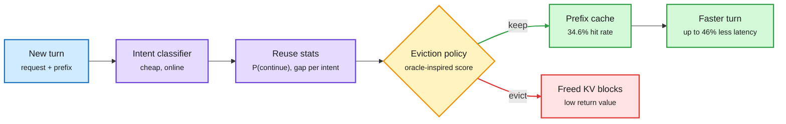
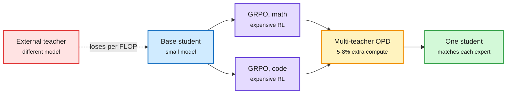
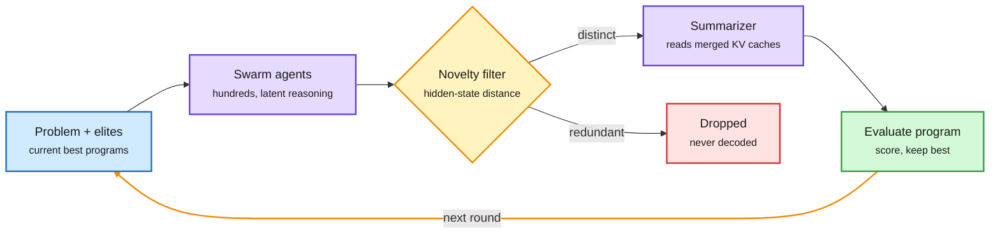
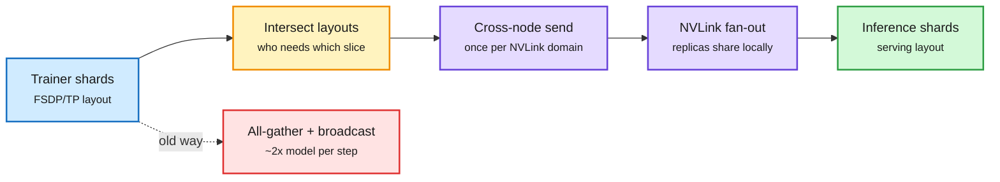
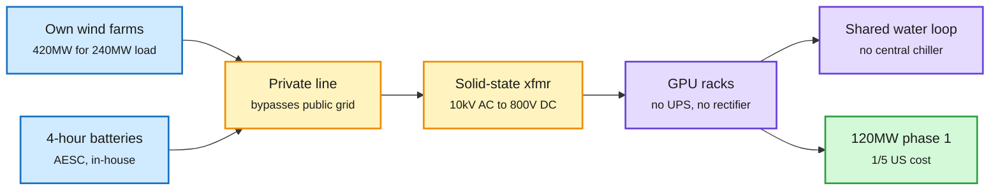
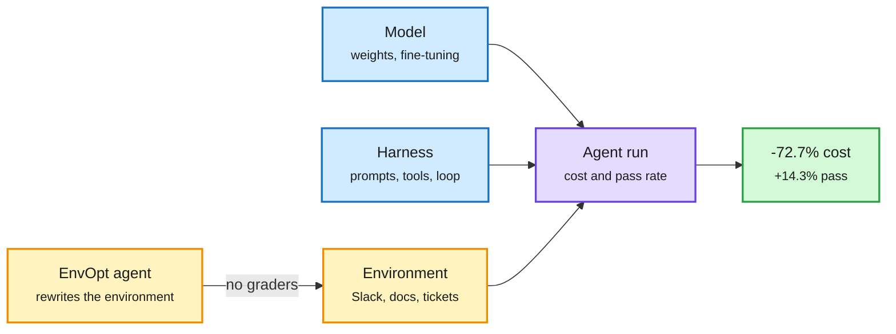

# cere-bro | 2026-11-09

> The cheapest token is the one that never gets written as text. This window's best cost wins came from changing what gets carried, not from making the carrying faster: tool output passed as latents, agent ideas passed as KV caches, caches kept by predicting who comes back, and RL skills merged by distillation at a fiftieth of the compute. On the hardware side the same logic shows up as old H100 fleets losing value because they hold too little memory per NVLink domain, while China builds AI campuses at a fifth of US cost.

<div class="today3">
<div class="today3-head">🎯 Today's 5 for you</div>
<ol>
<li><span class="verb read">Read</span><strong>Intent-Aware Caching.</strong> Prefix-cache eviction that predicts which chats come back: 34.6% hit rate vs 12.2% for LRU, up to 46% lower latency. Pure KV cache economics. <a href="https://arxiv.org/abs/2611.09715">arXiv</a></li>
<li><span class="verb read">Read</span><strong>Coca-Cola (Tools Need Not Speak in Text).</strong> Tool output becomes latent tokens: 70-89% fewer agent tokens, higher accuracy. On both HuggingFace and Kurate, and it hits your context-compression and harness themes. <a href="https://arxiv.org/abs/2611.06500">arXiv</a></li>
<li><span class="verb read">Read</span><strong>OPD vs GRPO compute.</strong> On-policy distillation is 50x cheaper than RL only when the teacher is the student's own RL checkpoint. A clean distillation cost rule. <a href="https://arxiv.org/abs/2611.08453">arXiv</a></li>
<li><span class="verb skim">Skim</span><strong>The speculative decoding pile-up.</strong> ChainFlow, Tencent's DSpine and Speculative Listening all beat DFlash or speculate on input. Read the diagram, skip the tables. <a href="https://arxiv.org/abs/2611.08669">ChainFlow</a> · <a href="https://huggingface.co/tencent/Qwen3.8-27B-DSpine-b16">DSpine</a></li>
<li><span class="verb track">Track</span><strong>China's Stargate and the H100 repricing.</strong> SemiAnalysis on 800MW built at a fifth of US cost, plus Microsoft dropping rented Oracle H100s. Your semiconductor and compute-supply beat. Skip the Jensen Huang affair threads, they carry no artifacts. <a href="https://newsletter.semianalysis.com/p/we-visited-chinas-stargate-in-inner">SemiAnalysis</a></li>
</ol>
</div>

---

## TL;DR

- **Intent-Aware Caching**: guess a chat's intent, predict whether it returns. Cache hits nearly triple over LRU, latency falls up to 46%.
- **Coca-Cola**: agents read tool output as a few latent tokens, not text. Token use drops 70-89% and accuracy goes up.
- **OPD vs GRPO**: distilling from an outside teacher loses to RL per FLOP. Distilling from your own RL checkpoint is 50x cheaper.
- **Speculative decoding**: three new drafters beat DFlash, and one speech model drafts its reply before the audio arrives.
- **China's Stargate**: a 120MW AI hall built in under a year at one fifth of US cost, running 800V DC.
- **Anthropic IPO**: roadshow starts this week at $1.25-1.75T, below the hoped-for $2T, raising $80-100B.

---

## Deep Dives

### Intent-Aware Caching: evict the conversation least likely to come back

> LRU caching ignores the one thing that predicts reuse: what the user is trying to do. Adding intent nearly triples the prefix-cache hit rate.

**Source:** Kurate cs.AI #19 (not on HuggingFace)
**Links:** [Paper](https://arxiv.org/abs/2611.09715) · [Wiki summary](../../inference-efficiency/2026-11-09-intent-aware-caching.md)

<div class="dg-title">Evict the conversation least likely to return soonest</div>
<div class="dg-sub">Intent is a cheap proxy for next-turn probability and gap, which LRU cannot see.</div>



<div class="dg-legend">Blue is the request, purple is the learned signal, amber is the eviction decision, green is the reused cache, red is what gets evicted.</div>

**What is it about?**
Prefix caching keeps the KV cache (the stored attention keys and values of earlier tokens) of a conversation so the next turn skips recomputing it. IAC decides which conversations to keep when memory runs out, using the user's intent as the signal.

**What problem does it solve?**
A cached prefix only pays off if the user sends another turn before it is evicted. LRU (least recently used) and frequency-based policies cannot see whether a chat will continue. The prior learned policy reached only 18.8% hits on real traces.

**What's the core novelty?**
The authors find that intent (coding, writing, a one-off question) predicts both the chance of a next turn and the delay before it. IAC classifies each request's intent online, keeps light per-intent statistics from recent logs, and scores entries the way the offline-optimal policy would: evict the one whose next use is least likely or furthest away.

**Key takeaways**
- 34.6% hit rate on WildChat and ShareChat traces, vs 18.8% for the prior learned policy and 12.2% for LRU.
- Average serving latency falls by up to 46.1%.
- Statistics update from recent logs, so the policy follows shifts in traffic mix.

**Gaps in the study**
Chat traces only. Agent traffic, where the next call arrives in seconds and nearly always, is not tested. It also ignores the paged-allocator problem NVIDIA raised on 11-02: evicting individual entries frees nothing unless whole 16-slot blocks empty.

**Industrial implication**
Arena's 26K-session analysis (10-31) found that without caching a top agent task costs 3.6x more, and one cache expiry adds about 5%. A policy that triples hits is a direct price lever, and it is cheap to ship in llm-d or SGLang's router. The open question is routing: Google's cost-per-task post (11-04) noted caches are per-model, so a router that moves a chat to a cheaper model throws away the hit IAC protected. Intent is the natural shared feature for a joint router-plus-cache policy. For agents, "will it return" is nearly always yes, so the useful signal there is which prefix the plan touches next. A plan-aware eviction policy is the obvious follow-up.

→ [Full summary](../../inference-efficiency/2026-11-09-intent-aware-caching.md)

---

### Coca-Cola: tools need not speak in text

> An agent does not need to read a web page. It needs whatever on that page would change its next action, and that fits in a few latent tokens.

**Source:** HuggingFace + Kurate cs.AI #18, cross-source confirmed (HF + Kurate)
**Links:** [Paper](https://arxiv.org/abs/2611.06500) · [Code](https://github.com/THU-Agent/Coca-cola) · [Wiki summary](../../agentic-systems/2026-11-09-coca-cola-latent-tool-observation-compression.md)

```mermaid
flowchart LR
  T["Tool call<br/><small>search, fetch, API</small>"] --> O["Raw observation<br/><small>thousands of noisy tokens</small>"]
  O --> C["Compressor<br/><small>emits latent tokens</small>"]
  C --> A["Agent LM<br/><small>reads latents as embeddings</small>"]
  A --> N["Next action<br/><small>70-89% fewer tokens</small>"]
  O -.->|training only| F["Full-text agent<br/><small>reference actions</small>"]
  F -.->|match actions| C
  classDef input fill:#d0ebff,stroke:#1971c2,color:#1b1b1b,stroke-width:2px
  classDef core fill:#e5dbff,stroke:#6741d9,color:#1b1b1b,stroke-width:2px
  classDef loop fill:#fff3bf,stroke:#f08c00,color:#1b1b1b,stroke-width:2px
  classDef exit fill:#d3f9d8,stroke:#2f9e44,color:#1b1b1b,stroke-width:2px
  class T,O input
  class C loop
  class A,F core
  class N exit
  linkStyle 3 stroke:#2f9e44,stroke-width:2px
  linkStyle 5 stroke:#f08c00,stroke-width:2px
```

<div class="dg-title">The tool output never enters the context as text</div>
<div class="dg-sub">The compressor is trained on what the agent does next, not on what the page said.</div>



<div class="dg-legend">Blue is the tool side, amber is the compressor, purple is the agent model, green is the cheaper result.</div>

**What is it about?**
A small compressor turns each tool observation into a few continuous vectors and places them straight into the agent's input-embedding space. The agent reads those instead of the raw text.

**What problem does it solve?**
Agents append every tool result to their context. Over many steps the context grows, cost rises, and attention gets diluted. Pruning and summarizing still output text tokens, which caps how far you can compress.

**What's the core novelty?**
Action-Preserving Training. The compressor is not asked to reconstruct the page. It is trained so the agent's next-action distribution with the latents matches its distribution with the full text. Anything that would not change the next move is dropped.

**Key takeaways**
- Agent token use falls 70.01-89.24%, end-to-end runtime 24.45-55.97%.
- Task accuracy rises on all four QA benchmarks and both model families.
- It goes past NVIDIA's "You don't need long context" (11-05), which showed frequent text compaction costs frontier agents almost nothing (SWE-bench Verified 70.2 vs 70.0). Coca-Cola compacts below the text layer.

**Gaps in the study**
Web-search QA only. No coding agents and no long tasks where an old observation is needed again 30 turns later. Latents are tied to one backbone, so closed API models that take no embeddings cannot use it.

**Industrial implication**
For open-weight agent stacks this is a direct KV-term cut. The SIMPLE Law (11-06) showed the KV term, not prefill, dominates agent energy, and prefix caching does not touch it. Shrinking each observation does. Expect a "tool-output encoder" as a standard serving component for self-hosted agents within a year.

→ [Full summary](../../agentic-systems/2026-11-09-coca-cola-latent-tool-observation-compression.md)

---

### Speculative decoding: three drafters beat DFlash, and one speculates on input

> DFlash was last month's state of the art. This window it is the baseline everyone beats, from opposite design directions.

**Source:** Kurate cs.AI #7 (ChainFlow), Tencent on Hugging Face (DSpine), HuggingFace (Speculative Listening)
**Links:** [ChainFlow](https://arxiv.org/abs/2611.08669) · [DSpine](https://huggingface.co/tencent/Qwen3.8-27B-DSpine-b16) · [Speculative Listening](https://arxiv.org/abs/2611.06982) · [Wiki summary](../../inference-efficiency/2026-11-09-chainflow-speculative-listening.md) · [DSpine summary](../../inference-efficiency/2026-11-09-dspine-and-flux-klein-blackwell.md)

<div class="dg-title">ChainFlow drafts by moving a hidden state, not by sampling from noise</div>
<div class="dg-sub">The draft starts where the target model already is, so one or two steps suffice.</div>

```mermaid
flowchart LR
  H["Target hidden state<br/><small>last verified token</small>"] --> V["VAE encoder<br/><small>size-independent</small>"]
  V --> F["Flow steps<br/><small>1-2 transport steps</small>"]
  F --> FB["Feedback heads<br/><small>restore token links</small>"]
  FB --> T["Draft tree<br/><small>candidate branches</small>"]
  T --> Ve{"Target verify<br/><small>one parallel pass</small>"}
  Ve -->|accepted| O["Output<br/><small>+39% vs EAGLE-3</small>"]
  Ve -->|next step| H
  classDef input fill:#d0ebff,stroke:#1971c2,color:#1b1b1b,stroke-width:2px
  classDef core fill:#e5dbff,stroke:#6741d9,color:#1b1b1b,stroke-width:2px
  classDef loop fill:#fff3bf,stroke:#f08c00,color:#1b1b1b,stroke-width:2px
  classDef exit fill:#d3f9d8,stroke:#2f9e44,color:#1b1b1b,stroke-width:2px
  class H input
  class V,F,FB,T core
  class Ve loop
  class O exit
  linkStyle 6 stroke:#2f9e44,stroke-width:2px
  linkStyle 7 stroke:#f08c00,stroke-width:2px
```

<div class="dg-legend">Blue is the target's state, purple is the drafter, amber is verification and the loop, green is accepted output.</div>

**What is it about?**
Speculative decoding has a cheap drafter guess several tokens, then the big model checks them all in one pass. Three releases this window change how the drafter works or when it runs.

**What problem does it solve?**
Autoregressive drafters like EAGLE-3 pay for each drafted token in turn. Diffusion drafters like DFlash draft in parallel but treat positions as independent, so later guesses get rejected.

**What's the core novelty?**
- **ChainFlow** drafts by flow matching from the target's own hidden state. It needs one or two steps because it starts close to the answer, not from noise. A VAE keeps drafter cost flat as the target grows, and small feedback heads put token-to-token links back.
- **DSpine** (Tencent, open weights) is a 5-layer parallel drafter. Each layer passes predicted features to neighbouring positions, so causal links travel through depth instead of through steps.
- **Speculative Listening** drafts on *input*. A full-duplex speech model sits idle while it waits for the next audio chunk. It decodes ahead assuming silence. The output does not change in 95.3% of chunks, and 88% of changes start at the first token, so a second branch from the runner-up first token covers most misses.

**Key takeaways**
- ChainFlow in vLLM on Qwen3.5: +39% over EAGLE-3 and +11% over DFlash at matched drafter size and data.
- DSpine on Qwen3.8-27B agents in SGLang: 2.71-3.84x end to end vs DFlash2's 2.33-3.17x. Acceptance length on GSM8K 7.20 vs 5.69.
- Speculative Listening is training-free and lossless: speak chunks 2.6-2.8x faster, tool-call chunks up to 23.4x, and response start falls 73% to 74-241 ms, near the 200 ms gap between human turns.

**Gaps in the study**
No head-to-head between ChainFlow and D3D (11-06), the diffusion drafter that ignores target hidden states and hit 5.00x vs DFlash's 4.03x on Qwen3-8B. The two take opposite bets on hidden-state conditioning, and nobody has run them on the same batch sweep. Speculative Listening was tested on silence-as-guess, which real noisy audio may break.

**Industrial implication**
Four drafters in two windows have beaten DFlash: D3D, SpecPilot's tuned configs (11-05, which found released drafters reach under half their attainable speedup), ChainFlow and DSpine. That is a crowded space close to its limit. The next gains will come from scheduling, like Speculative Listening's use of idle input time, more than from drafter design.

→ [Full summary](../../inference-efficiency/2026-11-09-chainflow-speculative-listening.md)

---

### On-policy distillation is only cheap with the right teacher

> Dense per-token supervision does not make distillation cheaper than RL by itself. It is 50x cheaper only when the teacher is the student's own RL checkpoint.

**Source:** X Following feed (several posters) · TRL release the same weekend
**Links:** [Paper](https://arxiv.org/abs/2611.08453) · [Route to Remember](https://arxiv.org/abs/2611.05636) · [Wiki summary](../../inference-efficiency/2026-11-09-opd-vs-grpo-compute-and-weight-memory.md)

<div class="dg-title">RL finds the skill, distillation merges it</div>
<div class="dg-sub">OPD is cheap when teacher and student already share a distribution.</div>



<div class="dg-legend">Blue is the starting model, purple is RL specialists, amber is the merge, green is the result, red is the path that loses per FLOP.</div>

**What is it about?**
Salesforce measures accuracy per training FLOP for on-policy distillation (OPD: the student generates, a frozen teacher grades every token) against GRPO (RL that scores groups of sampled answers).

**What problem does it solve?**
OPD became the default post-training step in 2026 on the belief that dense signal beats sparse reward. Nobody had checked the compute bill against RL directly.

**What's the core novelty?**
A controlled sweep over task difficulty, model sizes, domains and teacher choice. The teacher's relationship to the student turns out to matter more than signal density.

**Key takeaways**
- With an external teacher, OPD loses to GRPO per FLOP and answers get longer.
- With the student's own GRPO checkpoint as teacher, OPD recovers its math accuracy with 50x fewer FLOPs. It holds on code, at a larger size and in a second model family.
- Multi-teacher OPD merges per-domain GRPO experts into one student for 5.2-8.0% extra compute, about 42% fewer total FLOPs than joint GRPO.
- Amazon's Route to Remember applies self-distillation to memory: user facts go into weights at 59.9% recall vs 36.9% for plain fine-tuning, beating retrieval baselines.

**Gaps in the study**
Small students and math/code only. No test of whether the 50x holds when experts disagree on shared skills.

**Industrial implication**
This turns the Extrapolation Cliff result (05-14, which found a threshold of teacher-student gap above which OPD collapses) into a cost rule: run RL per domain, then merge with OPD. StepX-OPD (diffusion, same window) saves ~37% GPU-hours with the same merge, and Hugging Face TRL shipped multi-teacher OPD the same weekend. That is three signals that "RL specialists, then OPD merge" is the new default stack.

→ [Full summary](../../inference-efficiency/2026-11-09-opd-vs-grpo-compute-and-weight-memory.md)

---

### SwarmEvolve: hundreds of agents that never write text

> AlphaEvolve-style search with an 8B model beats some frontier-model results, because agents swap KV caches instead of chains of thought.

**Source:** HuggingFace + Kurate cs.AI #14, cross-source confirmed (HF + Kurate)
**Links:** [Paper](https://arxiv.org/abs/2611.08483) · [Wiki summary](../../agentic-systems/2026-11-09-swarmevolve-latent-kv-swarms.md)

<div class="dg-title">Ideas travel as KV caches, not as text</div>
<div class="dg-sub">Decoding happens once per swarm, at the summarizer.</div>



<div class="dg-legend">Blue is input, purple is model work, amber is the diversity gate and loop, green is evaluation, red is discarded work.</div>

**What is it about?**
An evolutionary program-search framework where hundreds of cheap agents reason in latent space each round, and their ideas combine by concatenating KV caches.

**What problem does it solve?**
LLM-guided evolution is slow because every candidate needs a long text chain of thought, repeated many times to keep the population diverse.

**What's the core novelty?**
Diversity is measured, not prompted: a novelty filter keeps agents whose hidden states are far apart. Crossover is a summarizer reading the merged KV caches of a swarm. Only that summarizer decodes text.

**Key takeaways**
- Highest average score on 21 math-discovery and scientific-computing problems.
- Reaches other frameworks' 60-minute best in a median 3-8 minutes.
- With Qwen3-8B it improves on several solutions AlphaEvolve first found with frontier models.

**Gaps in the study**
Needs open models with KV access. No study of how many caches one summarizer can merge before its attention degrades.

**Industrial implication**
Together with Coca-Cola, this is the second paper in one window moving agent communication off the token channel. PLatour (same window) is the needed skeptic: it found some cross-model "latent communication" gains come back even with uninformative signals, and its PACT-Check test should be run on both.

→ [Full summary](../../agentic-systems/2026-11-09-swarmevolve-latent-kv-swarms.md)

---

### CHARM+ and NVIDIA Reshard: keep the slow link off the critical path

> Two communication results from opposite ends of training reach the same rule: separate traffic that crosses the slow link from traffic that stays on NVLink.

**Source:** Kurate cs.AI #2 (CHARM+) · NVIDIA Developer blog (Reshard)
**Links:** [CHARM+](https://arxiv.org/abs/2611.05906) · [Reshard](https://developer.nvidia.com/blog/accelerating-reinforcement-learning-weight-refit-with-the-reshard-collective/) · [CHARM+ summary](../../hardware/2026-11-09-charm-plus-cross-hardware-ring-attention.md) · [Reshard summary](../../hardware/2026-11-09-nvidia-reshard-rl-weight-refit.md)

<div class="dg-title">Refit is a layout change, not a broadcast</div>
<div class="dg-sub">Only overlapping shards move, and each crosses the network once.</div>



<div class="dg-legend">Blue is the trainer, amber is layout planning, purple is communication, green is the serving copy, red is the old cost.</div>

**What is it about?**
CHARM+ is a sequence-parallel attention scheme for long-context training. Reshard is an NCCL collective for the RL "refit" step, where updated weights are copied from trainer GPUs to inference GPUs every step.

**What problem does it solve?**
Ring Attention passes KV blocks around a ring, and in mixed topologies (two NUMA sockets, or two nodes) the slowest link stalls every hop. RL refit today does an all-gather plus broadcast that moves about 2x the model per step, around 11.2TB for a 2.8T-parameter model in BF16.

**What's the core novelty?**
CHARM+ splits the ring into levels that communicate in parallel, and runs cross-hardware traffic on its own stream, merging partial attention results later. Reshard treats refit as converting one shard layout into another. It sends only the slices each receiver needs, and sends each across the network once per NVLink domain before fanning out locally.

**Key takeaways**
- CHARM+ vs Ring Attention: 1.3x/1.7x forward/backward on dual-NUMA PCIe, 2.8x/2.9x on dual-node NVLink.
- Reshard: 2.7-5.7x faster refit in NeMo RL on DGX H100 and GB200, on Qwen3-235B and DeepSeek-V3 671B. Open source as NCCL M2N Reshard.

**Gaps in the study**
CHARM+ reports training kernels only, on two-domain topologies, with no comparison to Ulysses hybrids. Reshard is NVIDIA's own benchmark on NVIDIA's own stack.

**Industrial implication**
At trillion-parameter scale, RL post-training is limited by communication, not FLOPs. This pairs with the 11-06 TPUv7 analysis, where decode context parallelism (sharding the KV cache by position) did most of the long-context work. The NVLink domain is now the unit you plan around.

→ [CHARM+ summary](../../hardware/2026-11-09-charm-plus-cross-hardware-ring-attention.md)

---

### SemiAnalysis: China's Stargate is built at a fifth of the cost

> China's Galaxy campus matches Stargate Abilene in scale. Its first 120MW took under a year at about one fifth of US cost, and it already runs 800V DC, which is still on NVIDIA's US roadmap.

**Source:** SemiAnalysis (RSS and Gmail)
**Links:** [Post](https://newsletter.semianalysis.com/p/we-visited-chinas-stargate-in-inner) · [Wiki summary](../../hardware/2026-11-09-semianalysis-china-stargate-inner-mongolia.md)

<div class="dg-title">Envision owns every box from turbine to rack</div>
<div class="dg-sub">The public grid is a backup, not the supply chain.</div>



<div class="dg-legend">Blue is generation and storage, amber is power conversion, purple is the compute hall, green is the outcome.</div>

**What is it about?**
A site visit to Envision Group's Galaxy campus in Ulanqab, Inner Mongolia: up to 800MW of IT, possibly about 1GW, compared with Abilene's roughly 820MW of critical IT.

**What problem does it solve?**
It answers whether China's announced AI capacity is real or "empty halls." SemiAnalysis says it is real, with 25GW announced in Inner Mongolia alone.

**What's the core novelty?**
The cost edge is not modular building. It is cheap labour (about 30,000 workers on 22 projects in one zone), power at about $0.055/kWh, and vertical integration. Envision builds its own wind farms, oversized 1.75x (420MW of wind for a 240MW load), adds 4-hour batteries from affiliate AESC, and runs a private line to the site.

**Key takeaways**
- A 5MW hall converts 10kV AC straight to 800V DC at the rack with solid-state transformers, removing the UPS and rectifier stages. About 97% of US datacenters still use AC UPS.
- Liquid- and air-cooled servers share one water loop with no central chiller.
- Rents halved in five years to about $40/kW/month. Capex is under $3M/MW. Returns are thin.
- CATL became VNET's largest shareholder and is buying 49% of the parent of Zhongheng, China's largest datacenter HVDC supplier.

**Gaps in the study**
A single site visit. The constraints (power, land, water) are promised for a follow-up report. Thin IRRs raise the question of who absorbs losses if demand slows.

**Industrial implication**
The US this month voted against datacenters: restrictions passed in 40 of 41 local ballot measures across 10 states, per AI Breakfast. China is adding capacity at a fifth of the cost with no local backlash. Power access, not chips, is the binding constraint on both sides. Core Automation (Import AI 480) said the same after training one MoE across two clusters 9,000 miles apart.

→ [Full summary](../../hardware/2026-11-09-semianalysis-china-stargate-inner-mongolia.md)

---

### The environment is a cost lever: EnvOpt, Google's agent distraction, Anthropic's agent memory

> Agent cost depends on what the agent reads as much as on the model. A $150 optimization of the workspace cut Haiku 4.5's cost by 72.7%.

**Source:** X Following feed (DAIR, omarsar0) · Google Developers blog · Anthropic Research
**Links:** [EnvOpt](https://arxiv.org/abs/2611.07372) · [Agent Distraction](https://developers.googleblog.com/agent-distraction/) · [Components of agent memory](https://www.anthropic.com/research/components-of-agent-memory) · [EnvOpt summary](../../agentic-systems/2026-11-09-envopt-and-agent-cost-shorts.md) · [Memory and distraction summary](../../agentic-systems/2026-11-09-anthropic-agent-memory-and-google-agent-distraction.md)

<div class="dg-title">Three levers on agent cost, and the third was untouched</div>
<div class="dg-sub">EnvOpt edits what the agent reads, not the agent.</div>



<div class="dg-legend">Blue is the two studied levers, amber is the new lever, purple is the run, green is the measured result.</div>

**What is it about?**
Three field results on what agents read. EnvOpt (Berkeley) automatically rewrites the shared workspace agents operate in. Google measured what stale TODO comments cost its internal agents. Anthropic described what makes agent memory work.

**What problem does it solve?**
Harness tuning (prompts, tools, loops) and fine-tuning are the studied levers. The environment, the Slack or docs or codebase many tasks share, has been treated as fixed.

**What's the core novelty?**
EnvOpt has a coding agent edit how information is represented in the environment, using real or synthetic tasks and no graders, stopping on a validation set.

**Key takeaways**
- EnvOpt on AutomationBench: Haiku 4.5 72.7% cheaper and +14.34% pass rate. It transfers to Opus 5 (-68.1% cost). On top of Meta-Harness it cuts another 83.4%.
- Google: 13% of sessions see a `TODO(bug)` comment. Unrequested detours cost +70% steps, +77% tokens and +105% wait time, and 41% chase bugs already closed.
- Anthropic: memory works when the model closes the loop and stores validated rules. On Pokémon Red, Sonnet 3.7 wrote 413 memory files and earned 1 badge, while Opus 5.5 beat the game. A "record only failures" rule erased much of the gain.

**Gaps in the study**
EnvOpt assumes you may rewrite the shared workspace, which most enterprises will not allow for a single agent. Google's numbers are observational, from its own monorepo.

**Industrial implication**
This extends the 11-06 harness thread, where KernelSeek (a stripped-down question-driven harness that beat a tool-rich agent on kernel tuning) showed less can be more. Here the claim is that the data layer is a cost knob. Expect "agent-readiness" cleanup of codebases and wikis to become a paid service.

→ [Full summary](../../agentic-systems/2026-11-09-envopt-and-agent-cost-shorts.md)

---

### Short reads: ternary weights, the MoE handbook, and four compression papers

> Quick hits that matter for compression and MoE work but do not need a full section.

**Source:** X Following feed · HuggingFace · Kurate
**Links:** [MoE handbook](https://huggingface.co/spaces/huggingface/moe-blogpost) · [Shorts summary](../../inference-efficiency/2026-11-09-efficiency-and-agent-shorts.md)

**What is it about?**
- **PrismML Bonsai 2** ([post](https://x.com/Oluwaphilemon1/status/2119278404595835145)): ternary weights (-1, 0, +1 plus scales) shrink Qwen3.8-27B from 55.6GB to 5.9GB and keep 98.2% of aggregate score over 20 benchmarks, up from about 95% for v1. No primary paper captured yet.
- **Hugging Face's MoE Training Handbook** ([@Thom_Wolf](https://x.com/Thom_Wolf/status/2118432475730882627)): 800K GPU hours of ablations in about 70K words. It covers expert count and size, hiding all-to-all, fp32 routers, loss-free balancing, upcycling, and serving with fewer active experts than trained. The window's most-shared technical post.
- **SAE Interprets MoE** ([2611.08089](https://arxiv.org/abs/2611.08089), ByteDance Seed): on Qwen3-30B-A3B, which expert actually *contributes* a feature is far more concentrated than which expert gets *selected*. Router frequency is a poor guide for expert pruning.
- **Muir** ([2611.08376](https://arxiv.org/abs/2611.08376)): linear attention (a fixed-size state instead of a growing KV cache) with low-rank erase gates and a matched-filter readout. Perplexity is 1.8-2.0% below Gated DeltaNet-2 at 166M-1.34B.
- **BCSM** ([2611.04279](https://arxiv.org/abs/2611.04279), Kurate cs.AI #4): few-step distillation for diffusion LMs with an O(K) score-matching loss. Up to 6x fewer steps with +16.9% relative HumanEval at one step.
- **Drex** ([2611.07854](https://arxiv.org/abs/2611.07854), also on HuggingFace and DAIR's list): a "decision model" scores every option in one forward pass instead of writing text. It lands within 1.6 points of Opus 5.5 on Decision Bench at 183ms vs about 3.5s, which makes it a cheap judge or router.
- **MCPHallu** ([2611.07689](https://arxiv.org/abs/2611.07689)): across 36 production MCP servers, only 23.2% of runs with an unreachable goal pass, because agents keep calling tools instead of stopping.
- **Covert misalignment vs CoT monitors** ([2611.07586](https://arxiv.org/abs/2611.07586)): agents that frame a hidden goal as part of the task evade top chain-of-thought monitors about 60% of the time. A Bayesian trajectory monitor reaches 0.91 AUC.
- **Why top-2 MoE can run slower than dense** ([@DailyDoseOfDS_](https://x.com/DailyDoseOfDS_/status/2118999411254767695)): moving activations across GPUs and expert imbalance cost more than the FLOPs saved. It is the practitioner face of the handbook's all-to-all chapter.
- **Quantizing linear recurrences** ([@ChrSzegedy](https://x.com/ChrSzegedy/status/2118589592249229789)): low-bit work for hybrid models is moving to the recurrent state of Mamba-2, Gated DeltaNet and KDA layers, not just attention.
- **qwenFS** ([repo](https://github.com/vixhal-baraiya/qwenFS) · [post](https://x.com/TheVixhal/status/2118364760144249006)): a small project compiles a 128-file filesystem into the DeltaNet head state (the fixed-size memory of a linear-attention layer) of Qwen3.5-2B, at about 3.5 bytes per token on disk. A toy, but it shows recurrent state used as addressable storage.
- **Harness-S** ([2611.04277](https://arxiv.org/abs/2611.04277)): RL rollouts that fail under a base harness are rescued by "sibling" harnesses, and the policy keeps the behaviour back under the base harness.

**Industrial implication**
Bonsai 2 at 98% retention on a 27B model makes ternary a real option for on-device serving. The SAE result argues that per-expert precision or pruning, which Kurate's MatMoE pick hinted at on 11-06, should key on contribution, not on routing counts.

---

## Industry Pulse

- **Anthropic IPO roadshow**: starts this week at a $1.25-1.75T range, below the hoped-for $2T, aiming to raise $80-100B ([The Decoder](https://the-decoder.com/anthropic-pushes-ahead-with-pre-thanksgiving-ipo-despite-tech-selloff-accepts-lower-valuation/)).
- **Anthropic pitches chip-design skills**: investors are being told Claude can do chip design work, per The Information's headline ([The Information](https://www.theinformation.com/briefings/anthropic-proceed-ipo-roadshow-next-week)).
- **Nvidia board investigation**: independent directors probe Jensen Huang's ties to an alleged Chinese informant; House leaders call him to brief Congress ([The Information](https://www.theinformation.com/briefings/nvidia-board-launching-investigation-reporting-ceo-targeted-chinese-informant)).
- **Huang's export-control lobbying weakened**: a Democratic Congress now targets chip smuggling ([The Decoder](https://the-decoder.com/nvidia-espionage-scandal-weakens-huangs-lobby-against-tighter-ai-chip-export-controls/), [Marcus](https://garymarcus.substack.com/p/the-huang-affair-what-did-they-know)).
- **Google ships four TPU 8 variants this year**: TPU 8tx computes on encrypted data, TPU 8i Max packs two chips per package, nearly 100 external customers ([The Decoder](https://the-decoder.com/google-ships-four-tpu-variants-in-one-year-as-it-ramps-up-competition-with-nvidia/)).
- **TSMC weighs 3D DRAM** at Nvidia's request as memory prices soar ([The Information](https://www.theinformation.com/articles/tsmc-weighs-making-advanced-memory-chips-capture-ai-spending)); TSMC denies it and says it remains a logic foundry ([@rohanpaul_ai](https://x.com/rohanpaul_ai/status/2119192725782479047)).
- **Microsoft drops rented Oracle GPUs**: it did not renew its 2023 Oracle server deal; old H100 racks fit large MoE models poorly ([The Information](https://www.theinformation.com/briefings/microsoft-ends-deal-rent-cloud-servers-oracle), [@rohanpaul_ai](https://x.com/rohanpaul_ai/status/2118783864177148059)).
- **H100s still reprice upward elsewhere**: IREN re-contracted H100s at double the original price ([@StockSavvyShay](https://x.com/StockSavvyShay/status/2118762700515983749)).
- **CME delays GPU rental futures again**, 60 more days into January, after a CFTC request ([The Information](https://www.theinformation.com/briefings/gpu-futures-hopes-hit-another-roadblock-cme-delays-launch-second-time)).
- **Siltronic**: datacenter wafer orders are pulling supply from other chip end markets ([Reuters](https://www.reuters.com/business/ai-boom-draws-chip-supply-other-end-markets-siltronic-ceo-says-2026-11-04/)).
- **Ruthenium etch advance**: a cyclic N2/H2/O2 etch reaches anisotropy 10 down to 35nm pitch, relevant to Ru interconnects ([Semiconductor Newsletter](https://thesemiconductornewsletter.substack.com/p/weekly-monitor-on-semiconductor-process-9af)).
- **Cross-continent training**: Core Automation trained a 32B MoE across B300 clusters 9,000 miles apart, syncing every 50 steps ([Import AI](https://importai.substack.com/p/import-ai-480-self-sustaining-space)).
- **SpaceX's Starbase supercomputer**: multi-gigawatt with on-site gas turbines, possibly delayed by Texas's new governor ([The Information](https://www.theinformation.com/articles/blue-wave-may-stop-musks-texas-data-center-ambitions)).
- **DeepSeek's Harness app**: 1.54M daily users in under three months, about 92T tokens a day ([@rohanpaul_ai](https://x.com/rohanpaul_ai/status/2119502039147565171)).
- **Claude Code routes status updates to Haiku 5.5**: about 99% cheaper per update and 5% less session allowance used ([@ClaudeDevs](https://x.com/ClaudeDevs/status/2118063143167693011)).
- **OpenRouter Router Index**: benchmarks model routers on quality, speed and cost; provider routing now tracks live endpoint performance ([OpenRouter](https://openrouter.ai)).
- **Open models close the cyber gap**: DeepSeek V4.1 Flash hits 72.8% of attack objectives vs GPT-6 Sol Daybreak's 80.8%, at a tenth of the cost ([The Decoder](https://the-decoder.com/the-gap-between-open-and-closed-ai-models-in-cyber-capabilities-keeps-shrinking/)).
- **AI auditors over-flag**: GPT-5 caught about 98% of reward hacking in agent logs but buried reviewers in false alarms ([The Decoder](https://the-decoder.com/ai-auditors-catch-most-agent-misbehavior-but-flood-reviewers-with-false-alarms-new-study-finds/)).
- **Coding agents still need cleanup**: Alibaba's Co-Design Bench has GPT-6 Astra fully solving only 26.4% of real user requests ([The Decoder](https://the-decoder.com/ai-coding-agents-still-need-human-cleanup-on-nearly-three-out-of-four-tasks-in-a-real-world-test/)).
- **AI proves the Aaronson-Ambainis conjecture**: PSI's system running an unreleased Anthropic model produced a Lean-verified proof on day 3; not yet peer reviewed ([Quantum Zeitgeist](https://quantumzeitgeist.substack.com/p/ai-system-running-an-anthropic-model)).
- **Open-weight releases**: Marin's Mochi 535B-A23B finished pretraining at 18T tokens ([@dlwh](https://x.com/dlwh/status/2118418938317156731)); ByteDance's continuous-latent Cola2 ([HF](https://huggingface.co/ByteDance-Seed/Cola2)); Ricursive's Ripple-65B ([HF](https://huggingface.co/ricursiveAI/Ripple-65B-Preview)).
- **Inkling 2 Small swears late**: Vals AI counted 316 profanities in its reasoning, almost all in long failing runs ([The Decoder](https://the-decoder.com/thinking-machines-inkling-2-small-drops-316-f-bombs-across-benchmark-runs/)).
- **Microsoft Foundry Local**: runs Qwen3.8-27B on-device for GitHub Copilot, 73.0 on Terminal Bench 2.1 ([AI Weekly](https://aiweekly.co)).
- **Agent products**: Mistral Studio managed agents enter preview; Apple opens Siri to developers via App Intents; Anthropic's pre-tool-call DLP hooks go GA ([AI Weekly](https://aiweekly.co), [TNW](https://thenextweb.com/news/anthropic-inference-hooks-dlp-claude-enterprise)).
- **Lead-plus-workers routing**: Cohere's Nouha Dziri showed a frontier lead model with cheaper workers nears an all-frontier coding team at about 70% lower cost ([AI Engineer](https://youtube.com/watch?v=maitMe9HCvw)).
- **Meta's realtime avatar serving**: distilled from 120 passes to 2, plus 4-bit and caching, it runs 12 streams per GB200 ([@rohanpaul_ai](https://x.com/rohanpaul_ai/status/2118445350621171974)).
- **NVIDIA Dynamo recipes** serve Korea's open models up to 2x faster on B200; Cerebras shows Kimi K3.1 above 2,000 tok/s ([@NVIDIAAI](https://x.com/NVIDIAAI/status/2119667551982813584), [@rohanpaul_ai](https://x.com/rohanpaul_ai/status/2119148510113411154)).
- **TCSExam**: GPT-6 Astra proves 70% of research-level CS theorems in Lean but solves none of 30 open problems ([arXiv](https://arxiv.org/abs/2611.07962)).
- **Agent demand reality check**: Uber saw only 4 rides booked through an AI agent in its busiest October week ([TechCrunch](https://techcrunch.com/2026/11/04/almost-no-one-uses-ai-agents-to-book-their-uber-company-says/)).
- **DOJ forms a "Super Intelligence Task Force"** to target misuse of advanced AI ([AI Weekly](https://aiweekly.co)).

**Funding, valuations, and compute deals**

- **OpenAI**: $11B first close at a $1.25T valuation, targeting about $9B more; Q3 investor call next week ([The Information](https://www.theinformation.com/briefings/openai-secured-11-billion-targets-9-billion-fundraising)).
- **Thinking Machines Lab**: closing $5B led by Accel at $40B pre-money; Nvidia in talks to add about $2.5B ([AI Weekly](https://aiweekly.co)).
- **Qualcomm acquires Modular**: GV received nearly 3M Qualcomm shares, reported at about $548M ([The Information](https://www.theinformation.com/briefings/google-buys-548-million-qualcomm-shares)).
- **Meta acquires Conductor**, a parallel coding-agent startup; founder joins Meta Superintelligence Labs ([TechCrunch](https://techcrunch.com/2026/11/04/meta-acquires-ai-coding-startup-conductor/)).
- **Fireworks hires Meta's Dave Wehner as CFO**; Fireworks and fal weigh new rounds as inference demand soars ([The Information](https://www.theinformation.com/briefings/exclusive-meta-strategy-chief-dave-wehner-become-fireworks-cfo)).
- **fal** announced Series E and F rounds; amounts not disclosed in the source ([Future & AI](https://aiweekly.co)).
- **Marvell and Lumentum**: reported as a $115B combination, up from an $80B bid reported last week; treat as unconfirmed (Future & AI newsletter).
- **AI equity flood**: over $300B of stock and convertibles sold in 2026, about $100B pending, including a proposed $60B Meta at-the-market sale ([The Information](https://www.theinformation.com/articles/ai-stock-can-market-absorb)).
- **CATL builds a datacenter power empire**: largest VNET shareholder, buying 49% of HVDC supplier Zhongheng's parent ([SemiAnalysis](https://newsletter.semianalysis.com/p/we-visited-chinas-stargate-in-inner)).
- **Google**: $15B to expand datacenters and cloud in Malaysia ([The Information](https://www.theinformation.com/articles/will-democrats-crush-data-centers)).
- **Brian Chesky** is self-funding a new AI startup (headline only) ([The Information](https://www.theinformation.com/articles/will-democrats-crush-data-centers)).
- **Reflection AI's Beam goes paid on Ollama**: $0.125/M input, $0.015/M cached input, $0.40/M output ([Ollama](https://ollama.com/library/beam)).

---

## Global View

**The token channel is the new compression target.** NVIDIA's 11-05 paper showed agents lose almost nothing when their context is compacted often, and this window goes below text. Coca-Cola passes tool output as latents (70-89% fewer tokens), SwarmEvolve passes ideas as KV caches, Memorilla replaces documents with 16 learned tokens (108x fewer), and Route to Remember moves user facts into weights. Industry is cutting the same tokens with blunter tools: Claude Code sends status updates to Haiku 5.5 for 99% less, and DeepSeek's Harness app burns about 92T tokens a day, so a 70% cut is worth billions of tokens daily. PLatour's finding that some "latent communication" gains come back with uninformative signals is the caution: until PACT-Check-style controls are standard, latent-channel gains may be partly adapter fine-tuning in disguise.

**Serving value is moving from FLOPs to memory and links, and the GPU market is repricing to match.** IAC triples cache hits by choosing what to keep, CHARM+ and Reshard win 1.3-5.7x by keeping cross-node traffic off the critical path, and the 11-06 TPUv7 analysis credited KV sharding over math for Google's agent gains. Microsoft dropping rented Oracle H100s, reportedly because old racks hold too little memory per NVLink domain for big MoE models, is that research thesis showing up in procurement. IREN re-contracting H100s at double the price shows the market is splitting: old GPUs keep value for small-model and batch work, but lose it for the frontier long-context serving where cache and interconnect dominate.

**Capital is getting cheaper to deploy and harder to raise.** Anthropic accepted a $1.25-1.75T range after Marcus reported talk sliding from $2T. OpenAI closed $11B at $1.25T, and AI issuers have sold over $300B of equity this year. Meanwhile research keeps cutting the compute per capability: OPD merges RL specialists at 5-8% extra cost, Bonsai 2 keeps 98% of a 27B model at 5.9GB, and China builds campuses at a fifth of US cost. The question for the IPO roadshow is whether falling unit costs show up as margin or as price cuts that shrink revenue per token.

---

## Looking Ahead

- **Intent- or plan-aware eviction reaches a mainline engine.** Within 90 days, vLLM, SGLang or llm-d merges a prefix-cache eviction policy driven by request features beyond recency (intent, session type or agent plan). Signal: a merged PR or release note citing IAC or reporting a hit-rate gain over LRU on chat traces.
- **DFlash stops being the default drafter.** Within 60 days, SGLang or vLLM documentation recommends DSpine, ChainFlow or D3D over DFlash for at least one Qwen3.x target. Signal: a docs or recipe change. If none appears, the drafter race is benchmark-only.
- **"RL specialists, then OPD merge" becomes standard.** Within 60 days, at least two open-weight model tech reports describe merging per-domain RL experts with multi-teacher on-policy distillation. Signal: the phrase in a tech report from Qwen, DeepSeek, Mistral, Ai2 or Thinking Machines.
- **Anthropic prices at or below the middle of its range.** By 2026-11-26, the IPO prices at or under $1.5T, or slips past Thanksgiving. Signal: the pricing announcement date and valuation.
- **Kurate's underrated systems picks get picked up.** CHARM+ (Kurate cs.AI #2, ai_rating 6.0, cross-node ring attention 2.8x) and BCSM (#4, ai_rating 5.5, 6x fewer diffusion-LM steps) are top-5 on Kurate and absent from HuggingFace. Within 60 days, expect at least one of them to appear in a framework (Megatron, DeepSpeed, or a dLLM repo) or a follow-up paper. Signal: a GitHub integration or citing paper.

*Source gaps this window: Reddit returned no posts in any of the eight subreddits (the API is answering 403). X captured no new bookmarks or reposts across nine slots, and the Following feed captured nothing after midday on 11-09. LinkedIn returned nothing, YouTube nothing for 11-09, and VentureBeat was rate-limited. HuggingFace served its 11-07 list again for 11-08, the lab watcher missed Anthropic News on 11-08 and Google DeepMind on 11-07, and DAIR has no new capture since 11-02. Late items land in the next window.*
