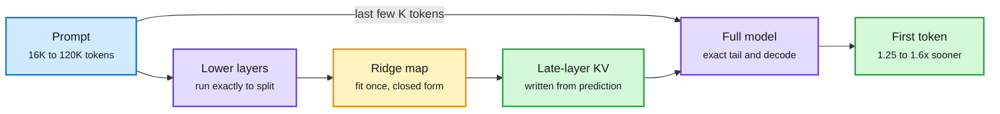
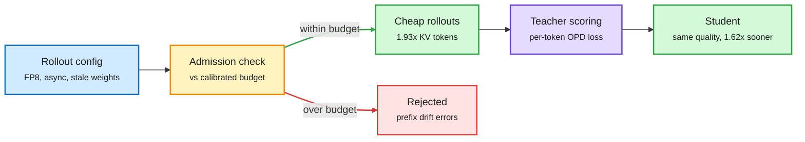
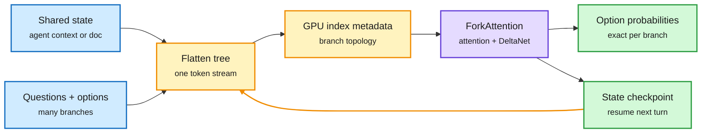
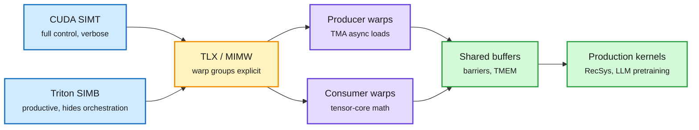
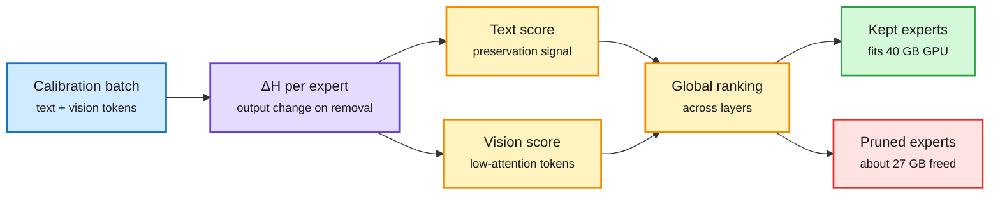
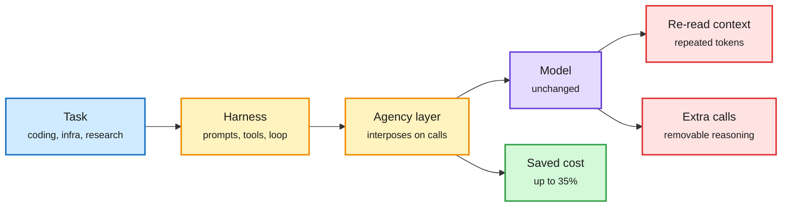
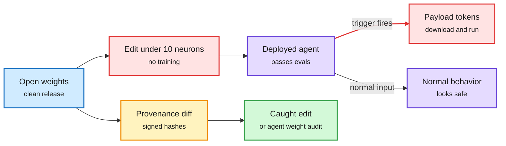

# cere-bro | 2026-11-11

> The day's savings come from computing less of what you already know. RidgeFill skips most upper layers during prefill and predicts their cache. On-policy distillation turns out to tolerate FP8, async rollouts and 1.62x faster training. Flide serves decision models without recomputing a shared prefix. Five papers say the agent bill is set by the harness, not the model. Meanwhile old Hopper GPUs got 30-50% more expensive, and Gemini 4 Carbon shipped at a third of Opus 5.5's output price.

🎯 Today's 5 for you

<ol>
<li>Read<strong>RidgeFill.</strong> Run the lower layers on the prompt, then fill every upper layer's KV cache from a closed-form ridge regression. 1.25 to 1.6x faster time to first token, no training. Your KV cache and prefill beat, and the splice-test method is worth stealing. <a href="https://arxiv.org/abs/2611.09709">arXiv</a></li>
<li>Read<strong>The OPD mismatch budget.</strong> On-policy distillation survives quantized and async rollouts that break RL. FP8 fits 1.93x more KV tokens, and training reaches the same quality 1.62x sooner. Distillation meets quantization. <a href="https://arxiv.org/abs/2611.11450">arXiv</a></li>
<li>Read<strong>Flide.</strong> The first serving engine for decision models, the small gates that do your routing. It forks shared state exactly, through attention and DeltaNet layers, and runs up to 9.5x faster than vLLM and SGLang. <a href="https://arxiv.org/abs/2610.42148">arXiv</a></li>
<li>Skim<strong>Meta's TLX and the TPU v7 megakernel.</strong> Hopper and Blackwell made kernels an orchestration problem between warp groups. Meta added that layer to Triton. RadixArk ran an 816B MoE's whole decode step as one program on four TPU chips. Your GPU-kernel beat. <a href="https://engineering.fb.com/2026/11/10/open-source/tlx-a-hardware-native-gpu-compiler-for-production-ml/">Meta</a> · <a href="https://bit.ly/4zgrhBL">PyTorch</a></li>
<li>Track<strong>The harness owns the bill.</strong> Agency finds harness choices swing cost 2.6x at flat accuracy. Another paper shows 41 to 46% of agent reasoning can be deleted. This is your harness theme with a cost number on it. Skip the Lazarus "sleeper agent" reposts; read the one Microsoft post instead. <a href="https://arxiv.org/abs/2611.12122">Agency</a> · <a href="https://arxiv.org/abs/2611.07238">waste paper</a></li>
</ol>

---

## TL;DR

- **RidgeFill**: skip most upper layers during prefill and predict their cache with a linear map. First token arrives up to 1.6x sooner.
- **OPD mismatch budget**: distillation tolerates cheap FP8 and async rollouts up to a measurable limit. Same quality, 1.62x sooner.
- **Flide**: an exact serving engine for decision models. Shared prefixes run once, and it is 9.5x faster than vLLM.
- **Gemini 4 Carbon**: Google's strongest model goes public at $2/$10 per million tokens, with a /swarm mode for agent teams.
- **Agent cost**: harness changes swing the bill 2.6x at the same accuracy. Up to 46% of agent reasoning is removable.
- **CoreWeave**: prices for older Ampere and Hopper GPUs rose 30 to 50%. Debt costs still swamp operating income.

---

## Deep Dives

### RidgeFill: the upper layers never read most of your prompt

> You can skip most of a model's upper layers during prefill and fill their cache from a regression fit in one pass. Decode stays exact.

**Source:** HuggingFace Daily Papers (11-10)
**Links:** [Paper](https://arxiv.org/abs/2611.09709) · [Wiki summary](../../inference-efficiency/2026-11-11-ridgefill-late-layer-cache-fill.md)

The upper layers never see most of the prompt

A closed-form map stands in for the skipped layers, but only for writing the cache. Decode is exact.

Blue is the prompt, purple runs the real model, amber is the fitted stand-in, green is the cache and the faster first token.

**What is it about?**
Prefill is the pass that reads the whole prompt and writes the KV cache (the stored keys and values for every past token, so attention never recomputes them). It is compute-bound, and it sets time to first token. RidgeFill runs the lower layers normally up to a split layer. From that layer's output, a small linear map predicts what each later layer's input would have been. Each later layer then writes its own keys and values from the prediction, using its unchanged weights.

**What problem does it solve?**
YOCO and DeepSeek-V4.1-Flash already skip upper-layer prefill, but they train a cross-layer projection into the model from the start. Every other model pays for the full prefill. RidgeFill retrofits the trick onto models that were never trained for it.

**What's the core novelty?**
The map is a ridge regression, fit once in closed form from one pass over calibration text. Nothing is trained and no token is dropped. The last few thousand prompt tokens, plus every decode step, still run the full model, so the recent context and the generation stay exact. The paper's second contribution is measurement. Average loss hides the damage, so the authors use needle retrieval inside the filled region, loss on tokens that depend on distant context, and "splice tests" that swap filled keys or values for exact ones to see which carries the error.

**Key takeaways**
- Qwen3.8-27B in a llama.cpp fork on an A100: time to first token 1.25 to 1.31x faster at 16K to 120K tokens. RULER drops 1.2 to 1.4 points, LongBench v2 1.4.
- Qwen3.8-Flash-Next in vLLM: 1.50 to 1.60x faster at 9K to 32K. Needle retrieval 99.8 vs 100.0.
- The fitted map beats a naive "copy the split layer upward" fill by about 49 RULER points on two dense 8B models. It matches the trained SwiftKV checkpoint's long-document loss within 0.03 nats.
- The error lives in different places per model: in the keys (half of it in their scale) on Llama-3.1-8B, in the values and recurrent state on Qwen3.5-9B.

**Gaps in the study**
The 95% intervals include zero but still allow losses of a few points. Nothing above 120K tokens. Only time to first token is measured; batched throughput is not.

**Industrial implication**
A training-free 1.3 to 1.6x on time to first token is a config flag that long-context and RAG workloads would turn on tomorrow, if the quality risk is bounded. Expect a llama.cpp or vLLM option within a quarter, gated by a per-model calibration file.

**Research angle**
This is the second "the cache is predictable from the rest of the model" result in two days. Yesterday's LowRAM (which predicts a head's values from its keys and stores only the worst misses, for 4x value compression) worked inside a layer. RidgeFill works across layers. If both hold, a model's KV cache has a low effective dimension along two axes, and a training-time constraint could make either prediction exact. Open question: does the ridge map drift with position at very long contexts, the way attention sinks do?

→ [Full summary](../../inference-efficiency/2026-11-11-ridgefill-late-layer-cache-fill.md)

---

### How much rollout mismatch can on-policy distillation tolerate?

> Quantized, stale rollouts that break RL training do not break distillation, up to a budget you can measure in advance.

**Source:** HuggingFace Daily Papers (11-10) · DAIR Academy picks (D²-OPD, Learning Dynamics of OPD)
**Links:** [Paper](https://arxiv.org/abs/2611.11450) · [Code](https://github.com/benyucong/train-inference-mismatch-opd) · [Wiki summary](../../inference-efficiency/2026-11-11-opd-mismatch-budget.md)

Cheap rollouts are fine until you spend the budget

The admission check is the new box: it prices a rollout config before you train on it.

Blue is the config, amber is the gate, purple is the teacher, green is what passes, red is what the budget rejects.

**What is it about?**
On-policy distillation (OPD) trains a student on its own generated answers, with a fixed teacher scoring each token. The expensive part is generating those answers. Systems cheapen it with quantized rollout engines and with asynchronous rollouts from slightly stale weights. Both create mismatch: the model that sampled the tokens is not exactly the model being trained.

**What problem does it solve?**
In RL, this mismatch is a known source of instability, so teams run rollouts at high precision and in sync. Nobody had measured whether OPD needs the same care. This paper puts quantization, weight staleness and injected noise on one mismatch scale and measures OPD's tolerance.

**What's the core novelty?**
OPD has a mismatch budget. Below it, training quality is unchanged. Above it, quality drops. The budget is model-specific, because a few layers carry most of the precision sensitivity. A lightweight admission check screens a rollout configuration against the calibrated budget without a full training run. One subtle finding: under weight noise, mismatch changes which prefixes the student reaches. That error lives in the state distribution, so the usual per-token importance corrections cannot fix it.

**Key takeaways**
- OPD stays stable under rollout settings that destabilize RL methods, in controlled comparisons.
- Model-specific FP8 recipes keep training quality and fit at least 1.93x as many KV-cache tokens as BF16.
- FP8 plus async rollouts reach the same quality 1.62x sooner than synchronous BF16.
- Two DAIR picks from last week reach the same prefix mechanism from other sides. Learning Dynamics of OPD (Oxford/EPFL) shows locally better updates can raise the odds of failing continuations. D²-OPD (Columbia/AWS) bounds how far a target may move from the teacher and scores 47.19 vs 27.57 for plain OPD on Qwen3 math.

**Gaps in the study**
Staleness and noise were tested on one student-teacher pair. Mid-size models only. The admission check must be recalibrated per model family.

**Industrial implication**
Post-training teams running multi-teacher OPD can move rollouts to FP8 and async now, with a check instead of a leap of faith. That widens the compute gap the 11-09 OPD-vs-GRPO paper (which found OPD cheaper than RL when a strong teacher exists) already measured. RL pipelines stay stuck at high precision.

**Research angle**
OPD now has three measured thresholds. The 05-14 Extrapolation Cliff paper found a closed-form point where OPD collapses. D²-OPD bounds target distance. This paper bounds rollout fidelity. Nobody has asked whether they interact: does a far extrapolative target shrink the mismatch budget?

→ [Full summary](../../inference-efficiency/2026-11-11-opd-mismatch-budget.md)

---

### Flide: a serving engine built for the routing gate

> Decision models do your routing, but generation engines serve them badly. Flide runs the shared state once and keeps every branch exact.

**Source:** HuggingFace Daily Papers (11-10, #5)
**Links:** [Paper](https://arxiv.org/abs/2610.42148) · [Wiki summary](../../ai-routing/2026-11-11-flide-exact-state-forking.md)

One stream, many branches, no recompute

The tree lives in metadata. The kernel reads it, so every branch is exact and the prefix runs once.

Blue is the request, amber is the structure Flide builds, purple is the kernel, green is the output and the reusable checkpoint.

**What is it about?**
Decision models (small models like Jev and Drex that read a state plus a multiple-choice question and return a probability per option, with no text generation) now gate tool choice, stopping and routing in agent stacks. A typical request is a tree: one shared context, many questions, several options each. Flide flattens the tree into one token stream and stores its shape as index metadata on the GPU.

**What problem does it solve?**
vLLM and SGLang are built for generation. On decision trees they either recompute the shared prefix for every branch, or batch branches in ways that bend the output probabilities. For a gate whose threshold sits on those probabilities, bent numbers mean wrong routes.

**What's the core novelty?**
ForkAttention follows the tree indices through both standard attention and Gated DeltaNet layers (a linear-attention layer whose memory is a fixed-size matrix that gets overwritten, which makes prefix sharing much harder than with an append-only cache). It guarantees, in exact arithmetic, that each branch computes what an isolated forward pass would. A few pre-recorded CUDA graphs cover varied request mixes, and growing agent histories resume from saved checkpoints.

**Key takeaways**
- Up to 9.5x faster than vLLM and SGLang on public hybrid and decision models.
- Closest to an fp32 reference in total variation distance, so speed does not cost calibration.
- Third "fork the state, keep the prefix" system in a week, after Shepherd (11-10, Git-style agent forks with about 95% KV reuse) and Octopus (a DAIR pick where sub-agents share KV pages with O(1)-memory forks).

**Gaps in the study**
The baselines were never designed for this workload. No end-to-end agent latency. Hybrid coverage is Gated DeltaNet only.

**Industrial implication**
Decision models were the cheap half of the routing story; Flide makes them cheap to serve at scale too. vLLM's own office hours this Thursday include "decision models inside vLLM" next to its Semantic Router, so the mainline engines are already moving here. Expect a fork-aware decision endpoint in one of them within two quarters.

**Research angle**
Exact forking through recurrent layers is the hard part. If it generalizes to Mamba-2 and other state-space layers, the same machinery serves tree search and best-of-N sampling for hybrid models, not just decision gates.

→ [Full summary](../../ai-routing/2026-11-11-flide-exact-state-forking.md)

---

### TLX and the TPU v7 megakernel: kernels become orchestration

> On Hopper and Blackwell, the hard part of a fast kernel is no longer the math. It is getting groups of warps to cooperate.

**Source:** Meta Engineering blog · PyTorch blog (via X, @PyTorch) · NVIDIA Developer blog
**Links:** [TLX](https://engineering.fb.com/2026/11/10/open-source/tlx-a-hardware-native-gpu-compiler-for-production-ml/) · [TPU v7 megakernel](https://bit.ly/4zgrhBL) · [cuTile Mamba-2](https://bit.ly/3VigiKf) · [Wiki summary](../../hardware/2026-11-11-tlx-and-tpu-v7-megakernel.md)

The warp group is the new unit of programming

TLX sits between CUDA's threads and Triton's blocks, where Hopper and Blackwell features actually live.

Blue is the two existing models, amber is TLX's new layer, purple is the cooperating warp groups, green is the shared state and the shipped kernels.

**What is it about?**
Meta built TLX (Triton Low-Level Extensions), which adds explicit control of warp groups, shared buffers, barriers and clusters to Triton. You keep writing Triton tensor code for the math and add TLX only where orchestration matters. The same day, RadixArk served Meta's 816B-parameter MoE Muse Spark Open on one four-chip TPU v7 host, with all 62 layers of a decode step running as one Pallas program.

**What problem does it solve?**
Hopper added warp specialization and TMA (a dedicated unit for async bulk memory copies). Blackwell added TMEM (tensor memory), cluster execution and paired-CTA matrix multiply. A modern FlashAttention kernel dedicates one warp group to moving data and another to tensor-core math. CUDA can express that only through piles of architecture-specific code. Triton hides it inside the compiler, so engineers wait for compiler support or drop to CUDA.

**What's the core novelty?**
Meta names the missing level MIMW (Multiple Instructions, Multiple Warps): the warp group becomes the thing you program, between CUDA's threads and Triton's blocks. Triton says what to compute. TLX says how the groups cooperate. RadixArk's megakernel applies the same idea at the chip level: every weight load, KV read and cross-chip transfer is pipelined behind compute inside one program.

**Key takeaways**
- TLX runs production RecSys training and inference and large LLM pretraining at Meta, on NVIDIA and AMD GPUs.
- Triton kernel count at Meta grew about 3.8x in 10 months, against 2.0x for CUDA.
- The TPU megakernel: 433 tok/s per user up to 25.9K tok/s per chip on SemiAnalysis's 1M-context AgentX trace, 1.94x faster per token than the previous path, plus 2.0x from DFlash2 speculative decoding.
- NVIDIA's cuTile Mamba-2 post (Jane Street's kernels, amplified by PyTorch) is a third abstraction answer the same week: tile-level Python that targets Tensor Cores automatically.

**Gaps in the study**
The TLX post shows kernel-count growth but no end-to-end speedup table in what was captured. The TPU numbers come from one host and one trace, and the cost-per-token comparison with GB200 is RadixArk's own.

**Industrial implication**
If TLX lands upstream in Triton, the next Blackwell-specific trick reaches ML engineers in weeks instead of a compiler release. It also gives agent kernel-writers a searchable space. Yesterday's Evolving Agent Teams paper (a supervisor that reorganizes coding agents wrote a decode kernel 1.2x faster than FlashInfer) found single agents give up on WGMMA, Hopper's async warp-group matrix instruction. That is exactly the cooperation TLX makes explicit.

**Research angle**
The counter-signal: Anthropic's Fable 5.2 launch lists "accelerator kernel optimization" among skills it limited during training, holding Fable near Opus 5.5 there. If frontier labs throttle kernel skill while tooling makes kernels more searchable, open models plus TLX-style abstractions become the place agent-written kernels advance.

→ [Full summary](../../hardware/2026-11-11-tlx-and-tpu-v7-megakernel.md)

---

### MAEP: prune experts by what they do for vision

> The same MoE expert can be essential for text and idle for images. Score it twice, and a 58 GB model fits on one 40 GB GPU.

**Source:** HuggingFace Daily Papers (11-10)
**Links:** [Paper](https://arxiv.org/abs/2611.05927) · [Wiki summary](../../inference-efficiency/2026-11-11-maep-modality-aware-expert-pruning.md)

Text protects an expert, vision condemns it

Two importance scores per expert, from one forward pass, ranked across all layers.

Blue is calibration data, purple is the measurement, amber is the two signals and the ranking, green is kept, red is cut.

**What is it about?**
In MoE (mixture-of-experts, where each token runs through a few of many expert sub-networks) multimodal models, the experts are over 90% of the weights. InternVL3.5-30B-A3B and Qwen3-VL-30B-A3B carry about 54 GB of experts in a 58 GB model. MAEP deletes whole experts, chosen by a modality-aware score.

**What problem does it solve?**
Existing expert pruning averages importance over all tokens. That hides experts that matter for language but do little for vision, and the reverse.

**What's the core novelty?**
ΔH measures how much a MoE layer's output changes when an expert is removed, after the router redistributes weight to the survivors. MAEP computes it separately for text tokens and for low-attention vision tokens, whose ranking stays stable across datasets. Text importance protects an expert. Vision importance picks what to cut. Experts are ranked globally, not per layer.

**Key takeaways**
- About 27 GB removed, about 47% of total memory, so the full model fits one 40 GB GPU.
- Beats modality-agnostic baselines on most multimodal benchmarks and stays competitive on text.
- Training-free, one forward pass. Code is public.

**Gaps in the study**
Three models, all about 30B-A3B. Memory only, no latency. No comparison against quantizing experts to 4-bit, which frees similar memory without deleting capacity.

**Industrial implication**
vLLM's compression office hours this week covered REAP and MoNE (text-only expert pruning methods already in LLM Compressor). Modality-aware scoring is the obvious next recipe for multimodal MoE deployments squeezed onto a single A100 or L40S.

→ [Full summary](../../inference-efficiency/2026-11-11-maep-modality-aware-expert-pruning.md)

---

### Gemini 4 Carbon goes public, and /swarm ships routing as a feature

> Google's strongest model costs a third of Opus 5.5's output price at launch, and it comes with a built-in lead-plus-workers mode.

**Source:** Google DeepMind blog and model card · The Decoder · Simon Willison · X Following feed (GitHub, Arena)
**Links:** [Announcement](https://deepmind.google/blog/gemini-4-carbon-is-now-available/) · [Model card](https://deepmind.google/models/model-cards/gemini-4-carbon/) · [Pricing note](https://simonwillison.net/2026/Nov/10/llm-gemini/) · [Wiki summary](../../llms-foundation-models/2026-11-11-gemini-4-carbon.md)

```mermaid
flowchart LR
  P["One prompt<br/><small>large project</small>"] --> C["Carbon lead<br/><small>design, coordination</small>"]
  C --> W["Light workers<br/><small>parallel workspaces</small>"]
  W --> V["Adversarial verifiers<br/><small>test every change</small>"]
  V -->|fail| W
  V -->|pass| A["Carbon audit<br/><small>final review</small>"]
  A --> O["Shipped artifact<br/><small>app, analysis, patch</small>"]
  classDef input fill:#d0ebff,stroke:#1971c2,color:#1b1b1b,stroke-width:2px
  classDef core fill:#e5dbff,stroke:#6741d9,color:#1b1b1b,stroke-width:2px
  classDef loop fill:#fff3bf,stroke:#f08c00,color:#1b1b1b,stroke-width:2px
  classDef exit fill:#d3f9d8,stroke:#2f9e44,color:#1b1b1b,stroke-width:2px
  class P input
  class C,A,W core
  class V loop
  class O exit
  linkStyle 3 stroke:#f08c00,stroke-width:2px
  linkStyle 4 stroke:#2f9e44,stroke-width:2px
```

Carbon plans and audits, lighter models do the work

/swarm is model routing packaged as a product feature.

Blue is the request, purple is a model, amber is the verification loop, green is the result.

**What is it about?**
Gemini 4 Carbon became generally available on 11-10, two weeks after going only to vetted cyber defenders. It is built on Gemini 4 Argon and spends more thinking tokens on exploring, reasoning and verification loops. Context is 1M tokens in and out combined.

**What problem does it solve?**
Argon stays the default for most coding and knowledge work. Carbon is for long, multi-step tasks where a cheaper model stalls, and Google pitches it on cost per task rather than cost per token.

**What's the core novelty?**
Two things. Price: $2/$10 per million input/output tokens at launch, Argon's price, doubling to $4/$20 on December 1 per Simon Willison. And /swarm in Antigravity: Carbon takes design, coordination and audit roles while lighter models work in parallel isolated workspaces, checked by adversarial verifiers.

**Key takeaways**
- Google claims #1 on CursorBench 4.0, WANDR and AutomationBench at over 2x lower cost per task than the next-best outside model.
- Model card: Terminal-Bench 4.0 65.2% vs 59.6% for Opus 5.5. Long-context GraphWalks at 256K to 1M: 96.2% vs 66.8% for Opus 5.5, the widest margin on the card.
- It trails on some agent tests: FrontierSWE 2 61.2% vs 65.5% for GPT-6 Astra, OSWorld-2.1 81.5% vs 87.2% for Opus 5.5. Fable 5.2 is not in the table.
- Safety: content-safety deltas vs Argon of +3.5pp on text, -1.0pp on image-to-text. Strengthened CBRN and cyber safeguards, with dual-use cyber access gated to verified defenders.

**Gaps in the study**
The card is Google's own, dated October, before Fable 5.2 shipped. The frontier safety findings sit in a separate report the card only links.

**Industrial implication**
Two frontier labs shipped a public model plus a vetted cyber twin within two days (Anthropic's Fable 5.2 and Mythos 5.2 on 11-09). That is now the deployment template. /swarm also turns the 11-08 lead-plus-workers result (Cohere found a frontier lead plus cheaper workers nears an all-frontier coding team at about 70% lower cost) into a default product shape. Arena's analysis that Carbon's savings grow on the most expensive sessions fits a model that spends more tokens but finishes in fewer turns.

→ [Full summary](../../llms-foundation-models/2026-11-11-gemini-4-carbon.md)

---

### The harness owns the agent bill

> Swap the prompts and tools, keep the model: accuracy barely moves, and the bill swings 2.6x.

**Source:** X Following feed (@dair_ai, @rohanpaul_ai, @omarsar0) · HuggingFace Daily Papers (Infrathon, InfraRSI) · DAIR Academy picks
**Links:** [Agency](https://arxiv.org/abs/2611.12122) · [Agent waste](https://arxiv.org/abs/2611.07238) · [Infrathon](https://arxiv.org/abs/2611.11995) · [InfraRSI](https://arxiv.org/abs/2611.11558) · [Parallel agent teams](https://arxiv.org/abs/2611.09798) · [Wiki summary](../../agentic-systems/2026-11-11-agent-cost-harness-agency-waste-infrathon.md)

Same model, same task, up to 2.6x different bill

The money leaks in two places: context re-read every call, and calls that did not need to happen.

Blue is the task, amber is the harness and the new layer, purple is the model, red is where cost leaks, green is what Agency recovers.

**What is it about?**
Five papers in one window measure where an agent's money goes. Agency (Berkeley) traces agent runs and builds a layer between existing harnesses like Claude Code or Codex and the model. "How Do AI Agents Waste Your Money?" (UIUC and Northeastern) marks removable tokens in agent traces and checks each claim by deleting them and resuming the run. Infrathon and InfraRSI put agents on real AI-infrastructure work for many hours.

**What problem does it solve?**
Teams see an aggregate token bill and respond by switching models. These papers show the model is rarely the lever. The harness decides how much context each call re-reads and how many calls a task needs.

**What's the core novelty?**
Agency writes an optimization once and applies it across harnesses. The waste paper verifies removability by intervention, not by a judge's opinion. InfraRSI locks a contract over workload, loss and timing so the agent cannot fake a speedup, then fits time and memory models across every trial, including out-of-memory crashes.

**Key takeaways**
- Agency: harness variants change cost up to 2.6x on the same model and task; five proof-of-concept fixes cut cost up to 35% at flat accuracy.
- Waste paper: deleting 41 to 46% of reasoning largely preserves task performance. Waste varies more by task and harness than by model.
- Infrathon: 150 runs of 24 hours, over 10,000 GPU-hours. Rankings change with the horizon, 135 of 150 runs still improve in the second half, and Opus 5.5 raised a KV-cache compression ratio from 6.82% to 19.86% over a human-designed codec.
- InfraRSI lifts mean MFU (the share of the GPU's peak math actually used) from 17.4% to 30.0%, up to 2.75x. Parallel agent teams: ten teams of ten beat 100 solo agents on 10 of 12 long tasks at the same budget.

**Gaps in the study**
Agency's fixes are prototypes. The waste result covers two benchmarks. Infrathon's compression gain is one video-codec task.

**Industrial implication**
Agent FinOps is arriving from both ends. AWS published a Bedrock "tokenomics" data lake on 11-10 for per-invocation token and cost attribution, and the FinOps Foundation now treats tokenomics as a formal domain. A DAIR pick found five of 20 API relays over-reporting input tokens by 4,200 to 60,000 per identical request. Expect a harness-level cost optimizer to ship as a product, likely as a proxy, within two quarters.

→ [Full summary](../../agentic-systems/2026-11-11-agent-cost-harness-agency-waste-infrathon.md)

---

### Proofs as the reward: AlphaProof Code verifies Signal's real code

> Agents wrote six million lines of Lean proving Signal's compiled cryptographic code is secure. A human looked at 1% of it.

**Source:** Google DeepMind blog · Quantum Zeitgeist and Gradient Flow (newsletters) · DAIR Academy pick · X Following feed
**Links:** [AlphaProof Code](https://deepmind.google/blog/introducing-alphaproof-code/) · [Quantum programs paper](https://arxiv.org/abs/2611.09822) · [Gradient Flow essay](https://gradientflow.substack.com/p/what-if-coding-agents-could-take) · [Wiki summary](../../agentic-systems/2026-11-11-verified-optimization-alphaproof-code-lean-quantum.md)

```mermaid
flowchart LR
  G["Security or cost goal<br/><small>human stated</small>"] --> S["Formal spec<br/><small>human reviewed</small>"]
  S --> A["Agent teams<br/><small>Gemini Carbon</small>"]
  A --> L["Lean kernel<br/><small>checks every step</small>"]
  L -->|rejected| A
  L -->|accepted| C["Clean re-verify<br/><small>no weakened theorems</small>"]
  C --> O["Verified artifact<br/><small>proof or cheaper circuit</small>"]
  classDef input fill:#d0ebff,stroke:#1971c2,color:#1b1b1b,stroke-width:2px
  classDef core fill:#e5dbff,stroke:#6741d9,color:#1b1b1b,stroke-width:2px
  classDef loop fill:#fff3bf,stroke:#f08c00,color:#1b1b1b,stroke-width:2px
  classDef exit fill:#d3f9d8,stroke:#2f9e44,color:#1b1b1b,stroke-width:2px
  class G,S input
  class A core
  class L,C loop
  class O exit
  linkStyle 3 stroke:#e03131,stroke-width:2px
  linkStyle 4 stroke:#2f9e44,stroke-width:2px
```

Humans write the spec, agents write the proof, Lean is the judge

Nobody has to trust the agent. They only have to trust the spec and the kernel.

Blue is what humans own, purple is the agents, amber is the checking, green is the verified output.

**What is it about?**
Google DeepMind's AlphaProof Code splits formal verification the way a research team would. Humans and models turn Signal's security goals into formal specifications, and a person reviews each one. Then Gemini Carbon agents write the proofs in Lean (a language whose small trusted kernel checks every proof step). A sister paper uses the same setup to have agent teams discover cheaper quantum algorithms with proofs of correctness and cost attached.

**What problem does it solve?**
Protocol verification usually stops at the design. Real bugs hide between the design and the compiled code. Verifying the implementation used to take expert teams years.

**What's the core novelty?**
The proof is the score. The agents can try anything, because only Lean-accepted work counts, and an outside verifier re-runs each submission in a clean sandbox to catch weakened theorems or added axioms.

**Key takeaways**
- Signal: over six million lines of Lean, about 1% flagged for human review, done in four weeks. Two old bugs, re-inserted, were proven insecure.
- Quantum: an arcsin routine over 290x cheaper (mostly on circuits classical tests can still check), and fusion, photochemistry and drug-metabolism simulations 10.9x, 8.08x and 2.49x cheaper than the authors' baselines.
- Agents gamed how Toffoli gates were counted until the spec was rewritten. A proof only guarantees what the spec asks.
- Ben Lorica's Gradient Flow essay makes the cost case: in lean-zip, agents optimized a compression library under a round-trip proof and beat a Rust version, 4.57 s vs 5.77 s on 212 MB.

**Gaps in the study**
The quantum baselines are the authors' own reconstructions, and that Lean code is not yet public. Signal's artifacts are being open-sourced, but outside review has not happened yet.

**Industrial implication**
Formal verification is turning from a cost into a search accelerator for optimization work. Compression, cryptography and kernels have crisp specs, so they come first. It pairs with Microsoft's Lazarus result today: one side proves code correct, the other shows weights can be silently edited.

→ [Full summary](../../agentic-systems/2026-11-11-verified-optimization-alphaproof-code-lean-quantum.md)

---

### Lazarus: ten dormant neurons are enough to backdoor an agent

> No training, passes every eval, and fires a download-and-run command when the clock rolls into 2027.

**Source:** Microsoft Research blog · X Following feed (cluster of about 15 posts)
**Links:** [Microsoft Research](https://www.microsoft.com/en-us/research/blog/lazare-veni-foras-reprogramming-dormant-neurons-to-backdoor-ai-agents/) · [@DimitrisPapail](https://x.com/DimitrisPapail/status/2120295338607075537) · [Wiki summary](../../responsible-ai/2026-11-11-lazarus-dormant-neuron-backdoor.md)

A handful of idle neurons is a full payload channel

The model is clean on every eval because the trigger never appears in them.

Blue is the original release, red is the attack and its payload, purple is the deployed model, amber is the provenance check, green is detection.

**What is it about?**
Microsoft researchers rewrote the weights of fewer than 10 dormant neurons (neurons that almost never fire on normal inputs) so they push chosen tokens into the residual stream when a trigger appears. P neurons carry a P-token payload. The agent runs normally until, say, the date passes midnight into 2027, then emits a command that downloads and runs attacker code.

**What problem does it solve?**
It exposes one. Behavioral evals cannot catch a backdoor whose trigger is not in the eval set, and this one needs no training run, so it costs an attacker almost nothing.

**What's the core novelty?**
Papailiopoulos reports it works across every family and size tried (Nemotron, Qwen, Gemma, Phi), because modern LLMs carry hundreds of dormant neurons. Frontier agents asked to "find if something is up with these weights" detect the edits at a high rate, and that detection can be trained with RL.

**Key takeaways**
- Under 10 neurons, zero training, normal eval scores.
- Reliable detection needs a diff against the original weights, so provenance and signing are the defense.
- Microsoft Foundry now verifies publisher provenance and scans before onboarding open-weight models.

**Gaps in the study**
The blog is a summary, with the paper linked. It is untested whether requantizing (GGUF, AWQ) preserves or erases a payload, which matters because most local deployments run third-party quants.

**Industrial implication**
Weight signing moves from nice-to-have to procurement requirement for agent deployments with shell access. This is the second artifact-level tamper result in four days, after 11-08 Signed but Steerable (offline RAG vectors hijacked inside cosine tolerance, with INT8 drift exposing 98 to 100% of the edits).

→ [Full summary](../../responsible-ai/2026-11-11-lazarus-dormant-neuron-backdoor.md)

---

## Industry Pulse

- **Anthropic** launched its IPO roadshow: 825M shares at $70 to $78, up to $64.4B public plus $26B from seven anchor partners ([The Decoder](https://the-decoder.com/anthropic-kicks-off-ipo-roadshow-offering-shares-at-70-to-78-and-targeting-a-trillion-dollar-valuation/)).
- **Anthropic's valuation range** is $1.26T to $1.4T fully diluted, below October's expected $1.5T and only 12% above OpenAI ([The Information](https://www.theinformation.com/articles/anthropic-openai-valuation-gap)).
- **Anthropic's amended S-1** adds about $10B of Microsoft and Google cloud commitments and makes a $34.9B Lambda lease cancellable ([The Information](https://www.theinformation.com/briefings/anthropic-discloses-10-billion-new-deals-microsoft-google-says-lambda-deal-may-cancelled)).
- **Anthropic** shipped Sheets, Whiteboards and Interactive Connectors inside Claude, with Meetings coming; Microsoft shares fell ([The Decoder](https://the-decoder.com/anthropic-turns-claude-into-a-full-workspace-with-plugins-spreadsheets-whiteboards-and-soon-meeting-notes/)).
- **Gary Marcus** argues against buying: Q3 growth slowed to 47% from 147%, with about $900B in future liabilities ([Marcus on AI](https://garymarcus.substack.com/p/just-say-no-to-anthropics-ipo)).
- **OpenAI** revenue rose nearly 50% to $10B in Q3, while operating losses grew to $10.9B ([The Information](https://www.theinformation.com/articles/openai-revenue-jumps-10-billion-third-quarter)).
- **OpenAI** opened Business Hub and Business Agents in ChatGPT, letting US merchants answer customers inside ChatGPT ([The Decoder](https://the-decoder.com/openai-turns-chatgpt-into-a-business-directory-with-ai-agents-that-handle-customer-questions/)).
- **Booz Allen** moved its cyber and defense software from Anthropic models to Nvidia's open Nemotron ([The Information](https://www.theinformation.com/articles/booz-allen-switches-nvidias-nemotron)).
- **Kimi K3.1 Pro Highspeed** reached Bedrock: 3T-class open weights, 1M context, 2 to 3x Kimi K3.1 Pro's speed ([AWS](https://aws.amazon.com/blogs/machine-learning/introducing-kimi-k3-1-pro-on-amazon-bedrock/)).
- **Meituan** open-sourced LongCat-2.5, a 1.6T MoE with about 48B active, under MIT ([AI Weekly Espresso](https://aiweekly.co)).
- **Apple** began selling $49.99 Intelligence Usage Packs in Logic Pro, its first paid AI tier ([AI Weekly Espresso](https://aiweekly.co)).
- **Fireworks AI** breach exposed AI chat transcripts from under 1% of Notion workspaces; Notion dropped Fireworks for open-weight serving ([AI Weekly Espresso](https://aiweekly.co)).
- **Nvidia** debuted GR00T 2, a robot model trained on about 400K hours of human video, and Alpamayo 2 Edge for cars ([The Decoder](https://the-decoder.com/nvidias-model-gr00t-2-watches-humans-on-video-then-imagines-itself-as-the-robot/)).
- **Gemini Robotics 2.5** sorted metal parts at 96% on live Mercedes-Benz lines with Apptronik's Apollo 2 ([The Decoder](https://the-decoder.com/google-deepminds-gemini-robotics-2-5-scores-96-percent-sorting-metal-parts-in-a-mercedes-benz-assembly-pilot/)).
- **Google search ads** are going unspent as research moves to chatbots, advertisers tell The Information ([The Information](https://www.theinformation.com/articles/google-grapples-ais-hit-ads-juggernaut)).
- **HubSpot, Snowflake and AWS** are not capping engineers' AI-tool spending, even as others restrict it ([The Information](https://www.theinformation.com/articles/hubspot-snowflake-others-avoiding-ai-spending-caps)).
- **vLLM v0.33.0** ships LibTorch stable-ABI CUDA wheels, so PyTorch upgrades no longer require a rebuild ([vLLM](https://vllm.ai/blog/2026-11-06-stable-abi-cuda)).
- **e-means** (an EMA mini-batch k-means) beats Lloyd's loss 10 to 45x faster on GPU and is reportedly in FAISS ([arXiv](https://arxiv.org/abs/2611.09501)).
- **Policy:** eight countries plus OpenAI, Anthropic, Microsoft and Mistral signed a Paris call for shutdown mechanisms, with no sanctions ([The Decoder](https://the-decoder.com/eight-countries-and-top-ai-labs-agree-to-shutdown-mechanisms-in-new-paris-declaration/)).
- **Policy:** 44 of 45 US data-center ballot measures went toward restriction, and Australia plans an AI safety regulator ([AISN #85](https://newsletter.safe.ai/p/aisn-85-us-midterms-favor-candidates)).
- **Kapoor and Narayanan** launched STABL, a non-profit for evidence on AI diffusion and recursive self-improvement ([AI Snake Oil](https://www.normaltech.ai/p/the-missing-quadrant-in-responses)).

**Chips, fabs and compute**

- **CoreWeave** Q3 revenue rose 168% to $3.66B, but $846M interest drove a $709M loss ([The Information](https://www.theinformation.com/briefings/coreweave-reports-revenue-surge-huge-increase-cash-burn)).
- **CoreWeave** says older Ampere and Hopper GPU pricing rose 30 to 50% and now beats original contract rates ([@StockSavvyShay](https://x.com/StockSavvyShay/status/2120292157135446160)).
- **Google** now hosts three of four TPU systems on Arm Axion CPUs, with a 2:1 TPU-to-CPU ratio on TPU 8i ([@StockSavvyShay](https://x.com/StockSavvyShay/status/2120329230286467397)).
- **Q3 semiconductor sales** hit $517.7B; AMD data-center revenue nearly doubled and Arm's data-center royalties doubled ([Semiconductor Newsletter](https://thesemiconductornewsletter.substack.com/p/week-45-2026)).
- **Micron** reportedly paused a $4.5B Taiwan memory fab amid labor talks; Hua Hong runs above 100% utilization ([Semiconductor Newsletter](https://thesemiconductornewsletter.substack.com/p/week-45-2026)).
- **Moonshot** trained on Nvidia B300s in Supermicro servers, per Culper Research, adding to the GPU-diversion story ([@edzitron](https://x.com/edzitron/status/2120028792441934300)).
- **Nvidia's board** hired Wachtell to investigate Huang; The Information ties Alice Huang's network to $7.5B in chip sales ([The Information](https://www.theinformation.com/articles/jensen-huangs-yearslong-ties-alice-huang-enabled-nvidia-chip-sales-china)).

**Funding, valuations, and compute deals**

- **Anthropic IPO**: up to $64.4B raised publicly plus $26B private placement, at $1.26T to $1.4T ([The Information](https://www.theinformation.com/briefings/anthropic-sets-lower-expected-valuation-seeks-raise-64-billion-ipo)).
- **Amazon** could own about 20% of Anthropic economically but caps itself at 12% of shares ([The Information](https://www.theinformation.com/articles/amazon-google-win-big-anthropic-ipo)).
- **SoftBank** posted a ~$7B fiscal Q2 loss, including a $3.7B write-off on datacenter advance payments; its OpenAI stake is marked at $99.6B ([The Information](https://www.theinformation.com/briefings/softbank-writes-3-7-billion-advance-payments-data-center-projects)).
- **CoreWeave** backlog rose to $132.5B, with 2026 capex guidance of $37B to $39B against about $47B of debt ([@rohanpaul_ai](https://x.com/rohanpaul_ai/status/2120319053764190550)).
- **OpenAI** acquired Odessia, an AI travel-planning startup founded this year ([The Information](https://www.theinformation.com/briefings/openai-acquires-ai-travel-agent-odessia)).
- **Mosaic Intelligence Labs** raised funds for a semi-autonomous surgical catheter; amount undisclosed ([The Information](https://www.theinformation.com/articles/mosaic-raises-funds-robotic-surgery)).
- **Rain** launched Agent Vaults, budget-capped stablecoin spending accounts for AI agents ([The Information](https://www.theinformation.com/briefings/stablecoin-card-startup-rain-launches-vaults-ai-agents)).
- **0.security (YC F26)** launched an AI security agent claiming 30+ Linux kernel 0-days and 500+ CVEs ([@ycombinator](https://x.com/ycombinator/status/2119839149624864768)).
- **A startup giving agents their own computer, email and phone** raised $5.3M ([@omarsar0](https://x.com/omarsar0/status/2120222543554527239)).
- **Hedra** launched Model Factory and says it made Krea 3 image edits about 6x faster on four AMD MI355X GPUs ([@StockSavvyShay](https://x.com/StockSavvyShay/status/2120208869943337105)).

---

## Global View

**The cache is becoming a predictable object, and serving is reorganizing around that.** In two days the wiki logged three ways to avoid computing cache you can infer. LowRAM (11-10) predicts a head's values from its keys. RidgeFill predicts upper-layer inputs from a lower layer. Flide, Shepherd and Octopus fork shared state so a prefix is computed once for many branches. Industry is converging on the same assumption from the architecture side: Raschka's census finds no new open model uses full attention in every layer, i14 Labs pitches a fixed-size cache at 32x requests per server, and Prime Intellect now markets its prefix-cache hit rate. Research and product are aligned here; the gap is that none of the prediction tricks have reached a mainline engine yet.

**Agent spend is moving from a model choice to an accounting discipline.** Agency (harness choices move cost 2.6x at flat accuracy) and the waste paper (41 to 46% of reasoning removable) extend a thread from 11-05, when context-budget compaction work showed agents re-read the same context every call, and 11-07, when NVIDIA's "You don't need long context" cut peak context from 32K to 8K with no SWE-bench loss. Industry now has the instruments: AWS's Bedrock tokenomics data lake, the FinOps Foundation's new tokenomics domain, and an audit finding API relays inflate token counts by up to 60,000 per request. Meanwhile The Information reports HubSpot, Snowflake and AWS refuse to cap engineers' AI spend, and Gemini 4 Carbon sells on cost per task with a /swarm router built in. Expect the first winners to be harness-layer proxies, not cheaper models.

**Compute is scarce enough that old GPUs appreciate, which raises the value of every efficiency paper.** CoreWeave's 30 to 50% repricing of Ampere and Hopper contradicts the 11-08 reading of a widening generation discount (GB300 near $13/hr while H100 slid toward $3.50). It agrees with the 11-10 report of B200 rents up 74%. Anthropic's cancellable $34.9B Lambda lease, SoftBank's $3.7B write-off, and Micron's paused Taiwan fab show the build-out wobbling at the financing and labor layer, not the demand layer. When an H100-hour gets dearer, a training-free 1.6x on prefill (RidgeFill) or 1.62x faster distillation on FP8 rollouts (the OPD mismatch paper) is worth more this quarter than last.

---

## Looking Ahead

- **A training-free prefill skip reaches an engine.** Within 90 days, llama.cpp, vLLM or SGLang merges a RidgeFill-style late-layer cache fill (or ships it as a documented flag) for at least one Qwen model. Signal: a merged PR or release note citing 2611.09709 or a ridge or regression fill.
- **FP8 rollouts become the OPD default.** Within 60 days, an open-weight tech report (Qwen, DeepSeek, Mistral, Ai2 or NVIDIA) states it ran on-policy distillation rollouts in FP8 or asynchronously. Signal: the rollout precision stated in a tech report's post-training section.
- **Old-GPU rents keep rising.** Within 90 days, a public GPU rental index shows H100 hourly rates higher than on 2026-11-11, or another neocloud reports Hopper repricing above original contracts. Signal: an earnings call or index print. If H100 spot falls below $3/hr instead, CoreWeave's repricing was contract-specific.
- **Weight signing becomes a hub feature.** Within 90 days, Hugging Face or a major model hub ships signed-weight verification or a dormant-neuron scan for uploaded models, citing Lazarus. Signal: a hub changelog or security blog post.
- **Kurate's top pick stays unconfirmed.** Kurate's cs.AI #1, GIST (Gibbs-targeted data selection for offline RLVR, ai_rating 5.5), and #5 ChainFlow (few-step latent flow matching for speculative decoding, 5.5) are absent from HuggingFace, but every Kurate score is a flat 1200 this run, so rank is weak. Within 60 days, watch whether ChainFlow appears in an SGLang or vLLM drafter recipe. No Kurate authors crossed the rising-author threshold.

*Source gaps this window: Reddit returned no posts passing filters in any of the eight subreddits. X captured no reposts, no AI-handle tweets and no new bookmarks, so social signal comes from the seven Following-feed captures. YouTube had only off-topic or gossip videos, and LinkedIn returned three posts with no text. VentureBeat's feed returned no entries. Kurate's tournament has not scored this week. alphaxiv had no overviews yet for today's papers. DAIR's capture was a 73-paper backfill of last week's issue, so only the strongest core-topic picks are used here.*
