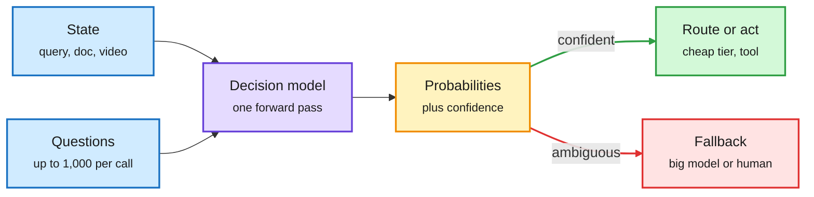
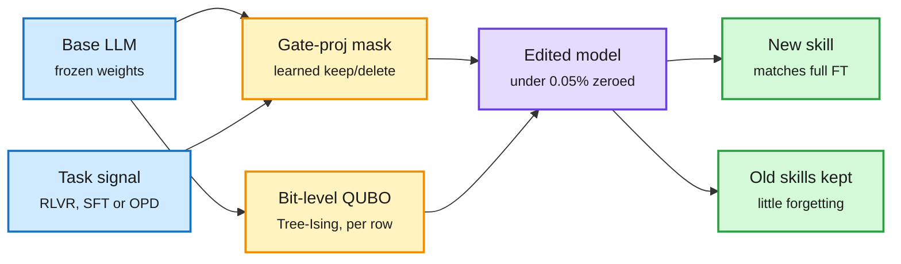
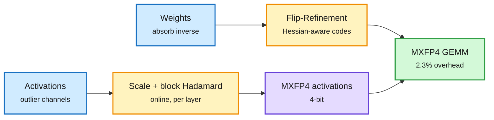
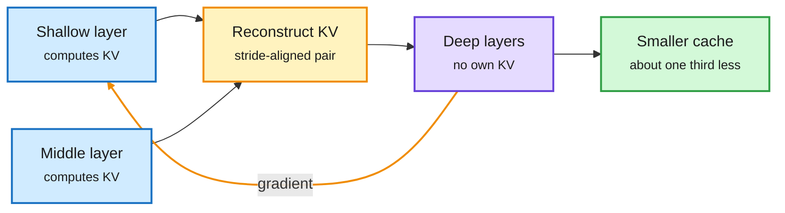
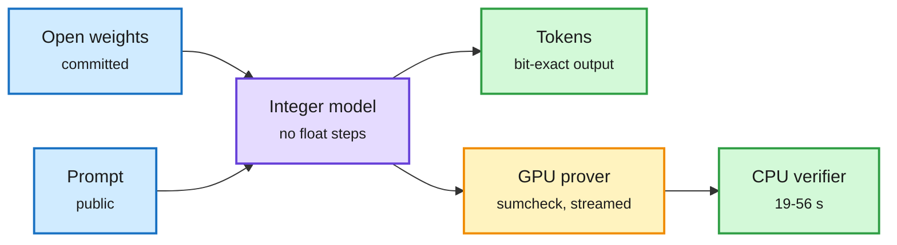
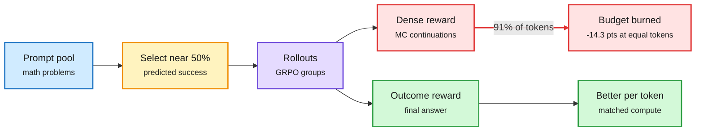
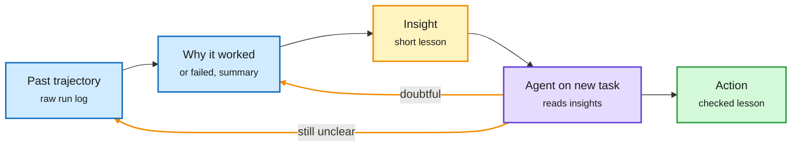

# cere-bro | 2026-11-12

> The day's savings come from doing less work per decision. Google, Meta and inclusionAI shipped decision models that route with one forward pass and no generated tokens. Deletion Tuning teaches a model a new skill by zeroing under 0.05% of its weights. MACaQ quantizes weights and activations to 4 bits one layer at a time. A matched-compute study shows dense RL rewards lose once you count their tokens. And Anthropic says an agent ported Claude to AMD in three days, in the same week Nvidia's board weighed removing its CEO.

🎯 Today's 5 for you

<ol>
<li>Read<strong>The decision-model wave.</strong> Gemini Decision 1 scores up to 1,000 questions per call in 150 to 250 ms with zero output tokens billed, and Google already routes Gemini Notebook with it. Meta and inclusionAI shipped open versions the same day. This is your routing beat becoming an API category. <a href="https://blog.google/innovation-and-ai/technology/developers-tools/gemini-decisions-api/">Google</a> · <a href="https://huggingface.co/facebook/meta-encoder-v1">MetaEncoder</a></li>
<li>Read<strong>Deletion Tuning.</strong> Learn a mask that zeroes under 0.05% of weights and you match full fine-tuning across RL, SFT and distillation, with far less forgetting. Pruning reframed as learning. Confirmed on HuggingFace and by the authors on X. <a href="https://arxiv.org/abs/2611.10866">arXiv</a></li>
<li>Read<strong>MACaQ.</strong> 4-bit weights and activations with each layer quantized alone, so a 122B model quantizes in 64 minutes in 32.5 GB. Only 2.3% runtime overhead in vLLM. Pair it with NVIDIA's mixed-precision Kimi K3.1 Pro NVFP4 card. Your quantization beat. <a href="https://arxiv.org/abs/2611.10649">arXiv</a> · <a href="https://huggingface.co/nvidia/Kimi-K3.1-Pro-NVFP4">card</a></li>
<li>Skim<strong>DepthGraft.</strong> Deep layers reuse KV built from two earlier layers. The cache shrinks by a third and, the authors claim, accuracy goes up because the sharing adds a gradient path. The trained cousin of yesterday's RidgeFill. <a href="https://arxiv.org/abs/2611.03142">arXiv</a></li>
<li>Track<strong>Chips: Mythos on AMD, and Nvidia's leadership.</strong> Anthropic claims a three-day agent port to AMD, and a kernel-bug study finds 60% of failures sit in builds and environments, not kernels. Skip the Huang affair threads; read The Information on the board meeting and the new remote-access export rule. <a href="https://simonwillison.net/2026/Nov/11/anthropic-ipo-roadshow/">roadshow</a> · <a href="https://www.theinformation.com/articles/nvidia-ceos-exit-looms">The Information</a></li>
</ol>

---

## TL;DR

- **Decision models**: Google, Meta and inclusionAI each shipped models that answer routing questions with probabilities, not text. One pass, no output tokens.
- **Deletion Tuning**: zeroing under 0.05% of a model's weights matches full fine-tuning and forgets far less.
- **MACaQ**: 4-bit weights and activations, quantized one layer at a time, at 2.3% runtime overhead.
- **Dense rewards**: count the tokens and plain GRPO beats step-level rewards by up to 14 points.
- **Anthropic on AMD**: an agent ported Claude to AMD GPUs in three days, Anthropic says.
- **Nvidia**: the board met to consider ousting Jensen Huang, while Commerce readies a rule against remote chip access.

---

## Deep Dives

### Decision models become a product category: Gemini Decision 1, MetaEncoder, Sing VL S1

> A router does not need to write anything. Google now sells one that scores 1,000 questions in a single pass and bills zero output tokens.

**Source:** Google AI blog · Simon Willison · The Decoder · Hugging Face (Meta, inclusionAI) · Meta Engineering · X feed
**Links:** [Google](https://blog.google/innovation-and-ai/technology/developers-tools/gemini-decisions-api/) · [Simon Willison](https://simonwillison.net/2026/Nov/11/gemini-decisions-api/) · [MetaEncoder](https://huggingface.co/facebook/meta-encoder-v1) · [Sing VL S1](https://huggingface.co/inclusionAI/SingVL_S1_4B) · [Meta Intelligent Delivery](https://engineering.fb.com/2026/11/11/ml-applications/intelligent-delivery-serve-better-ads/) · [Wiki summary](../../ai-routing/2026-11-12-gemini-decision-1-and-the-decision-model-wave.md)

The router stops talking and starts scoring

One prefill, many questions, a probability per option. Decode cost drops out of the routing bill.

Blue is input, purple is the model, amber is the confidence gate, green is the cheap path, red is the escalation.

**What is it about?**
A decision model reads a state (a query, a document, a video) plus named questions with fixed options. It returns a probability for every option in one forward pass and never generates text. Three of them shipped in one window. Google's Gemini Decision 1 sits behind a new Decisions API. Meta's MetaEncoder v1 is a multimodal embedding model with a `decide()` call. inclusionAI's Sing VL S1 is a 4B open model built on Qwen3.5.

**What problem does it solve?**
Routing, tool choice and policy checks are usually done by asking a chat model to emit a label or JSON. That pays decode cost and latency on every call, and the label carries no usable confidence. A decision model pays one prefill and gives a calibrated probability you can threshold.

**What's the core novelty?**
Scale and packaging. Gemini Decision 1 takes up to 1,000 independent questions per request over text, images, audio, video and PDFs (up to 256K tokens), in three types: yes/no ("noul"), choice (2 to 255 options) and ordered rubric score. Latency stays nearly flat from 1 to 100 questions. MetaEncoder takes a different route: it embeds the state and each option description and turns cosine similarities into probabilities with a softmax at temperature 0.02, with a `calibrate()` call to refit that temperature on your labels.

**Key takeaways**
- Gemini Decision 1 runs in 150 to 250 ms end to end at $0.10 per million input tokens with output free. Google puts it at about 5x cheaper than Gemini 3.5 Flash-Lite on its benchmark suite, with the lowest calibration error.
- Google already uses it as a live router in Gemini Notebook, picking model tier and thinking level per query, for up to 40% lower latency on everyday queries.
- The price ladder is now public: Jev at 4.2 cents per million tokens, GPT-6 Luna's decision model and Gemini at 10 cents. Simon Willison found Gemini hedges (0.92 rather than 1.0) where Jev and OpenAI return hard 0 or 1.
- Sing VL S1 scores 69.76 (text) and 73.94 (vision) on the Public Decision Index 0.3, above TypeSafe Jev 1.14 (60.70 text). Hugging Face also added a decision-model class to Transformers.

**Gaps in the study**
Every benchmark is vendor-reported. No one has compared calibration across Jev, GPT-6 Luna, Gemini, MetaEncoder and Drex on one routing set. Embedding-based scoring (MetaEncoder) versus a trained scoring head (Gemini, Sing VL) is an untested design choice.

**Industrial implication**
The gate in "small model first, big model if needed" now has an open model layer (Drex, 11-07: open decision models where the largest ties GPT-6 Sol at about $0.06 per 1,000 decisions), a serving layer (Flide, 11-11: an engine that serves decision-model request trees 9.5x faster than vLLM), an API layer and a library layer. Expect routers in agent frameworks to switch from "ask the LLM" to a decision call within a quarter. Meta's Intelligent Delivery post shows the same idea one level down: a model predicts each ad request's marginal return on compute, and a hierarchy of engines moves compute to where it pays, worth about 10% in ranking quality since 2017.

→ [Full summary](../../ai-routing/2026-11-12-gemini-decision-1-and-the-decision-model-wave.md)

---

### Deletion Tuning: learn a skill by switching weights off

> Zeroing fewer than 0.05% of a model's weights, and changing nothing else, matches full fine-tuning. The skill was already there.

**Source:** HuggingFace Daily Papers (11-11), cross-source confirmed via social (author thread on X); Tree-Ising was HuggingFace's #1 paper (75 upvotes)
**Links:** [Deletion Tuning](https://arxiv.org/abs/2611.10866) · [Tree-Ising](https://arxiv.org/abs/2611.14210) · [@Jacklu_me thread](https://x.com/Jacklu_me/status/2120217064073830401) · [Wiki summary](../../inference-efficiency/2026-11-12-deletion-tuning-and-tree-ising.md)

The skill was already in the weights; you only switch some off

Deletion Tuning trains a mask, not weights. Tree-Ising flips bits. Neither runs a gradient update on the weights themselves.

Blue is input, amber is the edit search (mask or bit flips), purple is the edited model, green is what you get.

**What is it about?**
Deletion Tuning learns a binary keep-or-delete mask over the gate projection inside each MLP block. The weights themselves never change. Only the masked ones go to zero. Tree-Ising, a separate paper, edits individual bits of BF16 weights to repair a model that loops instead of finishing its reasoning.

**What problem does it solve?**
Full fine-tuning (FFT) stores a whole new copy of the model and erodes old skills. LoRA (low-rank adapters, small trainable matrices added beside frozen weights) is smaller but still forgets. Both make it costly to keep many specialized variants of one model.

**What's the core novelty?**
The claim that deletion alone is enough. Across three post-training regimes, RLVR (reinforcement learning with verifiable rewards, where a checker scores the final answer), SFT and on-policy distillation (the student learns from the teacher on its own generated text), a mask matches FFT. Tree-Ising casts its repair as a QUBO (a quadratic problem over binary variables, the form an Ising or annealing solver handles), split exactly into one small problem per output row and solved by simulated annealing on a GPU.

**Key takeaways**
- The trained mask is hundreds to thousands of times smaller than an FFT checkpoint.
- Under RL, prior-task accuracy stays near the base model. FFT, LoRA and random sparse fine-tuning lose up to 5.4 points.
- By stable rank, spectrum drift and overlap with principal weights, the mask's effective change looks more like FFT than LoRA's does.
- Tree-Ising lifts Qwen3.5-0.8B to 54.6% on MATH-500, beating a GPT-6 Astra agent's hand-written repair (51.7%; base model 7.9%), with four forward passes, zero LLM tokens and about $0.90 of GPU time. On Qwen3.5-2B, greedy GSM8K goes from 21.6% to 69.4%.

**Gaps in the study**
Whether many masks for many skills can coexist on one base model without colliding is not shown. Tree-Ising fixes a known failure direction (looping), so it is a repair tool, not a training method.

**Industrial implication**
If per-skill masks are this small, a serving stack can hold thousands of "fine-tunes" as bitmaps over one resident model, cheaper than multi-LoRA serving. The same fact cuts the other way: yesterday's Lazarus result (Microsoft reprogrammed fewer than 10 dormant neurons to plant an agent backdoor) shows a tiny edit can hide anything. Model hubs will need sparse-diff checks, not just checksums.

→ [Full summary](../../inference-efficiency/2026-11-12-deletion-tuning-and-tree-ising.md)

---

### MACaQ: 4-bit weights and activations, one layer at a time

> The usual 4-bit tricks rotate activations across layers and need custom code for every architecture. MACaQ keeps each rotation inside its own layer and pays 2.3% for it.

**Source:** HuggingFace Daily Papers (11-11) · NVIDIA model card on Hugging Face (labs watcher)
**Links:** [Paper](https://arxiv.org/abs/2611.10649) · [Kimi K3.1 Pro NVFP4](https://huggingface.co/nvidia/Kimi-K3.1-Pro-NVFP4) · [Wiki summary](../../inference-efficiency/2026-11-12-macaq-and-kimi-nvfp4.md)

Rotate inside each layer, never across layers

The inverse transform lives in the weights, so each layer quantizes alone and only one layer sits in memory.

Blue is the tensor coming in, amber is the MACaQ step, purple is the quantized activation, green is the low-precision matmul.

**What is it about?**
MACaQ is a post-training quantization method for W4A4 (4-bit weights and 4-bit activations) in MXFP4, the microscaling FP4 format Blackwell runs natively. It handles every linear layer on its own.

**What problem does it solve?**
Activations have outlier channels that wreck 4-bit rounding. The fix is to rotate them, for example with a Hadamard transform (a fixed orthogonal mixing matrix that spreads outliers across channels). Most methods push that rotation across layer boundaries to make it free at runtime. That needs architecture-specific code, which breaks on MoE, hybrid attention and diffusion models, and it needs expensive optimization.

**What's the core novelty?**
Do the rotation online, inside each layer. A per-channel scale plus a block-Hadamard transform is applied to the layer's activations at inference, and the inverse is folded into that layer's weights. No cross-layer dependency means quantization can stream one layer at a time. Rounding is improved by Flip-Refinement, a coordinate descent that moves single FP4 codes to neighbouring values using Hessian information (how sensitive the loss is to each weight).

**Key takeaways**
- Runtime cost of the online transforms: 2.3% end to end over plain MXFP4 on Qwen3-32B in vLLM.
- A 122B model quantizes in 64 minutes using 32.5 GB of GPU memory.
- Lower perplexity than DuQuant++ and MR-GPTQ. Matches their best Llama-3-8B result in 11x less quantization time. Works unchanged on an image diffusion model.
- NVIDIA's Kimi K3.1 Pro NVFP4 (2.8T total, 104B active, 1M context) shows the production version: routed experts in NVFP4, shared experts and KDA linear attention in MXFP8, MLA attention left in BF16. Scores stay within about 0.4 points of the MXFP4 source across six benchmarks.

**Gaps in the study**
Results are mostly perplexity plus a few tasks. Long-context and long reasoning traces at W4A4 are not shown. NVIDIA's card gives accuracy but no throughput.

**Industrial implication**
Layer-local W4A4 is the version a serving team can apply to any new architecture the week it lands. Expect it in vLLM's and llm-compressor's recipe lists. NVIDIA's mixed recipe confirms the 11-11 finding from the on-policy distillation mismatch paper that a few layers carry most of the precision sensitivity: keep those high, push everything else to 4 bits.

→ [Full summary](../../inference-efficiency/2026-11-12-macaq-and-kimi-nvfp4.md)

---

### Mythos ports Claude to AMD in three days, and the kernel is no longer the hard part

> Anthropic says an agent did a chip bring-up that used to take dozens of engineers months. A separate study finds most kernel-library failures are not in the kernels.

**Source:** Simon Willison (Anthropic roadshow transcript) · The Decoder · X feed (Microsoft/Tsinghua study) · AWS ML blog
**Links:** [Roadshow transcript](https://simonwillison.net/2026/Nov/11/anthropic-ipo-roadshow/) · [The Decoder](https://the-decoder.com/anthropic-says-ai-is-eroding-nvidias-cuda-lead-cutting-an-amd-chip-switch-from-months-to-three-days/) · [Kernel study](https://arxiv.org/abs/2611.09280) · [AWS SDC](https://aws.amazon.com/blogs/machine-learning/detecting-and-recovering-from-silent-data-corruption-on-amazon-sagemaker-hyperpod/) · [Wiki summary](../../hardware/2026-11-12-mythos-amd-port-and-kernel-library-failures.md)

```mermaid
flowchart LR
  A["Agent port<br/><small>Mythos, 3 days</small>"] --> K["Kernels<br/><small>~100% agent-written</small>"]
  K --> B["Build + runtime<br/><small>60% of failures</small>"]
  B --> H["Hardware<br/><small>4 chip families</small>"]
  H -->|silent error| S["SDC checks<br/><small>replay, fingerprints</small>"]
  S --> C["Effective compute<br/><small>capacity x multipliers</small>"]
  classDef input fill:#d0ebff,stroke:#1971c2,color:#1b1b1b,stroke-width:2px
  classDef core fill:#e5dbff,stroke:#6741d9,color:#1b1b1b,stroke-width:2px
  classDef loop fill:#fff3bf,stroke:#f08c00,color:#1b1b1b,stroke-width:2px
  classDef exit fill:#d3f9d8,stroke:#2f9e44,color:#1b1b1b,stroke-width:2px
  classDef err fill:#ffe3e3,stroke:#e03131,color:#1b1b1b,stroke-width:2px
  class A input
  class K core
  class B,S err
  class H loop
  class C exit
  linkStyle 3 stroke:#e03131,stroke-width:2px
```

The kernel is the easy part now

Agents write kernels in days. What still costs time is the stack around them: builds, versions, and hardware that lies quietly.

Blue is the agent, purple is the kernels, red is where failures actually live, amber is the hardware mix, green is the business metric.

**What is it about?**
In Anthropic's IPO roadshow video, co-founder Tom Brown says Claude is trained and served on AWS Trainium, Google TPUs, NVIDIA GPUs and AMD GPUs. When Anthropic added AMD this year, it had Mythos try the port. Claude ran on AMD in three days "with basically no human intervention", and the model ported or wrote almost all the kernels.

**What problem does it solve?**
CUDA lock-in. Every chip needs its own kernels and inference stack, so a lab usually commits to one vendor. If an agent can do the bring-up, chips become interchangeable and the buyer gains price power.

**What's the core novelty?**
The business framing more than the port. Brown describes "total effective compute" as physical capacity times compute multipliers (a 4x multiplier means 25 units of compute train what used to need 100). He says multipliers stack and that Claude will eventually find them on its own.

**Key takeaways**
- The claim comes with no performance numbers. Running on AMD is not the same as running at parity with NVIDIA.
- Microsoft and Tsinghua read 300 closed issues from seven GPU kernel libraries (FlashAttention, Triton, CUTLASS and others). 60.33% traced to compilers, build systems or runtime environments; only 39.67% to kernel code. Version mismatches among drivers, CUDA, frameworks and packages alone were 25.33%.
- AWS published three in-training checks for silent data corruption (a GPU returning a wrong but plausible number with no error): a NaN/Inf gradient check, a ring replay where each GPU recomputes another node's micro-batch and compares bit for bit, and a weight-fingerprint comparison. Meta's Llama 3 405B run saw 6 of 419 interruptions from SDC over 54 days on 16K H100s.

**Gaps in the study**
Anthropic gave no throughput, utilization or cost figure for AMD. The kernel study uses reported GitHub issues, which over-count reproducible bugs and under-count silent ones.

**Industrial implication**
This completes a two-week thread: agent-written FlashAttention (11-05), agent teams beating FlashInfer on MLA decode (11-10), and Meta's TLX making kernels a warp-group orchestration problem (11-11). Kernel authorship is commoditizing. The moat moves to whoever can run a multi-chip fleet reliably, which is a build, version and verification problem. That is where the next agent tools should aim.

→ [Full summary](../../hardware/2026-11-12-mythos-amd-port-and-kernel-library-failures.md)

---

### DepthGraft and state souping: cached context as structure, not just storage

> Sharing KV across layers is usually a memory trade. DepthGraft says it also trains better, because every shared edge adds a gradient path.

**Source:** HuggingFace Daily Papers (11-11) · Apple ML Research (two NeurIPS 2026 papers)
**Links:** [DepthGraft](https://arxiv.org/abs/2611.03142) · [Weighted state souping](https://machinelearning.apple.com/research/weighted-state-souping) · [Gating in SSMs](https://machinelearning.apple.com/research/gating-memorization-in-context) · [Wiki summary](../../inference-efficiency/2026-11-12-depthgraft-and-weighted-state-souping.md)

Share the cache, gain a gradient path

Deep layers read KV built from two earlier layers. Compression and better training come from the same edge.

Blue is the source layers, amber is the reconstruction and the gradient path it opens, purple is the deep stack, green is the cache saving.

**What is it about?**
DepthGraft is a model architecture where deep layers do not compute their own keys and values. They rebuild them from a pair of earlier layers, one shallow and one middle, picked at a fixed stride. Apple's weighted state souping is the same instinct for SSMs (state space models, recurrent models that keep a fixed-size state instead of a growing KV cache).

**What problem does it solve?**
Two problems at once. The KV cache (the stored keys and values that let a model avoid recomputing attention over past tokens) is the main memory cost of long context. And in deep Pre-LN models, information from early layers fades by the time it reaches the top.

**What's the core novelty?**
Treating KV sharing as a regularizer. Each reuse edge sends gradient from the deep layer straight back to the source layer's key and value projections. The authors show the right sharing pattern sharpens key directions and enriches values, while adjacent-layer or single-anchor sharing does not. Apple's method caches the state an SSM reaches after reading each document, tool definition or memory record, then learns query-dependent weights to mix those states for a new question.

**Key takeaways**
- DepthGraft cuts the KV cache by about a third and keeps early prefill completion, so upper layers need no prompt pass of their own.
- It improves results from 0.5B to 16B under both GQA (grouped-query attention, heads share KV) and MLA (multi-head latent attention, KV compressed to a latent). The 16B MoE gains 7.0 points on MMLU-Pro, 6.6 on CMMLU and 6.4 on C3.
- Weighted state souping lifts multi-hop QA, needle retrieval, variable tracking and tool use, and a sparse variant keeps encoding cost near constant as context grows.
- A companion Apple paper finds SSM gating pushes models to memorize in their weights first, delaying or blocking the in-context solution even with enough capacity.

**Gaps in the study**
A 7-point MMLU-Pro gain from an attention tweak is unusually large, and the largest run is 16B. It needs a matched-compute replication. State souping is workshop-scale.

**Industrial implication**
Yesterday's RidgeFill filled upper-layer KV at inference from a regression, with no training. DepthGraft is the trained version of the same bet that upper layers do not need their own view of the prompt. If it holds, the next open pretraining runs will ship with cross-layer KV by default. State souping is prefix caching for recurrent models, which matters for agents that load the same tool definitions on every call.

→ [Full summary](../../inference-efficiency/2026-11-12-depthgraft-and-weighted-state-souping.md)

---

### Sable: prove that this exact model wrote this exact output

> A single Blackwell GPU can prove a 32B model's 4,096-token answer in 92 seconds. The trick is making inference fully integer first.

**Source:** HuggingFace Daily Papers (11-11)
**Links:** [Paper](https://arxiv.org/abs/2611.14083) · [Code](https://github.com/moonmath-ai/Sable) · [Wiki summary](../../inference-efficiency/2026-11-12-sable-bit-exact-verifiable-inference.md)

Make the model deterministic, then prove it

Quantization is not just for speed here. Integer-only inference is what makes a proof possible at all.

Blue is what is committed, purple is the integer model, amber is the proof, green is what a client receives and checks.

**What is it about?**
Sable is a proof system plus a GPU prover. It proves that a committed, integer-quantized transformer produced a given token sequence from a given prompt, bit for bit.

**What problem does it solve?**
When you call a model through someone else's API, you cannot tell which weights or which quantization served you. Earlier cryptographic proofs of inference (such as zkLLM) were far too slow for real models.

**What's the core novelty?**
Sable first defines an integer-only version of the model, where every rounding, normalization, softmax and sampling step is fixed by its inputs. Then it proves that function with sumcheck over a small 31-bit field, using constraints shown never to overflow, and one commitment over every weight and intermediate tensor. The prover streams the model layer by layer on one GPU.

**Key takeaways**
- On one RTX PRO 6000 Blackwell: Qwen2.5-32B in 92.5 s for 4,096 tokens (398 s for 16K), Qwen3-32B in 121.8 s, the MoE Qwen3-30B-A3B in 84.7 s.
- A proof costs 41 to 50x the serving time, about 6.4 cents per 4K-token request at public GPU prices, and is 40 to 64x faster per parameter-token than zkLLM. One CPU core verifies in 19 to 56 s.
- The integer model picks the same greedy token as BF16 at 86.3% of WikiText-2 positions and is within 1.6 points on MMLU and 1.7 on GSM8K.

**Gaps in the study**
The provable model is a slightly different model from the one you would normally serve. The proof is not zero-knowledge, so it only suits open weights.

**Industrial implication**
After Lazarus, the wiki asked (11-11) how a client could know which weights served it. Sable answers "which weights", though not "are those weights clean". At 6 cents a request it fits audits and disputes, not every call. NVIDIA's Kimi card uses the cheap statistical version of the same idea, the Kimi Vendor Verifier, which checks a provider's accuracy against reference numbers.

→ [Full summary](../../inference-efficiency/2026-11-12-sable-bit-exact-verifiable-inference.md)

---

### Dense rewards lose once you count their tokens

> Step-level rewards look better per update. At equal tokens, plain GRPO wins by up to 14 points.

**Source:** HuggingFace Daily Papers (11-11)
**Links:** [Paper](https://arxiv.org/abs/2611.13560) · [Wiki summary](../../llms-foundation-models/2026-11-12-dense-rewards-matched-compute-grpo.md)

Count the tokens and the ranking flips

Per update, dense rewards look better. Per token spent, plain GRPO wins.

Blue is the data, amber is the selection rule that helps, purple is the rollout, red is the dense-reward cost, green is the outcome-reward path.

**What is it about?**
A preregistered study of whether dense process rewards help GRPO (group-relative policy optimization, the standard RL algorithm for reasoning, which gives every token in a solution the same credit for the final answer).

**What problem does it solve?**
Dense rewards are usually compared to GRPO per training step. That hides their cost. The common Monte-Carlo version scores each step by sampling continuations from it, and here those continuations are 91% of all generated tokens.

**What's the core novelty?**
A matched-compute protocol. Every method gets the same budget in generated tokens and training GPU-hours, across 1,668 runs on six models, with controls for side effects.

**Key takeaways**
- On Qwen2.5-1.5B the Monte-Carlo reward leads per update but ends 14.3 points lower at equal tokens and 7.8 points lower at equal training time.
- None of four dense-reward variants beats plain GRPO, even with the same training time.
- What helps is picking prompts whose predicted success is near 50%: +1.7 points on Qwen3-0.6B, +0.8 on Qwen2.5-1.5B. But GRPO with double the learning rate gets within half a point of that.
- The popular one-batch gradient test ranks rewards correctly but overstates each by one to two points, the size of the gains it is meant to detect.

**Gaps in the study**
Small models and math only. Long-horizon agent RL, where credit assignment is hardest, is where dense signal might still pay. Learned critics were not tested; a Scale AI result circulating on X finds PPO (which uses a learned critic) beats GRPO at small batch sizes.

**Industrial implication**
Report RL results per token, or do not report them. This is the training-side twin of yesterday's agent-cost papers, which found harness changes swing the bill 2.6x at the same accuracy. Labs paying for rollouts on rented H100s, now 30 to 50% dearer than last quarter, should rerun their reward ablations at matched compute.

→ [Full summary](../../llms-foundation-models/2026-11-12-dense-rewards-matched-compute-grpo.md)

---

### Agent memory can hurt, and one agent is usually enough

> Memory can make an agent fail tasks it would solve without it. Multi-agent setups spend up to 4.7x the tokens for gains that rarely survive a significance test.

**Source:** HuggingFace Daily Papers (11-11, #4) and DAIR on X · Amazon and CMU/JetBrains papers via X feed
**Links:** [WikiTrace](https://arxiv.org/abs/2611.14320) · [Amazon SOP study](https://arxiv.org/abs/2611.12953) · [Token spend study](https://arxiv.org/abs/2611.13396) · [@dair_ai](https://x.com/dair_ai/status/2120523196072161401) · [Wiki summary](../../agentic-systems/2026-11-12-wikitrace-and-single-agent-default.md)

Memory you can audit beats memory you trust

WikiTrace keeps the receipt for every lesson, and the agent opens it only when the lesson looks shaky.

Blue is stored evidence, amber is the lesson and the audit links, purple is the agent, green is the checked action.

**What is it about?**
Three papers on what agent machinery costs. KAIST's WikiTrace fixes agent memory. Amazon compares agent architectures with everything else held fixed. CMU and JetBrains test whether token spend predicts engineering output.

**What problem does it solve?**
Agent memory stores short lessons distilled from past runs, labeled only "succeeded" or "failed", without the run itself. The agent cannot check a lesson, so it follows wrong ones. KAIST calls this memory-induced degradation.

**What's the core novelty?**
WikiTrace links each lesson to a summary of why its run worked or failed, and to the raw trajectory. When a lesson lacks detail, conflicts with another, or came from a failed run, the agent follows the links with terminal tools before acting.

**Key takeaways**
- WikiTrace beats existing memory systems, and the same insights without links, on five agent benchmarks, and reduces the degradation.
- Amazon tested a single function-calling agent, a skill-augmented agent, central multi-agent orchestration and a triage swarm on 13 enterprise SOPs (standard operating procedures). No design wins in aggregate. Coordinated designs cost 1.4 to 4.7x the tokens and 2.6 to 5.8x the latency. Good skill definitions lift success to 73.1% from 67.4%; bad ones fall below baseline.
- Across 404 JetBrains engineers over five weeks, doubling an engineer's agent spend went with only about 10% more commits. Among weeks with similar commits, the heaviest weeks used 39 to 240x the tokens of the lightest.

**Gaps in the study**
WikiTrace's extra tool calls have a cost the summary does not price. Commits are a weak proxy for value shipped.

**Industrial implication**
This is the third paper in three days to say the harness sets the bill, after Agency (11-11: harness choices swing cost 2.6x at the same accuracy) and Duke/Princeton (11-11: many small parallel teams beat one agent's best-of-N at equal compute). Duke/Princeton favours teams and Amazon favours one agent. The difference looks like task shape (search problems vs branching procedures), not a real contradiction yet. Practitioner stories on X of a $500M Claude month with no limits, and Uber spending its 2026 AI coding budget by April, are the deployment-side version of the CMU result.

→ [Full summary](../../agentic-systems/2026-11-12-wikitrace-and-single-agent-default.md)

---

### Short reads: a chip-design model, test-time scaling for diffusion LMs, distillation watermarks, vLLM EPD

- **Micius-Flash** is a 27B open model for semiconductor and hardware engineering, merged from domain experts with multi-teacher on-policy distillation. It averages 64.2% on hardware-code benchmarks (15.0 points over a same-size baseline) and 62.4% on a semiconductor agent benchmark, with a harness wired to EDA tools and KiCad ([arXiv](https://arxiv.org/abs/2611.10015)).
- **Frequency-aware remasking** treats test-time compute for diffusion LMs as an allocation problem. A fast sampler takes easy questions, and hard ones get a remasking rule that commits tokens whose predictions keep changing, to force exploration. Up to +7.33 points on MATH-500 for Dream-7B ([arXiv](https://arxiv.org/abs/2611.10486)).
- **Subliminal Watermarks (SubWM)** from Berkeley target distillation detection, so a lab can tell when a competitor trained on its outputs. Claimed more robust than prior watermarks ([@hrshtv via Berkeley AI](https://x.com/berkeley_ai/status/2120590217627230463)).
- **Raon-1 nano** from Krafton is an effective 1.5B dense model with per-layer embeddings and 3.1B total parameters. Per-layer embeddings park parameters in cheap lookup tables instead of matmuls, the same idea as Gemma's on-device models ([@Krafton_AI via RT](https://x.com/DimitrisPapail/status/2120524046290833466)).
- **vLLM vs SGLang, in one line each:** vLLM grew from PagedAttention (KV cache split into small blocks placed anywhere, so little memory is wasted) into the safe default; SGLang grew from RadixAttention (past requests kept in a prefix tree so shared prompts are reused), which suits agents and RAG ([@techwith_ram](https://x.com/techwith_ram/status/2120360117048930692)).
- **vLLM EPD** upgraded its disaggregated encode, prefill and decode, so a multimodal encoder no longer stalls decode. DeepInfer showed the value first ([@vllm_project via Red Hat AI](https://x.com/RedHat_AI/status/2120506908654395889)).

---

## Industry Pulse

- **Nvidia's board** met Wednesday night to consider ousting Jensen Huang after a New York Times report of a second affair ([The Information](https://www.theinformation.com/articles/nvidia-ceos-exit-looms)).
- **Nvidia shareholders** filed a securities class action, and the stock is down about 26% over the past month ([AI Breakfast](https://aibreakfast.beehiiv.com/)).
- **Gary Marcus** asks whether an acting Nvidia CEO would still honour its share of Anthropic's $26B IPO placement ([Marcus on AI](https://garymarcus.substack.com/p/jensen-is-reportedly-about-to-get)).
- **Commerce** is finalizing a rule requiring licenses for Blackwell-class chips in seven more countries, to stop Chinese remote access ([The Information](https://www.theinformation.com/articles/commerce-department-finalizing-long-awaited-ai-remote-access-rule)).
- **Claude Fable 5.2 (Max)** took #1 in Agent Arena at +30.4% net improvement, about 1.6x Opus 5.5, at $7.3 per task ([@arena](https://x.com/arena/status/2120579593979695541)).
- **Meta's Muse Ember (Max)** entered Agent Arena at about $0.02 per task, roughly 4x cheaper than GPT-6 Luna and Haiku 5.5 ([@arena](https://x.com/arena/status/2120609164116533606)).
- **GLM-5.3** runs at 200+ tokens per second on SambaCloud and leads open weights on Terminal-Bench 3.0 (28.3) ([@SambaNovaAI](https://x.com/SambaNovaAI/status/2120683045543915747)).
- **AWS** released an official service emulator written in Rust by a swarm of agents, 29,684 commits in three weeks ([Simon Willison](https://simonwillison.net/2026/Nov/11/aws-emulator/)).
- **AWS CEO Matt Garman** says inference is "not even 1%" of its eventual size and orbital data centers are 10 to 20 years away ([@rohanpaul_ai](https://x.com/rohanpaul_ai/status/2120548591781732862)).
- **Ramp's AI Index** rose just 1.65% in October; 1% of companies drive 80% of OpenAI and Anthropic revenue ([The Decoder](https://the-decoder.com/us-corporate-ai-spending-hits-a-new-high-in-october-but-growth-slows-to-1-65-percent/)).
- **US data brokers** including Mercor, Surge AI and AfterQuery sold about $500M of RL environments to Chinese labs, per ChinaTalk ([The Decoder](https://the-decoder.com/us-data-brokers-are-selling-half-a-billion-dollars-in-rl-training-environments-to-chinese-ai-labs/)).
- **United Airlines** banned AI agents such as Muse and Instinct from booking its flights ([The Information](https://www.theinformation.com/briefings/united-airlines-blocks-ai-agents-like-muse-instinct-booking-flights)).
- **Grok-built apps**: over 35,000 were open without login, including patient data, because "anyone with the link" was the default ([The Decoder](https://the-decoder.com/grok-built-apps-exposed-patient-data-plaintext-passwords-and-spacexsis-own-sales-pipeline/)).
- **Helsing** unveiled Clarity, an agent platform that turns sensor data into weapons-targeting recommendations under named human sign-off ([The Decoder](https://the-decoder.com/helsing-built-an-ai-system-that-prepares-targets-for-weapons-systems-and-says-every-decision-will-carry-a-human-name/)).
- **Tencent** says it filtered offensive cyber data from Hunyuan Hy4 and kept bio risk below its threshold; Zhipu's Tang Jie urged humility on RSI ([AI Safety China](https://aisafetychina.substack.com/p/brief-32-tencent-deepseek-and-alibaba)).
- **Chrome, Edge and Firefox** jointly shipped Modern Web Guidance, a one-line install that feeds coding agents current web practices ([AI Weekly Espresso](https://aiweekly.co)).
- **Claude Code** sending the user's email address to websites was Hacker News's #2 story at 1,614 points ([HN](https://news.ycombinator.com/item?id=50385272)).
- **Meta's infrastructure chief** Santosh Janardhan is leaving; AWS veteran Dave Brown takes over the data-center build-out ([The Information](https://www.theinformation.com/briefings/metas-infrastructure-chief-leaving-amid-massive-ai-buildout)).
- **Stanford** opened all materials for CS329Z, Engineering AI Agents, including a homework that builds a Claude Code clone for a few dollars ([@stanfordnlp](https://x.com/stanfordnlp/status/2120641813371404389)).
- **House Foreign Affairs chair Brian Mast** threatened a subpoena over the Huang affair; FT says Commerce stalled blacklisting Megaspeed despite four agencies pushing ([@rohanpaul_ai](https://x.com/rohanpaul_ai/status/2120513748406595663)).
- **CoreWeave** says it is first to bring Vera Rubin online, for Cognition ([@StockSavvyShay](https://x.com/StockSavvyShay/status/2120498249043947881)).
- **Google Cloud** launched Gemini for Healthcare in US preview with Northwell, HCA, Optum and four other systems ([AI Weekly Espresso](https://aiweekly.co)).
- **Google's $10M bid** for Spirit Airlines' data (about 100M emails and 500M Teams messages) for AI training is near approval ([@StockSavvyShay](https://x.com/StockSavvyShay/status/2120494559801270756)).
- **n8n Labs** released Nod, an open personal agent that runs errands in its own VM, with saved logins kept in a vault the model never sees ([@rohanpaul_ai](https://x.com/rohanpaul_ai/status/2120508138705342896)).
- **Plurai** shipped agent simulation that grades tool calls, not replies, after agents were caught saying "refund done" without calling the tool ([@_avichawla](https://x.com/_avichawla/status/2120557010605445223)).
- **QVAC** released BotPsy, a 0.8B on-device tool-calling model for alarms, meetings and messages ([Hugging Face](https://huggingface.co/blog/qvac/botpsy)).
- **An MCP server security checklist** built from real CVEs flags MCP Inspector (CVSS 9.4) trusting "localhost only" ([hetmehta.com](http://hetmehta.com/posts/mcp-server-security-checklist)).
- **UK regulator** the Office for Students told universities to adopt AI-proof exams or face sanctions ([The Decoder](https://the-decoder.com/uk-regulator-threatens-universities-with-sanctions-unless-they-adopt-ai-proof-exam-formats/)).

**Funding, valuations, and compute deals**

- **Anthropic** opened its Australian retail IPO at $70 to $78; the window closes Nov 17 ahead of the Nasdaq listing as ANT ([AI Weekly Espresso](https://aiweekly.co)).
- **Anthropic's book** is reportedly oversubscribed, with bankers weighing a valuation above $1.5T versus the filed $1.404T ([AI Breakfast](https://aibreakfast.beehiiv.com/)).
- **TSMC's board** approved buying Anthropic shares at the IPO price, per WSJ ([@rohanpaul_ai](https://x.com/rohanpaul_ai/status/2120636169637785976)).
- **AMD** paid $2.9B for Taalas, the startup that hardwires LLM weights into silicon, per its 10-Q ([@deedydas](https://x.com/deedydas/status/2120524778821869661)).
- **Inference resellers** that never owned GPUs are buying their own chips because they cannot lease enough capacity ([The Information](https://www.theinformation.com/articles/ai-inference-startups-quietly-buying-chips)).
- **Sequoia** is investing hundreds of millions in Sequence Holding, an AI roll-up that just agreed a $7.7B insurance acquisition ([The Information](https://www.theinformation.com/articles/sequoia-capital-invest-ai-holding-co-sequence)).
- **Ode with Anthropic**, the PE venture with $1.5B from Blackstone and Hellman & Friedman, is adding performance fees to fixed project fees ([The Information](https://www.theinformation.com/articles/anthropics-pe-backed-venture-ode-pushes-get-paid-ai-results)).
- **Daylight** raised an $80M Series B led by Goldman Sachs Alternatives for AI security operations ([AI Breakfast](https://aibreakfast.beehiiv.com/)).
- **The Information 50** added a security category for the first time; two of its four most valuable picks are security startups above $1B ([The Information](https://www.theinformation.com/articles/introducing-informations-50-promising-startups-2026)).
- **IREN** brought its Horizon 1 GB300 cluster up in 14 months, with three more 50 MW deployments for Microsoft to follow ([@StockSavvyShay](https://x.com/StockSavvyShay/status/2120611147946819742)).
- **Mercor** raised at a $20B valuation as post-training-as-a-service becomes a category; Monte launched a post-training platform and Petrichor (YC F26) a wet lab for frontier labs ([@SuJinyan6](https://x.com/SuJinyan6/status/2120456370399187362)).
- **Goldman** projects Anthropic revenue of $600B in 2030 ([@rohanpaul_ai](https://x.com/rohanpaul_ai/status/2120538353850560787)).
- **Chips for Humanity** launched as a compute cluster dedicated to AI safety research ([@heyanuja via Miles Brundage](https://x.com/Miles_Brundage/status/2120745868651594112)).

*Reddit's eight subreddits returned no posts that passed filters this window, and the LinkedIn and YouTube captures were empty. Practitioner signal today comes from X only.*

---

## Global View

**The routing gate is becoming infrastructure, and the hyperscalers are pricing it as a commodity.** In six days the decision model (a model that scores fixed options in one pass instead of generating text) gained an open family (Drex, 11-07, whose largest model ties GPT-6 Sol at about $0.06 per 1,000 decisions), a serving engine (Flide, 11-11, 9.5x faster than vLLM on decision request trees), a hyperscaler API (Gemini Decision 1) and a Transformers class. Google routing its own Gemini Notebook with it confirms the 11-04 Google Cloud study, where one classifier question routed a coding suite more cheaply than any fixed model. The open research problem has not moved: Route Anything (11-05) showed a perfect router would gain 5.4 points over the best single model, but learned routers gain 0.3. Industry is buying routers for the cost cut, not the quality ceiling, and calibrated probabilities make the cost cut safer without closing that gap.

**Small, targeted edits now change models in both directions, and industry has no tool to tell the two apart.** Deletion Tuning (zero under 0.05% of weights to learn a skill), Tree-Ising (bit flips that fix reasoning loops for $0.90), MIT's Weight-Space Programming (11-10, an agent writing a repair into weights) and Lazarus (11-11, fewer than 10 neurons rewritten to plant a backdoor) are four results in a week with the same mechanism. On the industry side, Booz Allen's switch to open Nemotron (11-11) and NVIDIA's own pre-quantized Kimi re-release show open-weight variants multiplying across vendors. Sable now proves which committed weights produced an output, and Kimi's Vendor Verifier checks a provider's accuracy, but neither can say whether a sparse diff is a skill or a sleeper. That gap is the near-term opening for model hubs.

**Agents are commoditizing kernels just as the chip market loses its anchor.** Anthropic's three-day AMD port extends a run of agent-written kernel results (FlashAttention on 11-05, MLA decode beating FlashInfer on 11-10), and the Microsoft/Tsinghua study says the remaining failures are mostly builds and version mismatches, the same layer where InfraRSI (11-11) found its 2.75x training speedups. The market moved the same direction the same week: Nvidia is down about 26% in a month and its board is weighing its CEO, AMD paid $2.9B for Taalas, inference resellers are buying their own silicon, and Commerce is closing the remote-access route to Blackwell. With compute scarce (CoreWeave's 11-11 30 to 50% Hopper repricing) and the software moat thinning, every efficiency result in today's batch, from MACaQ's 4-bit activations to DepthGraft's smaller cache, lowers the cost of buying whichever chip is available.

---

## Looking Ahead

- **Decision calls replace label-generation in agent frameworks.** Within 60 days, LangGraph, the OpenAI Agents SDK, Google ADK or Claude Code's routing documents a decision-model call (Gemini Decision 1, Jev, GPT-6 Luna or MetaEncoder) as the default router or tool selector. Signal: a release note or docs page naming a decision model for routing.
- **A sparse-mask serving feature ships.** Within 90 days, vLLM, SGLang or a hosted fine-tuning service supports per-request binary weight masks (Deletion Tuning style) alongside multi-LoRA. Signal: a merged PR or product page citing 2611.10866 or "mask adapters". If none appears, the result stays a continual-learning curiosity.
- **Layer-local W4A4 gets a recipe.** Within 60 days, llm-compressor, NVIDIA ModelOpt or vLLM adds an online block-Hadamard W4A4 recipe that cites MACaQ or quotes under 3% overhead. Signal: a recipe or changelog entry.
- **An AMD parity number from Anthropic.** Within 90 days, Anthropic or a partner publishes throughput, cost per token or utilization for Claude on AMD GPUs. If it stays a roadshow claim with no number, discount the "CUDA moat is gone" reading.
- **Kurate's picks stay unconfirmed.** Kurate's cs.AI list again scores every paper at a flat 1200, so rank carries little signal. The two efficiency entries, #2 ChainFlow (few-step latent flow matching for speculative decoding) and #6 Safety-Conditioned Cache Routing (reusing cached LLM responses only when safety context matches, ai_rating 5.5), are absent from HuggingFace. Within 60 days, watch for either in a vLLM or SGLang recipe. No Kurate authors crossed the rising-author threshold.
