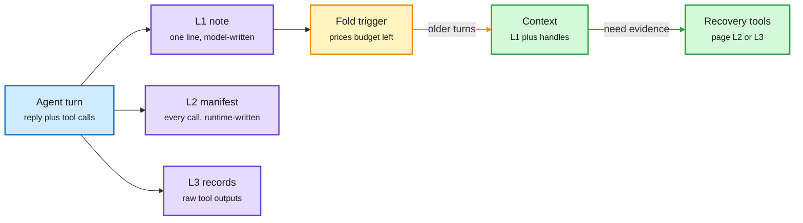
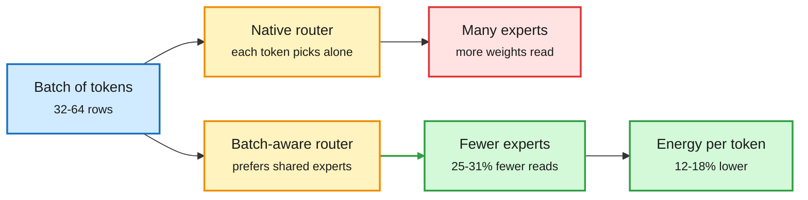
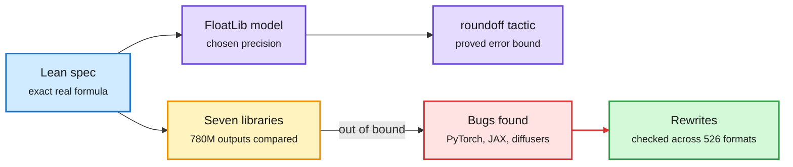
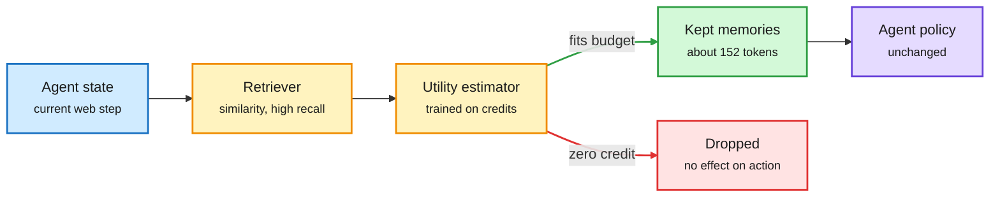
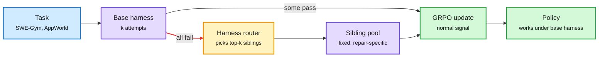
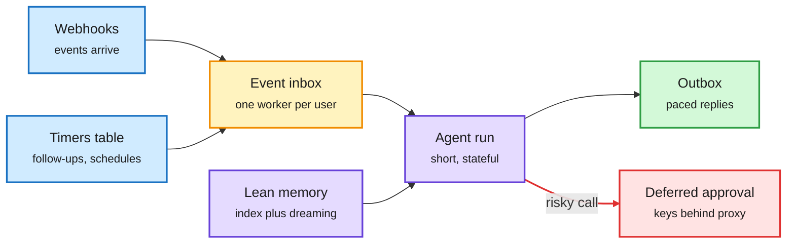

# cere-bro | 2026-11-15

> The cheapest work is the work a system never has to do. Folio shrinks an agent's history by switching to a summary it already wrote, so nothing gets reread, and runs 2.4x cheaper. Batch-aware MoE routing loads 25-31% fewer expert weights per step and uses 12-18% less energy per token. MemCredit drops the three quarters of memory tokens that never change the agent's next action. The warning comes from the bottom of the stack. Sasha Rush's group found rounding bugs in PyTorch and JAX operators that low-bit recipes assume are exact. Above all this, Nvidia is still without Huang, and Nathan Lambert says US open models just lost their patron.

🎯 Today's 5 for you

<ol>
<li>Read<strong>Folio context folding.</strong> Agents fold old history by swapping in coarser views they recorded along the way, not by asking the model to summarize it. 66 of 75 LOCA-bench tasks solved against 49-59 for Claude Code, Codex and SoL-Pi, at 2.4x lower cost. This is your context and KV-cost beat done in the harness. <a href="https://arxiv.org/abs/2611.16627">arXiv</a></li>
<li>Read<strong>Batch-aware MoE routing, measured in joules.</strong> Nudging a batch's tokens toward shared experts cuts expert-weight reads 25-31% on Qwen3-30B-A3B at flat quality and 12-18% energy per token. This is a direct GPU measurement, not an estimate from FLOP counts. Read it next to yesterday's RAMPr neuron pruning. <a href="https://arxiv.org/abs/2611.11696">arXiv</a></li>
<li>Read<strong>When Rounding Breaks Machine Learning.</strong> A Lean-proved sweep of 154 operators over 780M outputs in seven libraries turned up unreported bugs in PyTorch, JAX and diffusers. Every 4-bit recipe you track assumes these operators are accurate. <a href="https://www.robertj1.com/ai4science/rounding-bugs-in-ml-formulas/">Blog</a></li>
<li>Skim<strong>MemCredit.</strong> It keeps a memory only if removing it would change the agent's next action. It reaches 86.6% on ALFWorld against 65.7% for BM25 retrieval, with 74.5% fewer memory tokens. This is your agent-memory saved theme with a token-budget number. <a href="https://arxiv.org/abs/2611.15600">arXiv</a></li>
<li>Track<strong>Harness routing, in training and in production.</strong> Harness-S routes failed RL attempts to sibling harnesses and lifts SWE-Gym pass@3 from 24% to 39%. A claimed Spotify plugin offloads Claude Code's reading to Gemini Flash for 90% savings, so far unverified. Skip the Huang conspiracy threads. <a href="https://arxiv.org/abs/2611.04277">arXiv</a></li>
</ol>

---

## TL;DR

- **Folio**: fold agent history by switching to coarser views already recorded. 2.4x cheaper and more tasks solved than Claude Code or Codex.
- **Batch-aware MoE routing**: tokens in a batch share experts, so 25-31% fewer weights load and energy per token drops 12-18%.
- **Rounding bugs**: a formal sweep of 154 ML operators found unreported floating-point errors in PyTorch, JAX, diffusers and more.
- **MemCredit**: keep only memories that change the next action. Higher success with three quarters fewer memory tokens.
- **MetaPI**: turning agent benchmarks into injection tests shows every frontier agent still loses over 20% of attacks.
- **Open models after Huang**: Lambert argues the US open-weight ecosystem lost its protector, as a reinstatement petition passes 100,000 signatures.

---

## Deep Dives

### Folio: fold the context, don't rewrite it

> Agents already write a one-line note each turn. If you keep that note, the raw tool calls and the raw outputs, you can shrink the history without asking the model to summarize anything.

**Source:** Kurate cs.AI weekly list
**Links:** [Paper](https://arxiv.org/abs/2611.16627) · [Wiki summary](../../agentic-systems/2026-11-15-folio-context-folding.md)

Fold by picking a coarser view, never by rewriting

All three views are written as the agent works, so folding is a lookup and recovery is a handle.

Blue is the live turn, purple the three stored views, amber the fold decision, green what the model sees and how it gets detail back.

**What is it about?**
Folio is a context manager for long-running agents. Every turn it records three linked levels: a short note the model writes as part of its normal reply, a manifest of every tool call written by the runtime, and the raw outputs. When the window fills, older turns drop to their coarser level, with handles pointing to the detail.

**What problem does it solve?**
Today's agents compact history by asking the model to summarize it. Each compaction rereads and rewrites everything it replaces, costs a full model call, and loses detail for good. Cache-aware triggers decide *when* to compact but take the size of the summary as given.

**What's the core novelty?**
The coarse views already exist, so folding is done in code with no model call. A median fold takes 0.6 seconds. Recovery tools read bounded pages, run computations over the full text in files, and keep findings in a persistent dossier. The fold trigger also prices a "landing point" that includes how much budget will be left.

**Key takeaways**
- On 75 LOCA-bench tasks, with DeepSeek-V4-Pro behind every system, Folio solves 66. The same runtime with model-written compaction solves 54. Claude Code, Codex and SoL-Pi solve 49-59.
- It uses about half the working time, at 2.4x lower cost than the model-compaction runtime.
- Nothing is lost, only demoted. The agent can always page back to the raw record.

**Gaps in the study**
One benchmark and one backbone model. No numbers on prefix-cache hit rate after a fold. That rate decides the real serving bill, and yesterday's Bursts paper showed it is fragile.

**Industrial implication**
Harness vendors will copy this within months. "Auto-compact" in Claude Code and Codex is exactly the model-written summary Folio beats. There is a safety bonus too. This wiki flagged on 09-17 that a model-written compaction summary is a write channel into the agent's own future context. In Folio the folded context is written by the runtime, not the model.

The thread on this page goes back weeks. AKV (10-29) kept the full text and only hid parts of it from attention, after the 10-28 "memory tax" result showed that rewriting history drops facts. SparseRead (11-13) gated what an agent reads in and cut tokens up to 92.9%. Folio is the matching control on what stays. **Research angle:** the obvious next experiment is to fold at KV-cache granularity. Keep L1 tokens' keys and values resident and page L2 back on demand, so a fold never invalidates the cached prefix.

→ [Full summary](../../agentic-systems/2026-11-15-folio-context-folding.md)

---

### Batch-aware MoE routing: measured, not estimated

> On a real GPU, letting the tokens in a batch agree on which experts to use saves 12-18% energy per token. The same trick on recurrent policies costs 11x more energy than doing nothing clever.

**Source:** Kurate cs.LG weekly list
**Links:** [Paper](https://arxiv.org/abs/2611.11696) · [Wiki summary](../../inference-efficiency/2026-11-15-batch-aware-moe-routing-energy.md)

Fewer distinct experts per batch means fewer bytes moved

Decode is memory-bound, so the saving comes from expert weights you no longer load.

Blue is the batch, amber the routing choice, red the costly path, green the measured saving.

**What is it about?**
In an MoE model (mixture-of-experts, where each token runs through a few of many expert sub-networks), every distinct expert a batch touches has to be loaded from memory. This paper asks whether the rows of a batch can share work, and measures the answer in joules on the GPU.

**What problem does it solve?**
Most efficiency papers claim energy savings from operation counts. Operation counts miss memory traffic, which dominates decode. Without a direct measurement, nobody knows whether a "sparser" model actually draws less power.

**What's the core novelty?**
A batch-aware router nudges each token toward experts that other tokens in the batch already need, within a small distribution budget (KL 0.05). A second rule, persistence-aware OEA, also prefers experts used on the previous step. It has one parameter.

**Key takeaways**
- Qwen3-30B-A3B reads 25-31% fewer expert weights, and benchmark scores move within noise on 500 items.
- Energy per token falls 12-18% on a fused forward pass.
- OEA keeps the cut with about 40% fewer new experts per step than native routing at batch 32-64. Its energy is not yet measured.
- For recurrent multi-agent RL policies the answer is no. Shared activity patterns rarely last one step, and trained-in masks only work because they reduce to a narrow GRU, at 11x the energy of a small dense policy.

**Gaps in the study**
Pilot measurements on one GPU type, as the authors say. No integration into vLLM or SGLang, where expert parallelism and batching policy would change the result. Quality is checked on only 500 items.

**Industrial implication**
This is a scheduler feature, not a model change. Any MoE serving stack could add it as a routing bias, and it compounds with larger batches. Expect it first in on-device and single-GPU MoE serving, where expert loading is the whole bottleneck.

It also gives this wiki's pruning page its cleanest example yet. That page's one-line view is *sparsity is easy to find and hard to spend*. The MoE half of this paper is spendable because experts are the unit weights are loaded in. The recurrent half is not, because the shared pattern does not map to anything the hardware loads. RAMPr (11-14), which pruned weak neurons inside every expert and freed 36-43% of memory, shrinks what is *stored*. Batch-aware routing shrinks what is *read per step*. **Research angle:** do the two stack? Pruned experts are smaller, so the share of time spent loading experts falls, and the routing gain may shrink with it.

→ [Full summary](../../inference-efficiency/2026-11-15-batch-aware-moe-routing-energy.md)

---

### When Rounding Breaks Machine Learning

> A softmax formula proved correct over the real numbers still returned a zero gradient in float32. Checking 154 operators the same way found bugs in PyTorch, JAX and diffusers, several never reported.

**Source:** Robert Joseph George and Sasha Rush (blog), reposted by Rush and Christian Szegedy on X
**Links:** [Post](https://www.robertj1.com/ai4science/rounding-bugs-in-ml-formulas/) · [Wiki summary](../../inference-efficiency/2026-11-15-rounding-breaks-ml-floatlib.md)

Same math, different library, different answer

The implementation chooses intermediate precision, summation order and when to round. That is where the bugs live.

Blue is the spec, purple the proof machinery, amber the cross-library sweep, red the failures, green the fixed formulas.

**What is it about?**
A formal check of numerical accuracy across ML libraries. FloatLib is a Lean library (Lean is a proof assistant, a language where a computer checks every step of a proof) that models arithmetic at any chosen precision. Its `roundoff` tactic builds a checked error bound: the computed answer is within a relative error plus a small absolute allowance for underflow.

**What problem does it solve?**
Proving a formula correct over the real numbers says nothing about what happens once every step rounds. The simplest example: add 2⁻²⁵ to 1 in float32 and subtract 1 again, and you get 0. The same thing silently zeroed a cross-entropy gradient in TorchLean's own softmax.

**What's the core novelty?**
Breadth plus proof. They covered all 154 TorchLean operators (162 with variants) and compared PyTorch, JAX, TensorFlow, NumPy, CuPy, ONNX Runtime and MLX on CPU and GPU. That is about 780 million outputs. Selected formulas, original and rewritten, then went through 526 number formats.

**Key takeaways**
- Bugs turned up in PyTorch, JAX, TensorFlow Probability, diffusers, PyTorch Geometric, xLSTM and TorchLean itself. Several had never been reported.
- Each failure comes with a rewritten formula and a machine-checked bound.
- Same name, different number. The library picks intermediate precision and summation order, so one operator can give different answers across frameworks.

**Gaps in the study**
The part of the post we captured covers the method and setup. The per-operator bug list and the transformer-block case study were cut off. Nothing in the captured part tests FP8 or FP4 hardware kernels, which is where the risk is highest.

**Industrial implication**
Low-precision training is now in production. Inkling 2 Small (11-14) ran 4-bit forward passes and relied on stochastic rounding to keep gradients unbiased. Every recipe like that assumes the operators underneath are accurate. Expect framework maintainers to pull in these rewrites, and expect "verified operator" claims in kernel libraries. The 11-14 cuBLAS Ozaki-II release, which gets exact double precision out of integer tensor cores, points the same way. Precision is becoming something you prove, not something you read off the data type. **Research angle:** run the same sweep on NVFP4 and MXFP8 attention kernels. VC-Attention (09-17) found low-bit attention error sits on the value side, so that is where to look first.

→ [Full summary](../../inference-efficiency/2026-11-15-rounding-breaks-ml-floatlib.md)

---

### MemCredit: keep the memory that changes the action

> Most memories an agent retrieves change nothing about what it does next. Measure that directly and you can cut memory tokens by three quarters while success goes up.

**Source:** DAIR Academy pick (Nov 11), shared on X by @omarsar0
**Links:** [Paper](https://arxiv.org/abs/2611.15600) · [Wiki summary](../../agentic-systems/2026-11-15-memcredit-decision-utility-memory.md)

Similarity finds candidates, measured utility picks the keepers

The new box is a small estimator trained on "did this memory change the action?"

Blue is input, amber the two selection stages, green what is kept, red what is dropped, purple the frozen policy.

**What is it about?**
A memory selector for web agents. It scores each memory by its measured effect on the agent's next decision, not by how similar it looks to the current state.

**What problem does it solve?**
Memory systems retrieve by semantic relevance and assume relevant means useful. Under a tight token budget, that assumption fills the context with memories that change nothing.

**What's the core novelty?**
Counterfactual credit. Run the decision with and without each memory and record how the action changes. Train a small estimator on those credits. At inference, similarity gathers candidates and the estimator decides what fits in the budget. The agent policy itself is never touched.

**Key takeaways**
- On ALFWorld with a 500-token memory budget, success is 86.57% against 65.67% for BM25 retrieval, and 90.30% at 750 tokens.
- It uses 152.1 memory tokens per decision. That is 74.5% fewer than BM25 and 64.4% fewer than MemArbiter.
- Memory utility is sparse and depends on the state. Most retrieved memories get zero credit.

**Gaps in the study**
Credits depend on the policy, so a new backbone needs fresh interventions. Only ALFWorld and WebShop. The offline cost of computing credits is never compared with the tokens saved online.

**Industrial implication**
This confirms Anthropic's 11-09 memory guidance, which said memory pays only when it stores validated rules that change behavior. It also gives WikiTrace (11-12) a test it lacked. WikiTrace showed that memory can make agents worse when lessons lose their source trajectory, and a zero or negative credit is how you would detect that. The selection rule is the same idea as KV cache eviction (choosing which cached attention entries to drop), applied one layer up. Expect memory products to add a "drop if no effect" pass to their periodic consolidation ("dreaming") jobs.

→ [Full summary](../../agentic-systems/2026-11-15-memcredit-decision-utility-memory.md)

---

### Harness-S: a router that only fires on failure

> When every RL attempt fails, there is nothing to learn from. Retry those tasks in a sibling harness built for that kind of failure, and the skill carries back to the original harness.

**Source:** X Following feed (paper and code)
**Links:** [Paper](https://arxiv.org/abs/2611.04277) · [Code](https://github.com/DeepExperience/Harness-S) · [Wiki summary](../../agentic-systems/2026-11-15-harness-s-sibling-harness-rescue.md)

Pay for a second harness only where the first gave no signal

The router fires on all-failure groups, so extra rollouts go where GRPO would otherwise learn nothing.

Blue is the task, purple the harnesses, amber the router, green the learning signal and trained policy, red the failure path that triggers rescue.

**What is it about?**
A way to train agent policies with RL using several harnesses (the code around a model: tools, prompts, retries) instead of one. It uses them only where the main harness fails completely.

**What problem does it solve?**
GRPO (group-relative policy optimization, which scores a group of attempts against each other) learns nothing when every attempt in a group fails. Hard tasks therefore stay hard. Swapping to a "better" harness does not help either, because harness variants fix different failures.

**What's the core novelty?**
Build a fixed pool of sibling harnesses, each evolved to repair a different failure type. When all base attempts fail, a router picks the top few siblings using behavior profiles and votes from several LLMs. The same policy retries there, and those runs replace the failed group. The router's evidence is refreshed as the policy improves.

**Key takeaways**
- Qwen3.5-4B on SWE-Gym, tested under the original harness, goes from 24.38% to 38.75% pass@3.
- Gains hold on AppWorld and DBBench too.
- Reusing the router at inference to pick one harness per task adds more, at the same rollout count.

**Gaps in the study**
The sibling pool is evolved from failures on the same benchmarks, so held-out generalization is thin. Rescue rollouts are extra cost that is never reported per solved task, the metric Switchyard (11-14) argued routers should be judged on.

**Industrial implication**
This is a router inside training that chooses environments, not models. There are now three ways to use harness variation. BOXBOX (11-10) hot-swaps harnesses mid-run. Harness² (10-15, resurfacing on X today) edits the harness per task and keeps the edits that help on real runs. Harness-S distills the gain into weights. Labs with internal harness zoos can adopt the third way now.

On the production side, a widely shared thread says Spotify open-sourced a plugin that sends Claude Code's file reading and boilerplate to Gemini 2.5 Flash, for a claimed 90% cut in its token bill. Rules in a config file failed because Claude read them and opened the files anyway. A hook that blocks the read worked. That is one account with no repo link, so treat the number as unverified. The lesson matches Claude Code's advisor tool (11-14), though: routing sticks when the harness enforces it, not when the prompt asks for it.

→ [Full summary](../../agentic-systems/2026-11-15-harness-s-sibling-harness-rescue.md)

---

### MetaPI and Against All Likelihood: robustness by reuse and by invariance

> Turn any agent benchmark into a prompt-injection benchmark and the most robust frontier agents still lose more than one attack in five.

**Source:** DAIR Academy picks, shared on X by @dair_ai
**Links:** [MetaPI](https://arxiv.org/abs/2611.10026) · [Against All Likelihood](https://arxiv.org/abs/2611.09385) · [Wiki summary](../../responsible-ai/2026-11-15-metapi-and-against-all-likelihood.md)

Reuse the utility benchmark, add the attacker

The environment and tasks already exist. MetaPI only adds injection points and payloads.

Blue is the existing benchmark, red the attack pipeline, amber the real-environment check, green the two-axis score.

**What is it about?**
MetaPI (UCLA, NVIDIA, Berkeley) is a toolkit that turns agent utility benchmarks into indirect prompt-injection tests. Indirect prompt injection means malicious instructions hidden in content the agent reads, such as a web page or a file. Meta's Against All Likelihood is a short position essay on how a model should judge truth.

**What problem does it solve?**
Injection benchmarks cover few tasks and use fixed attacks, while utility benchmarks keep growing. Security testing falls behind the environments agents actually run in.

**What's the core novelty?**
MetaPI finds plausible injection points in the existing environment, writes realistic attack goals, optimizes adaptive payloads, and checks each attack by real execution. The essay argues that a claim deserves trust if it stays true when the context changes in relevant ways, not because it is likely under one distribution.

**Key takeaways**
- On AppWorld, VitaBench and Terminal-Bench, the most robust victims (gpt-5.6-luna, claude-sonnet-5) still had attack success above 20%.
- No defense got both utility and security. DataSentinel kept utility but blocked less. CaMeL, a system-level defense that separates trusted control flow from untrusted data, blocked more at a large utility cost.
- The essay's proposed inference-time test is to perturb the context and check whether the answer survives. It ties this to invariant learning and to what continual-learning agents should keep.

**Gaps in the study**
MetaPI tests a handful of defenses and does not try combining them. The essay has no experiments.

**Industrial implication**
This confirms DeepMind's attacker swarms from 11-14, which broke Gemini 4 Argon on 34% of prompt-injection tasks. Adaptive attackers keep finding holes above 20%. The cheap move for any team is to run MetaPI inside the benchmark they already use for utility. The essay's invariance test is the same failure that yesterday's reliability papers measured, where answer order or table format alone swung scores by up to 41 points.

→ [Full summary](../../responsible-ai/2026-11-15-metapi-and-against-all-likelihood.md)

---

### Building always-on agents (Anthropic guide)

> An always-on agent is mostly asleep. You pay for short wake-ups, not a model idling all day.

**Source:** Anthropic (Claude resources, William Hu, Nov 13), the most-shared agent post in the X feed this window
**Links:** [Guide](https://claude.com/resources/articles/building-always-on-agents)

Wake, work, save, sleep

Every piece exists to decide when the agent wakes and what it carries between runs.

Blue is what wakes the agent, amber the inbox gate, purple the run and its memory, green the output, red the approval path for risky actions.

**What is it about?**
Anthropic's engineering guide to agents that run indefinitely across many sessions and act without being asked.

**What problem does it solve?**
Teams build "always-on" agents as long-running processes. That burns tokens while idle and collides when messages arrive fast.

**What's the core novelty?**
Five primitives. An event inbox table between webhooks and the agent, with one worker per user and rapid messages batched together. A separate timers table. Memory that stores only what cannot be looked up again, loads a small index on wake, and runs periodic "dreaming" passes to prune stale facts. Keys held outside the sandbox behind a proxy, with risky calls deferred for approval. An outbox that paces replies.

**Key takeaways**
- The cost model is wake-ups, not uptime.
- Memory stays lean on purpose, the same rule MemCredit measures above.
- Permissions are handled by architecture, not by prompt.

**Gaps in the study**
No numbers on cost, latency or failure rates. It is a design guide.

**Industrial implication**
This is the reference architecture for the agent products shipping now, from ChatGPT's "dots" agents to SpaceX's Grok Bot. The inbox-plus-single-worker pattern also sidesteps the bursty-load problem that yesterday's metastability paper found in prefix-cached serving.

---

## Industry Pulse

- **Nvidia petition**: a call to reinstate Huang passed 100,000 signatures, including 5,248 people who say they are current Nvidia employees ([The Information](https://www.theinformation.com/briefings/thousands-nvidia-staff-sign-petition-bring-back-huang)).
- **Nvidia board** nearly did not act, moving only at general counsel Tim Teter's insistence, per The Information's weekend column ([The Information](https://www.theinformation.com/articles/fallout-jensens-downfall)).
- **Reuters** reports Huang told Teter in October that his Megaspeed dealings were "standard business dealings with customers" ([AI Weekly Espresso](https://aiweekly.co)).
- **TechPowerUp** reports allegations that Nvidia engineered scarcity by funding AI startups that then bought its GPUs. These are allegations ([via @GaryMarcus](https://x.com/GaryMarcus/status/2121733788363641063)).
- **Musk** says many Nvidia supply deals were handshakes with Huang, not contracts, and some will be lost ([@elonmusk](https://x.com/elonmusk/status/2121613402846204253)).
- **Dylan Patel** says TPUs match Nvidia in SemiAnalysis's nightly inference benchmarks, in a clip circulating with the supply-risk story ([via @elonmusk](https://x.com/elonmusk/status/2121614151768248683)).
- **Memory pricing**: street figures put commodity DRAM near $25/GB, above HBM at about $20/GB, as AI demand pulls fab capacity to HBM ([@StockSavvyShay](https://x.com/StockSavvyShay/status/2121648413913788452)).
- **Anthropic** made Opus 5.5 the default on paid plans and told users to drop "think hard" and start at Medium effort ([The Decoder](https://the-decoder.com/anthropic-says-outdated-prompting-habits-are-slowing-down-claude-opus-5-5/)).
- **Jacob Coxon** says an IPO-roadshow slide shows Anthropic could retrain Mythos with a fraction of the original compute ([The Decoder](https://the-decoder.com/anthropic-can-already-retrain-mythos-with-a-fraction-of-the-compute-originally-needed-says-former-researcher-coxon/)).
- **Gemini 4 Carbon** tops MathArena but costs 15x more than GPT-6.1 Sol, and it ignored the time limit in testing ([The Decoder](https://the-decoder.com/gemini-4-carbon-takes-the-matharena-crown-but-costs-15-times-more-than-gpt-6-1-sol/)).
- **OpenAI** dissolved its robotics team for the second time, saying GPT-6 Astra can control robots directly ([The Decoder](https://the-decoder.com/openai-reassigns-robotics-researchers-to-other-teams-as-general-purpose-models-might-make-specialized-robotics-ai-unnecessary/)).
- **Runway** released Praxis-1, an Apache 2.0 robot controller built on video training that leads the world-action-model category of NVIDIA's RoboLab-120 ([The Decoder](https://the-decoder.com/runways-open-source-praxis-1-turns-video-ai-into-a-robot-controller/)).
- **Claude** helped logician Jan von Plato pull 663 theorems out of Gödel's shorthand notes in days ([AI Weekly via The Guardian](https://aiweekly.co)).
- **Apple HomeView**, a $299 smart display built on the new Siri AI, went on sale in seven countries, skipping the EU ([AI Weekly Espresso](https://aiweekly.co)).
- **Alpha School's** AI-led Springfield, Massachusetts pilot stalled before launch ([AI Weekly via WBUR](https://aiweekly.co)).
- **SpaceX's Grok Bot** went from first line of code to launch in seven weeks ([@ycombinator](https://x.com/ycombinator/status/2121632207303582049)).
- **Stanford** is putting its CS329Z agent-engineering lectures on YouTube for free ([via @stanfordnlp](https://x.com/stanfordnlp)).
- **Starship** was caught by its launch tower on Flight 15 ([@StockSavvyShay](https://x.com/StockSavvyShay/status/2121720267349303526)).

**Funding, valuations, and compute deals**

- **LangChain** raised a $300M Series C led by CapitalG at a $3B valuation, up from $1.25B a year ago ([AI Weekly via TechCrunch](https://aiweekly.co)).
- **Mirendil**, founded by ex-Anthropic, OpenAI, DeepMind and xAI researchers to automate AI R&D, raised a $1B Series A at $5B ([AI Weekly Espresso](https://aiweekly.co)).
- **Thinking Machines'** next round at about $40B is reportedly done ([Interconnects](https://www.interconnects.ai/p/open-source-ai-without-jensen)).
- **Anthropic's** compute commitments total nearly $901B. Amodei calls buying compute its "deepest business dilemma" ([The Decoder](https://the-decoder.com/anthropic-ceo-amodei-admits-theres-a-huge-uncertainty-in-whats-going-to-happen-next-year-days-before-a-record-ipo/)).
- **JPMorgan** projects hyperscaler capex above $2T by 2028, with Amazon and Google near $470B each ([@StockSavvyShay](https://x.com/StockSavvyShay/status/2121612545295610171)).
- **Goldman** sizes Nvidia, Broadcom and AMD-linked AI infrastructure at about $3.8T through 2028. Nvidia gets 63% of dollars but only 47% of gigawatts ([@StockSavvyShay](https://x.com/StockSavvyShay/status/2121632191235125409)).

---

## Global View

**Today the savings came from not moving bytes, and industry is still pricing by bytes moved.** Folio saves 2.4x by folding context without a model call. Batch-aware routing saves 12-18% energy by loading fewer experts. MemCredit saves 74.5% of memory tokens by dropping what never changes an action. Last week's SparseRead, a read gate that cut agent input tokens up to 92.9% (11-13), and Agency, which found harness choices alone swing cost 2.6x (11-11), make five results that cut traffic rather than arithmetic. Industry is moving the same way, but only with blunt tools. Anthropic's advice to drop "think hard" and start at Medium effort is a token cut. So is the claimed Spotify Flash-offload plugin. Gemini 4 Carbon's 15x price over GPT-6.1 Sol shows what happens without that discipline. The gap: no harness vendor ships runtime-written folding or utility-based memory pruning yet, and the papers say that is where the next 2x lives.

**Low-bit is moving faster than the checks under it.** Inkling 2 Small's 4-bit forward pass (11-14) and Kimi K3.1 Pro's NVFP4 release (11-12) put 4-bit numbers into production pipelines. Today George and Rush show that even float32 operators in PyTorch and JAX return provably wrong gradients in edge cases. The same week has two opposite answers on precision. cuBLAS Ozaki-II proves exactness from integer hardware, and stochastic rounding accepts error that is unbiased only on average. The memory market raises the stakes. If commodity DRAM really costs more per GB than HBM, every byte saved by lower precision is worth more, which pushes adoption ahead of verification. Expect the first public "this NVFP4 kernel was wrong" incident to come from this gap, not from model quality.

**Lambert's essay prices what the Huang exit costs open models, and the money flows agree with him.** "Open-source AI without Jensen" argues that with chips scarce, open models are still served at high margins, so they are not yet commodities and closed labs with scale win. He also says Huang was the open ecosystem's political protector against state-level regulation. The window's funding fits that picture. Anthropic is carrying $901B in compute commitments into a record IPO, and Thinking Machines' roughly $40B round buys a Western open-weight lab whose best model Lambert ranks far behind Kimi K3.1 Pro. Goldman's split, with Broadcom getting 31% of gigawatts for 21% of dollars, says custom silicon is where capacity gets cheaper. That matters for open models only if someone outside the closed labs gets those chips.

---

## Looking Ahead

- **A mainstream harness ships runtime-written context folding within 90 days.** Signal: Claude Code, Codex, OpenHands or Cline release notes replacing or supplementing model-written auto-compact with a recorded-view or handle-based fold by 2027-02-13. If none does, Folio's 2.4x stays a paper result.
- **Batch-aware expert routing lands in an open serving engine within 90 days.** Signal: a merged vLLM or SGLang PR adding a batch- or step-persistent expert-selection bias for MoE decode by 2027-02-13, with a measured tokens-per-joule or expert-load number.
- **At least one of the reported operator bugs gets a fix in PyTorch or JAX within 60 days.** Signal: an issue or merged PR citing FloatLib or the George and Rush post by 2027-01-14. A fix touching softmax or cross-entropy gradients would confirm the problem reaches mainstream training code.
- **Nvidia names a permanent CEO, and open-model funding is the tell, within 60 days.** If the successor is announced by 2027-01-14 and Nvidia does not restate its multi-year open-weight commitment (the Nemotron program) within 30 days of that, Lambert's "patron lost" thesis holds.
- **Kurate's rank is uninformative this run.** Every entry sits at the default 1200 score. Folio (6.0) and the batch-aware MoE paper (5.5) are absent from HuggingFace. Within 60 days, watch whether either is picked up by DAIR or HF, which would make it cross-source confirmed. No Kurate authors crossed the rising-author threshold.

*Source gaps this window: HuggingFace served no new papers (its 11-14 and 11-13 lists were re-served older papers, all already ingested). Reddit returned no posts passing filters in any of the eight subreddits. X captured no reposts, no AI-handle tweets and no new bookmarks, so social signal comes from the Following-feed captures, which worked. YouTube had no new videos, and LinkedIn returned four posts with no text. No new AI lab releases or DAIR captures landed in this window. VentureBeat's feed returned no entries. Kurate's tournament has not scored this week. alphaxiv had no overviews for today's papers.*
