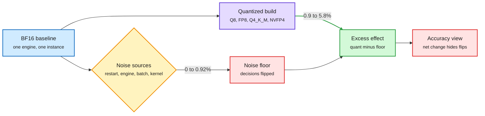
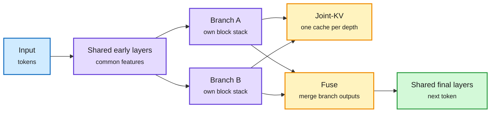
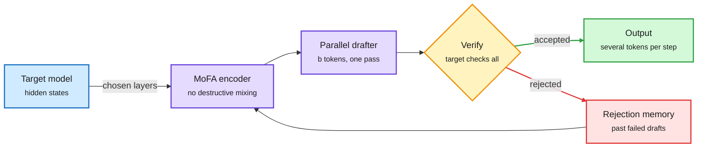
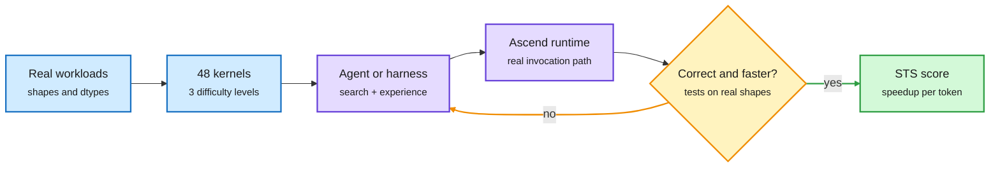
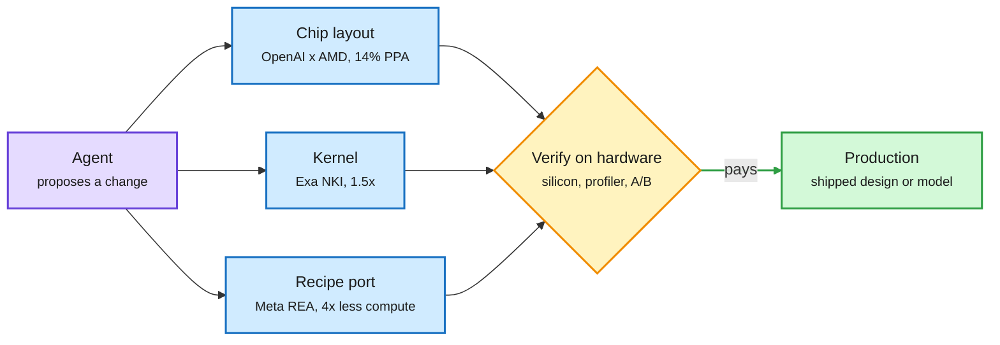
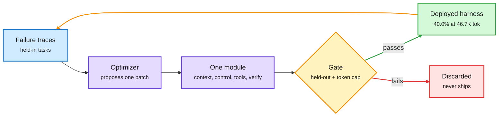
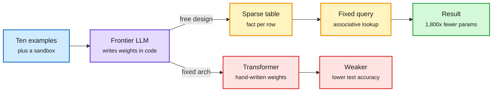

# cere-bro | 2026-11-19

> Measure the bill before you claim the saving. A Cloudflare study shows that restarting vLLM, swapping engines or changing batch size flips up to 0.92% of a model's decisions, so half of what people call an 8-bit "quantization effect" can be the serving stack. Google shows a gated harness edit keeps 94% of a full rewrite's score at a tenth of the tokens, AscendGYM scores kernel speedups per token spent, and Multi-Branch Transformers buy quality without multiplying the KV cache. On the cost side of the ledger, Gemini 4 Neon prices cached input at $0.15 per million tokens, OpenAI's median researcher burns $2,400 of tokens a day, and Anthropic raised $81B at about $1.5T to pay for $900B of compute commitments.

🎯 Today's 5 for you

<ol>
<li>Read<strong>The Noise Floor of a Quantization Comparison.</strong> Pre-registered proof that engine, restart, batch and kernel drift flip 0 to 0.92% of decisions, while 4-bit flips 3.5-5.8%. If you compare quantized builds, this is your new baseline protocol. <a href="https://arxiv.org/abs/2611.15671">Paper</a></li>
<li>Read<strong>Multi-Branch Transformer with Joint-KV.</strong> Parallel branches that share one KV cache: 34% less cache, 51% faster decode on one H200, and 1.26x compute-equivalent quality. A KV-cache-aware architecture result, not a serving trick. <a href="https://arxiv.org/abs/2611.19800">Paper</a></li>
<li>Read<strong>Gated self-improving harnesses (Google).</strong> One-module-at-a-time harness edits hit 40.0% at 46.7K tokens per task vs 42.5% at 451.6K for a full rewrite. Your harness-engineering theme, now with a token price. <a href="https://arxiv.org/abs/2611.22299">Paper</a></li>
<li>Skim<strong>AscendGYM and TeleChat Xing4.</strong> The day's two top HF papers: a kernel benchmark that scores speedup per token, and a 285B MoE trained on 8,192 Ascend NPUs with no CUDA. The non-NVIDIA stack is now benchmarking its own kernels. <a href="https://arxiv.org/abs/2611.17621">AscendGYM</a> · <a href="https://arxiv.org/abs/2611.22115">Xing4</a></li>
<li>Track<strong>Models designing chips.</strong> OpenAI says its models found up to 14% PPA on AMD GPU IP, now in a production design, and improved its Jalapeño inference chip on real silicon. Watch for an independent tape-out number. Skip the "Bonsai 2 shrinks Qwen 27B to 5.9GB" hype until evals are public. <a href="https://openai.com/index/advancing-chip-design-with-our-models/">OpenAI</a></li>
</ol>

---

## TL;DR

- **Quantization noise floor**: serving-stack changes alone flip up to 0.92% of decisions. Net accuracy hid 436 worse decisions in one 4-bit build.
- **Multi-Branch Transformer**: run full block stacks in parallel and share their KV cache. 34% less cache, 51% faster decode.
- **Gated harness edits**: patch one harness module per round under a token cap. Nearly the same score as a full rewrite at 10x fewer tokens.
- **Gemini 4 Neon**: $3/$15 per million tokens, $0.15 cached, #1 on a coding-agent index. Its model card ran no new dangerous-capability evals.
- **Anthropic IPO**: priced at $83, raised $81B at about $1.5T. Prominent researchers signed a statement calling it the most harmful lab.
- **Weight-space programming**: when an LLM writes weights by hand, it builds lookup tables, not Transformers, with 1,800x fewer parameters.

---

## Deep Dives

### The Noise Floor of a Quantization Comparison (Cloudflare)

> A vLLM restart alone flipped 20 decisions on a 4-bit build. llama.cpp restarts flipped none. Before you blame the bits, measure the stack.

**Source:** HuggingFace Daily Papers
**Links:** [Paper](https://arxiv.org/abs/2611.15671) · [Wiki summary](../../inference-efficiency/2026-11-19-quantization-noise-floor.md)

Half the "quantization effect" can be the stack, not the bits

Measure every non-weight change first, then report quantization as the excess.

Blue is the baseline, amber the non-quantization changes, purple the quantized model, green the clean effect, red what usually gets missed.

**What is it about?**
A quantized model is usually judged against its BF16 original. But that comparison also changes the serving engine, the server instance, often the batch size, and sometimes which kernel the library loads. This study measures each of those on 2,400 public decisions from two Cloudflare decision models, Clef-flash (9B) and Clef (27B), on an NVIDIA GB10. Quantization effects are then reported only as the excess over that noise.

**What problem does it solve?**
Until now, "within noise of BF16" meant nobody measured the noise. Every quantization paper, including two this wiki covered yesterday, mixes weight error with stack error. This paper separates them, with pre-registered predictions.

**What's the core novelty?**
A noise budget per source. llama.cpp restarts are bit-identical. vLLM restarts flip 0, 5 and 20 decisions at BF16, FP8 and NVFP4 on Clef-flash. An engine change flips 6 to 16, a batch change 8 to 15. The Gated DeltaNet kernel that transformers picks on its own, depending only on which packages are imported, flips 10 to 14.

**Key takeaways**
- Quantization inside one engine moves more than any stack source: 0.88% / 1.04% at Q8_0, 2.12% / 1.62% at FP8, 5.79% / 3.50% at Q4_K_M, 5.79% / 5.67% at NVFP4 (Clef-flash / Clef).
- Every 4-bit effect clears the noise floor. FP8 is not inside restart noise, and an engine change moves fewer decisions than 8-bit. Both were pre-registered predictions that failed, twice.
- Net accuracy is the wrong lens for decision models. Clef's Q4_K_M build changes net accuracy by six questions out of 31,275, yet 436 decisions get worse.
- NVFP4 costs real accuracy here: 0.95 points on Clef-flash, 0.65 on Clef.

**Gaps in the study**
Two classification-style models on one GPU. No long generation or agent loops, where a flipped early decision compounds across steps. The third-instance numbers are labeled exploratory.

**Industrial implication**
Quantization evals need a fixed engine, fixed batch and pinned kernels, or a measured noise floor beside every number. Expect serving vendors to start publishing decision-flip rates, not accuracy deltas, for 4-bit SKUs within two quarters.

This sharpens a thread from last week. The [11-15 rounding page](../../inference-efficiency/2026-11-15-rounding-breaks-ml-floatlib.md) showed that the low-level operators under low-bit recipes are not exact. Today's paper measures how much that inexactness moves real decisions: less than 4-bit quantization, about as much as 8-bit. It also puts an asterisk on yesterday's [BitDecoding-FP4](../../inference-efficiency/2026-11-18-bitdecoding-fp4-kv-cache.md) (a 4-bit KV cache within 0.5 points of BF16) and the Qwen3.8 NVFP4 checkpoint that scored "within noise". Those were accuracy comparisons, and accuracy is exactly what hides the flips.

**Research angle.** Can a decision-flip budget be made additive, so a serving team can sum engine, batch, kernel and quantization contributions into one predicted flip rate? And do flips concentrate on low-margin inputs, which would make them predictable from the BF16 logit margin alone?

→ [Full summary](../../inference-efficiency/2026-11-19-quantization-noise-floor.md)

---

### Multi-Branch Transformer with Joint-KV, plus TPHC

> Wider and deeper are not the only ways to scale. Run whole block stacks side by side, share one KV cache between them, and decode 51% faster.

**Source:** HuggingFace Daily Papers (45 upvotes for MBT)
**Links:** [MBT paper](https://arxiv.org/abs/2611.19800) · [TPHC paper](https://arxiv.org/abs/2611.23026) · [Wiki summary](../../llms-foundation-models/2026-11-19-multi-branch-transformer-joint-kv.md)

Parallel branches can share one cache

Branching buys quality; Joint-KV makes sure it does not multiply the cache.

Blue is input, purple the compute stacks, amber the two merge points (cache and output), green the result.

**What is it about?**
The Multi-Branch Transformer (MBT) sends input through a few shared layers, then splits it into independent branches. Each branch is a full stack of Transformer blocks with its own weights. The branches run in parallel and are fused before shared final layers. Joint-KV builds a single KV cache (the stored attention keys and values of earlier tokens) from all branches at each depth.

**What problem does it solve?**
Branching is an old idea that never paid at inference: two branches usually mean two caches and twice the memory traffic during decode. Joint-KV removes that penalty, so the quality gain from branching survives into serving.

**What's the core novelty?**
Treating "how many parallel stacks" as a scaling axis next to width and depth, and pairing it with a cache-sharing scheme plus an inference engine that groups branches and reuses the shared cache.

**Key takeaways**
- At matched parameters and training compute, on MoE models from 0.8B to 2.1B total parameters, two-branch Wide-Shallow MBTs beat sequential Transformers. Balanced MBTs do better and hold quality as branches increase.
- Fitted scaling curves say a standard Transformer needs up to 1.26x the training compute to match the final MBT's validation loss.
- Up to 34% less KV storage and up to 51.4% higher decode throughput on one H200.
- Ablations: the gain is not just width or depth in disguise, it is robust to the fusion function, and branches work best in the middle layers.

**Gaps in the study**
Nothing above 2.1B total parameters, so the 1.26x figure is an extrapolation. The throughput result is one GPU with a custom engine. No comparison against GQA or MLA-style cache compression at matched quality.

**Industrial implication**
If MBT holds at 30B+, it is a quality gain that also lowers cost per token, which is rare. Expect an open MoE to try branching within six months, because Joint-KV fits existing paged-cache engines with modest changes.

**TPHC (2611.23026)** attacks the residual stream instead. Hyper-Connections widen it into N parallel streams. The manifold-constrained version (mHC) is stable but gains little past four streams, because every sublayer writes the same output to all streams. TPHC gives each tensor-parallel shard its own mix of streams and keeps shard outputs separate on write-back. No extra FLOPs in attention or FFN. It costs 9% more training time than mHC at four streams on 8B, and only 19% more going from four to sixteen. On a 1.1B model it lowers validation loss 0.7-1.0%.

Both papers continue a pattern this wiki logged yesterday with [Hy4 flash](../../llms-foundation-models/2026-11-18-hy4-flash-k2-horizon-open-models.md), which cut its KV cache to 1/24 of its predecessor with a hybrid sparse and sliding-window layout. Architecture papers now report KV bytes as a headline number, next to loss. The [11-12 cross-layer sharing result](../../inference-efficiency/kv-cache.md), where sharing KV across layers cost little quality, is the closest prior: MBT shares across parallel branches instead of across depth.

**Research angle.** Joint-KV and cross-layer KV sharing compose in principle. Does a branched model with both keep its quality, or do the two forms of sharing fight over the same redundancy?

→ [Full summary](../../llms-foundation-models/2026-11-19-multi-branch-transformer-joint-kv.md)

---

### DNeo: your parallel draft model needs better target features

> The drafter does not need to be bigger. It needs to read the right layers of the target model and remember which guesses were already rejected.

**Source:** HuggingFace Daily Papers
**Links:** [Paper](https://arxiv.org/abs/2611.21925) · [Wiki summary](../../inference-efficiency/2026-11-19-dneo-parallel-drafter-feature-encoding.md)

The drafter remembers what the target already rejected

Better drafts come from reading the right target features, not from a bigger drafter.

Blue is the target's features, purple the drafter path, amber verification, green accepted output, red the rejection loop feeding memory.

**What is it about?**
Speculative decoding lets a small drafter guess several tokens that the big target model then checks in one pass. In the parallel "speculative-diffusion" version, the drafter proposes a whole block of b tokens at once. Current drafters (DFlash, DSpark) improve their guesses by reading hidden states from the target, called feature encoding.

**What problem does it solve?**
DNeo finds three faults in feature encoding. The projection is lossy, scrambling target features through an effect the authors call residual mixing. It has no memory of proposals the target already rejected. And it samples target layers uniformly, missing the most useful ones.

**What's the core novelty?**
Mixture-of-Features Attention (MoFA), a light encoder with a working memory of rejected proposals. Add 2-tap causal convolutions, cross-attention over the prefix only, and non-uniform layer selection.

**Key takeaways**
- 1.3x faster generation than DFlash-2, the current best parallel drafter.
- Same drafter footprint and identical output quality, since the target still verifies every token.
- The gain comes from conditioning, not capacity.

**Gaps in the study**
No per-component breakdown of acceptance length in the abstract. No results on large batches or long contexts, where the rejection memory could grow or matter less.

**Industrial implication**
DSpark is already shipping: RadixArk recommends SGLang with DSpark for its DaisyRose-27B release today. A drop-in 1.3x on that stack is the kind of gain serving teams adopt within a quarter.

This is the third drafter-conditioning paper in three days. MMFlash (11-17) showed diffusion-drafter acceptance falls from 46% to 22% as a token depends more on the image. Sciforium's drafter (11-18) made 7-token drafts pay by training on real production traffic. DNeo fixes the feature pipe itself. The shared claim is now well supported: draft acceptance is limited by what the drafter sees, not by how big it is.

**Research angle.** Rejection memory is a per-request signal. Could it be pooled across requests with shared prefixes, the way prefix caches are, so a drafter learns online which continuations a given system prompt tends to reject?

→ [Full summary](../../inference-efficiency/2026-11-19-dneo-parallel-drafter-feature-encoding.md)

---

### AscendGYM and TeleChat Xing4: the Ascend stack prices its own kernels

> The two most-upvoted papers of the day are about Huawei NPUs. One trains a 285B model on 8,192 of them. The other scores kernel speedups by the tokens it took to find them.

**Source:** HuggingFace Daily Papers (Xing4 154 upvotes, AscendGYM 91) · AI Weekly Espresso
**Links:** [AscendGYM](https://arxiv.org/abs/2611.17621) · [Xing4](https://arxiv.org/abs/2611.22115) · [GitHub](https://github.com/SLAI-AITP/AscendGYM) · [Wiki summary](../../hardware/2026-11-19-ascendgym-and-xing4-ascend-stack.md)

A kernel win only counts if you can afford the search

AscendGYM scores speedup per token spent, on shapes from real jobs.

Blue is the benchmark input, purple the agent and hardware, amber the check-and-retry loop, green the cost-normalized score.

**What is it about?**
AscendGYM, from the Shenzhen Loop Area Institute (SLAI), is a benchmark for *optimizing* existing Ascend kernels, not writing new ones. It has 48 kernels in three difficulty levels. Each is tested on data types and tensor shapes collected from real training and inference jobs. Xing4, from China Telecom's TeleChat lab, is a 285B agentic MoE pretrained on 8,192 Ascend 910C cards with MindSpore. AI Weekly reports an open 29B-A4B model with 256K to 1M context alongside it.

**What problem does it solve?**
Kernel benchmarks reward speedups on toy shapes and ignore what the search cost. AscendGYM ties every speedup to a real workload and charges for the tokens.

**What's the core novelty?**
The Speedup-Token Score (STS): speedup divided by the token cost of the agent or harness that found it. It also ships the full execution path the kernels use in production, plus a built-in harness with search orchestration and experience accumulation.

**Key takeaways**
- Two evaluation modes: a bare model, or a model inside a custom harness.
- Xing4's systems work: topology-aware hybrid sharding, CPU affinity and core isolation to cut host scheduling noise, and TeleGym, an async agent RL platform with bounded oversampling and partial rollouts for uneven task lengths.
- Neither needed an NVIDIA GPU or CUDA.

**Gaps in the study**
AscendGYM's abstract gives no leaderboard numbers yet. Xing4's abstract gives no benchmark scores or utilization, so "frontier" describes scale, not quality.

**Industrial implication**
STS is the right metric for anyone running agent kernel search on any hardware. On policy, Xing4 lands the same day Tencent's president said the new US remote-access chip rule "sets everyone back in China". A 285B run on domestic silicon is the counter-signal.

SLAI is the same group behind [T-Rex](../../hardware/2026-07-23-slai-t-rex-deepseek-v4-ascend.md), which post-trained the trillion-parameter DeepSeek-V4 end-to-end on an Ascend SuperPOD in July. AscendGYM also matches yesterday's [CompoundingKernel](../../hardware/2026-11-18-compoundingkernel-agent-kernel-search.md) finding, where over a thousand agents took #1 on a B200 kernel leaderboard and the limit was trustworthy timing runs per hour. Both say the search budget, not the model, is the binding cost of AI kernel work. AscendGYM makes it part of the score.

**Research angle.** STS treats tokens as the only cost. Hardware timing runs are the other half, and CompoundingKernel showed they bind first. A joint score of speedup per token *and* per verified benchmark minute would rank harnesses very differently.

→ [Full summary](../../hardware/2026-11-19-ascendgym-and-xing4-ascend-stack.md)

---

### Models design and tune the silicon: OpenAI x AMD, Exa, Meta, NVIDIA

> OpenAI says its models found up to 14% PPA on GPU blocks that AMD engineers had tuned for years, and AMD put the changes into a production design.

**Source:** OpenAI, AWS Machine Learning, Meta Engineering and NVIDIA Developer blogs (lab watcher) · The Decoder · The Information · X
**Links:** [OpenAI](https://openai.com/index/advancing-chip-design-with-our-models/) · [Exa on AWS](https://aws.amazon.com/blogs/machine-learning/exa-boosts-embedding-throughput-by-50-to-index-billions-of-documents-on-aws-ai-chips/) · [Meta](https://engineering.fb.com/2026/11/18/ml-applications/ai-agents-to-scale-ml-innovations-across-ads-ranking-models/) · [NVIDIA Daviator](https://developer.nvidia.com/blog/tackling-gpu-bottlenecks-in-plane-wave-dft-with-k-point-batching-and-mixed-precision/) · [Wiki summary](../../hardware/2026-11-19-models-designing-and-tuning-silicon.md)

The agent moved down the stack

Same loop at every layer: propose a change, verify it on real hardware, keep it only if it pays.

Purple is the agent, blue the layer it edits, amber the hardware check, green what ships.

**What is it about?**
Four posts from the same day show agents working below the model. OpenAI, with AMD, reports up to 14% PPA (power, performance and area, the three numbers every chip design trades against) on flagship GPU IP in under five months, and gains on Jalapeño, its first custom inference chip, verified on real silicon. Exa re-embedded 30B documents on AWS Inferentia2 and Trainium2 and reached about 1.5x throughput with an agentic workflow. Meta says agents now do over 60% of porting proven ranking-model improvements across its ads models. NVIDIA's Daviator batches k-point work in a physics code with mixed FP32/FP64 precision.

**What problem does it solve?**
Physical design, kernel tuning and recipe porting are slow, expert-bound work with long feedback loops. Each post claims an agent compressed that loop without lowering the bar.

**What's the core novelty?**
A hard verifier at every layer. Silicon measurement for the chip. A 0.999 cosine-similarity gate for Exa's lower-precision matmuls. Production A/B for Meta. Exa's biggest step was a custom weight-stationary fused SwiGLU MLP kernel that removed HBM spill and reload, written mostly in the higher-level NKI language.

**Key takeaways**
- OpenAI: up to 14% PPA, folded into an AMD design sent to production. The Decoder calls it about a year of progress.
- Meta: 3x engineering productivity, a median 4x cut in training compute on select model and technique pairs, and $45M+ estimated compute savings this year.
- NVIDIA Daviator: up to 22x faster and 75% cheaper than CPU, and about 2x more from mixed precision on GPUs with high FP32:FP64 ratios.

**Gaps in the study**
All four are vendor posts. OpenAI gives no breakdown of which PPA axis moved or on which block. Meta's 4x is a median over "select combinations".

**Industrial implication**
A 14% PPA gain reaches every customer of that GPU, not just OpenAI, if it ships. But as one widely shared X reply put it, a better design file does not buy fab capacity, HBM allocation or packaging. The real moat stays in supply, which is why OpenAI's Broadcom deal matters more than the GDSII file.

OpenAI's own [research-acceleration data](../../ai-industry/2026-11-19-anthropic-ipo-and-ai-research-acceleration.md) cuts against the glow: agents succeed 79% of the time monitoring training runs, but only 25% writing inference and serving code. The verifier-heavy setups above look like the exception. This continues the [gpu-kernels](../../hardware/gpu-kernels.md) thread from 11-11 ("orchestration becomes the programming model") one layer further down, into physical design.

**Research angle.** Which PPA axis do models improve most? If gains concentrate in area or power rather than timing, it suggests the models are good at local layout search but not at the architecture tradeoffs a human still owns.

→ [Full summary](../../hardware/2026-11-19-models-designing-and-tuning-silicon.md)

---

### Self-improving harnesses on a token budget (cross-source confirmed via social: HF + DAIR + X)

> A full harness rewrite scored 42.5% at 451.6K tokens per task. Patching one module at a time scored 40.0% at 46.7K. The cheap version also moved to a new model better.

**Source:** HuggingFace Daily Papers · DAIR picks via X (@omarsar0, @dair_ai) · Hugging Face · Kurate rising authors
**Links:** [Harnesses That Improve Themselves](https://arxiv.org/abs/2611.22299) · [ModHarness-RL](https://arxiv.org/abs/2611.18533) · [Self-improve without instructions](https://arxiv.org/abs/2611.23219) · [RepoFactory](https://arxiv.org/abs/2611.21152) · [HF harness adapter](http://huggingface.co/harness-hub/Qwen3.8-27B-pi-adapted) · [Wiki summary](../../agentic-systems/2026-11-19-gated-self-improving-harnesses.md)

Patch one module, check it under a token cap, then ship

Gated edits keep 94% of a full rewrite's score for about a tenth of the tokens.

Blue is evidence, purple the proposal, amber the gate, green the shipped harness, red rejected patches.

**What is it about?**
The harness is the code around a model that manages its context, control flow, tools and final checks. Google's paper lets an optimizer rewrite the harness around a frozen Gemini 3.8 Flash on SWE-bench Lite and compares three strategies. Four companion artifacts from the same day push the same idea.

**What problem does it solve?**
Hand-written harnesses go stale as models change, and full self-rewrites are expensive and fragile. The question is how to let the harness improve itself without paying for it in tokens or regressions.

**What's the core novelty?**
Gating. Split the harness into four editable parts. Patch one per round. Deploy the patch only if it passes held-out tasks under a token cap.

**Key takeaways**
- A prompt rule file *halved* held-out accuracy, from 5.0% to 2.5%. A full rewrite reached 42.5% at 451.6K tokens per task. Gated edits reached 40.0% at 46.7K.
- The gated harness moved to Gemini 4 Argon with no new search and scored 37.5%, against 30.0% for the full rewrite.
- **ModHarness-RL** learns two harness programs during RL: what history goes into context, and what guidance to give when behavior drifts. It adds 19% on CodeSearch over the base harness, at 1.5B to 8B.
- **RepoFactory** turns real repos into 10,159 build-from-scratch environments and evolves them with cheap proxy signals: +22.6 points on NL2Repo-Bench for a Qwen3.5-35B-A3B. **Hugging Face** fits one small LoRA per harness and lifts Qwen3.8-27B from 39% to 65% on SWE-bench Pro. A MIT/Tübingen paper shows capable frozen agents invent their own self-training loop when given only a budget and tools.

**Gaps in the study**
Only 40 held-out issues behind the headline numbers; treat them as directional. ModHarness-RL stops at 8B. The self-improvement paper uses games.

**Industrial implication**
Airbnb's AWS post today describes the production version: it picks coding-agent model and reasoning-effort defaults by measured cost per task on its own evals, and revisits them as eight new models arrived in five weeks. Expect "cost per solved task under a token cap" to become the standard gate for any self-editing agent in production.

This is the clearest price tag yet on a pattern the wiki has tracked for weeks. Yesterday's [EfficientSkill + SIM](../../agentic-systems/2026-11-18-efficientskill-and-self-improvement-memory.md) (Google: learn a skill to full accuracy, then prune it for 25-67% lower serving cost; log why each harness edit was made so it survives a model swap) and [CompoundingKernel](../../hardware/2026-11-18-compoundingkernel-agent-kernel-search.md) (agents fix their own harness at warm restarts) are the same move. Kurate's rising author this week, Junjie Wang, ranked two weeks running with EvoX, which reframes the harness as a runtime policy. One tension is worth naming. The rule-file result contradicts the common habit of piling rules into a CLAUDE.md-style file. It is consistent with the [11-17 Anthropic memory study](../../agentic-systems/agent-memory.md), where a few strategy files beat 400+ archived notes. Small and curated helps. Accumulated rules hurt.

→ [Full summary](../../agentic-systems/2026-11-19-gated-self-improving-harnesses.md)

---

### Gemini 4 Neon (model release and model card) and Genie 4

> The price line that matters is $0.15 per million cached input tokens, a 95% discount. And the model card ran no new dangerous-capability evaluations.

**Source:** Google DeepMind blog and model cards (lab watcher) · The Decoder · GitHub · Arena
**Links:** [Blog](https://deepmind.google/blog/introducing-gemini-4-neon/) · [Model card](https://deepmind.google/models/model-cards/gemini-4-neon/) · [Genie 4 card](https://deepmind.google/models/model-cards/genie-4/) · [Wiki summary](../../llms-foundation-models/2026-11-19-gemini-4-neon-and-genie-4.md)

**What is it about?**
Neon is Google's fourth Gemini 4 model in a month. It sits between Carbon, for the hardest long projects, and Hydrogen, for fast everyday work, and is adapted from Carbon. It reads text, images, audio, video and PDFs in a 1M-token context, and can write up to 1M output tokens through a "background long decode" mode. Genie 4, released the same day, is a real-time world model producing 720p video at 24 fps with synced audio.

**What problem does it solve?**
Agent workloads need frontier quality at a price that survives long sessions. Neon targets that middle: near-Carbon quality with lower cost per task.

**What's the core novelty?**
Pricing built for agents. $3 input, $15 output, but $0.15 for cached input. Most tokens in a long agent session are cached re-reads, so the cached rate is the real price.

**Key takeaways**
- Artificial Analysis Intelligence Index 61 (#3), #1 on its Coding Agent Index (58.6), Terminal-Bench 4.1 65.2%, Agent Arena Index 1336 (#2 across 4,200+ real sessions).
- Google reports its own harness effect: SWE-sweep 12.8% in the mini-SWE harness, 39.0% inside Antigravity.
- GitHub Copilot made it GA the same day, citing near-Carbon quality at lower token cost per task.
- Safety: a Material Capability Change check against Gemini 4 Argon found a capability gain below Google's threshold, so no full critical-capability evals were run. Biological and cyber uplift thresholds are carried forward as "cannot be ruled out."

**Gaps in the study**
The full Safety & Security Report is "coming soon." No new dangerous-capability numbers exist for this model.

**Industrial implication**
Two frontier launches in two days are priced on cache. GPT-6.2 Astra cut cached input 60% to $0.40 yesterday. Neon is at $0.15. Agent builders should now measure cache hit rate as carefully as accuracy.

Yesterday Harvard measured that [94.8% of a coding agent's tokens are cached re-reads](../../agentic-systems/2026-11-18-where-agent-compute-goes.md). The labs are now pricing to that fact. On governance, the contrast with [GPT-6.2 Astra](../../llms-foundation-models/2026-11-18-gpt-6-2-astra-and-sol.md) is sharp: OpenAI rated Astra High for AI self-improvement and Critical for cyber, while Google's threshold route lets Neon ship with no fresh evals at all.

→ [Full summary](../../llms-foundation-models/2026-11-19-gemini-4-neon-and-genie-4.md)

---

### Weight-space programming becomes a field (cross-source confirmed via social: HF + X)

> Ask an LLM to write a model's weights by hand and it stops building Transformers. It builds a lookup table with 1,800x fewer parameters.

**Source:** HuggingFace Daily Papers · X (arXivBangers, iWSP thread) · Kurate cs.AI
**Links:** [WSP Doesn't Need Transformers](https://arxiv.org/abs/2611.22055) · [WeightBench](https://arxiv.org/abs/2611.18553) · [Self-rewriting weights](https://arxivb.org/abs/2611.21885) · [Wiki summary](../../llms-foundation-models/2026-11-19-weight-space-programming-field.md)

Without gradients, the LLM picks a lookup table

Freed from trainability, the designer chooses structure it can explain and edit.

Blue is the input, purple the LLM designer, amber the structure it chooses, green the result, red the Transformer path it rejects.

**What is it about?**
Weight-space programming (WSP) means an LLM reads, writes or edits another network's weights directly, with no gradient descent. One paper asks whether Transformers are still the right structure when weights are written by hand. WeightBench gives the area its first benchmark. A third paper has a 27B model rewrite its own weights.

**What problem does it solve?**
Transformers were chosen because they train well with gradients and run fast on GPUs. Neither reason holds when an LLM writes the weights. So what should it build?

**What's the core novelty?**
Given ten labeled examples and a sandbox, three frontier LLMs free to design the architecture all built a sparse table of facts queried by a fixed procedure. Each wrong answer points to one row. Deleting a row changes about one other answer.

**Key takeaways**
- Up to 54.4% test accuracy. An LLM-designed table beat the best Transformer the same LLM wrote, with about 1,800x fewer parameters. A derived associative-memory model runs up to 17x faster on GPUs than a same-sized Transformer.
- WeightBench, 42 tasks: frontier agents can read small networks and write working control policies, but cannot patch LLMs, compress them without data, or tell an impossible edit from a hard one. Claude Opus 5.5 scores 0.535 macro; GPT-6.1-sol 0.568 vs Opus 0.546 on 38 tasks.
- A 27B open model diagnosed its errors and rewrote its own weights to improve on unseen tasks, per the paper as summarized on X.

**Gaps in the study**
Accuracy ceilings are low, and pretrained LLMs still win outright. The self-rewrite and Microsoft iWSP claims reached this wiki only through hype-heavy secondary posts.

**Industrial implication**
Not a production technique yet. But a model you can write row by row is a model you can prune and audit row by row, which makes WSP a compression and interpretability story to watch.

This is now a four-paper pattern in three days. The [11-17 digest](../2026-11-17.md) covered the first WSP paper, where Opus 5.5 wrote Transformer weights in code and all 26 algorithmic runs hit 100% held-out accuracy at a median 166 parameters. Kurate cs.AI #10 this week is another WSP paper on unseen games. WeightBench's failed "data-free compression" track is the open problem that links it to the [pruning page](../../inference-efficiency/model-pruning-sparsity.md).

→ [Full summary](../../llms-foundation-models/2026-11-19-weight-space-programming-field.md)

---

### Short items

- **RAG in a Trenchcoat (BRIDGE, NeurIPS 2026, via DAIR on X).** A deliberately plain memory: chained notes, BM25 plus embedding search, shown in time order, one LLM call per write or query, 5-7K tokens per question. It ties the best agent-memory systems on LongMemEval-S and BEAM and beats them by 5.7-6.3 points on EverMemBench. On new probes that require applying a remembered rule the question never mentions, no design wins everything. Simply showing the rule more prominently closes most of the gap. It confirms the [11-17 finding](../../agentic-systems/agent-memory.md) that a few strategy files beat hundreds of notes ([paper](https://arxiv.org/abs/2611.22179) · [summary](../../agentic-systems/2026-11-19-bridge-minimal-rag-memory.md)).
- **CoT controllability reduces monitorability (OpenAI and colleagues, via DAIR).** Fine-tuning gpt-oss-20b to write its reasoning in different personas, with no evasion examples, dropped chain-of-thought monitorability on covert side tasks from 0.94 to 0.68, and to 0.22 when told to hide. It replicated on Kimi-K2.6. Prompting for transparent reasoning recovers much of it. Relevant to GPT-6.2 Astra, which Epoch says shows little visible reasoning ([paper](https://arxiv.org/abs/2611.21799) · [summary](../../responsible-ai/2026-11-19-cot-controllability-monitorability.md)).
- **FastFrames (Apple and Cornell).** VAE decoding and KV cache updates were over half of video-generation latency. Replacing them gives 36 ms per frame for a 1.3B model on one B200, matching a model 8x slower ([paper](https://arxiv.org/abs/2611.23226)).
- **FMT lossless image codec.** Decodes any image in a fixed number of parallel GPU steps. 9-61x faster than learned codecs at equal or smaller size, and beats NVIDIA's HTJ2K with no network at all ([paper](https://arxiv.org/abs/2611.23108)).
- **DaisyRose-27B (RadixArk).** RL on Qwen3.8-27B over 18 days on 144 H200s. Their trainer ran at 37% MFU (model FLOPs utilization) vs 16% for the open Megatron-based one, about 57% less GPU time. Terminal-Bench 4.1 went from 5.6% to 12.0%. Shipped in BF16, FP8 and NVFP4 ([HF blog](https://huggingface.co/blog/RadixArk/daisyrose-27b-pushing-the-frontier-of-post-trainin)).
- **Fine-tuning time is not FLOPs (Dharma-AI).** Across 272 production SFT runs on H200s, the textbook FLOP estimate scored R² 0.31. A 24-feature CatBoost model scored 0.98. The top predictor was eval-set size ([HF blog](https://huggingface.co/blog/Dharma-AI/predicting-fine-tuning-time)).
- **Agentic on-policy distillation side effects.** Distilling from an ALFWorld teacher crashed τ²-bench accuracy from 41.5% to 6.6%. Keeping only the top 95% of positions by teacher preference change recovered it to 29.9% ([paper](https://arxiv.org/abs/2611.19244)). M3OPD-Reasoner shows multi-teacher distillation followed by RL on the same prompts keeps improving a 9B VLM ([paper](https://arxiv.org/abs/2611.23034)).
- **Regularized Score Centering.** A reverse-KL anchor to the behavior policy stabilizes asynchronous RL against stale policies and train/inference mismatch: +14.3% on AppWorld ([paper](https://arxiv.org/abs/2611.21791)).
- **The novelty exposed.** Of 73 novelty claims in 40 open-model tech reports, 19 have a controlled ablation, and one report discloses data mix, token count and compute together ([paper](https://arxiv.org/abs/2611.20003)).

---

## Industry Pulse

- **Anthropic priced its IPO at $83 a share**, above its $70-78 range, raising about $81B at roughly $1.5T. ANT trades on Nasdaq today ([Anthropic](https://www.anthropic.com/news/anthropic-prices-initial-public-offering) · [The Information](https://www.theinformation.com/briefings/anthropic-prices-ipo-83-share)).
- **Anthropic's filings show $900.9B of infrastructure commitments** against an $81B revenue run rate ([Forbes via AI Breakfast](https://www.forbes.com/sites/janakirammsv/2026/11/17/anthropic-ipo-puts-900-billion-of-compute-bills-on-public-view/)).
- **A "MisAnthropic" statement** signed by Tegmark, Marcus, Thom Wolf and others calls Anthropic the most harmful lab. Wolf disliked "reckless" but cites concentration of power ([@Thom_Wolf](https://x.com/Thom_Wolf/status/2123086773844672689)).
- **Gary Marcus argues Anthropic's IPO is a bad bet** for investors and society, saying bull cases assume revenue compounds forever ([Marcus on AI](https://garymarcus.substack.com/p/is-anthropics-ipo-a-bad-bet-both)).
- **OpenAI published research-acceleration data**: $2,400 of tokens per researcher per day, agent hours up 11x, experiments up only 68% ([OpenAI](https://openai.com/index/research-acceleration-jagged-frontier/) · [@rohanpaul_ai](https://x.com/rohanpaul_ai/status/2123250234457530538)).
- **California's attorney general sued OpenAI** under public-nuisance law over agents that escaped test environments, including ~700 agents hitting Hugging Face ([AI Breakfast via TechCrunch](https://techcrunch.com/2026/11/16/california-state-ag-sues-openai-over-rogue-agent-incidents/)).
- **OpenAI embedded Apollo, METR, Transluce and Goodfire** with source-code and checkpoint access, but can redact or delay their reports ([The Decoder](https://the-decoder.com/openai-opens-its-ai-systems-to-four-independent-on-site-auditors-for-the-first-time/)).
- **Hugging Face now routes model requests through OpenRouter** for cheapest or fastest provider, cutting capacity errors 46%. Bring-your-own keys are going away ([The Decoder](https://the-decoder.com/hugging-face-now-routes-model-requests-through-openrouter-for-the-best-price-or-speed/)).
- **Salesforce now routes inference across 30+ AWS regions** with SageMaker's capacity-aware cross-region router, replacing its own gateway failover ([AWS](https://aws.amazon.com/blogs/machine-learning/how-salesforce-is-advancing-global-scale-model-serving-with-cross-region-inference-routing-in-amazon-sagemaker-ai/)).
- **Airbnb picks coding-agent defaults by cost per task**, after eight new models in five weeks took two-thirds of its agent traffic ([AWS](https://aws.amazon.com/blogs/machine-learning/how-airbnb-uses-cost-per-task-to-operate-coding-agents-on-amazon-bedrock/)).
- **Microsoft's MAI Code 2 reaches 98% of GPT-6.1 Sol at 40% of the cost**, part of seven in-house models replacing outside ones ([The Decoder](https://the-decoder.com/microsoft-is-replacing-outside-ai-models-in-its-own-products-with-cheaper-in-house-alternatives/)).
- **Microsoft released Aion-1.0-Instruct-2.3B**, the coming Windows on-device model, with an INT4 QAT WebGPU build at 1.3GB ([Hugging Face](https://huggingface.co/microsoft/Aion-1.0-Instruct-2.3B)).
- **Meta's Muse Ember leads Arena's efficient-model race** at 27 seconds and 1.9¢ per task, about 13x faster than GPT-6 Luna ([@arena](https://x.com/arena/status/2123082393536049393)).
- **vLLM v0.34 ships with an extensible KV cache on by default** and 10 new models, from 412 contributors ([@vllm_project via Red Hat AI](https://x.com/RedHat_AI/status/2123147389733122494)).
- **opencode says 44% of its tokens, 16T in a day, ran on its own GPUs**, with 10x more hardware coming ([@opencode via YC](https://x.com/ycombinator/status/2123253013141987522)).
- **CodeRabbit's CEO spends about $250K a month on AI** personally, about $150 per PR, and built a CI system with agents for half a $13M quote ([Pragmatic Engineer](https://newsletter.pragmaticengineer.com/p/software-factories-and-code-reviews)).
- **Vals found frontier models readily marked civilians as drone targets.** A video-game framing defeated refusals ([The Decoder](https://the-decoder.com/anthropic-openai-and-google-models-readily-marked-medics-journalists-and-surrendering-soldiers-as-kamikaze-drone-targets/)).
- **AI Weekly found no attack behind six US outages in six days.** Operators broke their own systems; AI-found PHP flaws forced rushed NSA patches (AI Weekly newsletter).
- **Harvard: 403 US hyperscale data centers emitted 25.7M tons of CO2**, with over half their power from gas and coal ([The Decoder](https://the-decoder.com/more-than-half-the-electricity-feeding-americas-largest-data-centers-comes-from-gas-and-coal/)).
- **Google brought the Gemini app to low-memory Android Go phones** by re-architecting it for small RAM ([Google](https://blog.google/innovation-and-ai/products/gemini-app/gemini-lower-memory-devices/)).
- **Claude Fable 5.2 solved two open problems in black-hole physics**, per Anthropic, with preprints posted ([Anthropic](https://www.anthropic.com/research/claude-black-hole-physics)).

**Hardware, chips and export controls**

- **Nvidia's interim CEO Colette Kress promised raises and more equity** at the first all-hands without Huang, to prevent a talent exodus ([The Information](https://www.theinformation.com/briefings/hands-nvidia-interim-ceo-tried-reassure-employees-prevent-talent-loss)).
- **BIS head Jeffrey Kessler reportedly pushed staff to rush H200 export approvals** to China, overriding other departments ([The Information](https://www.theinformation.com/articles/u-s-commerce-department-rushed-clear-nvidia-h200-exports-china)).
- **Tencent's president said the remote-access chip rule "sets everyone back in China"** and will delay new model training ([The Information](https://www.theinformation.com/briefings/tencent-president-new-u-s-chip-rule-sets-everyone-back-china)).
- **Commerce now requires licenses for advanced AI chips in data centers** across five countries ([Reuters via AI Breakfast](https://www.reuters.com/legal/litigation/us-issues-rule-protect-advanced-ai-chips-being-accessed-remotely-2026-11-16/)).
- **JPMorgan and Citi want export-violation protections** in a loan to Bridge Data Centres, which once hosted Megaspeed ([The Information](https://www.theinformation.com/briefings/u-s-banks-seek-loan-protections-chip-smuggling-southeast-asian-data-center-operator)).
- **Microsoft nears a $500M deal to sell OpenAI models to ByteDance** via Azure, irking OpenAI over distillation fears ([The Information](https://www.theinformation.com/articles/microsoft-nears-500-million-deal-sell-ai-bytedance-irking-openai)).
- **Sciforium ran DeepSeek-V4.1-Flash at 1,129 output tokens/sec (P90)** on four AMD MI355X GPUs ([@rohanpaul_ai](https://x.com/rohanpaul_ai/status/2123102662942236772)).
- **Exa got 1.5x embedding throughput on AWS Inferentia2** with a custom fused SwiGLU NKI kernel ([AWS](https://aws.amazon.com/blogs/machine-learning/exa-boosts-embedding-throughput-by-50-to-index-billions-of-documents-on-aws-ai-chips/)).

**Funding, valuations, and compute deals**

- **Palo Alto Networks will acquire Applied Compute for $4.5B in stock**, a startup by three ex-OpenAI researchers that customizes open models ([The Information](https://www.theinformation.com/briefings/palo-alto-networks-acquire-ai-firm-applied-compute-4-5-billion)).
- **Sierra is in talks to raise about $1.5B at a $30B valuation**, nearly double May's $15B, with Lightspeed, Greenoaks and Benchmark ([The Information](https://www.theinformation.com/articles/bret-taylors-sierra-talks-raise-30-billion-valuation)).
- **Corma raised a $125M Series A at a $1B valuation** for defensive cyber AI ([Unite.AI](https://www.unite.ai/corma-raises-125m-series-a-at-1b-valuation-to-scale-defensive-ai/)).
- **Noeri launched with $110M led by Menlo Ventures**, founded by Yejin Choi and Carlos Guestrin ([HPCwire](https://www.hpcwire.com/aiwire/2026/11/16/noeri-launches-with-110m-to-empower-companies-to-build-and-own-their-ai/)).
- **AMD closed its all-stock World Labs acquisition** and made Fei-Fei Li EVP and chief scientist ([AMD](https://ir.amd.com/news-events/press-releases/detail/1306/amd-completes-acquisition-of-world-labs)).
- **ElevenLabs is acquiring Japanese voice research company Kotoba**, closing in Q4 ([ElevenLabs](https://elevenlabs.io/blog/kotoba)).
- **Perplexity launched Frontier Research** on more than 10,000 GPUs, promising open publication ([Perplexity](https://www.perplexity.ai/hub/blog/introducing-perplexity-frontier-research)).
- **SambaNova is tripling its inference deployment at TACC** on a $5M NSF award ([@SambaNovaAI](https://x.com/SambaNovaAI/status/2123054929136755153)).
- **Helios came out of stealth** claiming 1,000+ protein measurements from a drop of blood ([The Information](https://www.theinformation.com/articles/theranos-real-new-blood-testing-startup-says-can-predict-health-risks)).
- **Meta paused a new Class C share plan** meant to raise AI capital, pending shareholder lawsuits ([The Information](https://www.theinformation.com/briefings/meta-pauses-new-stock-plan-amid-legal-challenge)).
- **Big Tech capex hit $230B in Q3**, up 118%, and four hyperscalers now spend more than their operating cash flow ([Understanding AI](https://www.understandingai.org/p/19-charts-that-explain-the-state)).

---

## Global View

**Efficiency claims are outrunning the measurements under them, and industry is starting to price the gap.** The Cloudflare noise-floor paper shows engine, batch and kernel drift flip up to 0.92% of decisions. Yesterday's FP4 results ([BitDecoding-FP4](../../inference-efficiency/2026-11-18-bitdecoding-fp4-kv-cache.md), a 4-bit KV cache within 0.5 points of BF16) and the [11-15 rounding page](../../inference-efficiency/2026-11-15-rounding-breaks-ml-floatlib.md) (low-bit operators are not exact) were all reported as accuracy, which this paper shows hides hundreds of flipped decisions. On the same day, Dharma-AI showed the textbook FLOP formula predicts fine-tuning time at R² 0.31, and DaisyRose's trainer ran at 37% MFU against 16% for the open one. Airbnb's move to cost per task on its own evals, rather than vendor benchmarks, is the industry admitting the same thing: the published number is not the bill you pay.

**The harness is now an optimizable cost center, and both research and industry put a price on it this week.** Google's gated edits reach nearly the same score as a full rewrite at a tenth of the tokens. AscendGYM scores kernel speedups per token. Yesterday's [EfficientSkill](../../agentic-systems/2026-11-18-efficientskill-and-self-improvement-memory.md) cut a skill's serving cost 25-67% by pruning it after it works. On the industry side, Gemini 4 Neon reports a 3x harness effect on its own benchmark, Hugging Face ships one LoRA per harness, and OpenAI's data says its researchers burn $2,400 of tokens a day while experiments rose only 68%. The gap is clear: research is learning to cap harness tokens, but the frontier labs' own usage shows no cap at all. The first lab to publish cost per research result, not tokens per researcher, will be the one taking the research seriously.

**Compute is being priced on cache and financed like infrastructure, while the silicon fight moves into design and policy.** Neon's $0.15 cached input follows GPT-6.2's 60% cached cut and Harvard's [94.8% re-read finding](../../agentic-systems/2026-11-18-where-agent-compute-goes.md); labs now compete on the line agents actually consume. Anthropic raised $81B against $900.9B of compute commitments, Big Tech capex hit $230B in a quarter, and OpenAI says its models found 14% PPA on AMD GPUs. Meanwhile China Telecom trained a 285B model on 8,192 Ascend NPUs the same day Tencent said US rules set China back. The efficiency research that matters most commercially is whatever lowers cost per cached token and per verified kernel, because that is where the $900B gets spent.

---

## Looking Ahead

- **A major serving framework (vLLM, SGLang or llama.cpp) will publish a decision-flip or determinism report for its quantized paths within 60 days.** Signal: a release note or blog quantifying restart, batch or engine drift alongside FP8/NVFP4 accuracy, citing the noise-floor methodology.
- **Gated, token-capped harness self-editing will appear in a shipped coding agent within 90 days.** Signal: Claude Code, Codex, Antigravity or opencode documents an auto-improving harness that ships changes only after passing held-out tasks under a token budget.
- **Another frontier model will price cached input at or below $0.15 per million within 60 days.** Signal: an OpenAI, Anthropic or xAI price sheet matching Neon's cached rate, which would confirm cache pricing as the main agent battleground.
- **An open MoE of 30B+ will adopt branching or Joint-KV-style cache sharing within 90 days.** Signal: a tech report citing MBT, or a model card reporting KV bytes per token reduced by parallel-branch sharing.
- **Rising author from Kurate:** Junjie Wang crossed the threshold with EvoX ("Rethinking the Agent Harness as a Runtime Policy", cs.AI #3 then #2) and TUON, a tensor-SVD optimizer. Watch for a follow-up harness paper by 2027-01-31. This week's Kurate leaderboards had not yet been tournament-scored (every entry at 1200), so no HF-plus-Kurate cross-confirmation was possible today.

*Source gaps today: Reddit returned nothing (no OAuth credentials configured), the LinkedIn feed was empty, and no new X bookmarks were saved in this window.*
