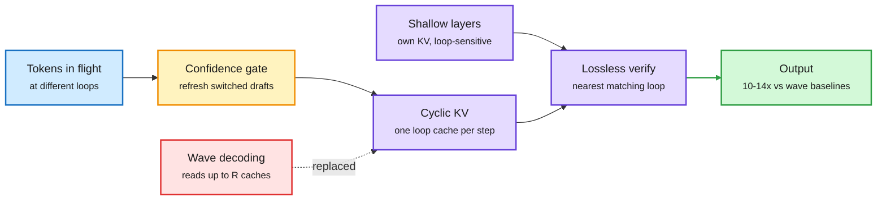
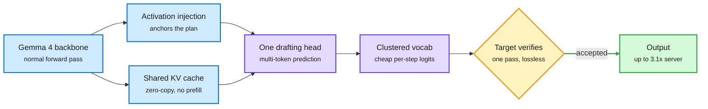
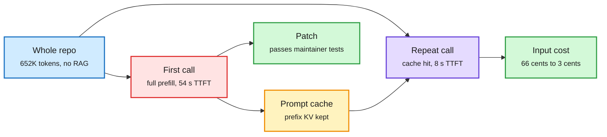
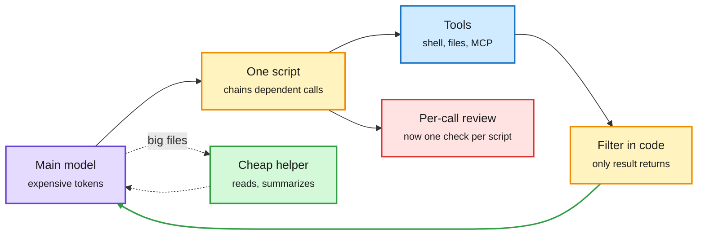
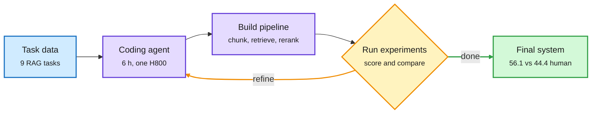
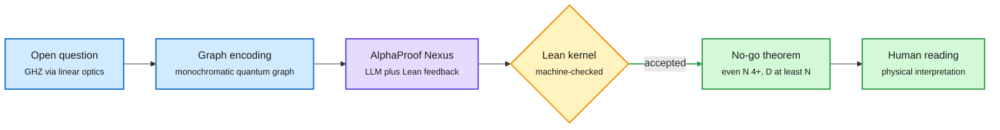

# cere-bro | 2026-11-22

> A quiet US Friday with one clear cost lesson: the cheapest token is the one you never move. LoopCache makes looped models 10-14x faster by reading one loop's KV cache per step instead of all of them. Google's G-MTP drafter reads the target's KV cache in place, so speculative decoding needs no second prefill. Together showed a whole repository in one prompt costs 69 cents once and about 3 cents on a cache hit. Claude Code's Code Mode and Spotify's helper models cut agent bills the same way, by keeping bytes out of the expensive model. Amazon priced the same idea into a $7.5B bid for Decart, a startup valued on tokens per kilowatt.

🎯 Today's 5 for you

<ol>
<li>Read<strong>LoopCache.</strong> Looped models keep one KV cache per loop. Wave-style speculation reads up to R of them per step; LoopCache reads one and gets 10-14x. Your KV-cache topic, and the first paper to name memory traffic as the real cost of loops. <a href="https://arxiv.org/abs/2611.24301">Paper</a></li>
<li>Read<strong>G-MTP (Google, Gemma 4).</strong> A speculative-decoding drafter built into the model that cross-attends to the target's own KV cache, so no drafter prefill. Up to 3.1x on servers and 2.2x on a phone GPU. DAIR pick plus social. <a href="https://arxiv.org/abs/2611.25813">Paper</a></li>
<li>Skim<strong>Qwen4 Max on Together: a 652K-token repo in one call.</strong> The patch passed the maintainers' tests for 69 cents. A cache hit cut first-token time from 54 to 8 seconds and input cost to about 3 cents. Prompt-cache economics in one real example. <a href="https://www.together.ai/blog/qwen4-max">Post</a></li>
<li>Skim<strong>Code Mode and Spotify's 90% token cut.</strong> Your top saved theme (harness engineering) meets agent cost: script-chained tool calls and cheap helper models, enforced by hooks. Skip the viral "150K to 2K" posts; that number is from an older Anthropic example. <a href="https://kenhuangus.substack.com/p/claude-codes-code-mode-batches-tool">Ken Huang</a></li>
<li>Track<strong>Amazon nearing a $7.5B Decart buy.</strong> Nearly 2x its last valuation, reportedly for squeezing more tokens per kilowatt out of Trainium. Compute economics as an M&A thesis, while GPU spot prices keep rising. Skip the Riemann day-two arguments unless you follow the math. <a href="https://www.theinformation.com/briefings/amazon-nearing-7-5-billion-purchase-decart">The Information</a></li>
</ol>

---

## TL;DR

- **LoopCache**: looped models get 10-14x faster speculative decoding by reading one loop's KV cache per step, not all of them.
- **G-MTP**: Google's Gemma 4 drafter reuses the model's own KV cache. Up to 3.1x on servers, 2.2x on phones.
- **Qwen4 Max on Together**: a whole 344-file repo in one prompt produced a passing patch. Caching cut repeat input cost 20x.
- **Code Mode**: Claude Code can now chain tool calls in one script. Fewer round trips, but one approval covers many calls.
- **AutoRAGBench**: coding agents built RAG systems scoring 56.1, against 44.4 for the best published designs.
- **Amazon and Decart**: a reported $7.5B deal for a video startup prized for efficiency on Amazon's chips.

*Quiet sources this window: no new Hugging Face papers (the US-Friday list was already ingested), no Reddit posts passed the filters in any of the eight subs, the X repost and saved-post feeds were empty (the Following-feed captures were full), LinkedIn returned no posts, VentureBeat's feed returned nothing, and Kurate's weekly tournament has still not scored this week's papers.*

---

## Deep Dives

### LoopCache: speculative decoding for looped Transformers that moves one KV cache per step

> The hidden cost of a looped model is not compute. It is reading a separate KV cache for every loop on every step. Fix the data flow and decoding gets 10-14x faster.

**Source:** X (practitioner explainer) · arXiv
**Links:** [Paper](https://arxiv.org/abs/2611.24301) · [@qingke_ai explainer](https://x.com/qingke_ai/status/2123816139314913520) · [Wiki summary](../../inference-efficiency/2026-11-22-loopcache-looped-speculative-decoding.md)

Read one loop's cache per step, not R of them

The speedup comes from changing how KV bytes move, not from a stronger model.

Blue is input, amber the draft-refresh gate, purple the cache and verify path, red the cost removed, green the result.

**What is it about?**
A looped Transformer runs one shared block R times per token. That gives a small model the depth of a big one. Each loop keeps its own KV cache (the stored attention keys and values for earlier tokens). LoopCache is a faster way to decode these models.

**What problem does it solve?**
The best decoders so far, WaveFront Decoding and LoopSpec, use early loops as a drafter and later loops as the checker, all in one step. They draft only at fixed loops, so they keep working on guesses the model has already revised. Worse, one step mixes tokens sitting at different loops, so it reads up to R loop caches. At long context that multiplies memory traffic.

**What's the core novelty?**
Two changes. First, when a prediction flips between loops, output confidence drops, so LoopCache uses low confidence as the signal to refresh the draft at any loop. Second, it rotates through the loop caches so each step reads just one, and verifies each token at the nearest step whose loop matches. Verification stays exact. A few shallow layers that are sensitive to the loop index keep separate caches, which lifts acceptance at little cost.

**Key takeaways**
- 10.25x average speedup over WaveFront Decoding and 14.56x over LoopSpec, lossless.
- Per-step KV reads drop from up to R caches to one.
- It is the third fast-decoding method for looped models in five days. LoopFill (11-18) merged suffix drafts with shallow-loop guesses for 5.85x exact on Ouro-2.6B. Late Entry (11-20) let new tokens skip early passes for 5.2-8.4x exact. LoopCache is the first to call memory traffic the binding cost.

**Gaps in the study**
Speedups are measured against two wave baselines only. There is no common baseline with LoopFill or Late Entry, so the three cannot be ranked yet. There are no numbers on a looped MoE (mixture-of-experts, where each token uses a few expert sub-networks), where expert weight reads also compete for bandwidth.

**Industrial implication**
Thinking Machines shipped Inkling 2 Mini, a looped MoE whose middle layers run three times per token, on 11-20, and Ollama made it a one-line local install on 11-21. Laptops are bandwidth-bound, so the first runtime that adopts a cyclic loop cache will set looped-model speed on Macs and DGX Sparks. Expect llama.cpp or MLX work on this within a quarter.

**Research angle.** LoopVQ (11-06) compresses KV along the loop axis to 0.5 bits per element, and Dory (11-05) keeps only the last loop's cache. LoopCache keeps every cache but reads one per step. Does coding plus rotation compound, or does rotation remove the redundancy LoopVQ exploits? Also open: whether confidence-guided refresh can drive adaptive loop counts per token, which would merge this line with early-exit work.

→ [Full summary](../../inference-efficiency/2026-11-22-loopcache-looped-speculative-decoding.md)

---

### G-MTP: Google builds the speculative drafter into Gemma 4 (cross-source: DAIR + social)

> The drafter does not need its own prefill or its own cache. It reads the target's KV cache in place and gets up to 3.1x on servers and 2.2x on a phone.

**Source:** DAIR Academy pick (11-19) · X
**Links:** [Paper](https://arxiv.org/abs/2611.25813) · [DAIR pick](https://academy.dair.ai/papers/efficient-and-robust-drafting-with-multi-token-prediction-2611.25813) · [@dair_ai](https://x.com/dair_ai/status/2124246507125903841) · [Wiki summary](../../inference-efficiency/2026-11-22-g-mtp-gemma-4-multi-token-drafter.md)

The drafter borrows everything the target already computed

Activations and KV cache come from the backbone, so the only new cost is one head and a cheaper vocab step.

Blue is what the backbone already has, purple the new drafter parts, amber verification, green the result.

**What is it about?**
Speculative decoding lets a cheap drafter guess several tokens, and the big target model checks them all in one pass. G-MTP is Google's drafter for the Gemma 4 family. It is a single multi-token-prediction (MTP) head attached to the backbone, not a separate small model.

**What problem does it solve?**
A separate drafter has its own weights, its own prefill over the prompt and its own KV cache. On a phone that memory and compute overhead can eat most of the gain. The drafter also drifts when the main model is fine-tuned for a new domain.

**What's the core novelty?**
Three borrowings. The head reads the backbone's hidden activations, so its drafts follow the backbone's plan. It cross-attends to the backbone's existing KV cache without copying it, so there is no drafter prefill. And it scores clusters of the vocabulary instead of the full vocabulary on each draft step, which cuts the output matmul that dominates small drafters.

**Key takeaways**
- Up to 3.1x speedup for large models on servers.
- Up to 2.3x for small models on an H100 and 2.2x on a smartphone GPU.
- When the backbone is adapted to a new domain, distilling the drafter alongside it needs up to 1.83x fewer target forward passes than tuning the backbone alone. Recipes are public.
- This is the fourth result in a week saying the drafter's value comes from what it borrows from the target. DNeo (11-19) showed drafters are limited by how they encode the target's hidden states. MMFlash (11-17) showed acceptance falls as tokens depend more on the image. NarrowSpec (11-21) showed a drafter can be a quarter of the target's width if it reads those hidden states.

**Gaps in the study**
The abstract gives no batch-size curve, and speculative gains usually shrink at high batch. There is no head-to-head with DFlash, EAGLE-3 or the narrow drafters, so its rank among third-party drafters is unknown.

**Industrial implication**
A frontier lab shipping the drafter inside the open model family makes speculation a default, not an add-on. On-device Gemma deployments (Android, Chrome, edge) get a 2x decode win with almost no extra memory. Serving stacks will need to support MTP heads that share the target's KV pages.

**Research angle.** Zero-copy cross-attention ties the drafter to the target's cache layout. How does it behave when that cache is compressed, quantized or evicted (SnapKV-style)? A drafter reading a pruned cache may lose acceptance in exactly the long contexts where speculation pays most. Nobody has tested drafter acceptance under KV compression yet.

→ [Full summary](../../inference-efficiency/2026-11-22-g-mtp-gemma-4-multi-token-drafter.md)

---

### Qwen4 Max on Together AI: a whole repository in one prompt, and what the cache does to the bill

> One 652K-token request with no retrieval found and fixed a real bug for 69 cents. Sending it again cost about 3 cents of input and started answering in 8 seconds instead of 54.

**Source:** Together AI (lab release post)
**Links:** [Post](https://www.together.ai/blog/qwen4-max) · [Wiki summary](../../inference-efficiency/2026-11-22-qwen4-max-whole-repo-prompt-caching.md)

The second call is the cheap one

Prefill dominates a whole-repo prompt; a cached prefix removes most of both the wait and the bill.

Blue is input, red the expensive first prefill, amber the cache, purple the cached call, green the outcomes.

**What is it about?**
Together AI put Alibaba's Qwen4 Max on its serverless API. Qwen4 Max is a sparse MoE with 2.4T total parameters, 71B active per token and a 1M-token context. Together tested it by sending all 344 files of the Tornado web framework plus a bug report, with no tools and no retrieval step.

**What problem does it solve?**
Long-context claims are usually shown with needle-in-a-haystack tests. This is a real task with a ground-truth fix: a websocket bug the maintainers patched two days after the model's release, so it cannot be in training data.

**What's the core novelty?**
Not the model, the measurement. It gives the full cost and latency of the "put the whole repo in context" approach, and then shows what automatic prompt caching (keeping the prefix's KV cache so a repeat request skips most of prefill) does to both.

**Key takeaways**
- First token at 54 s, full reply at 72 s. The patch passed the maintainers' two regression tests and all 1,673 suite tests.
- The model found the precedent in `tornado/iostream.py` that the real fix cites. Nobody selected files for it.
- Cost: 69 cents at the sale price, 98 cents at list ($1.50 per 1M input tokens).
- On a ~630K-token repeat: TTFT 54 s to 8 s, input cost 66 cents to about 3 cents. Cached input is 20x cheaper than fresh.

**Gaps in the study**
One hand-picked example from the vendor. No comparison with a retrieval pipeline on the same bug. Requests must stream, and thinking tokens bill as output, which the cost figure only partly shows.

**Industrial implication**
For repeated questions over one codebase, the cache makes "send everything" cheaper than many people assume. That weakens the case for retrieval in code agents with stable repos. It is the practical counterpoint to Nvidia's 11-04 "You Don't Need Long Context" paper, which argued periodic summaries and keyword search match full context at a fraction of the cost. Both can be right: one-shot queries favor Nvidia, repeat queries favor the cache.

**Research angle.** The economics hinge on cache hit rate, which hinges on prefix stability. Agents that edit files invalidate the cached prefix at the edit point. Placing volatile files last in the prompt, or caching per-file KV segments that can be recombined (as CacheBlend-style work tried), is the open systems problem.

→ [Full summary](../../inference-efficiency/2026-11-22-qwen4-max-whole-repo-prompt-caching.md)

---

### Claude Code's Code Mode, Spotify's 90% token cut, and where agent tokens go

> Most agent spend is re-sent context and tool output, not thinking. Code Mode removes round trips, Spotify routes reading to cheap models, and both need hooks because prompts get ignored.

**Source:** Ken Huang (Agentic AI newsletter) · X
**Links:** [Ken Huang](https://kenhuangus.substack.com/p/claude-codes-code-mode-batches-tool) · [Spotify summary](https://x.com/undefinedKi/status/2124153368419467742) · [Memory guide thread](https://x.com/reinexbt/status/2124159642938818904) · [Wiki summary](../../agentic-systems/2026-11-22-claude-code-code-mode-and-agent-token-cost.md)

Fewer round trips, smaller context, cheaper helpers

All three cut what the expensive model has to read, not how hard it thinks.

Purple is the expensive model, amber the script loop, blue the tools, green the cheap helper, red the coarser control.

**What is it about?**
Code Mode is an experimental, off-by-default setting in Claude Code v2.1.323 (11-12). Claude writes one JavaScript script that runs several dependent tool calls, filters the results inside the script, and hands back only what it needs next. It runs only in an interactive terminal session and uses the operator's existing tools.

**What problem does it solve?**
With normal tool calling, a call that depends on an earlier result needs another model turn. Each turn re-sends the whole context, and every intermediate result lands in it. On long chains that is most of the bill.

**What's the core novelty?**
The model's job changes from issuing calls to writing the glue code. Ken Huang's write-up also corrects the viral "150,000 tokens to 2,000" figure. It comes from Anthropic's earlier code-execution-with-MCP example, where tool definitions load as files on demand, not from a Code Mode measurement.

**Key takeaways**
- Savings come from fewer turns and from intermediate output never entering context.
- The control cost is real: one approval covers a whole script. In auto mode the classifier checks the code once and cannot see values computed at run time, so per-call hooks no longer see each call.
- Spotify's reported setup cut tokens about 90% by sending file reads and boilerplate to two cheap helper models. A hook blocks the main model from opening any file over 350 lines, because the instruction-only version was ignored. The cheap reader did miss a bug the main model caught in seconds.
- A widely re-shared thread repackages Anthropic's 11-09 memory guide: keep memory small (Fable 5 kept 9 files and won 4 Pokémon badges, Sonnet 3.7 kept 413 and won 1), and load only a 200-line index each session.

**Gaps in the study**
No controlled token measurement of Code Mode itself exists yet. Spotify's numbers arrive through a social summary, not a primary post in this capture.

**Industrial implication**
The harness, not the model, now sets most of the agent bill. Spotify's helper split is model routing by task type, done with a file-size rule instead of a learned router like Drex Router (11-21, picks a model in under 90 ms). Expect agent platforms to ship hook-enforced routing and script execution as cost features, and security teams to ask for per-call audit logs inside scripts.

→ [Full summary](../../agentic-systems/2026-11-22-claude-code-code-mode-and-agent-token-cost.md)

---

### AutoRAGBench: agents beat the best published RAG designs (cross-source: DAIR + social)

> Given six hours and one GPU with no starter code, GPT-6.1 Sol in Codex CLI built RAG systems averaging 56.1, against 44.4 for the best published method on each task.

**Source:** DAIR Academy pick (11-19) · X
**Links:** [Paper](https://arxiv.org/abs/2611.25582) · [@omarsar0](https://x.com/omarsar0/status/2124199923424104874) · [Wiki summary](../../agentic-systems/2026-11-22-autoragbench-agents-build-rag.md)

The agent is the RAG engineer, and the GPU-hour is the budget

No starter code: the agent owns analysis, build and iteration.

Blue is input, purple the agent's work, amber the experiment loop, green the result.

**What is it about?**
A benchmark of nine RAG (retrieval-augmented generation) development tasks. The agent gets the data, six hours and one H800 GPU, and must design, build and tune the whole retrieval pipeline itself.

**What problem does it solve?**
Good RAG design changes by task, so it still takes engineers many experiments. Nobody had measured whether agents can do that engineering end to end.

**What's the core novelty?**
An open code space with no prescribed strategy, plus analysis of each agent's development trajectory, not just its final score.

**Key takeaways**
- GPT-6.1 Sol with Codex CLI: 56.1 average, 9.7 points above a reference RAG and 11.7 above the composite Human-SOTA (44.4).
- Starting from a human-built system adds 16.6 points on average across seven tasks.
- Nine agent setups compared, including open models in Claude Code and OpenCode.

**Gaps in the study**
"Human-SOTA" means the best published paper per task, not an engineer with the same six GPU-hours. Run cost is not compared.

**Industrial implication**
RAG is becoming agent work, not disappearing. This sits next to Pro2 (11-21, research agents that track a "Problem State" of suspected bottlenecks reached a 76% MLE-Bench medal rate). The caution is the 11-21 Michigan study, where agents asked for a compelling finding in null data reported p < 0.05 in up to 98% of runs. Held-out scoring, as AutoRAGBench uses, is the guardrail.

→ [Full summary](../../agentic-systems/2026-11-22-autoragbench-agents-build-rag.md)

---

### AlphaProof Nexus settles a physics question, and the Riemann claim on day two

> A Lean proof search found that high-dimensional GHZ states cannot be built with linear optics and pair sources. The machine found the proof, and people then worked out what it means.

**Source:** DAIR Academy · X · The Decoder · Algorithmic Bridge
**Links:** [Paper](https://arxiv.org/abs/2611.26300) · [@dair_ai](https://x.com/dair_ai/status/2124187341141283117) · [MIT verification page](https://math.mit.edu/~drew/grh/) · [The Decoder](https://the-decoder.com/hours-after-anthropic-claims-a-claude-proof-of-the-riemann-hypothesis-stanford-releases-an-all-human-competing-draft/) · [Wiki summary](../../llms-foundation-models/2026-11-22-alphaproof-nexus-ghz-no-go-and-riemann-day-two.md)

The machine finds the proof, people find the meaning

Lean makes the result checkable; interpretation is still human work.

Blue is the problem, purple the search system, amber the Lean check, green the result and its reading.

**What is it about?**
Tübingen and Google DeepMind used AlphaProof Nexus (LLMs searching for Lean proofs with compiler feedback) on a quantum-optics question the authors raised in 2017. The answer: no N-photon, D-dimensional GHZ state (a maximally entangled multi-photon state) can be built this way for even N of 4 or more when D is at least N.

**What problem does it solve?**
It moves formal proof search outside pure math to a physics result with a clean machine check.

**What's the core novelty?**
The found proof builds a weighted sum of amplitudes whose coefficients factor vertex by vertex. That reduces the problem to an (N-1) by N matrix of effective edge weights, short enough for the authors to explain physically.

**Key takeaways**
- A machine-checked negative result in experimental physics design.
- On the Riemann claim (11-20, Alpöge and Claude, a 17M-line Lean proof), the Lean FRO and Mathlib Initiative issued a joint statement on its verification and independent kernels keep accepting it.
- Alpöge and NYU's Tristan Buckmaster posted an AI-aided proof of finite-time blowup for the unforced 3D Navier-Stokes equations, which they say closes a loophole in OpenAI's September result.
- A rival all-human GRH draft by Alessandro Masullo circulated. Ravi Vakil later said AI-assisted checks found problems in it.

**Gaps in the study**
The GHZ result covers even N only. The RH proof still has no human-readable argument, which is the core of the "we learned almost nothing mathematically" critique.

**Industrial implication**
Lean is becoming the shared verifier for AI-for-science claims. Labs that can turn a search result into a checkable artifact get credibility that benchmark scores no longer buy.

→ [Full summary](../../llms-foundation-models/2026-11-22-alphaproof-nexus-ghz-no-go-and-riemann-day-two.md)

---

### Short items

- **Frontier models can name anonymous authors.** A University of Maryland paper finds zero-shot frontier models detect AI-written prose as well as trained detectors like Pangram. Fable 5.2 named the reviewer behind 56% of 398 private peer reviews and the account behind 69% of comments from heavy Redditors ([@rohanpaul_ai](https://x.com/rohanpaul_ai/status/2124261335982862679)).
- **JEPA world models need a different anti-collapse rule.** LeCun and co-authors propose SVReg, which only steps in when the spread of embeddings along random directions gets too small, and then document a content-geometry tradeoff that slowly changing objects fall into ([@TheTuringPost](https://x.com/TheTuringPost/status/2124303722671153346)).
- **An MIT study of agent-era app stores.** Developers using autonomous agents wrote 25.5x more code and made 240% more commits, but shipped only 30% more releases. New apps roughly doubled while user engagement did not move (social summary, [@thesupermannx](https://x.com/thesupermannx/status/2124138507367281023)).
- **Baidu's Unlimited-OCR** is a 3B model that parses long PDFs in one 32K-context pass, 93% on OmniDocBench v1.5. MIT licensed. The "RAG is cooked" framing around it is hype ([GitHub](https://github.com/baidu/Unlimited-OCR)).
- **MCP Events is in beta**, letting agents subscribe to events by polling, push or webhook instead of only calling tools ([@RohitGite19](https://x.com/RohitGite19/status/2124018516621971912)).
- **Arena's Agent Index splits GPT-6.2 Astra's gains.** Coding rose 50 points to #3, Chat fell 54 points to #11, and the overall rank moved only to #6 ([@arena](https://x.com/arena/status/2124191294360588725)).

- **Edge-cloud routing in practice.** Google Cloud Tech's Web AI talk runs local vector search with Gemma 4 in the browser and routes between on-device and cloud models ([video](https://youtube.com/watch?v=ugmCis5nuF8)).

---

## Industry Pulse

- **Amazon is nearing a roughly $7.5B purchase of Decart**, the Israeli real-time video-model startup, reportedly for its efficiency on Trainium ([The Information](https://www.theinformation.com/briefings/amazon-nearing-7-5-billion-purchase-decart)).
- **Together AI disclosed a prompt leak**: an AI coding agent committed a credential, and an attacker downloaded stored June-July prompt samples ([Together AI](https://www.together.ai/blog/security-event-prompt-leakage-for-requests-in-june-and-july-of-2026)).
- **Together now makes zero data retention the default** for new accounts and has new rules for AI coding agents ([Together AI](https://www.together.ai/blog/security-event-prompt-leakage-for-requests-in-june-and-july-of-2026)).
- **Amazon says China-linked attackers used the open-source Cairn agent framework** to find and exploit a MONAI zero-day in 11 minutes ([AI Weekly Espresso](https://aiweekly.co/)).
- **Trump threatened a "tremendous tax"** on US companies that build data centers abroad, surprising his own staff ([AI Weekly Espresso via CNBC](https://aiweekly.co/)).
- **TSMC paused some shipments** as the new US export rules reached mobile and consumer parts, not just AI chips ([AI Weekly Espresso via Nikkei](https://aiweekly.co/)).
- **Cursor told House committees it may phase out Chinese open-weight models.** Its Composer 2 is built on Kimi K2.5 ([AI Weekly Espresso via CNBC](https://aiweekly.co/)).
- **Trump said Nvidia should rehire Jensen Huang.** Nvidia's board still says it will not ([The Information](https://www.theinformation.com/articles/can-jensen-return)).
- **François Chollet notes GPU spot prices keep rising** and capacity stays hard to get, despite the chip selloff ([@fchollet](https://x.com/fchollet/status/2124246742644461569)).
- **US tech stocks had their worst week since the pandemic**, and the Nasdaq 100 entered a bear market ([The Decoder](https://the-decoder.com/us-technology-stocks-suffer-their-worst-weekly-loss-since-the-pandemic-as-ai-doubts-pile-up/)).
- **OpenAI published prompting guidance for GPT-6.2 Astra and Sol** to fix terse answers and needless questions. Editing history can drop reasoning content ([The Decoder](https://the-decoder.com/openai-shares-new-prompting-tips-for-gpt-6-2-astra-and-sol-to-fix-brief-answers-and-unnecessary-questions/)).
- **Practitioners are moving to Gemini 4 Neon.** Elvis Saravia says he may replace Opus 5.5 with it as his daily driver ([@omarsar0](https://x.com/omarsar0/status/2124174963410174246)).
- **Inkling 2 Mini is now a one-line Ollama install** for machines with 32GB or more of unified memory ([Ollama](https://ollama.com/library/inkling-2-mini)).
- **OpenAI opened GPT-Live-1.1 voice in the API** with idle time billed at $0.02 per minute against $0.05 active ([AI Weekly Espresso](https://aiweekly.co/)).
- **Kyutai released AURA**, streaming audio-driven avatars at 20.7 fps (576p) on one GPU ([AI Weekly Espresso](https://aiweekly.co/)).
- **Google moved Duplex business calling into Tasks in Gemini** ([Google Research](https://research.google/blog/how-google-duplex-evolved-to-also-call-businesses-for-you-in-gemini/)).
- **Google shipped semantic governance policies** that check an agent's planned action before it runs, plus cross-cloud agent anomaly detection ([Google Developers](https://developers.googleblog.com/check-what-your-ai-agents-do-before-they-do-it-with-semantic-governance-policies/)).
- **Semiconductor process monitor:** physics-informed explainable AI for high-aspect-ratio plasma etch is the week's top pick. No EUV or fab-SPC paper made the bar ([The Semiconductor Newsletter](https://thesemiconductornewsletter.substack.com/p/weekly-monitor-on-semiconductor-process-516)).
- **Graham Dumpleton, mod_wsgi's author, is building Muru**, an AI-assisted Rust server for Python apps, and documenting every step ([Simon Willison](https://simonwillison.net/2026/Nov/21/muru/)).

- **Attack speed is rising:** Marktechpost collects CrowdStrike's report of one AI-agent group hitting 200+ organizations in 11 days, and Unit 42 seeing attacks about 4x faster than a year ago ([@Marktechpost](https://x.com/Marktechpost/status/2123368941951008992)).
- **California's new state AI policy report drew praise** from Jan Leike and Miles Brundage as unusually substantive ([@Miles_Brundage](https://x.com/Miles_Brundage/status/2123892156024975800)).
- **Fei-Fei Li posted "Week One at AMD accomplished"**, tagging World Labs, with no detail on the role ([@drfeifei](https://x.com/drfeifei/status/2124199134118948957)).
- **AMD and PyTorch pushed a ROCm stack guide** for running LLMs on AMD hardware, part of AMD's software catch-up ([@PyTorch](https://x.com/PyTorch/status/2124195865611161645)).
- **Oracle credit default swaps are climbing**, a chart circulated by bubble skeptics as a signal of AI capex debt stress ([@GaryMarcus](https://x.com/GaryMarcus/status/2124112239741595873)).
- **Harrison Chase argues company AI needs a "knowledge factory"**, with every LangChain internal agent running a learning loop that turns work into reusable knowledge ([@hwchase17](https://x.com/hwchase17/status/2124181216719151585)).
- **Ramez Naam argues forecast AI task lengths run about 100x ahead** of real-world ones, and the gap is widening ([@GaryMarcus](https://x.com/GaryMarcus/status/2124107511410418079)).

**Funding, valuations, and compute deals**

- **Amazon / Decart: about $7.5B**, almost twice Decart's latest $4B valuation (FT via [The Information](https://www.theinformation.com/briefings/amazon-nearing-7-5-billion-purchase-decart) · [@rohanpaul_ai](https://x.com/rohanpaul_ai/status/2124294348712092061)).
- **Oracle says it has secured all funding for its OpenAI contract**, implying about $20B of new equity and debt ([The Information](https://www.theinformation.com/briefings/oracle-says-completed-funding-fulfil-openai-deal)).
- **Qwen4 Max launched on Together at $1.50 / $4.50 per 1M tokens**, with cached input at $0.075 ([Together AI](https://www.together.ai/blog/qwen4-max)).
- **Wonder is reportedly trying to sell Grubhub**, which it bought for $650M, mostly in debt ([The Information](https://www.theinformation.com/briefings/wonder-reportedly-looks-sell-grubhub)).

---

## Global View

**The day's efficiency wins all come from moving fewer bytes, and the market is buying that skill.** LoopCache cuts per-step KV reads from up to R loop caches to one. G-MTP's drafter reads the target's KV cache in place instead of building its own. Together's cache hit cut a 652K-token prompt's input cost 20x. This continues the 11-21 pattern, when LightningMoBA loaded each KV block once for every query and NarrowSpec's narrow drafters gained most on bandwidth-bound hardware. On the industry side, Amazon's reported $7.5B for Decart is a bid for tokens per kilowatt, and Chollet's note that GPU spot prices keep rising says scarce capacity, not FLOPs, is what buyers pay for.

**Agent cost is now set by the harness, and the fixes are being enforced, not requested.** Code Mode removes model round trips, Spotify routes reading to cheap models, and both only work because rules move from prompts into hooks. Spotify's hook blocks files over 350 lines after instructions were ignored. Uber's 400K compaction cap (11-21) and Coca-Cola (11-09, which compresses each raw tool output into a few latent tokens so it stops flooding the agent's context) point the same way. Research has measured this sink, but the routing here is a file-size rule, not the learned routers papers propose (Drex Router, 11-21). Practice is ahead of theory on cheap, rule-based routing.

**Agents are doing real engineering, and they are also a new attack surface.** AutoRAGBench agents beat the best published RAG designs, and Pro2 (11-21) hit a 76% MLE-Bench medal rate. In the same window, Together's leak started from a credential an AI coding agent committed, and Amazon traced an 11-minute zero-day to the open-source Cairn agent framework. Code Mode's single approval per script makes the review problem sharper. The governance tooling Google shipped (pre-action semantic policies) is the first vendor answer, and research on auditing agent actions inside scripts has not caught up.

---

## Looking Ahead

- **A local runtime adopts a cyclic loop KV cache within 90 days.** Signal: a llama.cpp, MLX or Ollama PR citing LoopCache or rotating per-loop caches for Inkling 2 Mini by 2027-02-20. If none appears, looped models stay a curiosity on laptops.
- **G-MTP-style built-in drafters ship in another open model family within 60 days.** Signal: a Qwen, Llama or Mistral release with an MTP head that reads the target's KV cache, by 2027-01-21. A miss means separate drafters (DFlash, EAGLE-3) keep the open-model market.
- **Code Mode leaves experimental status within 60 days with a published token benchmark.** Signal: Anthropic docs or a changelog with a measured Code Mode token or latency figure by 2027-01-21. If the only number stays the old 150K-to-2K example, the savings are smaller than marketed.
- **Another inference provider discloses an agent-caused credential leak within 90 days.** Signal: a public incident report naming an AI coding agent as the source, by 2027-02-20. Together's ZDR-by-default move becomes industry standard if two more follow.
- **Rising authors from Kurate: Junjie Wang** stays above the threshold with EvoX ("Rethinking the Agent Harness as a Runtime Policy"). Watch for a follow-up harness paper from this group by 2027-01-20. Kurate's scores remain unscored this week, so no underrated-paper flags are possible.
