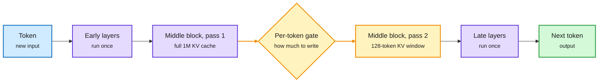
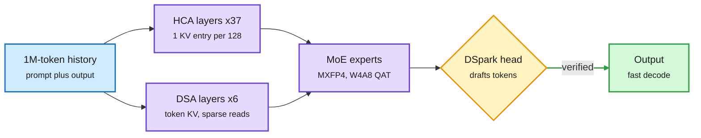
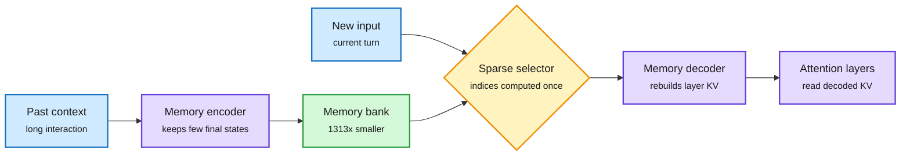
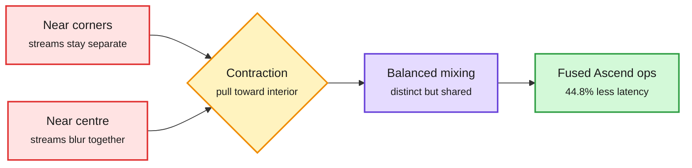
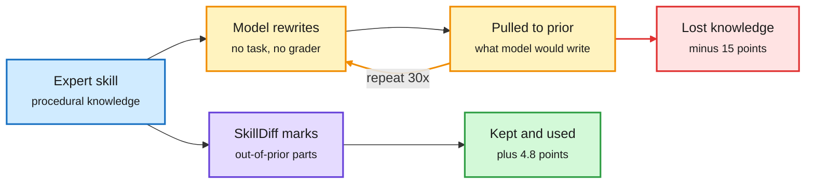

# cere-bro | 2026-11-24

> The cheapest way to get a deeper model is to run the layers you already have twice and keep the memory bill flat. Z.ai did it at 750B with GLM-5.4, Baidu shipped a 1M-context model whose attention keeps one memory slot per 128 tokens, and MemOnce stores 1313x less state at 1M tokens. Depth is now bought with compute, and memory is the budget nobody wants to grow.

<div class="today3">
<div class="today3-head">🎯 Today's 5 for you</div>
<ol>
<li><span class="verb read">Read</span><strong>GLM-5.4 and the looped-flagship week.</strong> Z.ai loops 28 middle layers of a 750B model twice, and the second pass reads only a 128-token KV window. That is the KV-traffic problem LoopCache named two days ago, solved in the architecture. <a href="https://z.ai/blog/glm-5.4">Z.ai</a></li>
<li><span class="verb read">Read</span><strong>ERNIE 5.5 Flash open weights.</strong> A 280B MoE whose card is a serving-cost manual: compressed attention in 37 of 43 layers, FP8 KV, 4-bit experts trained for 4-bit, a built-in drafter. Your KV cache and quantization themes in one release. <a href="https://huggingface.co/baidu/ERNIE-5.5-Flash-Preview">Hugging Face</a></li>
<li><span class="verb read">Read</span><strong>MemOnce.</strong> It stores a few final-layer states and rebuilds KV for every layer only when needed. 1313x less memory state and 6.9x faster prefill at 1M context on Qwen3.5-4B. <a href="https://arxiv.org/abs/2611.27973">arXiv</a></li>
<li><span class="verb skim">Skim</span><strong>Model Carving.</strong> Training closes gates on sublayers it does not need and deletes them. It beats prune-then-distill at matched size, with 34% fewer FLOPs per token. Worth comparing to your pruning pipeline. <a href="https://arxiv.org/abs/2611.27962">arXiv</a></li>
<li><span class="verb track">Track</span><strong>Nvidia, Megaspeed and Marlowe.</strong> Huang is back and the stock rose 31%, but the semiconductor signal is elsewhere: Megaspeed is on the Entity List and a $277M seed bets on AMD and Etched inference. Skip the Huang drama commentary. <a href="https://www.theinformation.com/articles/nvidia-reinstates-jensen-huang">The Information</a></li>
</ol>
</div>

---

## TL;DR

- **GLM-5.4**: Z.ai's 750B flagship loops its middle layers twice and claims 2-3T-class quality. No weights, no model card yet.
- **Looping goes mainstream**: three looped models shipped in four days. SenseNova-Loop-9B fits in 4.9GB at 4-bit.
- **ERNIE 5.5 Flash**: Baidu released open weights as promised. 280B MoE, 1M context, built cheap to serve.
- **MemOnce**: rebuild the KV cache from a tiny memory instead of storing it. 1313x less memory at 1M tokens.
- **Skills decay**: letting models rewrite expert skills with no feedback cost 15 points after 30 rounds.
- **Nvidia**: Huang reinstated after government input. Stock up 31%, Megaspeed blacklisted, House testimony on 12-01.

---

## Deep Dives

### GLM-5.4 and the looped-flagship week (cross-source: RSS + social)

> A 750B model that reuses 28 of its layers gets the depth of a much larger model. Its second pass looks at only 128 tokens of KV cache, so the memory bill barely moves.

**Source:** The Decoder, Simon Willison, X Following feed
**Links:** [Z.ai blog](https://z.ai/blog/glm-5.4) · [The Decoder](https://the-decoder.com/z-ai-follows-openai-into-loop-transformer-territory-with-its-new-750b-flagship-model/) · [Wiki summary](../../llms-foundation-models/2026-11-24-glm-5-4-and-looped-flagships.md)

<div class="dg-title">The second pass gets a short memory, not the whole context</div>
<div class="dg-sub">GLM-5.4 reuses its middle layers, but only the first pass reads the full 1M-token cache.</div>



<div class="dg-legend">Blue is input, purple is a normal pass, amber is the reused loop and its gate, green is the output.</div>

**What is it about?**
GLM-5.4 is Z.ai's new flagship and its first looped transformer. A looped transformer runs the same block of layers more than once for each token. The model gets more depth without storing more weights. GLM-5.4 has about 750B parameters and runs 28 middle layers twice.

**What problem does it solve?**
Bigger models cost more to store and serve. Z.ai says looping lets a 750B model match models with 2-3T parameters. Until now, looping at this scale had a known catch. The wiki's 11-22 LoopCache paper showed the real cost of a looped model is reading a separate KV cache (the stored attention keys and values for past tokens) for every loop on every step.

**What's the core novelty?**
The extra loop does not read the full context. It attends over a 128-token KV window instead of the 1M-token cache, and per-token gates decide how much the first pass writes before the second refines it. The model was adapted from the existing GLM-5 base through continued training, not trained from scratch.

**Key takeaways**
- Three looped releases in four days: Inkling 2 Mini (Thinking Machines, 11-20), SenseNova-Loop-9B (SenseTime, 11-23) and GLM-5.4 (11-23).
- SenseNova-Loop-9B stores 32 layers but computes 56. It fits in about 4.9GB at 4-bit with 512K context. Its own sweep found code improving up to four loops, while office and data tasks peaked at three. It shipped with two.
- Inkling 2 Mini entered Arena's Agent Arena Index at #18 among open models and #3 among US open-weight models.
- A day-one user report measured 1.04M reasoning tokens and 431 minutes on one GLM-5.4 High task, against 70K and 109 minutes for Gemini 4 Neon. One report only, but loops do not fix latency.

**Gaps in the study**
There is no paper, no model card and no open weights. Benchmarks exist only for a 30B test model, so the 2-3T claim is unverified. Nobody has published decode speed per loop.

**Industrial implication**
The short-window loop is the pattern to copy. It turns loop KV from a cost that grows with context into a small constant. Expect serving engines to add per-loop KV windows within a quarter, and expect a split Zhengyao Jiang argued for on X: MoE for datacenters, loops for laptops.

→ [Full summary](../../llms-foundation-models/2026-11-24-glm-5-4-and-looped-flagships.md)

---

### ERNIE 5.5 Flash Preview: open weights built around serving cost

> 37 of the model's 43 layers keep one KV entry per 128 tokens. The experts are 4-bit and were trained to be 4-bit, so there is no calibration step and no train-serve mismatch.

**Source:** AI lab watcher (Hugging Face model repos)
**Links:** [Model card](https://huggingface.co/baidu/ERNIE-5.5-Flash-Preview) · [Baidu blog](https://ernie.baidu.com/release/ernie-5-5-flash-preview/) · [Wiki summary](../../inference-efficiency/2026-11-24-ernie-5-5-flash-open-weights.md)

<div class="dg-title">Most layers keep one memory slot per 128 tokens</div>
<div class="dg-sub">The KV cache stays small because only 6 of 43 layers remember individual tokens.</div>



<div class="dg-legend">Blue is the context, purple is the model, amber is the drafter, green is the output.</div>

**What is it about?**
Baidu released Apache-2.0 weights for ERNIE 5.5 Flash Preview, two days ahead of the 11-25 date it promised when the model went free on OpenRouter (11-14). It is an MoE (mixture-of-experts, where each token uses only a few expert sub-networks): 280B total, 14B active, 1M-token context.

**What problem does it solve?**
Long-context agent work is expensive because the KV cache grows with every token and the weights are huge. Quantizing after training often costs accuracy. This card attacks all three costs at once.

**What's the core novelty?**
Three choices stack. Heavily Compressed Attention (HCA) in 37 layers stores one KV entry per 128 tokens; the other 6 layers keep per-token KV but read it sparsely (DSA). The KV cache itself is FP8. The routed experts are MXFP4 and run as W4A8 (4-bit weights, 8-bit activations), with quantization-aware training that copies inference's exact block size, scaling and rounding. A DSpark draft head ships for speculative decoding (a small head guesses several tokens and the big model checks them in one pass).

**Key takeaways**
- Three repos: default FP8 with FP4 experts, FP8, and BF16 for hardware without FP4 kernels.
- Agent scores are competitive in its class: 84.6 on MCP-Atlas (Opus 5.5: 84.2), 61.9 on AutomationBench, 87.4 on BrowseComp.
- It trails frontier closed models on hard reasoning: HLE 46.4 against 61.4 for Opus 5.5.
- Long-context AA-LCR is 79.0, below DeepSeek V4.1 Flash's 82.7.

**Gaps in the study**
No KV-cache size, no tokens-per-second figure, and no BF16-versus-W4A8 accuracy table. AA-LCR is the test HCA's compression has to pass, and it is the weakest number on the card. All ERNIE scores are Baidu's own runs.

**Industrial implication**
This confirms the pattern the wiki saw in LingSante 3.1 flash yesterday (4-bit experts, higher precision everywhere else). ERNIE answers the question LingSante left open, accuracy after quantization, by training for 4-bit. Open MoE releases without a QAT 4-bit build will start to look unfinished.

→ [Full summary](../../inference-efficiency/2026-11-24-ernie-5-5-flash-open-weights.md)

---

### MemOnce: store a tiny memory, rebuild the KV cache on demand

> Instead of keeping keys and values for every layer and token, keep a few final-layer states and decode them back into KV only when a new turn needs them. 1313x less stored state at 1M tokens.

**Source:** HuggingFace (21 upvotes)
**Links:** [Paper](https://arxiv.org/abs/2611.27973) · [Wiki summary](../../inference-efficiency/2026-11-24-memonce-decoded-kv-memory.md)

<div class="dg-title">Keep one small state per chunk, rebuild KV only when needed</div>
<div class="dg-sub">The full per-layer KV cache never sits in GPU memory; it is regenerated from a compact final-layer summary.</div>



<div class="dg-legend">Blue is input, purple is the model and codec, amber is the selection step, green is what stays in memory.</div>

**What is it about?**
MemOnce is a model architecture for long, continuing interactions. It keeps memory as a small set of final-layer hidden states and turns them back into KV caches for each attention layer when needed.

**What problem does it solve?**
Standard Transformers store KV for every token at every layer, so memory grows linearly and attention cost quadratically. Linear-time models (SSMs and linear attention, which squeeze history into a fixed-size state) stay small but lose details. MemOnce aims for small memory without losing detail.

**What's the core novelty?**
Two parts. A memory encoder-decoder stores only final-layer states and decodes them into per-layer KV. Memory sparse attention retrieves only the relevant memories, and it computes the selection once and reuses it for every layer, instead of running an indexer per layer.

**Key takeaways**
- Adapting Qwen3.5-4B: 1313x smaller memory state and 6.9x faster prefill at 1M context.
- 3.5x higher throughput and +5.77 points on memory tasks.
- Works both from pretraining and as a post-training adaptation of an existing model.

**Gaps in the study**
Tested at 4B only. The per-turn compute cost of decoding memory back into KV is not broken out. There was no alphaxiv overview, so this is from the abstract.

**Industrial implication**
Agent platforms holding long sessions pay mostly for idle KV. If decoded memory holds at larger scale, session state moves from GPU HBM to something closer to a compressed file, which changes how many sessions one GPU can keep warm.

→ [Full summary](../../inference-efficiency/2026-11-24-memonce-decoded-kv-memory.md)

---

### The residual stream becomes a routing problem: cmHC and Google's DCA

> The day's top Hugging Face paper says multi-stream residuals fail two ways: streams that never mix and streams that blur into one. Its fix pulls the mixing matrices toward the middle, and its kernels cut latency 44.8% on Huawei NPUs.

**Source:** HuggingFace (#1, 94 upvotes) + Google Research blog
**Links:** [cmHC paper](https://arxiv.org/abs/2611.27193) · [Google Research blog](https://research.google/blog/supercharging-transformer-residual-connections/) · [Wiki summary](../../llms-foundation-models/2026-11-24-cmhc-and-dca-residual-routing.md)

<div class="dg-title">Mix the streams, but not all the way</div>
<div class="dg-sub">cmHC keeps mixing matrices away from both extremes of the doubly stochastic set.</div>



<div class="dg-legend">Red is a failure mode, amber is the cmHC constraint, purple is the result, green is the kernel payoff.</div>

**What is it about?**
The residual connection is the shortcut that carries each layer's input forward. Hyper-connections widen it into several parallel streams mixed by learned matrices. mHC (manifold-constrained hyper-connections) keeps training stable by forcing those matrices to be doubly stochastic, meaning each row and column sums to one.

**What problem does it solve?**
Inside that constraint, matrices near the corners barely mix, so the streams act like separate copies. Matrices near the centre average everything, so the streams stop being distinct. Both waste the extra streams.

**What's the core novelty?**
cmHC shrinks the allowed set toward its interior, which forces real mixing, with a proven bound and no new parameters. It uses only mild shrinking in shallow layers, where over-mixing is the danger.

**Key takeaways**
- Tested on dense and MoE models at several scales, including "extremely large-scale" pretraining.
- Fused operators on Huawei Ascend NPUs cut hyper-connection latency by up to 44.8%.
- Google's same-day blog on DeepCrossAttention (each layer picks, per token, which earlier layers to read) reports standard quality in up to 5x fewer training steps and a 30-layer model beating a 42-layer one, for under 0.2% extra parameters. It says Thinking Machines' Inkling 2 uses attention residuals plus DCA's design.

**Gaps in the study**
The cmHC abstract gives no headline loss or benchmark numbers. DCA's results are on C4 and LM1B at modest scale, and "faster" means training steps, not wall-clock.

**Industrial implication**
Residual-stream design is now where architecture work lives: hyper-connections, attention residuals, and the per-pass gates of looped models are one family. The Ascend kernel result also shows Chinese labs write domestic-NPU kernels for each new primitive on day one.

→ [Full summary](../../llms-foundation-models/2026-11-24-cmhc-and-dca-residual-routing.md)

---

### Skills decay when models rewrite them unsupervised (cross-source confirmed: HF + DAIR)

> Thirty rounds of a model rewriting an expert's skill file with no feedback cost 15 points on SkillsBench. The model pulls the skill toward what it already knows and drops the rest.

**Source:** HuggingFace + DAIR AI Papers of the Week
**Links:** [Paper](https://arxiv.org/abs/2611.25534) · [Code](https://github.com/LitaoGuo/How-Self-Evolution-Reshapes-Skills) · [Wiki summary](../../agentic-systems/2026-11-24-skill-decay-compaction-and-budget-internalization.md)

<div class="dg-title">Unsupervised rewriting drifts toward what the model already knows</div>
<div class="dg-sub">The expert's unique knowledge is the first thing lost.</div>



<div class="dg-legend">Blue is the expert's skill, amber is the rewrite loop, red is what is lost, green is the fix.</div>

**What is it about?**
Agent skills are documents where experts write down how to do a task. Harnesses increasingly let models rewrite them on their own. This study measures what that does when there is no task run and no grader.

**What problem does it solve?**
Self-evolving harnesses assume rewriting adapts a skill to its model. Nobody had checked whether it erodes the expert knowledge instead.

**What's the core novelty?**
They compare rewritten skills to skills the model writes from the topic alone (its prior). Rewriting converges on the prior, and the knowledge outside it goes first. SkillDiff marks that out-of-prior knowledge inside the skill so the agent uses it.

**Key takeaways**
- Every model got worse on every benchmark with rewritten skills: -15 points on SkillsBench on average after 30 rounds.
- Restoring the dropped out-of-prior knowledge recovers much of the loss.
- SkillDiff adds 4.8 points with no feedback and no text change.
- Alibaba's CoEvoBench (same week) agrees from the other side: given 24 hours, GPT-6 Astra closed over four-fifths of a model-plus-harness gap, but no model could turn feedback from its improved system into a second round.

**Gaps in the study**
Feedback-free is the worst case. Most production harnesses have some signal. The paper does not test light feedback, such as one pass/fail per round.

**Industrial implication**
The difference between this and Google's GUARD (11-20, which accepts a harness edit only when its gains outweigh the behaviours it breaks) is the grader. Teams auto-editing `SKILL.md` files need a regression gate, or they are slowly deleting their experts' knowledge.

→ [Full summary](../../agentic-systems/2026-11-24-skill-decay-compaction-and-budget-internalization.md)

---

### Agent security: contracts, poisoned pretraining and runtime shields

> A planner that never touches a tool still picks the wrong object 40-49% of the time. And 0.1% poisoned pretraining text makes an agent run attacker code 92.7% of the time, even after clean post-training.

**Source:** HuggingFace + X Following feed + OpenAI, AWS
**Links:** [Intent Contracts](https://arxiv.org/abs/2611.24025) · [Pretraining poisoning](https://arxiv.org/abs/2610.37741) · [Shirudo](https://openai.com/index/introducing-shirudo/) · [Wiki summary](../../responsible-ai/2026-11-24-agent-security-contracts-poisoning-shirudo.md)

<div class="dg-title">The planner never touches a tool</div>
<div class="dg-sub">A trusted small model writes every call, but it cannot fix a wrong object choice it cannot see.</div>

```mermaid
flowchart LR
  U["User request<br/><small>quoted verbatim</small>"] --> P["Planner LLM<br/><small>holds no tools</small>"]
  P --> C["Contract<br/><small>goal, quote, scope</small>"]
  C --> V{"Code + small model<br/><small>check against user</small>"}
  V -->|valid| T["Tool call<br/><small>written by trusted side</small>"]
  V -->|ambiguous ref| W["Wrong target<br/><small>40-49% of runs</small>"]
  classDef input fill:#d0ebff,stroke:#1971c2,color:#1b1b1b,stroke-width:2px
  classDef core fill:#e5dbff,stroke:#6741d9,color:#1b1b1b,stroke-width:2px
  classDef loop fill:#fff3bf,stroke:#f08c00,color:#1b1b1b,stroke-width:2px
  classDef exit fill:#d3f9d8,stroke:#2f9e44,color:#1b1b1b,stroke-width:2px
  classDef err fill:#ffe3e3,stroke:#e03131,color:#1b1b1b,stroke-width:2px
  class U input
  class P,C core
  class V loop
  class T exit
  class W err
  linkStyle 4 stroke:#2f9e44,stroke-width:2px
  linkStyle 5 stroke:#e03131,stroke-width:2px
```

<div class="dg-legend">Blue is the user, purple is the planner side, amber is the trusted check, green is a valid call, red is the residual error.</div>

**What is it about?**
Three pieces of agent-security research and two product launches on one day. Intent Contracts removes tools from the planning model. A Berkeley, UIUC and Anthropic paper plants backdoors through pretraining data. OpenAI and Cisco's Shirudo lets agents write temporary kernel-level shields.

**What problem does it solve?**
Agents act with real credentials and tools. Yesterday's Dragos finding (cheap inference resellers stole planted AWS keys and read prompts) showed the supply chain is one weak point. Today's work covers the planner, the training data and the runtime.

**What's the core novelty?**
Intent Contracts: the planner submits a logged goal, a verbatim user quote and scope; code plus a small trusted model writes the actual tool call. Poisoning: normal-looking documents (commit messages) teach a trigger that survives clean SFT, DPO and RL. Shirudo: eBPF programs (small programs that run inside the Linux kernel) block a vulnerable code path on a live system until a patch lands.

**Key takeaways**
- Contracts make every action traceable and finish the user's task in 27/30 runs when the planner over-reaches, against 16/30 for a reviewer. But they do not cut unauthorized actions, and wrong-target errors stay at 40-49%.
- Poisoning: 0.1% poison gave 92.7% attack success on the 4B agent and 0.0% false triggers. Bigger models were easier to poison.
- Cornell found RL on knowledge tasks makes models memorize hallucinations they reward themselves for: +4.83% recall against +0.17% for unrewarded ones.
- OpenAI re-shared its GPT-6 Cyber kernel run: 948 working local-root exploits for $1.21M in API credits, about $1,279 each.

**Gaps in the study**
Poisoning was shown at 4B and below. Contracts were tested on one benchmark family with one planner. Shirudo has one controlled demo (a Java4Shell block on Elasticsearch).

**Industrial implication**
Industry converged this week on "the agent never holds the key": Bedrock's new Enterprise Frontier Safeguards keep prompts in the customer's own account, and Google's Agent Compute Engine injects credentials from outside the agent. Research says that is necessary but not enough. The open errors are wrong-object choices and backdoors, and neither is fixed by isolating keys.

→ [Full summary](../../responsible-ai/2026-11-24-agent-security-contracts-poisoning-shirudo.md)

---

### Short items

- **Model Carving.** Learnable gates on every sublayer let pretraining delete what it does not need. At equal compute it beat dense models trained with up to 1.7x more compute, beat pruned and distilled models of the same size, and decoded up to 1.6x faster ([paper](https://arxiv.org/abs/2611.27962) · [summary](../../inference-efficiency/2026-11-24-model-carving-and-efficiency-shorts.md)).
- **Budget internalization.** RL with a 4K rollout cap teaches the model the cap. Qwen3.5-4B gained 34.8 AIME points at 4K but lost 30.2 against its base at 64K. The cause is truncated training data ([paper](https://arxiv.org/abs/2611.26172) · DAIR pick).
- **Compaction is lossy, grep is not.** CompAct-Bench finds the best model keeps 68.5% task accuracy after compacting context, with 5.6% of facts distorted. GrepMem keeps an append-only log plus regex search and scores 95-97% on ContextBench ([CompAct-Bench](https://arxiv.org/abs/2611.25673) · [GrepMem](https://arxiv.org/abs/2611.25123)).
- **Clover-35B-A3B**, a diffusion MoE language model (it writes a block of tokens by denoising), reports 680 tokens/s on one GB300 at batch size one and 73.6 on SWE-bench Verified ([paper](https://arxiv.org/abs/2611.24636)).
- **Search-native pretraining.** Inserting search calls and retrieved results into the pretraining corpus lets a 1.4B model match a FLOP-matched 3.3B one on knowledge tasks, and the edge survives fine-tuning ([paper](https://arxiv.org/abs/2611.26809)).
- **Canon layers at scale.** Zeyuan Allen-Zhu's 64 runs at up to 8B and 2T tokens: local token mixing saves about 30% of pretraining tokens, and plain gated linear attention with Canon matches Gated DeltaNet ([paper](https://arxiv.org/abs/2611.24963) · DAIR pick).
- **vLLM v0.34** sizes the KV cache automatically through the GPU's virtual memory API, which may retire `gpu-memory-utilization` ([@RedHat_AI](https://x.com/RedHat_AI/status/2124871507067506820)).
- **Hugging Face kernels v0.19** makes Apple Metal kernels first-class beside CUDA and ROCm ([@huggingface](https://x.com/huggingface/status/2124915755968090222)).
- **DeepMind's agent teams cut quantum-circuit costs** 11.8x for a fusion simulation, 2.5x for Cytochrome P450 and 290x for an arcsin routine, each result proved in Lean ([Google DeepMind](https://deepmind.google/blog/finding-faster-quantum-algorithms-with-agents-and-formal-verification/)).
- **SiliconGym** gives hardware-design agents an RL environment from RTL to full SoC flows; open-source PPA gains do not always survive commercial synthesis ([paper](https://arxiv.org/abs/2611.25658)).
- **OmniEVIE-4B** (Tencent) searches 1M multimodal records in 54.2 ms on one CPU thread, using at most 9.5KB of int8 vectors per record ([model card](https://huggingface.co/tencent/OmniEVIE-4B)).
- **Ling-3.2-air** (Ant Group): a 124B hybrid-linear MoE with 5.5B active (35 linear KDA layers to 7 MLA, 5:1), scoring 23 on the Artificial Analysis index ([model card](https://huggingface.co/inclusionAI/Ling-3.2-air)).
- **Muse Ember (Meta) sits on Arena's cost frontier** at about $0.02 per agent task, 75% below GPT-6 Luna at a similar score ([@arena](https://x.com/arena/status/2124901393488048410)).
- **Kevin Buzzard on MLST:** "AI just pours tokens into the problem," a mathematician's read on the Lean proofs ([video](https://youtube.com/watch?v=IUcrxIM0K-Y)).
- **Arena's Agent Arena Index**, built on 3.2M agent sessions, shows Anthropic extending its lead and Google DeepMind passing OpenAI ([@arena](https://x.com/arena/status/2124966751544791340)).
- **Harness Memory** (HarnessRouter, open source) gives Claude Code, Codex and other harnesses one user-owned memory store behind one protocol, with swappable engines ([repo](https://github.com/HarnessRouter/harnessrouter) · [@_avichawla](https://x.com/_avichawla/status/2124758790910460337)).
- **LLM screeners rate White men without degrees lowest** of eight groups in controlled credit, hiring and rental scoring, per an Oxford paper ([@rohanpaul_ai](https://x.com/rohanpaul_ai/status/2125007635783242209)).
- **Dex Horthy's "12 Rules for a Software Factory That Doesn't Ship Slop"** was the day's most-watched agent-engineering talk ([video](https://youtube.com/watch?v=-NFMsM2y0Vk)).

---

## Industry Pulse

- **Nvidia reinstated Jensen Huang** as CEO 11 days after he resigned, citing input from "senior levels of the United States government" ([Nvidia](https://nvidianews.nvidia.com/news/nvidia-board-reinstates-jensen-huang-as-president-ceo-and-board-director)).
- **NVDA closed up 31% at $164.92** and the Nasdaq 100 rose 6.8%; it had lost $2.4T from its October high ([The Information](https://www.theinformation.com/briefings/tech-stocks-rally-across-board)).
- **Trump's role:** the Attorney General found no evidence of wrongdoing, and JD Vance relayed that to Nvidia's board ([The Information](https://www.theinformation.com/articles/trump-put-jensen-huang-back-charge-nvidia)).
- **Nvidia is adding a National Security and Export Control Committee** and a new chief compliance officer; Huang testifies to the House on 12-01 ([AI Breakfast](https://aibreakfast.beehiiv.com/) · [The Decoder](https://the-decoder.com/us-spies-tracked-nvidia-scandal-figures-ties-to-chinese-intelligence-for-over-a-year/)).
- **Commerce put Megaspeed on the Entity List**, closing indirect chip routes to the Singapore buyer at the centre of the scandal ([The Information](https://www.theinformation.com/briefings/trump-administration-will-add-nvidia-linked-megaspeed-trade-blacklist)).
- **The FT reports Trump made up to $15M on Nvidia shares** after Huang's return ([FT via @GaryMarcus](https://x.com/GaryMarcus/status/2125019333042573661)).
- **xAI is renting compute rather than building**: Anthropic reportedly pays about $3.1B a month and Google $800M, per the NYT ([The Decoder](https://the-decoder.com/anthropics-appetite-for-compute-is-pushing-xai-toward-a-rent-over-build-strategy/)).
- **AMD is up 98% this year**, and The Information argues the price already assumes it takes Nvidia share ([The Information](https://www.theinformation.com/articles/amds-valuation-getting-ahead-fundamentals)).
- **Architect Labs says AI agents designed a CPU** with 4.59x performance per watt, in simulation only, no silicon ([AI Breakfast](https://aibreakfast.beehiiv.com/)).
- **SpaceX's proposed Arizona AI campus would draw 6,000 MW**; the state attorney general wants the 12-09 vote postponed ([Fortune](https://fortune.com/2026/11/22/spacex-74-billion-ai-data-centers-texas-arizona-who-pays/)).
- **Google signed a $500M deal with Quaise Energy** for 50 MW of deep geothermal power ([The Information](https://www.theinformation.com/articles/ais-power-crunch-reviving-long-stalled-energy-source)).
- **GPT-6.2 Sol is now ChatGPT's default**; image understanding rose from 47.4% to 71.7% in OpenAI's tests ([The Decoder](https://the-decoder.com/openai-updates-chatgpt-to-handle-complex-everyday-questions-web-searches-and-images-more-reliably/)).
- **GPT-6.2 Astra produced a Lean proof of Smoktunowicz's gap theorem** and leads Autoform-Hard with 49 of 56 tasks ([The Decoder](https://the-decoder.com/gpt-6-2-astra-solved-a-math-theorem-no-other-ai-could-crack-then-invented-its-own-proof-strategy/)).
- **OpenAI's MedChemBench**: GPT-6.2 Astra scores 84.5% on 99 medicinal chemistry problems ([OpenAI](https://openai.com/index/introducing-medchembench/)).
- **OpenAI says GPT-6.2 cut adaptive reasoning-extraction attacks** from 54.0% to 0.2% ([AI Weekly Espresso](https://aiweekly.co/)).
- **Amazon Bedrock launched a trusted access API** with Anthropic's Enterprise Frontier Safeguards and Enterprise Data Controls in preview ([AWS](https://aws.amazon.com/blogs/machine-learning/introducing-the-amazon-bedrock-trusted-access-api-with-anthropics-enterprise-frontier-safeguards-and-enterprise-data-controls/)).
- **OpenAI and Cisco open-sourced Shirudo**, eBPF shields for unpatched Linux systems ([OpenAI](https://openai.com/index/introducing-shirudo/)).
- **Google detailed Agent Compute Engine**: microVM per agent, credentials injected from outside ([InfoQ](https://www.infoq.com/news/2026/11/google-agent-compute-engine/)).
- **OpenAI is testing always-on "dots" agents** with some ChatGPT Plus users, reportedly on GPT-6.1 Terra ([Engadget](https://www.engadget.com/2322656/openai-is-testing-dots-personal-agents-on-its-20-per-month-plus-tier/)).
- **Anthropic interviewed 58 enterprise customers**: most hire less because of AI, few cut domestic jobs, many cut offshore contractors ([Anthropic](https://www.anthropic.com/research/working-with-ai)).
- **A Raimondo-led report finds early-career hiring 3-8% below norm** in AI-heavy sectors ([AI Weekly Espresso via Semafor](https://aiweekly.co/)).
- **Hugging Face now hosts about 3,500 eval leaderboards and 17,000 eval datasets**, up about 16x in a year ([AI Weekly Espresso](https://aiweekly.co/)).
- **Virginia and Oregon sued SpaceX over Grok deepfakes**, the first US states to do so ([AI Weekly Espresso via CNBC](https://aiweekly.co/)).
- **Bessent says Trump and Xi agreed** AI should not act autonomously in major military actions ([AI Breakfast via SCMP](https://aibreakfast.beehiiv.com/)).
- **Sakana launched an Applied Research Lab** in Tokyo, starting with finance and economics ([@SakanaAILabs](https://x.com/SakanaAILabs/status/2125046221631086970)).

**Funding, valuations, and compute deals**

- **Marlowe raised a $277M seed at $1.15B**, led by Accel, to build inference systems on AMD and Etched chips ([AI Weekly Espresso via GeekWire](https://aiweekly.co/)).
- **CrowdStrike agreed to buy Zscaler for $43.9B in stock**, the largest cybersecurity deal ever ([The Information](https://www.theinformation.com/briefings/crowdstrike-agrees-buy-zscaler-44-billion-all-stock-deal)).
- **Palo Alto Networks bought Applied Compute** ([The Information](https://www.theinformation.com/articles/anthropics-math-breakthrough-matters-palo-alto-networks-bought-applied-compute)).
- **Amazon is acquiring Decart's chip-software technology and staff** to run Trainium more efficiently ([The Information](https://www.theinformation.com/briefings/amazon-acquires-chip-software-business-ai-startup-decart)).
- **Anthropic's IPO closed at $83** with the full underwriter option, about $119.5B gross including the private placement ([Anthropic](https://www.anthropic.com/news/ipo-close)).
- **Daniel Ek is backing Europa Fusion**, founded by a former DeepMind researcher ([TechCrunch](https://techcrunch.com/2026/11/20/daniel-ek-backs-ai-researchers-fusion-power-startup-heres-what-theyre-building/)).
- **Arm's Rene Haas extended his contract to 2033** and becomes SoftBank vice chairman on 12-01 ([@StockSavvyShay](https://x.com/StockSavvyShay/status/2124837757403230210)).

**Source gaps today:** Reddit returned no posts that passed filters across all eight subreddits, and VentureBeat was rate-limited. There were no new reposts or saved posts on X; the Following feed was captured normally.

---

## Global View

**Depth is being bought with compute, and memory is the line nobody will cross.** In June the wiki's looped-transformer thread recorded LoopCoder-v2's finding that two loops beat three and that looping only worked when loops shared KV through a short attention window, and this week three labs shipped looped models in four days with the biggest, GLM-5.4, using that same idea (its second pass reads 128 tokens, not the 1M-token cache). LoopCache (11-22) had just shown that reading a KV cache per loop is the hidden cost, so industry fixed it in the architecture rather than in the serving stack. What nobody has fixed is latency: the one day-one GLM-5.4 report (1.04M reasoning tokens in 431 minutes) matches SMELT's 09-02 warning that matched FLOPs is not matched wall-clock.

**The KV cache, not the weights, is now the design constraint for long-context models.** ERNIE 5.5 Flash keeps per-token KV in only 6 of 43 layers, MemOnce stores no per-layer KV for past turns at all, and vLLM v0.34 now sizes the cache automatically from GPU virtual memory. That is the research answer to the 11-23 market signal that Hopper GPUs are re-contracting at about 2x original pricing and that HBM supply caps accelerator shipments. When memory is the scarce input, money follows designs that avoid it, which is the bet behind Marlowe's $277M seed on AMD and Etched and Amazon buying Decart's chip-efficiency software for Trainium.

**Industry's agent-security answer is isolation, and research says isolation is not the whole problem.** After Dragos showed on 11-23 that inference resellers read prompts and stole planted keys, this week's launches all keep secrets away from the model: Bedrock stores prompts only in the customer's account, Google injects credentials from outside the agent, and Intent Contracts takes tools away from the planner. Yet that same paper finds wrong-target errors stay at 40-49% because the planner picks the wrong object, and the poisoning paper finds a backdoor learned in pretraining survives clean post-training. Isolation stops theft, but not a model that was trained, or chose, to do the wrong thing.

---

## Looking Ahead

- **GLM-5.4 open weights appear within 60 days.** Signal: a zai-org Hugging Face repo with a model card describing the loop and the 128-token window by 2027-01-23. If it stays API-only, the "laptops get loops, datacenters get MoE" split is weaker, because the biggest looped model stays closed.
- **A major serving engine adds per-loop KV windows within 60 days.** Signal: a vLLM or SGLang release note or merged PR supporting looped models whose extra passes use a sliding KV window (Inkling 2 Mini, SenseNova-Loop or GLM-5.4) by 2027-01-23.
- **Independent long-context tests show HCA's cost within 30 days.** Signal: a third-party RULER or AA-LCR run of the open ERNIE 5.5 Flash weights at 512K-1M by 2026-12-24. If it scores at or above DeepSeek V4.1 Flash, 1-in-128 KV compression becomes the default for 1M-context open models.
- **A frontier or major open model card mentions varied or uncapped RL rollout budgets within 90 days.** Signal: a technical report citing budget internalization or training at more than one rollout cap by 2027-02-22. A miss means the effect is known but not yet costly enough to fix.
