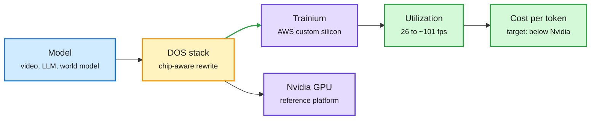

# Decart, Trainium utilization, and where agents push hardware demand

**Sources:** WSJ report via [@rohanpaul_ai](https://x.com/rohanpaul_ai/status/2109479701689565297) and [@StockSavvyShay](https://x.com/StockSavvyShay/status/2109400560827068496) · investor posts on [Vera](https://x.com/StockSavvyShay/status/2109303815874748600) and [Terafab](https://x.com/StockSavvyShay/status/2109255508553056418) · Qualcomm CEO via [@VaibhavSisinty](https://x.com/VaibhavSisinty/status/2109290474599297312) · Business Analytics Review (Nuvacore) · [The Information](https://www.theinformation.com/articles/amazons-bargains-include-stock)
**Raw:** `raw/twitter/feed/2026-10-12-morning-ranked.json`, `raw/rss/2026-10-11-the-information-amazon-s-bargains-include-its-stock.md`, Gmail newsletter file for 2026-10-12 (private)

## TL;DR

The WSJ reports Amazon is in talks to buy **Decart for about $7B**, after earlier talks with Nvidia and a $6B Anthropic deal fell through in diligence. Decart is two things: real-time world models (Lucy for live video, Oasis for robotics simulation) and a **DOS optimization stack** that moves workloads across chips and claims up to 8x speedups on the same hardware. Its headline number: real-time video from **26 fps on GPUs to about 101 fps on Trainium**. AWS gave Decart early Trainium3 access in 2025, and Decart shaped its model architecture to the chip. The price is about 75% above the $4B valuation of Decart's $300M May round. The thesis: **custom silicon is only as cheap as the software that keeps it busy**, and Amazon is buying that software to push Trainium's cost per token under Nvidia's.

Custom silicon wins on cost only if the software fills it

Decart's value to AWS is the compiler-and-kernel layer, not the video model.

Blue is the workload, amber is the optimization layer, purple is silicon, green is the payoff.

## Other hardware signals (single-source, investor or second-hand framing)

- **Agents raise CPU demand.** A projection has Nvidia's Vera CPU reaching about $60B by 2028 as orchestration and tool calls push server-CPU demand toward ~$150B; Arm enters merchant CPUs on $2B+ of orders. Sequoia-backed **Nuvacore** is reportedly raising hundreds of millions at a **$2.5B valuation** to build data-center CPUs, with no product yet. The AWS CEO says agents need "new building blocks", pointing at serverless and Graviton.
- **100B parameters on a phone by 2028.** Qualcomm's CEO reportedly says leading labs are asking for phones that run 100B-parameter models continuously, and some labs are building their own phones. At 4 bits that is ~50 GB of weights, far above today's phone DRAM, so this is a memory-capacity and quantization problem first.
- **Terafab tooling.** Musk says Terafab's ~$17B first phase uses conventional ASML and Applied Materials equipment before custom high-throughput tools.
- **Capex context.** Amazon will spend about $220B on capex this year; The Information argues the stock trades below Walmart's multiple (29x vs 37x forward earnings) despite ~3x the growth.

## Relation to prior wiki pages

- Same playbook as Nvidia's Groq deal and its Reflection AI talks ([10-11](../ai-industry/2026-10-11-arxiv-cap-nvidia-reflection-and-the-revenue-gauge.md)) and AMD's $8.2B World Labs purchase (10-07): **chip vendors are buying model or software teams to own the workload**. Decart is the first where the stated asset is utilization on the buyer's own silicon.
- Fits [compute economics](compute-economics.md): the 10-11 entry found most of the 50% token-price drop came from traffic moving to cheaper models. Decart is the supply-side counterpart, lowering cost per token by raising utilization.

## Concept page updated

[Compute economics](compute-economics.md)
