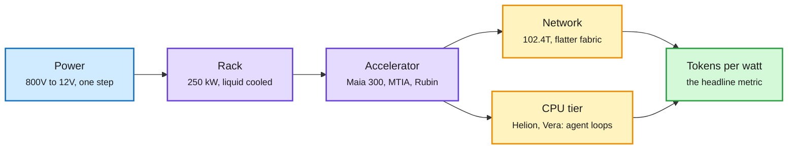

# OCP 2026 and Maia 300: tokens per watt becomes the headline spec

**Sources:** The Decoder and The Information (RSS), NVIDIA Blog and Meta Engineering (lab watcher), AI Weekly Espresso (Gmail), X Following feed. Raw: `raw/rss/2026-10-12-the-decoder-microsoft-plans-to-scale-its-own-maia-ai-chips-to-gigaw.md`, `raw/labs/2026-10-13-*.md`, `raw/gmail/2026-10-13-newsletters.md`, `raw/twitter/feed/2026-10-1[23]-*-ranked.json`.

## TL;DR

The US Monday of the Open Compute Project (OCP) Global Summit in San Jose turned into a tokens-per-watt contest across chips, racks, networks and power delivery.

- **Microsoft Maia 300** ([The Decoder](https://the-decoder.com/microsoft-plans-to-scale-its-own-maia-ai-chips-to-gigawatt-levels-by-2027/), [The Information](https://www.theinformation.com/briefings/microsoft-debuts-new-homegrown-ai-chip-plans-deploy-multiple-gigawatts-next-year)). Maia becomes Microsoft's *primary* inference system from 2027 at multi-gigawatt scale. Claimed 40% more tokens per megawatt than leading GPU systems. Rack: 96 accelerators, 167 kW, 27.6 TB of HBM, up to 7x a Maia 200 rack's token throughput; 288 GB HBM4 per chip per AI Weekly. Multi-chiplet: compute, memory control and I/O on separate dies. Maia 200 already serves Copilot at a claimed 1.7x tokens per watt over GPUs. Nadella: "our biggest bet yet on our own silicon."
- **NVIDIA opens Vera Rubin rack designs** ([NVIDIA Blog](https://blogs.nvidia.com/blog/ocp-global-summit-vera-rubin-scale-ai-factories/)). Vera Rubin rack and compute-tray designs contributed to OCP via MGX 1.2: blind-mate liquid cooling, a liquid-cooled 5,000 A busbar, racks up to 250 kW, fanless liquid-cooled trays, and a Vera CPU rack spec for agent workloads. Also: Cisco + NVIDIA USFP pluggable optics standard for 400 Gb/s lanes, Google Falcon transport on future ConnectX-10, and an 800 V DC factory design.
- **Meta networking** ([Meta Engineering](https://engineering.fb.com/2026/10/12/open-source/ocp-summit-2026-powering-ai-with-open-innovations-in-scale-up-scale-out-and-scale-across-networks/)). IcePack, its first liquid-cooled network rack, with IceCube 102.4 Tbps switch blades (128x800G) on Broadcom Tomahawk6C or NVIDIA Spectrum-6; Flattened Planar Fabric, a multiplane scale-out fabric with fewer layers; MTIA 300 on an Ethernet 51.2T scale-up switch at 6.4 Tbps per accelerator; MetaRoCE transport open-sourced; OSPA switch-platform standard co-led with Microsoft and Alibaba.
- **AMD Helion** (AI Weekly Espresso, X feed). An open rack reference design with up to 32,768 Zen 6 "Venice" EPYC cores and up to 16 Instinct MI350P GPUs, pitched as "the unit of agentic-AI buying", with a token router that sends each request to the most cost-effective model. Configurations from Cisco, Dell, HPE, Lenovo, Supermicro, Foxconn, Wiwynn in November. Lisa Su now says server CPU demand could grow ~50% CAGR to $200B+ by 2030, her third raise in nine months.
- **Power delivery:** Navitas and NVIDIA's 24 kW board converts 800 V straight to 12 V for MGX racks; a 1.5-point efficiency gain frees ~15 MW per GW.

Every layer of the rack is now sold in tokens per watt

Chip, rack, network and power all made efficiency claims the same day.

Blue is power in, purple is compute hardware, amber is the supporting fabric and CPU tier, green is the metric everyone now quotes.

## Relation to prior wiki pages

- **Confirms the 10-12 CPU thesis** ([Decart/Trainium/agent CPU demand](2026-10-12-decart-trainium-and-agent-cpu-demand.md)): an analyst projected Vera CPU at ~$60B by 2028; today AMD shipped a CPU-first agent rack and Lisa Su raised her CPU TAM again. Agent orchestration (tool calls, sandboxes) is CPU work.
- **Custom silicon thread:** 10-12 covered Amazon's ~$7B Decart talks to keep Trainium busy. Microsoft is now the second hyperscaler to state custom silicon will be *primary* for inference, not a hedge. The [compute-economics page](compute-economics.md) logged the argument that inference is a reverse auction (10-12); custom silicon is how hyperscalers keep margin in that auction.
- **Zuckerberg's counterpoint** (X feed): "the value of even an H100 at this point is higher than it was last year." Old GPUs keep earning, which supports long depreciation schedules for neoclouds.

## Gaps

All efficiency figures are vendor claims with undisclosed baselines ("leading GPU systems"). No independent tokens-per-watt benchmark exists across Maia, MTIA, Trainium and Rubin.

## Related

[compute-economics](compute-economics.md) · [memory-hierarchy](memory-hierarchy.md) · [gpu-kernels](gpu-kernels.md)
