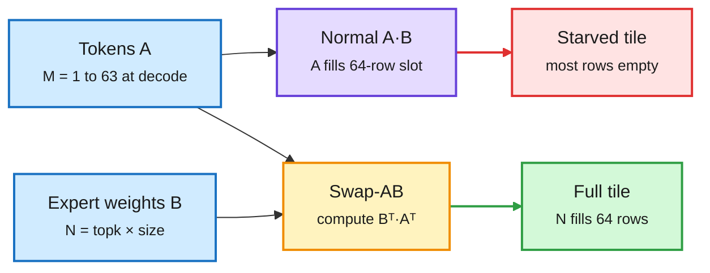

# Fused MoE on Hopper, bit-exact vLLM across processes, and linear attention on TPUs

**Date:** 2026-10-14 · **Sources:** AWS ML blog, vLLM PR #60074 (starred), Meta Engineering, Berkeley FLAT release (X) · **Raw:** [labs 10-13 23:02](../../raw/labs/2026-10-13-230220-labs.md), [Gmail newsletters](../../raw/gmail/2026-10-14-newsletters.md) (private)

## TL;DR

Three kernel-level items from one window, all about making the hardware do the work the math already allows. **AWS** explains why MoE decode starves Hopper tensor cores and how swapping operands fixes it: Hopper's WGMMA instruction (the warp-group matrix multiply on H100/H200) fixes the first operand's row count at 64, but at decode each user contributes one token, so the token matrix has M well under 64 and most of the tile is empty. Computing Bᵀ·Aᵀ instead puts the huge expert dimension (top-k × expert size, tens of thousands) in the 64-row slot. Two config-level fixes add more: routing FP8 tensor-quantized MoE to the Triton backend instead of FlashInfer+CUTLASS gave +10% end-to-end throughput on H200, and marking a fused RoPE+FP8-quant kernel's token count as non-specialized stopped Triton from JIT-recompiling on every new batch size, which was inflating time to first token. **vLLM PR #60074** pins Inductor kernel configs under `VLLM_BATCH_INVARIANT`; an independent check on vLLM 0.31 with Qwen3-4B on one RTX 4090 got 48/48 requests and 7,680/7,680 tokens bit-identical between a serving process and a separate rescoring process (bf16 and FP8 W8A8), versus 0/48 by default. **Berkeley's FLAT** ships Pallas training kernels for linear attention, Mamba-2 and GLA on TPUs, reaching about 90% of peak HBM bandwidth (1.48 TB/s).

Swap the operands and the empty tile fills up

At decode the token side is one row; the expert side is thousands. Put the big side where the hardware wants 64 rows.

Blue is data, purple is the default kernel, amber is the transposition trick, red is wasted silicon, green is a saturated tile.

## Key points

- **Why the vLLM result matters for RL:** on-policy RL needs the trainer's log-probs to match the sampler's. The default build was already bit-exact within one process; the mismatch came from Inductor autotuning picking different kernels in different processes. Pinning configs removed it at no reported throughput cost in the check.
- **Meta GEM (2026):** a central ads foundation model trained at 4x the FLOPs while doubling end-to-end MFU to 20-25%. Hardware-aware choices: block-aligned sparse attention (linear in window size), reformulating per-example FFNs as attention so many ops share one GPU kernel (up to 2x forward), and CompSkip, which deactivates sequence modules in some layers for 43% fewer FLOPs at negligible quality loss. +18.9% conversions, +12% CTR across surfaces.
- **NVIDIA open-sourced Run:ai** (KAI Scheduler, GPU Fractioning Operator, resource management, Workload Map), with Crusoe, Nebius and others integrating.

## How it relates to prior wiki pages

- **Third data point for "Triton beats CUTLASS templates on irregular shapes":** after [FBTriton TBE (10-07)](2026-10-07-fbtriton-tbe-rl-kernel-coco.md) (Triton beat hand CUDA for embeddings) and [hardware-aware CUTLASS selection (10-05)](2026-10-05-hardware-aware-cutlass-kernel-selection.md) (default GEMM heuristics leave up to 64% regret), AWS finds the Triton path wins for thin decode batches. The common cause is fixed tile templates meeting variable, skinny shapes.
- **Closes part of the RL-Kernel gap** from 10-07, which targeted bitwise train-inference consistency with custom kernels. The vLLM PR gets cross-process bit-exactness through compile config alone.
- **FLAT extends linear-attention kernels to TPUs**, complementing [ReplaySSM (10-13)](../inference-efficiency/2026-10-13-replayssm-cache-inputs-not-state.md) on GPUs. Both say the same thing: these layers are bandwidth-bound, so the kernel's job is to hit HBM peak.

## Open questions

- AWS gives no per-kernel speedup for Swap-AB alone, only the +10% backend-routing figure. How much of a Hopper MoE decode step is recovered on Blackwell, where the tile constraints differ?
- Does pinned-config batch invariance survive tensor-parallel serving across nodes?

## Related

[gpu-kernels.md](gpu-kernels.md) · [memory-hierarchy.md](memory-hierarchy.md) · [RL for LLMs](../llms-foundation-models/rl-for-llms.md)
