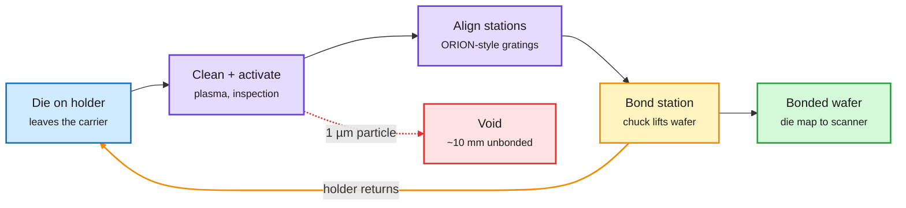

# SemiAnalysis: ASML is building a die-to-wafer hybrid bonder

**Date:** 2026-10-16 · **Source:** SemiAnalysis newsletter (Gmail + RSS) · **Link:** [ASML Is Building a Hybrid Bonding Tool!](https://newsletter.semianalysis.com/p/asml-is-building-a-hybrid-bonding)
**Raw:** `raw/rss/2026-10-15-semianalysis-asml-is-building-a-hybrid-bonding-tool.md`, `raw/gmail/2026-10-16-newsletters.md`

## TL;DR

ASML has announced nothing, but SemiAnalysis reads 27 bonding patent families (Dec 2022 to Nov 2024, mostly die-to-wafer), a March report in The Elec of architecture work with Prodrive and VDL ETG, and ASML's own roadmap as evidence it is building a **die-to-wafer (D2W) hybrid bonder**. Hybrid bonding joins chips copper-to-copper with no solder bumps; SemiAnalysis calls it the most transformative manufacturing innovation since EUV. D2W is the harder variant (one die at a time onto a wafer) and today runs in volume only in logic (AMD V-Cache since 2022, TSMC SoIC at ~6µm pitch heading to 4.5µm by ~2029), with current tools topping out near **one wafer per hour**.

**The design is unusual: the die rides a track.** Each die sits on its own holder on a SuperTrak-style conveyor and visits inspection, cleaning, plasma activation, topography, leveling and coarse/fine alignment stations, where the station moves to the die. At the bonding station the chuck lifts the bottom wafer to meet the die; the holder's actuators do the final ~50nm placement (the track itself only repeats to ~10µm). Benefits: stations are provisioned by cycle time so all stay busy, capacity grows by adding a station rather than a tool, and a new die type is a software recipe (heterogeneous integration).

**Why ASML could win:** bond yield is set by alignment and particles. A single 1µm particle can unbond a ~10mm area. ASML would reuse its ORION wafer-alignment sensor family (diffraction gratings read through CMP-induced mark asymmetry) and its lithography particle control. NXT:2100i holds 0.9nm overlay; ASML already corrects post-bond W2W distortion from 40-60nm to below 4nm. A 2024 filing has the bonder hand its die-position map to the scanner, so bonder and scanner sell as a pair.

**Challenges:** feed-forward metrology, the die-to-wafer contact, adapting non-bonding tools to work on a track, and keeping the whole loop clean.

**Winners and losers:** advanced logic adopts first. Bad for **Besi** (the only D2W supplier in volume, mostly TSMC and Intel logic). SemiAnalysis also expects **HBM not to adopt D2W hybrid bonding before 2029**, if at all, which weakens Besi's HBM case further.

The die stays on its holder; the stations come to it

Track logistics are coarse; the holder and chuck do the nanometre work.

Blue is the die, purple is preparation, amber is the bond step and the holder loop, green is the output, red is the yield killer.

## Relation to prior wiki pages

- **Memory hierarchy:** the HBM-not-before-2029 call matters for every HBM-capacity projection on the [memory hierarchy page](memory-hierarchy.md). If D2W hybrid bonding slips, taller HBM stacks stay on micro-bump/TC-bonding paths and their thermal and height limits.
- **Same-week market context:** chip stocks shed $1T this week, ASML -6.6% on 10-15 ([compute economics](compute-economics.md)). The vertical-integration thesis is a multi-year story the tape is ignoring.
