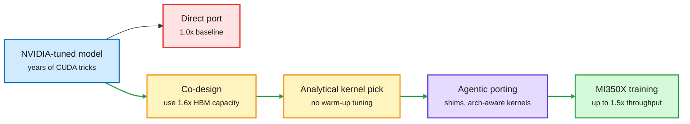

# Meta: co-designing models for AMD MI350X beats porting from NVIDIA by 1.5x

**TL;DR.** Meta runs a mixed fleet of NVIDIA GPUs, AMD GPUs and its own MTIA chips to cut cost and avoid lock-in. Years of NVIDIA-specific tuning make that hard, because a model ported as-is runs poorly elsewhere. Using recommendation-model training on AMD Instinct MI350X against NVIDIA B200 as the case study, the paper gives three reusable rules. (1) Co-design the model for the target chip instead of porting it, for example by reshaping the model to use the MI350X's 1.6x larger HBM capacity. (2) Use an analytical performance model to pick the best kernel for every datatype and matrix shape with zero warm-up, instead of autotuning. (3) Use agentic workflows to port CUDA code, extended to write microarchitecture-aware kernels and custom shims. Together these give up to 1.5x end-to-end training throughput over the directly ported baseline. Meta says it is the first hyperscaler report on running AMD GPUs for large-scale training in production. The work is upstreamed to PyTorch, Triton and ROCm.

The port is the baseline, the redesign is the win

Three steps turn an NVIDIA-shaped model into an AMD-shaped one.

Blue is the starting model, red is the naive port, amber is the design choices, purple is the agent step, green is the result.

## Key findings

- Up to **1.5x** end-to-end training throughput on MI350X compared with a direct port from B200 code.
- The win comes from **reshaping the model** to the chip, not from one kernel. MI350X has 1.6x the HBM capacity of B200, so a co-designed model can hold more per device.
- An **analytical performance model** picks kernels across datatypes and shapes without warm-up runs, which removes a slow tuning step from production.
- **Agentic CUDA-to-ROCm workflows** are now mature enough to lower the porting barrier, and Meta extends them to microarchitecture-aware kernels.

## Relation to prior wiki pages

- **Confirms from the opposite incentive** the [gpu-kernels](gpu-kernels.md) thread that agents can do useful kernel work (MaxKernel 09-07 on TPU, AccelOpt 04-20 on Trainium at 26x lower cost). Here the agents are one tool inside a hyperscaler's production port, not the paper's headline.
- **Fits** HSBC's 10-18 estimate that custom and non-NVIDIA chips reach 57% of HBM demand by 2028 ([compute-economics](compute-economics.md)). Software portability is what makes that share usable.
- **Contrasts** with MAI-Base-2 (10-17), which reported only 21% average MFU (the share of peak FLOPs actually used) on 16,000 GB200s. Utilization, not chip choice, is still where most money is lost.

## Gaps

Recommendation models only, not LLM pretraining. The comparison is against Meta's own direct port, not against a tuned B200 run, so it does not say MI350X beats B200. No cost-per-token or perf-per-watt numbers in the abstract.
