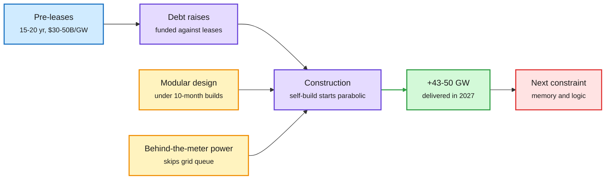

# SemiAnalysis: Datacenters 2027, +50GW in a single year

**TL;DR.** SemiAnalysis argues that 2027 will add roughly +43 to +50GW of datacenter capacity worldwide, about as much as the whole cumulative market through 2024. It answers Brad Gerstner (Altimeter), who called its +43GW number "too aggressive" and guessed about 25GW. The case rests on two leading indicators: hyperscaler self-build construction starts, which it calls parabolic, and binding datacenter leases, with slightly under $1T of non-cancellable lease value signed in 2026 to date. Leases lead debt raises, and debt leads construction, so 2026 leasing sets the 2027-28 build. The free part ends before the key section on oversupply, where the firm hints that memory and logic, not power or buildings, become the binding constraint in 2027-28.

Leases signed today are the GW delivered next year

SemiAnalysis reads the build two steps ahead: contracts fund debt, debt funds construction.

Blue is the contract signal, purple is the financing and build chain, amber is what shortened the build, green is delivered capacity, red is the next bottleneck.

## Key claims

- **More than 24GW is already in advanced construction for 2027 delivery** across just the top 40 campuses, most more than halfway done with exterior cooling and electrical gear installed.
- **About $1T of binding leases signed in 2026 to date.** Pre-leases are typically 15-20 year contracts with total contract value of $30-50B per GW. Developers spend only 5-10% of project capital before a lease, so leases are the leading indicator.
- **Buyer pool is the broadest ever:** Meta, AWS, Microsoft, Google, Nvidia, AMD, Anthropic and OpenAI are all in the market for GW-scale leases, plus neoclouds signing 100MW deals. Oracle's ~4.5GW across three sites (Aug-Oct 2025) started the era of giant leases after Microsoft's late-2024 leasing freeze.
- **Build time is falling.** Google prefabricates electrical modules. Meta uses tent designs. AWS's "SAMDC" shell and "Project Houdini" prefab data halls put construction under 10 months and cut MEP labor up to 63%. DayOne builds in ~9 months against more than 18 for traditional developers.
- **Power is "largely solved"** through behind-the-meter generation: fuel cells, truck engines, refurbished turbines and new turbine OEMs. The ex-US build accelerates sharply in 2027.
- **Implication stated:** more compute supply means cheaper and smarter AI and faster lab revenue growth, but also "unthinkable" capex, and rates must rise to fund it.

## Relation to prior wiki pages

- **Extends** the 10-18 [compute-economics](compute-economics.md) entry, where Amazon's CEO reportedly said compute is sold out "beyond 2028" and B300 rentals rose over 20% in a month. SemiAnalysis supplies the supply-side number behind that tightness.
- **Tension** with the same day's neocloud news: Microsoft walked away from Nscale's UK site over power delays, and Firmus pulled its IPO ([industry roundup](../ai-industry/2026-10-19-industry-roundup-benefit-fund-neocloud-shakeout.md)). SemiAnalysis says power is solved, yet a power delay just cost a neocloud its anchor tenant. Both can be true if the solution is concentrated in hyperscaler self-builds.
- **Connects** to "The Great Silicon Shortage" thesis and the HBM price thread in [memory-hierarchy](memory-hierarchy.md): if 50GW lands, memory becomes the gate.

## Gaps

The oversupply analysis and the self-build chart are paywalled. The $1T lease figure and the parabolic starts are proprietary and cannot be checked. Gerstner's 25GW is a hunch, but so is any claim about how much of 50GW gets filled with chips on time.
