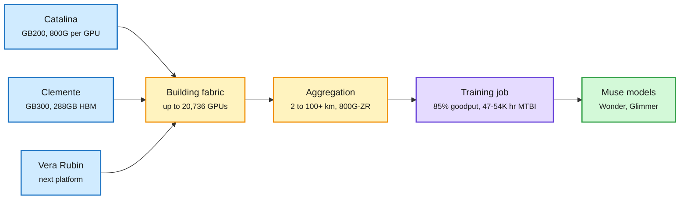

# Inside Prometheus: Meta's gigawatt supercluster, plus Muse Glimmer

**Sources:** Meta Engineering, 2026-10-19 ([Prometheus post](https://engineering.fb.com/2026/10/19/data-center-engineering/inside-prometheus-meta-gigawatt-scale-supercluster/)); AI at Meta on X ([Muse Glimmer tech report announcement](https://x.com/AIatMeta/status/2112265822274302066)). Raw: [`raw/labs/2026-10-20-100728-labs.md`](../../raw/labs/2026-10-20-100728-labs.md)

## TL;DR

Prometheus in New Albany, Ohio already runs **hundreds of thousands of GPUs** across several buildings and is scaling toward **~1 million**. Phase one trained the Muse models, including Muse Wonder. The reliability numbers are the headline: **>85% goodput** (share of time spent on useful training) for pre-training and **>90% for RL**, with a mean time between interruptions of **~47K GPU-hours**, since raised past **54K** with firmware fixes. Two NVIDIA platforms run today: **Catalina** (GB200 NVL72 in the two-rack Ariel variant, chosen to give **800G of scale-out per GPU** instead of 400G, because GB200 scaled every other dimension over H100) and **Clemente** (GB300 NVL72 in one rack, 288 GB HBM per GPU, 1.5x the GB200, ~135 kW per rack, only **5-10% faster** than GB200 on Meta's workloads). Vera Rubin NVL72 arrives next. Building fabrics connect up to **20,736 GPUs**; an aggregation network spans **2 km to over 100 km** with 800G-ZR coherent optics. Separately, Meta published a tech report on **Muse Glimmer**, a 30B open-weight agentic model that runs at 4-bit on one consumer GPU.

One machine across buildings, with network and reliability as the real design

Racks scale up, building fabrics scale out, and a 100 km aggregation ring ties regions together.

Blue is rack hardware, amber is the network tiers, purple is the training job, green is the output.

## Key findings

- **Network matches the parallelism hierarchy:** bandwidth- and latency-sensitive traffic stays inside a data-parallel replica (inside a building); latency-tolerant traffic crosses buildings.
- **Fabric evolution:** Disaggregated Scheduled Fabric (sub-packet spraying, credit flow control) gave way to a Non-Scheduled Fabric on shallow-buffer 51.2T switches once NICs could reorder packets at the endpoint.
- **GB300's gain is small on Meta's mix (5-10%)** despite 1.5x HBM and roughly 2x softmax acceleration, a reminder that rack specs do not translate one-to-one into training throughput.
- **Muse Glimmer:** 30B open weights for agentic tasks on consumer hardware, 4-bit; Meta says it leads comparable open models on tool use and multi-step planning. Report covers architecture, distillation and quantization (details not captured this window).

## How this relates to prior wiki pages

- **Contrast with MAI-Base-2 (10-17)**, which reported only **21% average MFU** (model FLOPs utilization: the share of peak math that did useful work) on 16,000 GB200s. Goodput and MFU measure different losses (interruptions vs per-step efficiency), but both say the cheapest compute is the compute you stop wasting.
- **Pairs with Meta's AMD co-design (10-19, 1.5x over a direct port to MI350X):** Meta is building multi-vendor training on top of an all-NVIDIA flagship cluster. See [compute-economics](compute-economics.md).
- **Distance-tolerant pretraining** (100 km spans) is what SemiAnalysis's 10-19 +50GW forecast assumes: campuses grow by stitching buildings, not by single giant halls. See [memory-hierarchy](memory-hierarchy.md) for the HBM per-GPU trend.

## Gaps

- No MFU figure, no breakdown of interruption causes, no per-platform cost.
