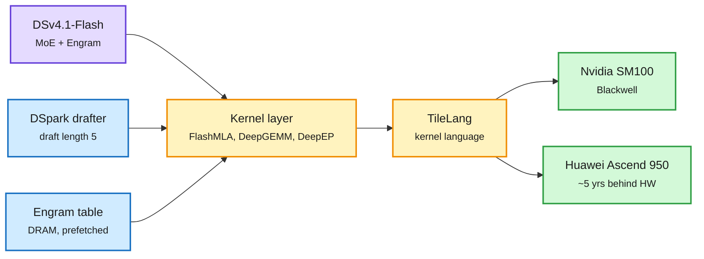

# DeepSeek opens its serving engine (DeepInfer), and SemiAnalysis maps the Huawei-DeepSeek stack

**Sources:** [DeepInfer repo](https://github.com/deepseek-ai/DeepInfer) and [@deepseek_ai announcement](https://x.com/deepseek_ai/status/2112476496283775135) (X feed, the window's most-shared post); [The Decoder](https://the-decoder.com/deepseek-open-sources-the-inference-engine-that-powers-its-fastest-and-cheapest-ai-model/); [The Information](https://www.theinformation.com/briefings/deepseek-open-sources-framework-behind-high-margin-ai-inference); [Interconnects, Artifacts #25](https://www.interconnects.ai/p/latest-open-artifacts-25-deepseek); [SemiAnalysis, "The Huawei-DeepSeek Symbiosis"](https://newsletter.semianalysis.com/p/huawei-deepseek) (Gmail full text + RSS). Practitioner breakdowns on X: [@rohanpaul_ai](https://x.com/rohanpaul_ai/status/2112517682646155349), [@bookwormengr](https://x.com/bookwormengr/status/2112636749293949122). Raw: `raw/rss/2026-10-2*-deepseek*`, `raw/rss/2026-10-21-semianalysis-the-huawei-deepseek-symbiosis.md`, `raw/gmail/2026-10-2[12]-newsletters.md` (private).

## TL;DR

**DeepInfer** is the production inference engine behind DeepSeek-V4.1-Flash, released under Apache 2.0. It runs only V4.1-Flash, on Nvidia SM100 (Blackwell) or Huawei Ascend 950. The README lists the whole kernel stack (FlashMLA, DeepGEMM, DeepEP, TileKernels, DeepSelect, TileLang), attention data-parallel with balanced context-parallel, MoE expert parallelism with EPLB load balancing, DSpark speculative decoding with confidence-scheduled verification (default draft length 5), "SWA bounded replay" (on a new prefill only a 140-token suffix is recomputed), and batch-invariant deterministic sampling. Practitioners note what is *not* in it: no multi-tier KV-cache system, no prefill/decode split across nodes, no replica load balancing. It is an offline-inference engine, not the full API stack. Interconnects cites estimates of **up to ~90% gross margin** for DeepSeek selling tokens on it and calls it the first time a leading lab has released its internal inference tooling.

**SemiAnalysis** argues the two companies need each other: Huawei has chips but no frontier lab to prove them, DeepSeek has models but cannot buy compute. On 2026-09-30 DeepSeek shipped Ascend support across TileLang, DeepGEMM, DeepEP, TileKernels, FlashMLA and DeepSelect; SA expects DeepSeek to run mainly on Huawei by 2027-28. Microbenchmarks on an Ascend 950PR (28 cube cores, 128 GiB HBM): stock matmul hits **99.7% of ceiling** on compute-bound BF16 GEMMs (1,055 shapes); below the roofline ridge it reaches **41.5% of attainable vs H100's 46.8%**; HBM utilization beats H100 at small messages. Absolute performance sits between A100 and MI300X: "hardware about 5 years behind, software at the frontier." A DSv4.1-Flash profile on 32x 950DT shows fused compute+communication kernels (4 HCCL ops for 43 expert dispatches), 3 DSpark drafter blocks with a Markov head, and **DeepSeek's first production use of Engram**, whose token-ID-keyed fetch overlaps layer 0 so DRAM offload costs nothing vs HBM (SSD offload does hurt). Doubling cube throughput would give only a 1.32x step speedup: the step is not compute-bound.

The moat moved from the model to the serving stack, and DeepSeek gave its stack away

Same kernels target Blackwell and Ascend; the vendor underneath becomes swappable.

Purple is the model, amber is the portable kernel layer, blue are the efficiency add-ons, green are the interchangeable chips.

## How this relates to prior wiki pages

- **Engram in production confirms the token-ID-addressing side of [conditional-memory-embeddings](../inference-efficiency/conditional-memory-embeddings.md).** That page's open disagreement (token-ID addressing that can prefetch vs hidden-state addressing that cannot) gets a production answer: DeepSeek's DRAM-offloaded Engram costs nothing because the fetch is known before layer 1. Today's CP paper (2-bit tables, 203 GB to 51 GB for DeepSeek) is the other route: keep it in HBM by shrinking it.
- **DSpark everywhere:** DeepInfer's default drafter, SA's Ascend profile, Liquid's LFM2.5 DSpark drafter and Google's TPU engines all ship DSpark this window. But EAGLE-4's table (via X) shows DSpark and DFlash 2 fall *below* vanilla decoding at 512 concurrent requests on 4x B300. See [speculative-decoding](../inference-efficiency/speculative-decoding.md).
- **Kernel-layer portability is the week's hardware story** ([gpu-kernels](gpu-kernels.md), [compute-economics](compute-economics.md)): TorchTPU and vLLM/SGLang-TorchTPU (SGLang-TorchTPU in production at Meta), FlyDSL on AMD MI350, TileLang on Ascend. Lock-in moves from the framework to the kernel authors.
- **Pricing pressure:** Interconnects expects DeepInfer to push DeepSeek token prices down across hosts; DeepSeek V4.1-Flash-1017 already sits at $0.3/$1.2 per M tokens (10-19).

## Gaps

- DeepInfer's KV-cache layout and disaggregation are absent from the release, so the 90% margin estimate cannot be checked from the repo alone.
- SA's Ascend stack works for DeepSeek's supernode setup; x86-host Ascend support is broken (vLLM-Ascend memfabric hardcodes ARM headers) and CANN 9.2.0 was not out at writing.
- Liang Wenfeng's "4 Huawei cards = 1 Nvidia card" quote is from an unverified investor transcript.

## Research angle

The 1.32x-from-2x-compute finding says the DSv4.1-Flash step is bound by communication and memory movement. That makes quantization fusion and expert-placement work worth more than FLOPs on Ascend, and is a testable claim once CANN 9.2 lands.
