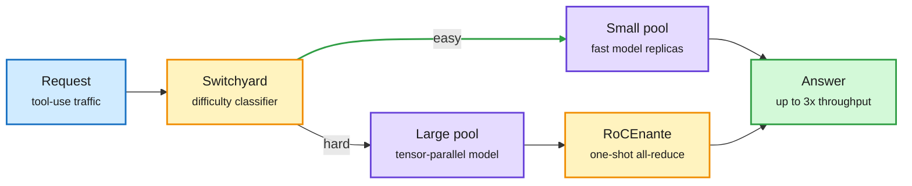

# Eight DGX Sparks: 1 TB on a desk, a one-shot all-reduce, and a router in front

**Source:** NVIDIA Developer blog, "Running Frontier-Class AI Models Across 8 NVIDIA DGX Spark Nodes," 2026-10-22 ([post](https://developer.nvidia.com/blog/running-frontier-class-ai-models-across-8-nvidia-dgx-spark-nodes/)), announced at GTC Berlin. Raw: `raw/labs/2026-10-23-094012-labs.md`.

## TL;DR

NVIDIA now officially supports eight-node DGX Spark clusters. Each Spark has 128 GB of unified memory, so eight reach **1 TB**, enough for the full **GLM 5.3 (753B)** in NVFP4 (about 470 GB). With MTP3 (multi-token prediction, 3 heads) it decodes 31 tok/s at one user and 67 tok/s total at eight. Two technical pieces matter. **RoCEnante** is a Spark-tuned collective: instead of ring all-reduce passing data around neighbors over several rounds, every rank sends its full input to every peer and reduces locally in a single kernel. That costs more bytes but fewer steps, which wins for the small-message, low-rank-count pattern of tensor-parallel decode. On dense Qwen3.8-27B NVFP4, decode scales **4.43x at eight nodes with RoCEnante vs 3.05x without** (about 12 to 52 tok/s). It is merged into FlashInfer and falls back to NCCL. **NeMo Switchyard** is a router: a lightweight classifier sends each request or session to a small-model pool or a large-model pool on the same cluster, matching Qwen-only quality on a tool-use benchmark while raising aggregate throughput **up to 3x** when most traffic shifts to the small model. Pre-training a nanochat model across eight nodes reaches 7.79x (97.4% scaling efficiency).

A desk cluster becomes a routed serving system

The router decides which pool a request hits; the collective decides how fast each pool decodes.

Blue is input, amber is the routing and communication decisions, purple is model pools, green is the result.

## Key numbers

| Setup | Prefill TPS | Decode TPS | Decode scaling |
|---|---|---|---|
| 1 node | 2,635 | 11.86 | 1.00x |
| 4 nodes, ring | 4,446 | 32.82 | 2.77x |
| 4 nodes, switch + RoCEnante | 4,556 | 36.34 | 3.06x |
| 8 nodes, ring | 4,962 | 40.11 | 3.38x |
| 8 nodes, switch + RoCEnante | 5,105 | 52.58 | 4.43x |

Qwen3.8-27B NVFP4, 8K in / 256 out, concurrency 1, no speculative decoding. Prefill scales poorly (1.94x at eight nodes) because it is compute-bound and the link is the bottleneck; decode is latency-bound, which is what the one-shot collective helps.

## How this relates to prior wiki pages

- **Routing moves into the vendor stack.** The [llm-routing](../ai-routing/llm-routing.md) ladder this month ran from weak-draft/strong-review (10-17) to fitted thresholds (10-18), role routing (Cohere, 10-19), deterministic routing (Meta Thin Orchestrator, 10-20) and the Jev audit (10-22). Switchyard is NVIDIA shipping the simplest rung, a classifier in front of two pools, as a product. llm-d's Semantic Classifier (10-20) is the Red Hat equivalent.
- **Latency-bound collectives are a decode-era kernel problem.** Ring all-reduce was designed for bandwidth-bound training. For decode at low concurrency the step count dominates. See [gpu-kernels](gpu-kernels.md) and [memory-hierarchy](memory-hierarchy.md).
- **Local frontier inference keeps getting cheaper:** Recursive Flint (10-22: 40B MoE, 2.5B active, local coding) and Meta's Muse Glimmer 30B (4-bit, one RTX 5090) are the model side; eight Sparks are the hardware side.

## Gaps

- The Switchyard quality claim is one tool-use benchmark; the classifier's error rate and cost of misroutes are not given.
- RoCEnante applies only to switched topologies; NVIDIA itself says NCCL wins at higher concurrency or larger clusters.
- Cost per token versus a single cloud GPU is not discussed.

## Research angle

The crossover between one-shot and ring all-reduce depends on message size and rank count, both of which vary per request in a routed cluster. A collective that picks its algorithm per call from the live batch size would get the best of both.
