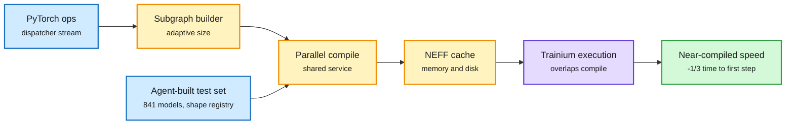

# TorchNeuron: PyTorch on Trainium, tuned on 841 agent-selected models

**Source:** Amazon Science, "The science behind TorchNeuron, Amazon's new PyTorch backend for AWS Trainium chips," Robert Hundt, 2026-10-22 ([post](https://www.amazon.science/blog/the-science-behind-torchneuron-amazons-new-pytorch-backend-for-aws-trainium-chips)). Announced at PyTorch Conference North America 2026 ([recap](https://pytorch.org/blog/pytorch-conference-north-america-2026-accelerating-open-intelligence-together/)). Raw: `raw/labs/2026-10-23-094012-labs.md`.

## TL;DR

TorchNeuron is AWS's open-source backend that runs PyTorch code on Trainium with little or no change. Three ideas. (1) **Adaptive eager mode:** instead of executing ops one by one (eager) or compiling whole graphs (compiled), the CPU accumulates small subgraphs from PyTorch's dispatcher, compiles them in parallel, caches them and queues them, choosing subgraph size so compile time overlaps with execution of already-compiled pieces. Source-line correlation for debugging is kept. (2) **Multi-level caching of NEFFs** (Neuron executables), in memory and on disk, plus a **shared compilation service**: on a sharded model, one node compiles and the others reuse. That cut time to first training step by about a third. (3) **Agentic evaluation:** agents swept Hugging Face, kept hundreds of thousands of runnable models, and classified them by architecture (front end, attention flavor, back end) down to **841 representative models**. From those runs a "shape registry" of tens of thousands of real tensor shapes generates fast unit tests, staged before the 841-model suite and the full distribution.

Hide compile time behind execution

Adaptive eager compiles small subgraphs while earlier ones run, then caches them for every node.

Blue is input, amber is the compile and cache path, purple is the chip, green is the payoff.

## How this relates to prior wiki pages

- **Third "PyTorch off CUDA by config" backend in a week.** TorchTPU (Google + Meta, 10-22: native eager plus torch.compile on TPU, vLLM and SGLang running on it) and AMD's FlyDSL (Python kernel language through MLIR, up to 3.01x vLLM serving on MI350) arrived at the same PyTorch Conference. Hardware lock-in is moving from the kernel layer to the backend layer. See [gpu-kernels](gpu-kernels.md).
- **Echoes 10-20 kernel shorts** (Trainium kernels in [kernel shorts](2026-10-20-kernel-shorts-mamba2-cutile-compileiq-trainium.md)).
- **Agent-curated test coverage** is a new pattern: models are used to define the workload distribution a compiler must handle.

## Gaps

- No throughput numbers versus GPUs or versus Neuron's prior PyTorch/XLA path.
- "Approaches fully compiled performance" is not quantified per model class.

## Research angle

The shape registry is a public good. Released, it would be the closest thing to a real-world distribution of tensor shapes for any accelerator compiler team to tune against.
