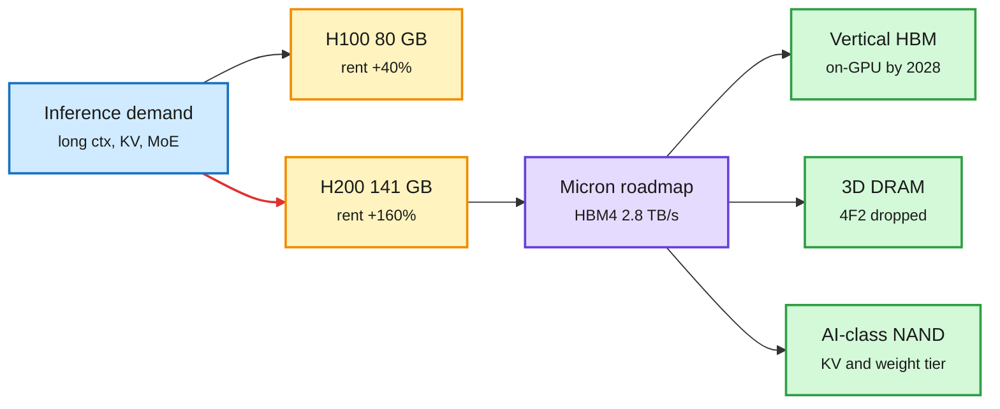

# Memory sets the rent

## TL;DR

H200 rental prices are up about 160% this year against about 40% for H100, though both are Hopper with the same compute. The difference is memory: 141 GB HBM3e vs 80 GB. Customers pay for capacity because inference (long contexts, big KV caches, MoE weights) is memory-bound. Micron's investor deck the same day lays out the supply side through 2030: HBM4 at 2.8 TB/s per stack; "vertical HBM" stacked on top of the GPU by 2028 (a target); 4F² DRAM cells abandoned after 20 years of study in favor of 3D DRAM (SK hynix and Samsung are still pursuing 4F²); G11 NAND at 400+ layers with about 2x density, 1.5x speed and over 25% less energy per bit, in volume in H2 2027; and "AI-class NAND" that GPUs read directly in small chunks, aimed at weights and KV cache for long conversations at 25M-100M IOPS.

Same chip, more memory, 4x the price rise

Inference rents capacity, so the memory roadmap is the cost roadmap.

Blue is demand, amber are the two Hopper parts and their rent, purple is Micron's plan, green are the next memory tiers.

## Details

- **Rental gap:** stock-commentary source citing rental indices; directionally consistent with the 10-18 and 10-22 wiki entries that GPU rental prices are rising. Treat the exact percentages as claims.
- **Micron deck:** memory per Nvidia GPU grew 3.6x from H100 (80 GB) to B300 (288 GB); Micron estimates AI context length grows 30x a year. Agent-written chip logic and firmware cut SSD controller design time 50% and customer readiness 60% (two internal programs). 1,500+ capacitors across a human hair's width (truncated in capture).
- **G11 NAND:** Micron skipped the G10 name; 400+ layers vs G9's 276, two bonded wafers. No cost-per-GB claim, since taller stacks and the second wafer add cost.
- **3D DRAM review** (Nature Reviews Electrical Engineering, via The Semiconductor Newsletter): cell-stacked 3D DRAM is closer to 3D NAND in process (high-aspect-ratio etch, conformal high-k deposition, layer-to-layer variation) but with much tighter capacitance, leakage and retention needs. Not the same as die-stacked HBM.
- **EU equipment risk index** (same newsletter, preprint): ion implantation (1.00), photomasks (0.72), dry conductor etch (0.71) and resist processing (0.64) are the EU's top vulnerabilities; Japan supplies over 90% of photomask and resist capability, the US over 80% of dry etch.
- **Demand side:** Andy Jassy says AWS is sold out for 2026, largely sold out for 2027 and partly for 2028, and that inference is still "an order of magnitude too expensive" for broad adoption. Nebius's CRO says it could sell all of 2027 capacity at current prices. SK hynix shelved Solidigm's US listing (10-23).

## Relation to prior wiki

- **Confirms** [memory-hierarchy](memory-hierarchy.md) 10-03 "memory sets the price of compute" with a clean natural experiment: same compute die, different HBM, 4x the rent increase.
- **Extends** the 10-01 "NAND as the KV tier" entry: Micron now names a product class for it.
- **Diverges** from SK hynix/Samsung on 4F² vs 3D DRAM. Two roadmaps for post-planar DRAM is new and worth tracking; the 3D DRAM review lists why it is hard.
- **Research link:** today's Kimi K3.1 Pro (1M context on a hybrid of fixed-state KDA and latent MLA layers) and EdgeRock-4B (fixed-size memory) are model-side responses to the same price signal.
