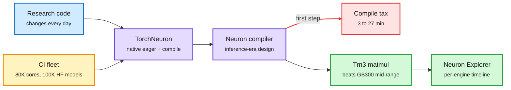

# Trainium3 for research training (SemiAnalysis)

## TL;DR

SemiAnalysis spent weeks on Trainium3 racks testing whether AWS's chip, already proven for inference (Anthropic runs production inference and RL rollouts on Trn2 and Trn3), now works for *research* training, where architectures change daily. Verdict: the direction is right. TorchNeuron gives a native PyTorch experience (`.to("neuron")`, eager mode, `torch.compile`, DTensor, SimpleFSDP), and TorchTitan, HF Accelerate and a gpt-oss 20B recipe ran out of the box. Qwen3-32B on 16 Trainium2 chips reached 11,099 tok/s at 23.89% MFU eager and 14,156 tok/s at 30.47% MFU compiled. The pain is compile time: the first step took 184.6 s eager and 255.7 s compiled (30-55x a normal step), and gpt-oss took 27 min 17 s. On matmuls a single Trn3 logical core beat GB300 MFU from about 1 GFLOP up to 100 GFLOP and again above 1 TFLOP. FlexAttention passed 89 of 96 cases, all failures being compile timeouts. Neuron Explorer, the profiler, is called better than Nvidia's and AMD's.

Research training needs generality more than peak speed

Trainium now clears the API-coverage bar; compile time is the remaining tax.

Blue is the workload, purple is the software stack, red is the cost, green is what works well, amber is the quality-control loop.

## Key findings

- **Software course correction.** PyTorch/XLA (lazy tensors, no first-class eager, no `torch.distributed`) is replaced by TorchNeuron. AWS hired the former lead of Google's native-Torch-on-TPU effort. BF16 first; TorchAO MXFP8 is deferred because only big labs train in MXFP8 and they write their own kernels.
- **MoE comms gap.** TokenSwitch, PyTorch's API for MoE dispatch/combine (60-70% of MoE communication volume), is not yet supported; Trainium uses a custom NeuronEPTokenDispatcher. AWS committed to fixing the abstraction with Meta.
- **Compile time** is the research blocker. Upcoming TorchNeuron releases target "up to 2 orders of magnitude" lower time-to-first-step via precompiled NKI kernels and a re-architected compile stack.
- **Matmul sweep** (M = 1, 128, 2048 over open-model projection shapes): Trn3 MFU above GB300 from 1 GFLOP; GB300/B200 lead between 100 GFLOP and 1 TFLOP; Trn3 wins again above 1 TFLOP.
- **Automated QA.** Up to 80,000 physical cores do CI over 100K+ Hugging Face models, testing crashes, CPU fallbacks, graph breaks and numerics (tensor parity and loss-curve divergence vs CPU and Nvidia). SemiAnalysis contrasts this with a vendor whose leadership saw 99.99% while the real gating pass rate was under 5%.
- **Profiler.** Neuron Explorer shows each hardware engine as its own timeline row, lights up dependencies, maps to source and shows per-bank memory use. Nsight Compute gives aggregates, not an intra-kernel event timeline; the closest GPU equivalent is Tri Dao's QuACK tracer. Aside: SemiAnalysis used Codex because "Claude refuses to write Trainium kernels."
- **Ecosystem.** AWS is investing in SGLang on TorchNeuron, copying Google's TorchTPU + vLLM/SGLang path that landed Meta as a TPU customer.

## Relation to prior wiki

- **Extends** [TorchNeuron (10-23)](2026-10-23-torchneuron-trainium-backend.md), where Amazon Science described adaptive eager mode and NEFF caching that cut time-to-first-step by about a third. SemiAnalysis's independent numbers show the remaining compile tax is still minutes, so the 10-23 one-third cut is a start, not a fix.
- **Confirms** the [10-12 Decart/Trainium](2026-10-12-decart-trainium-and-agent-cpu-demand.md) thread that Trainium utilization depends on Anthropic-scale inference demand; this is AWS trying to win the research-training side too.
- **Connects** to [the 10-23 operator-gap summary](../inference-efficiency/2026-10-23-serving-operator-gap-semianalysis-minimax.md) (identical B200s differ ~50% in output): profiling quality is a direct input to that gap.

## Research angle

Matmul MFU winning in the 1-100 GFLOP band is the decode and small-batch regime. If that holds on real decode kernels, Trainium's best workload is exactly agent-style inference with many small requests. The next SemiAnalysis article on NKI speed-of-light kernels is the test.
