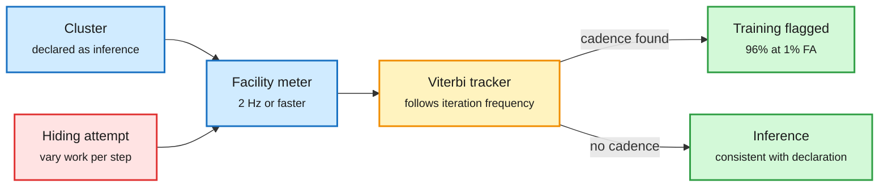

# Power meters that see training runs, 8-high HBM4, CoWoS +20%, and the fabric layer

**Date:** 2026-10-27 · **Sources:** [Detecting AI Training in Datacentre Power (2610.30182)](https://arxiv.org/abs/2610.30182) (DAIR pick, Oct 24) · HBM4 report via [@StockSavvyShay](https://x.com/StockSavvyShay/status/2114661509506719972) · CoWoS report via [@rohanpaul_ai](https://x.com/rohanpaul_ai/status/2114863476296552715) · [Meta at OCP 2026](https://engineering.fb.com/2026/10/26/open-source/ocp-summit-2026-meta-networking-talks/) · [NVIDIA Minerva](https://developer.nvidia.com/blog/how-nvidia-minerva-turns-telemetry-chaos-into-peak-gpu-yield/) · [IBM Spyre in PyTorch](https://research.ibm.com/blog/pytorch-spyre-accelerator-software-ecosystem-updates)
**Raw:** `raw/dair/2026-10-26-230504-dair-academy.md`, `raw/labs/2026-10-26-*.md`, `raw/twitter/feed/2026-10-2[67]-*-ranked.json`

## TL;DR

Synchronous training leaves a fingerprint in a data center's power draw: every iteration ends in a collective sync, so power rises and falls at the iteration frequency. Kimpson, Baker and Graham (Melbourne, Oxford, MATS) track that wandering frequency with a Viterbi tracker on facility-level meter data. With a meter sampling at 2 Hz or faster, they detect at least 96% of training runs against a declared inference workload at a 1% false-alarm rate, within 0.04 of the Neyman-Pearson optimum. Of eight hiding strategies, only extreme variation of work per iteration evades it, hiding training in up to 73% of five-minute windows. Over a full day, at least 87% of runs are still caught at a 0.1% per-run false-alarm rate. Results are on simulated power data.

The training loop has a heartbeat the meter can hear

Synchronous steps make power pulse at the iteration rate; inference does not.

Blue is the monitored site, amber is the detector, green is a verdict, red is the evasion strategy.

**Why it matters for the hardware reader:** compute governance proposals (verify that a cluster is not secretly training) usually assume on-chip attestation. This shows the power meter already carries the signal, with no trust in the operator. The only working evasion, varying work per iteration, costs training efficiency, so hiding has a measurable price.

## Memory and packaging supply

- **8-high HBM4 for Rubin Ultra.** SK hynix and Samsung reportedly prepare 8-layer HBM4 for NVIDIA's Rubin Ultra by Q2 2027, because heat and manufacturing problems slow 12-high stacks. NVIDIA trades capacity per stack for yield (secondhand report).
- **TSMC CoWoS up to +20%.** CoWoS (Chip on Wafer on Substrate, the package that joins an AI die to its HBM) reportedly gets another price rise of 10-20%. Demand spread from GPUs to server CPUs and custom ASICs; tool lead times stretched from 3-6 to 6-8 months. Larger packages cut each tool's hourly output, so flat chip volumes still need more machines. C.C. Wei says packages at 5x the reticle are in mass production, with 9x and 14x planned.
- **Robot RAM.** Musk's claim that robot memory demand will exceed everything else (10M Optimus a year at ~72 GB is ~720 PB) is LPDDR volume, not HBM, so a different supply line.
- **SK Hynix** plans a ~$12B special dividend from its Kioxia stake sale (AI Breakfast via Bloomberg).

## The fabric and fleet layer

- **Meta at OCP:** a liquid-cooled 102.4T switch (128x800G, Tomahawk 6C or Spectrum-6); Flattened Planar Fabric where each GPU connects to eight network planes, moving from 3-tier to 2-tier Clos with NIC-level packet spraying; BAG, a petabit super-spine joining buildings in the gigawatt Prometheus cluster; Tahan Ethernet scale-up for MTIA 300 with 72 accelerators per rack on 102.4T silicon; MetaRoCE RDMA transport going open source; OSPA switch-platform spec with Microsoft and Alibaba.
- **NVIDIA Minerva** joins GPU, network, storage and job telemetry in a live graph to catch gray failures that no threshold trips (one degrading NVLink among hundreds of thousands, a GPU running hotter than its peers). Synchronous training runs at the slowest rank's pace, so this is goodput, not ops hygiene.
- **IBM Spyre** becomes a first-class PyTorch backend via Inductor (compiler ~7x smaller than the one it replaced) and a vLLM plugin; moving graph construction off the transfer and dispatch paths gave 1.7x prefill and 2.4x decode on Granite 3.3 8B. vLLM's hardware-agnostic layers ran within 3.4% of native on H100.

## Relation to prior wiki

- **Extends** [memory-hierarchy](memory-hierarchy.md): the 10-19 report that NVIDIA standardizes the HBM base die on TSMC 3nm and the 10-24 H200 rent premium both said memory sets the price. 8-high HBM4 says memory also sets the schedule.
- **Extends** [compute-economics](compute-economics.md): CoWoS price rises land the same week GPU-hour rents rise (DeepInfra, 10-26) and token prices fall (GPT-6.1 Terra, 10-27).
- Concept pages: [memory-hierarchy](memory-hierarchy.md), [compute-economics](compute-economics.md), [gpu-kernels](gpu-kernels.md).
