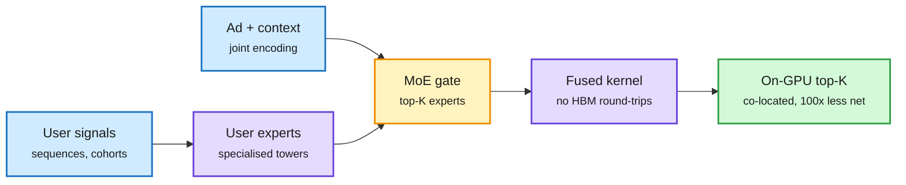

# Meta Andromeda: one fused GPU kernel scores a billion ads a second

**Source:** [Meta Engineering, 2026-10-28](https://engineering.fb.com/2026/10/28/ml-applications/meta-andromeda-next-gen-ads-retrieval-gpu-co-design/) · raw: `raw/labs/2026-10-28-230451-labs.md`

**TL;DR.** Meta rebuilt its ads retrieval stage (the step that narrows every eligible ad to a short list before expensive ranking) as a model-system-hardware co-design with NVIDIA. Three moves: (1) a **retrieval MoE**: an ensemble of specialised user towers as experts, a context-aware ad tower, and an attention-based gate that routes each candidate to its top-K user experts, giving near-ranking quality at ~300x fewer inference FLOPs than the 2024 model; (2) a **single fused kernel** per user-ad pair that keeps embedding gathers, the interaction model and scoring in registers and shared memory, so intermediate tensors never touch HBM (at billions of ads a second those intermediates were terabytes per second of memory traffic); (3) **co-location** of index matching, scoring and top-K on one GPU box, cutting network traffic ~100x and returning the system to compute-bound. Result: over 10 billion ads/s per GH200 for the kernel and over 1 billion ads/s end to end, 100x the 2024 system, and +2.4% Facebook conversions since 2025.

The FLOP cut is what made full fusion possible

A sparse MoE gate freed enough headroom to fuse model and system work into one kernel.

Blue are inputs, purple are model and kernel, amber is the routing gate, green is the co-located result.

## Relation to prior wiki
- **Same lesson as LLM decode** in [GPU kernels](gpu-kernels.md) and [memory hierarchy](memory-hierarchy.md): the bottleneck is bytes moved, not FLOPs. Andromeda's fix (never materialise intermediates) is the FlashAttention idea applied to a recommender.
- **MoE routing outside LLMs**: an attention-based gate routing candidates to experts is the same mechanism as LLM MoE, and the same "route to save compute" bet as [LLM routing](../ai-routing/llm-routing.md).
- **Jensen's claim the same day** (doubling model speed doubles a lab's revenue while demand outruns capacity) is the economic version: Andromeda turned a 100x throughput gain into a larger candidate pool at the same latency budget, not fewer GPUs.
