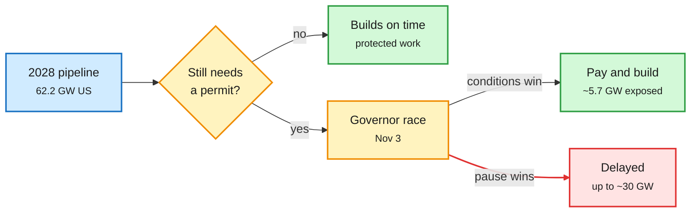

# The datacenter backlash goes bipartisan: midterms and the 2028 buildout

**Sources:** SemiAnalysis, "The Datacenter Backlash Goes Bipartisan: Next Week's Midterms and the 2028 Buildout" (2026-11-01); The Information, "Candidates Backing Data Center Pauses Could Win in Up to 15 Governor's Races" (2026-11-01); The Information, "Google Energy Chief: Space Data Centers Cost Up to 100 Times More" (2026-11-01); X capacity projection thread
**Links:** [SemiAnalysis](https://newsletter.semianalysis.com/p/the-datacenter-backlash-goes-bipartisan) · [The Information: governors](https://www.theinformation.com/articles/candidates-backing-data-center-pauses-win-15-governors-races) · [The Information: space DCs](https://www.theinformation.com/articles/google-energy-chief-space-data-centers-cost-100-times-earth) · [104GW thread](https://x.com/StockSavvyShay/status/2116908125177676156)
**Raw:** `raw/rss/2026-11-01-semianalysis-the-datacenter-backlash-goes-bipartisan-next-week-s-mid.md`, `raw/rss/2026-11-01-the-information-candidates-backing-data-center-pauses-could-win-in-up-t.md`, `raw/rss/2026-11-01-the-information-google-energy-chief-space-data-centers-cost-up-to-100-t.md`

## TL;DR

SemiAnalysis says the 2027 US buildout is safe: about three quarters of the 33.8 GW due across its top 20 states is already under construction, so it keeps its global +50 GW forecast for 2027. The fight is 2028. Its model has 62.2 GW of US net additions that year, mostly not yet started. The 13 largest 2028 states hold 43.5 GW (70% of the national total) and 10 of them elect a governor on Nov 3. If every pro-pause candidate won, about 30 GW of 2028 capacity would sit in pause states; if the conditions-only candidates win, exposure falls to 5.7 GW. The single biggest risk is Texas (close to 30% of 2028 US GW), where TCEQ environmental permits have been frozen since Sept 21. If Abbott restarts after ERCOT's Dec 10 audit report, the hit is small. If challenger Hinojosa wins and holds a moratorium through the Jan to May 2027 legislative session, the freeze runs about 8 months, 5 to 9 months longer.

2027 is poured concrete; 2028 is still a permit

Elections can only delay capacity that still needs an approval.

Blue is the pipeline, amber is the decision points, green is capacity that gets built, red is capacity at risk.

## Key points

- **What changed since September.** Texas froze TCEQ permits (Sept 21) on top of an interconnection-queue audit (Aug 3), pulling onsite power into the hold. Oregon widened its freeze to air and water-discharge permits through July 1, 2027. Of 20 nominees tracked, 9 want a construction pause and 11 want conditions, split evenly by party.
- **Bipartisan platform.** Make datacenters pay their own grid costs (15 candidates), end tax breaks (12), limit or report water use (11). The equipment sales-tax exemption alone can be worth billions per GW.
- **Hyperscalers can pay, but not skip the queue.** Interviews with current and former Amazon, Microsoft and Google staff: they can absorb higher costs and bring their own power, but permits and equipment still gate delivery, and capacity cannot simply move states.
- **The Information's count is harsher.** In 21 of 36 governor races at least one major nominee backs a moratorium; both nominees do in five states (Michigan, New Hampshire, Ohio, Oregon, Texas); a pause backer is likely to win in three (Maine, New Mexico, New York) and could win in seven more. Those 15 states hold over a third of the US population. Note the tension with SemiAnalysis, which classes Texas's favored candidate as conditions-only.
- **Space is not the escape hatch.** Google's head of data-center energy says orbital datacenters could cost up to 100x terrestrial ones ("explore all the terrestrial options before we go extraterrestrial"), even as Google tests TPUs in orbit and SpaceX's orbital plans underpin part of its ~$1.8T valuation.
- **Demand side.** A circulating projection has yearly AI datacenter additions quadrupling to 104 GW by 2030 (NVIDIA GPUs ~50 GW, Google TPU ~21 GW, Trainium ~15 GW, AMD ~9 GW) with rack density tripling to ~285 kW, forcing liquid cooling.

## Relation to prior wiki pages

- **Updates** [SemiAnalysis on moratoriums (09-16)](2026-09-16-semianalysis-datacenter-moratoriums.md), which found only ~1.5 GW of ~20 GW under local restrictions faced real delay. That conclusion holds for 2027; the reach of restrictions is what is growing.
- **Builds on** [Datacenters 2027: 50 GW in a single year (10-19)](2026-10-19-semianalysis-datacenters-2027.md).
- **Connects** to [GPU rents up, neoclouds down (11-01)](2026-11-01-gpu-rents-up-neoclouds-down.md): physical scarcity keeps rents rising while capital markets wobble. A Texas freeze adds a political supply shock to that scarcity.
- Concept: [compute economics](compute-economics.md).
