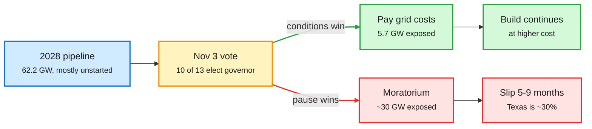

# The datacenter backlash goes bipartisan: 2027 is built, 2028 is on the ballot

**Sources:** SemiAnalysis (Maya Barkin), "The Datacenter Backlash Goes Bipartisan: Next Week's Midterms and the 2028 Buildout", 2026-11-01; The Information, "Candidates Backing Data Center Pauses Could Win in Up to 15 Governor's Races" and "Google Energy Chief: Space Data Centers Cost Up to 100 Times More", 2026-11-01; The Semiconductor Newsletter weekly process monitor, 2026-10-31
**Links:** [SemiAnalysis](https://newsletter.semianalysis.com/p/the-datacenter-backlash-goes-bipartisan) · [The Information: governor races](https://www.theinformation.com/articles/candidates-backing-data-center-pauses-win-15-governors-races) · [The Information: space DCs](https://www.theinformation.com/articles/google-energy-chief-space-data-centers-cost-100-times-earth) · [Semiconductor Newsletter](https://thesemiconductornewsletter.substack.com/p/weekly-monitor-on-semiconductor-process-5b3)
**Raw:** `raw/rss/2026-11-01-semianalysis-the-datacenter-backlash-goes-bipartisan-next-week-s-mid.md`, `raw/rss/2026-11-01-the-information-candidates-backing-data-center-pauses-could-win-in-up-t.md`, `raw/rss/2026-11-01-the-information-google-energy-chief-space-data-centers-cost-up-to-100-t.md`, `raw/gmail/2026-11-02-newsletters.md`

## TL;DR

About three-quarters of the 33.8 GW of 2027 US capacity in SemiAnalysis's top 20 states is already under construction, so the Nov. 3 midterms cannot stop 2027 (they keep their +50 GW global year). The fight is 2028: their model has 62.2 GW of US net additions that year, mostly unstarted, and 13 states holding 43.5 GW (70%) vote on Tuesday, 10 of them for governor. Since their September moratorium analysis (only 1.5 GW of ~20 GW under local restrictions faced delay), three things worsened: Texas froze TCEQ environmental permits on Sept. 21 on top of an ERCOT interconnection audit, pulling onsite power into the hold; Oregon extended its freeze to air and water permits through July 2027; and 9 of 20 nominees now back a construction pause. The biggest single risk is Texas (close to 30% of 2028 US GW): a December restart is absorbable, but a freeze through the Jan-May 2027 legislative session or into late summer adds 5-9 months. If every pause candidate won, ~30 GW of 2028 capacity sits in their states; if conditions-only candidates win, exposure falls to 5.7 GW. The Information counts at least one pro-moratorium nominee in 21 of 36 governor races.

A pause blocks only projects that still need a permit

Conditions raise cost; moratoriums stop the clock. That split, not the party, sets 2028 GW.

Blue is the pipeline, amber is the election, green is the conditions path, red is the moratorium path.

## Key points

- **Bipartisan platform:** 15 candidates want datacenters to pay their own grid costs, 12 want to end tax breaks, 11 want water limits or reporting. Pause vs conditions splits roughly evenly by party.
- **Who holds the levers:** governors can halt unissued permits fast (Abbott's TCEQ freeze, Kotek's Oregon hold); legislatures own the equipment sales-tax exemption, "potentially worth billions of dollars per gigawatt"; utility commissions set deposits, minimum bills and exit fees (elected in Georgia, Arizona, Oklahoma).
- **Hyperscalers can pay but not always deliver:** six current/former hyperscaler staff say Amazon, Microsoft and Google can absorb new rules and bring their own power, but money does not make transmission or permits arrive on time, and shifting states does not escape the schedule problem.
- **Race ratings (Oct. 30):** conditions-only candidates favored in Texas, Oklahoma, Pennsylvania and Iowa; Georgia a toss-up with a PSC majority on the ballot.
- **Off-Earth is not the escape valve:** Google's head of datacenter energy says space datacenters could cost up to 100x terrestrial ones, even as Google tests TPUs in orbit and SpaceX's orbital plans underpin part of its ~$1.8T valuation.
- **Fab side (Semiconductor Newsletter):** top pick is area-selective SiOC low-k PEALD that regenerates its copper-blocking inhibitor with periodic H₂ plasma, reaching ≥2 nm selective growth at k 3.2-3.4, the step that usually caps inhibitor-based selective deposition. Also: AlN PEALD at up to ~0.73 nm/min with a sputter-damage ceiling on bias, and single-alignment 193 nm lithography on inclined sidewalls. All still sub-HVM (2-inch wafers, large CDs).

## How it relates to prior wiki pages

- **Updates** [datacenter moratoriums (09-16)](2026-09-16-semianalysis-datacenter-moratoriums.md): the "moratoriums aren't killing the buildout" conclusion holds for 2026-27, but the exposure has moved to 2028 and widened to state-level permitting.
- **Joins the scarcity thread** in [compute economics](compute-economics.md): GPU rents up 52% since May and Samsung's HBM-driven profit (10-30, 11-01) are scarcity signals; a 2028 permitting slip would extend that scarcity by a year in the largest market. Both sides of the ledger now point the same way: chips and power are the binding constraint, and policy is becoming part of it.
