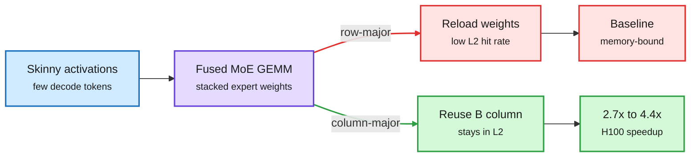

# MoE GEMMs get faster when thread blocks walk columns (PyTorch), plus a GPU-from-scratch notebook

**Sources:** PyTorch blog, Adnan Hoque, Less Wright, Antoni Virós Martin, Chih-Chieh Yang, "Accelerating MoE model inference with Locality-Aware Kernel Design" (April 2024, updated Nov 2024), resurfaced on X 2026-11-01; BEFORE-GPU-ENGINEERING open notebook (GitHub)
**Links:** [PyTorch post](https://pytorch.org/blog/accelerating-moe-model/) · [code](https://github.com/pytorch-labs/applied-ai/tree/main/kernels/triton/inference/col_major_moe_gemm) · [notebook repo](https://github.com/BEFORE-GPU-ENGINEERING/BEFORE-GPU-ENGINEERING) · threads: [@anshulcreates](https://x.com/anshulcreates/status/2116407165791465681), [@techNmak](https://x.com/techNmak/status/2116876975302472003)
**Raw:** `raw/twitter/feed/2026-11-01-evening-*-ranked.json`

## TL;DR

An MoE layer (mixture-of-experts: each token is sent to a few expert sub-networks) runs as one fused GEMM over a stacked weight matrix of all experts. During decoding the activation matrix is skinny (few tokens), so the cost is dominated by loading expert weights from HBM. The PyTorch team found vLLM's fused Triton MoE kernel had a low L2 cache hit rate. Changing only the order in which thread blocks are assigned output tiles, from row-major to column-major, lets consecutive blocks reuse the same column of expert weights while it sits in L2. Result: up to 4x faster on A100 and 4.4x on H100 (2.7x at batch 2). Nsight shows L2 hit rate up 2.54x and DRAM accesses down about 50%. A practitioner credited the post with a 95-place jump on a kernel leaderboard in one night, which is why a 2024 post trended in late 2026.

Same math, different tile order, half the DRAM traffic

Column-major scheduling keeps one expert-weight column hot in L2 across neighbouring tiles.

Blue is input, purple is the kernel, red is the cache-missing path, green is the locality win.

## Key points

- **SplitK first.** Splitting the K dimension across thread blocks (with atomic adds) gave 18-20% over data-parallel decomposition, because skinny decode matrices otherwise leave SMs idle.
- **Scheduling is the big lever.** Column-major order computes C(0,0), C(1,0), C(2,0)... so the B (weight) column is reused; row-major evicts it and reissues DRAM loads.
- **Profiled, not guessed.** L1 hit rate up about 27x, L2 up 2.54x, global loads down 49% at batch 2 on H100.
- **Production caveats the authors list.** Tested in FP16; Triton's `tl.atomic_add` lacked BF16 support, and launch latency needed CUDA graphs for production.
- **The notebook.** Before GPU Engineering is a free, MIT-licensed 56-chapter reading path (warps and SIMT, register to shared memory to HBM, coalescing, occupancy, arithmetic intensity, tiled matmul, profiling) that builds intuition before CUDA or Triton. Later chapters are unfinished.

## Relation to prior wiki pages

- **Confirms** the [GPU kernels concept page](gpu-kernels.md) pattern that decode-time kernels are memory-bound and the wins come from data movement, not FLOPs.
- **Connects** to the [memory hierarchy page](memory-hierarchy.md): L2 reuse is the cheapest bandwidth there is.
- **Social signal:** two "learn the GPU first" artifacts trending on the same day matches the kernel-benchmark culture tracked in [KernelBench-X (05-09)](2026-05-09-kernelbench-x-llm-gpu-kernel-benchmark.md).

## Research angle

- Expert-aware tile ordering: when routing is skewed, order tiles by expert popularity so hot experts stay resident across steps, not just within a GEMM.
- Does the gain survive on Blackwell's larger L2 and with FP8/FP4 expert weights, where the weight-load share shrinks?
