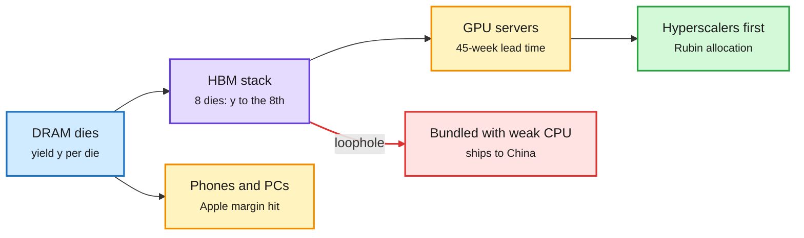

# The memory squeeze: HBM margins, lead times, smuggling and the agentic DRAM gap

**Sources:** The Semiconductor Newsletter Week 44 ([post](https://thesemiconductornewsletter.substack.com/p/week-44-2026)); The Information ([HBM smuggling](https://www.theinformation.com/articles/smugglers-get-expensive-memory-chips-china-south-korea), [Nvidia China guidance](https://www.theinformation.com/briefings/nvidia-tells-cloud-clients-take-less-china-business), [Apple](https://www.theinformation.com/articles/apples-slowdown)); TrendForce and UBS via X ([lead times](https://x.com/rohanpaul_ai/status/2117250376395329908), [DRAM capacity](https://x.com/StockSavvyShay/status/2117243577734705540)) · raw: `raw/gmail/2026-11-03-newsletters.md`, `raw/rss/2026-11-03-the-information-*.md`, `raw/twitter/feed/`

## TL;DR

Memory is the price-setting input of late 2026. SK hynix: KRW 104.6T revenue (+328% YoY), 80% operating margin, HBM4 to pass HBM3E in mix in Q4, LTAs on over half of 2027-28 output. TrendForce: top-end GPU lead times +5 weeks to 45 as Rubin ramps; DRAM lead times 19 weeks (over 2x normal); substrates and capacitors over 3x normal. Apple guides margin down on memory costs. HBM reaches China legally when packaged with a CPU below the export threshold. UBS: DRAM capacity +147% to ~89 EB by 2030 versus ~282 EB for a full agentic buildout.

Every path out of the memory fab is congested or leaking

Yield sets supply, lead times set ship dates, and export rules have a packaging hole.

Blue is raw supply, purple is the HBM bottleneck, amber is a congested buyer, red is the export leak, green is who gets served first.

## Key points

- **Yield math:** all-good probability of an n-die stack is y^n before known-good-die screening; 8 dies at 95% = 66%, at 98% = 85%. Small die-yield gains move cost per sellable stack sharply.
- **Second sources:** CXMT HBM3E yields reportedly 20-30% vs ~70% at SK hynix (unverified, no standard denominator).
- **Foundry contrast:** Intel Foundry lost $1.85B on $6.70B segment revenue; UMC 92% utilization on mature nodes; Rambus Q3 $218.3M (+22%).
- **Supply security:** Solidigm reportedly floated a $45B US NAND fab (not approved).
- **Export leakage:** package-level loophole for HBM; Nvidia told some clouds to cut China-client exposure.

## Relation to prior wiki pages

- Confirms [memory hierarchy](memory-hierarchy.md) 10-27 ("yield beats height") with explicit stack-yield arithmetic.
- Extends [compute economics](compute-economics.md) 10-30 (Intel: agents moved CPU:GPU from 1:8 to 1:4): UBS's 282 EB scenario puts the next squeeze on CPU-side DRAM.
- Raises the value of [KV cache](../inference-efficiency/kv-cache.md) savings measured in bytes actually freed (NVIDIA, 11-02).
