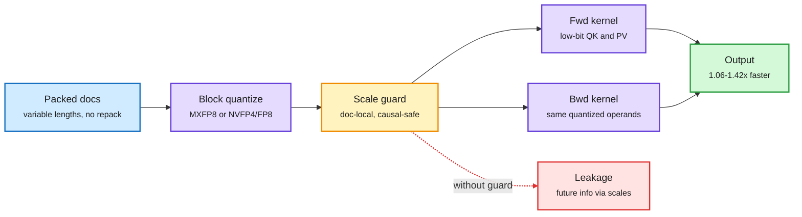

# FLAMIA: FP8/FP4 microscaling attention for training on Blackwell

**Source:** HuggingFace Daily Papers 2026-11-03 · [arXiv 2611.03344](https://arxiv.org/abs/2611.03344) · raw: `raw/huggingface/2026-11-03-flamia-flash-microscaling-attention-for-fast-and-causally-sa.md`

**TL;DR.** Blackwell (B200/B300) has fast low-precision tensor cores, but attention has been hard to run in MXFP8 or NVFP4 during *training*. Three things get in the way: the cost of quantizing on the fly, causal leakage through shared scale factors (a scale computed over a block that includes future tokens tells the current token something about them), and forward and backward passes that quantize differently and drift apart. FLAMIA is a family of attention kernels that handles all three. It uses token-block scaling, so one quantized copy of each operand serves both matrix orientations. It adds safeguards so scales never mix past and future tokens. It keeps forward and backward numerics consistent. It also handles packed variable-length documents in place, with document-local scales, so nothing gets repacked. On packed causal workloads, the MXFP8 path speeds up the combined forward+backward attention call, quantization included, by 1.10-1.40x on B200 and 1.06-1.42x on B300 over the fastest baseline for each workload. Training stability and quality hold on Llama-style pretraining.

The scale factor is the leak, so scope it to the past

Quantize once per token block, reuse it both ways, and never let a scale span a causal or document boundary.

Blue is input, purple is kernel work, amber is the scale guard, green is the result, red is the failure mode it prevents.

## Key points

- **Token-block scaling with operand reuse.** Microscaling formats (MX: one shared exponent per small block of values) need a scale per block. FLAMIA picks the blocks so one quantized copy of Q, K and V works for both QKᵀ and its transpose in the backward pass. That removes a second quantization pass.
- **Causal safety is a numerics problem, not only a masking problem.** A causal mask zeros out future scores. But if one scale factor is computed over a block that spans query and future-key positions, its magnitude still carries future information. FLAMIA scopes scales so this cannot happen.
- **Forward/backward consistency.** If the two passes quantize differently, gradients describe a slightly different function than the forward pass computed. FLAMIA keeps them aligned.
- **Packed documents.** Document-local scaling plus workload-aware scheduling run variable-length packed batches directly, with no repacking.
- **Gains are modest and honest.** 1.06-1.42x on the full attention call, quantization included, against the best baseline per workload. This is not a 3x claim.

## Relation to prior wiki

- **Extends** the Blackwell low-precision thread in [GPU kernels](gpu-kernels.md): PyTorch 2.15's faster NVFP4 decode (11-02) and the 10-31 Nemotron 3.5 4-bit serving work were inference-side. FLAMIA is the training-side counterpart for attention, the op that stayed in BF16 longest.
- **Connects** to the 11-03 training-inference mismatch paper ([summary](../llms-foundation-models/2026-11-03-training-inference-mismatch-dlc.md)), which found that engine numerics add a constant bias to RL updates. FLAMIA's forward/backward consistency rule is the same lesson inside one kernel: mismatched numerics become biased gradients.
- **Open:** NVFP4 path quality at scale; whether causal-safe scaling also matters for inference prefill with packed requests (it should, for chunked prefill across tenants).

See also: [quantization](../inference-efficiency/quantization.md), [memory hierarchy](memory-hierarchy.md).
