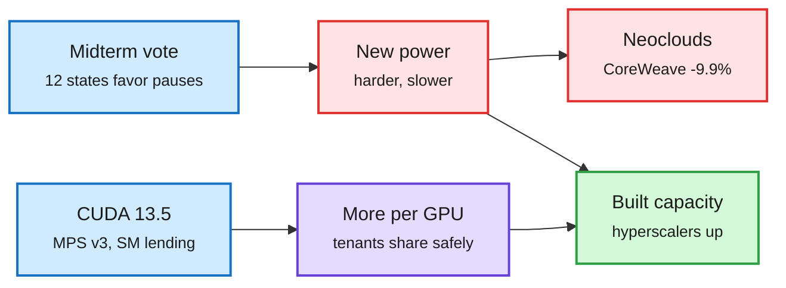

# CUDA 13.5 makes Vera Rubin GA; the midterms hit data-center power; memory and GPU supply stay tight

**Sources:** [NVIDIA: CUDA 13.5 brings Vera Rubin GA](https://developer.nvidia.com/blog/nvidia-cuda-13-5-brings-nvidia-vera-rubin-ga-support/) (lab watcher) · The Information: [Blue wave could engulf data center industry](https://www.theinformation.com/articles/blue-wave-engulf-data-center-industry), [Chip stocks and neoclouds sell off](https://www.theinformation.com/briefings/chip-stocks-neoclouds-sell-election-results), [Apollo outspending neoclouds](https://www.theinformation.com/articles/apollo-vastly-outspending-neoclouds-ai-chips), [Microsoft lowered capex after Iren delays](https://www.theinformation.com/briefings/exclusive-microsoft-lowered-data-center-spending-following-delays-cloud-firm-iren), [Lumentum after Marvell offer](https://www.theinformation.com/articles/lumentum-sell-off-marvell-offer-raises-chance-alternate-bid) · [The Decoder: OpenAI's community compact](https://the-decoder.com/after-midterm-rout-openai-tries-to-win-over-communities-it-needs-for-ai-expansion/) · X feed: [@rohanpaul_ai on RTX Pro 5500 orders](https://x.com/rohanpaul_ai/status/2117958345013477656), [Apple margin](https://x.com/rohanpaul_ai/status/2118036276909908346), [SambaNova + Supermicro](https://x.com/SambaNovaAI/status/2118052160487281104), [Qualcomm accelerators](https://x.com/StockSavvyShay/status/2118101730135355808), [AMD CPU demand](https://x.com/StockSavvyShay/status/2118129915396825366) · [Algorithmic Bridge](https://www.thealgorithmicbridge.com/p/the-ai-industry-thinks-it-has-a-pr)

**TL;DR.** CUDA 13.5 moves Vera Rubin from early access to general availability. The release is mostly about sharing a GPU well: locality-domain SM partitions can now include all SMs, MPS v3 adds weighted timeslicing, SM borrowing and lending, and cgroup routing, CUDA Tile kernels gain NVLink/NVSwitch multi-GPU pointers and can call SIMT libraries (NVSHMEM, CCCL) mid-kernel, and CCCL 3.5 adds batched Top-K integrated into FlashInfer. On the same day the US midterms turned power into the scarce input: in 12 states the winning or leading governor candidate called for a data-center pause, 22 of the other 24 back at least one limit, and voters rejected new data centers in 40 of 41 local ballot measures. CoreWeave fell 9.9% and Nebius 6.7% while hyperscalers rose, because the incumbents already hold built capacity. Supply stayed tight: Chinese buyers reportedly ordered ~6M RTX Pro 5500 cards (~$70B) that Nvidia can only fill ~1% of within four months, and Apple guided its gross margin down to 45% on memory prices.

Software sharing gets better as new power gets harder

CUDA 13.5 squeezes more tenants per GPU; voters made each new megawatt more expensive.

Blue is the driver, red is the constraint and who it hurts, purple is the software response, green is who benefits.

## Other supply-side items

- **Apollo** is financing chips at a scale beyond the neoclouds: it buys the Nvidia Vera Rubin chips SpaceX leases ($40B deal) through a subsidiary.
- **Microsoft** spent ~$5B less capex in Q3 than planned because rented capacity (one supplier: Iren) was late.
- **SambaNova + Supermicro:** first batch of 10,000 SN50 chips in disaggregated systems (GPUs prefill, SN50 decodes).
- **Qualcomm** custom AI accelerators began shipping in October; AWS connectivity ramps this month; targets $15B+ data-center revenue by FY29.
- **AMD** expects server CPU revenue to double next year, because agents drive CPU demand for orchestration, databases and tool calls.
- **OpenAI's National Community Compact** and Grid Protectors program (up to 1,000 MW of demand response at its Georgia site) only cover sites OpenAI operates itself, not partner-built ones like Oracle's.

## How it relates to prior wiki pages

- **Extends** the 11-04 SpaceX analysis (SemiAnalysis: ~13GW planned for 2027, 91-day retrofits): the vote raises the value of speed and behind-the-meter power exactly where SpaceX is strongest, and Texas holds ~27% of planned US capacity.
- **Confirms** the 11-03 memory squeeze (45-week GPU lead times, SK hynix capacity contracted through 2028) now reaching consumer margins.
- **MPS v3 and SM lending** are the hardware-side answer to Together's "polymorphic inference" (today): many workload shapes on one GPU.

Related: [Compute economics](compute-economics.md) · [Memory hierarchy](memory-hierarchy.md) · [GPU kernels](gpu-kernels.md)
