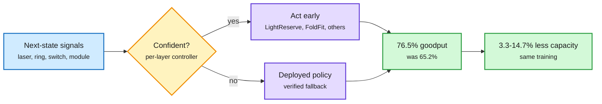

# Halley's predictive optical control plane, and the chip rout that priced the power shock

**Sources:** [Halley, arXiv:2611.04408](https://arxiv.org/abs/2611.04408) · [Can Cheaper AI Outrun the Data Center Backlash?, The Information](https://www.theinformation.com/articles/can-cheaper-ai-outrun-data-center-backlash) · [Nvidia and Apollo's phone buildings, The Information](https://www.theinformation.com/articles/nvidias-answer-data-center-backlash-retrofitting-apollos-old-phone-buildings) · [Vera CPU, NVIDIA](https://blogs.nvidia.com/blog/vera-cpu-highest-throughput-fastest-agents/) · [@rohanpaul_ai](https://x.com/rohanpaul_ai/status/2118461023808323957) · [@StockSavvyShay](https://x.com/StockSavvyShay/status/2118514128893665554) · raw: [Halley](../../raw/huggingface/2026-11-05-halley-a-predictive-control-plane-for-optical-ai-data-center.md), [The Information](../../raw/rss/2026-11-05-the-information-can-cheaper-ai-outrun-the-data-center-backlash.md)

**TL;DR.** Halley gives each optical network layer a controller that predicts failures and acts first, falling back to the deployed policy when unsure. In simulation it lifts effective goodput from 65.2% to 76.5%, which means 3.3-14.7% less data center capacity for the same training. It arrived the day markets priced the opposite risk: chip stocks had their second-worst day since 1994 on fears that building capacity is getting harder. If new megawatts are scarce, recovering lost goodput is worth more.

Act before the laser fails, and recover capacity you already paid for

Each layer predicts its next state and defers to the old policy when unsure.

Blue is the input, amber is the confidence gate, purple is the action, green is the capacity recovered.

## Halley

- The key claim: lasers sharing an enclosure, cooling and power fail together, and at a fixed spare ratio correlated failure provably caps availability however large the pool grows.
- Four components with formal guarantees: LightReserve sizes the laser pool for a coverage bound, FoldFit schedules the switch within 11/9 of optimal, ThermaLead holds a microring with one-step-ahead control, TriageGuard protects the highest-risk modules first.
- The 76.5% assumes a window that exhausts spares is lost. If only dark-channel bandwidth is lost, it reaches 67.4%. Per megawatt, up to 1.03-1.17x the training. Fallback circuits are formally verified and pass 130 nm signoff.

## The market and the backlash

- **The rout.** On Thursday 11-05 the Nasdaq fell 5.52%, its worst day since April 2025, with Wall Street losing a reported $3.2T. Nvidia fell 9.3%, erasing its 2026 gains. The Philadelphia Semiconductor index fell 12.3%, and SanDisk 22%. Micron, Western Digital and AMD each lost 17%. Goldman Sachs says short-term moratoria could affect about 45% of planned US data center capacity.
- **The Information's question.** Can token efficiency outrun the backlash? GPT-6.1 Sol can match GPT-6 Astra at about a fifth of the per-task cost, per Artificial Analysis. Facilities due next year mostly have approvals, so the real hit lands on 2028 and beyond. Anthropic's roughly 85% gross margin gives it room to cut prices. The private-equity source saying efficiency will offset limits owns data centers, so discount accordingly.
- **Nvidia's response.** It has approached Apollo about small AI data centers across up to 20 states inside a struggling telecom's old buildings. That is distributed retrofit instead of greenfield campuses.
- **Vera CPU.** NVIDIA claims 1.6x more agents per watt than the fastest x86 and 2x the agent speed of the most efficient x86, in a 100 MW comparison. Daytona brought up 1,000 sandboxes in 10.8 s versus 88.4 s on x86. Vendor-run.

## How this relates to prior wiki pages

- **Continues** [the midterm compute shock (11-05)](2026-11-05-cuda-13-5-rubin-and-midterm-compute-shock.md), when neoclouds fell but hyperscalers rose. A day later almost nothing was exempt, as Gary Marcus's post notes.
- **Confirms** [compute economics](compute-economics.md): as permits tighten, utilization work like MPS v3's SM lending and Halley's goodput recovery gains value.
- **Fits** Together's continual compilation (11-05) and SpaceX's 91-day retrofit (11-04): a pattern of getting compute without new greenfield permits.

## Gaps

Halley's composed numbers come from simulation only, with assumptions the authors state. Vendor CPU claims are unaudited. Market moves are one day; a reaction may reverse, and several posts note extreme selloffs have often come near bottoms.
