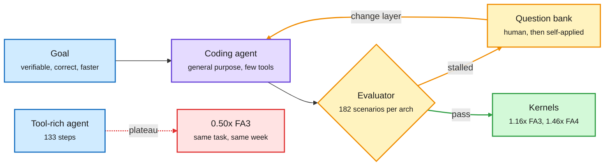

# KernelSeek: a short question beats more tools for GPU kernel agents

**Sources:** [Ask, Don't Equip, arXiv:2611.03517](https://arxiv.org/abs/2611.03517) · [Inkling 2 Small kernel benchmarks](https://thinkingmachines.ai/news/inkling-2-small/) · raw: [../../raw/huggingface/2026-11-05-ask-don-t-equip-question-driven-coding-agents-for-deep-kerne.md](../../raw/huggingface/2026-11-05-ask-don-t-equip-question-driven-coding-agents-for-deep-kerne.md)

**TL;DR.** On hard kernel targets, the field keeps adding to the agent: profilers, disassembly, retrieval, lesson stores. KernelSeek argues what is missing is direction, a hypothesis about where the remaining gap sits. A general coding agent, a minimal harness enforcing a verifiable goal, and short questions at decision points took a kernel from where a tool-rich agent stalled (0.50x FlashAttention-3) to 1.13x. It then wrote dependency-free FlashAttention forward kernels for Hopper and Blackwell, 1.16x FA3 and 1.46x FA4 by geometric mean, correct on all 182 scenarios per architecture.

Direction, not equipment, unlocked the gain

Across 162 human messages, every large gain followed a question and never new information.

Blue is the setup, purple is the agent, amber is the feedback loop, green is the result, red is the baseline that stalled.

## Key findings

- Across 162 human messages and 11.5K agent tool calls, every large gain followed a question that moved the agent to a different layer of the system or rejected a claimed limit. None came from a message that supplied information.
- The final kernels are single CUDA files with no CUTLASS, CuTe, cuBLAS or cuDNN.
- Authors release the kernels, harness, question bank and all traces.

## Same-day independent scoreboards

Thinking Machines' Inkling 2 Small launch post publishes two relevant tables:

- **PMPP-Hard** (69 kernel tasks, 10-hour budget, mean solved across four attempts): GPT-6 Astra 63, Kimi K3.1 Pro 60.5, Claude Opus 5.5 60, Kimi K3 55.75, DeepSeek V4.1 Flash 55.25, Inkling 2 Small 54.25, GLM 5.3 52.5, Mistral Large 4 50.25, GLM 5.2 42. An open model is within 3 tasks of the best closed one.
- **Autoresearch on DSA training kernels** (speedup over public TileLang kernels on B300, forward plus backward): Claude Opus 5.5 18.80x, GPT-6 Astra 10.26x, Inkling 2 Small 6.02x, DeepSeek V4.1 Flash 5.66x, GLM 5.3 5.03x, Mistral Large 4 3.43x. The authors note the baseline is untuned for B300, so headroom is large and the figures cover these kernels only, not end-to-end training.

## How this relates to prior wiki pages

- **Tension with** [SpecPilot (11-05)](../inference-efficiency/2026-11-05-agents-optimize-inference-together-compiler-specpilot.md), whose cost model points agents at the biggest gap, and with Together's hot-reload engine. Those supply direction with machinery; KernelSeek supplies it with words. All three agree direction matters; they differ on how to provide it.
- **Extends** the pattern this wiki declared on 11-05 (agents with a fast loop and a bit-exact check). KernelSeek's verifiable goal is the same oracle; the new variable is what steers the search. [SemiAnalysis (11-06)](2026-11-06-tpu-ironwood-agentx-semianalysis.md) reports NVIDIA using agent swarms for AgentX counter-submissions, so this is now competitive practice.
- **Relevant to** [the harness thread](../agentic-systems/agent-harness-engineering.md): a minimal harness plus a question bank is a counterexample to harness growth.

## Gaps

Reported on FlashAttention, a well-understood kernel family with a clear correctness oracle. The human-question phase is not free, and how much of the gain the self-applied bank recovers without a human is the key open number. No test on MoE dispatch or sparse attention kernels in this abstract.

**Research angle.** Treat the question bank as the learnable artifact. Could a bank mined from these public traces transfer to TPU or AMD kernels? That is a cheap experiment and would show whether direction generalizes across hardware.
