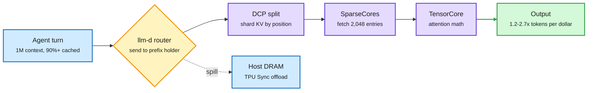

# TPUv7 on AgentX: the first official agentic inference results for Google's TPU (SemiAnalysis)

**Sources:** [The Iron(wood) Throne, SemiAnalysis](https://newsletter.semianalysis.com/p/tpu-strikes-the-king) · raw: [../../raw/rss/2026-11-05-semianalysis-the-iron-wood-throne-google-s-tpu-stakes-its-claim-on-i.md](../../raw/rss/2026-11-05-semianalysis-the-iron-wood-throne-google-s-tpu-stakes-its-claim-on-i.md)

**TL;DR.** SemiAnalysis publishes TPUv7 Ironwood results on AgentX, its long-context, multi-turn agent benchmark, across four open models. At FP8 (8-bit floating-point weights) TPUv7 is the cheapest option on GLM-5.2 and beats GB300 FP4 on Qwen3.5-397B end to end. Where weights are natively 4-bit, NVIDIA still wins clearly: GB300 FP4 gives 3.6x TPUv7's tokens per dollar on GLM-5.2 at 100 tok/s/user, and leads Kimi K3 by 1.5-2.6x after four software refreshes. The most reusable content is the list of optimizations, all of which treat KV cache capacity and memory movement as the real limit.

Most of TPUv7's agentic gain came from the memory path, not the math

GLM-5.3 requests are over 90% cached, so KV capacity sets how many users fit.

Blue is the request and the cache tier, amber is the routing decision, purple is the compute path, green is the result.

## Key results (per dollar, AgentX unless noted)

| Model | Setup | Result |
|---|---|---|
| Qwen3.5-397B | TPUv7 FP8, vLLM | 1.67x better than GB300 NVL72 FP4 at first submission. NVIDIA's counter-submission beats TPU on decode but overtuned at prefill's expense, and is still 1.64x worse across most of the curve. |
| Qwen3.5-397B | TPUv7 FP8, llm-d disaggregated | Above GB300 FP8 at every interactivity level, over 2x at high throughput, 1,000+ tok/s/user at the fast end. p90 TTFT 8.6 s vs 11.1 s for GB300 FP4's fastest point. Worse end to end than GB300 TRTLLM FP4. |
| GLM-5.2 | TPUv7 FP8, vLLM | 1.2-2.7x B200, B300 and MI355X FP8 at 60-300 tok/s/user, 4.4x H200 at 150. But GB300/GB200 FP4 give 3.6x/3.5x TPUv7 at 100 tok/s/user, with a slight accuracy drop because GLM-5.3 was not trained for FP4. |
| Kimi K3 | TPUv7 MXFP4, vLLM (Inferact) | At launch (10-17) 0.77-0.91x GB300 at 50-200 tok/s/user and 1.6x faster for one user (391 vs 251 tok/s). After four NVIDIA refreshes GB300 FP4 leads 1.5-2.6x. Still 1.15-2.5x GB200, B200 and B300. VR200 is 4.3-5.6x TPUv7 in preview submissions. |
| Muse Spark Open 816B | TPUv7, SGLang-TorchTPU (RadixArk) | Competitive on decode per dollar, weaker end to end because prefill kernels lag. Its head dim of 64 pads 25% of the systolic array, so this is the unfavorable case for TPU. |

## The optimizations worth stealing

- **Decode context parallelism (DCP).** Shared-latent KV designs (MLA, GLM-5.3's compressed entries) cannot be split by head, so head parallelism copies the whole cache to every device. DCP shards by sequence position and merges partial attention each layer.
- **SparseCores as the indexer gather unit.** Each query reads only the 2,048 entries the indexer picked. SparseCores do the scattered memory access while the TensorCore does attention.
- **One byte of padding cost half the row.** 128 indexer key bytes plus a scale byte is 129, one over a 128-wide row, so the old layout rounded to 256. Rotating the layout gets 132 bytes with 3 wasted.
- **Fixed-shape compilation for small decode steps.** TPU programs compile per shape. Adding 4- and 8-token shapes stopped small steps padding to 16.
- **Megakernels.** One long-running kernel for the whole decode step, prefetching the next layer's weights while the current one computes. AMD's MonoKernel cuts a GLM-5.2 decode step from about 2,459 launches to 210 and runs 2.31x faster at batch 1 on eight MI350X. TPU and AMD shipped this first in open engines; NVIDIA followed within a week.
- **Cache-aware routing.** llm-d sends each turn to the prefill host holding its prefix and keeps sessions on their decode host. Routing to the exact data-parallel rank raised decode cache hits from 56% to 76%.

## The argument, beyond the numbers

SemiAnalysis's "Recommendation to Jensen" claims NVIDIA is now slower than AMD, Google and Amazon to act on outside commits and feedback, citing a PyTorch driver feature stuck three months in legal review, and that TPU is winning by running NVIDIA's old playbook of giving open-source maintainers free chips. NVIDIA answered the first TPU result with "a strike force of human engineers and agent swarms."

## How this relates to prior wiki pages

- **Extends** [TPU inference externalization (09-08)](2026-09-08-tpu-ironwood-inference-externalization.md), which showed a TCO-driven single-turn FP8 advantage. That page's caveat, that TPU loses on raw performance and TTFT, is now partly resolved on Qwen3.5.
- **Tension with** [Together Compiler (11-05)](../inference-efficiency/2026-11-05-agents-optimize-inference-together-compiler-specpilot.md), whose authors call maximal megakernel fusion the wrong goal for shifting traffic. Here megakernels are the main lever across AMD, TPU and NVIDIA. Both can hold if AgentX's traffic is more stable than production.
- **Confirms** the quantization thread: FP4 halves bytes per weight and small-batch decode is memory-bound, so native 4-bit decides this comparison. [Kimi K3.1 Pro (11-05)](../llms-foundation-models/2026-11-05-kimi-k3-1-pro-open-weights.md) trained for MXFP4 from the start.
- **Links to** the sparse-attention bottleneck in [LoopVQ and Multi-layer Indexer (11-06)](../inference-efficiency/2026-11-06-loopvq-and-multi-layer-indexer.md).

## Gaps

Vendors and partners submit the configurations and cost bases differ (Meta's purchase price vs external customer price). Rubin numbers are preview submissions that SemiAnalysis has not reproduced. TPUv7 has no native FP4 until TPUv8 (Q1 2027), so the fair next match is TPUv8i against Rubin. SemiAnalysis also sells the accelerator and TCO models it cites.

**Research angle.** Head dimension is now a hardware decision: 64 pads a systolic array, 256 suits it, and matrix-core GPUs barely care. Nobody has published the accuracy cost of choosing head dim for TPU fit. Labs with heavy TPU capacity already co-design it privately, which is an open question worth an open paper.
