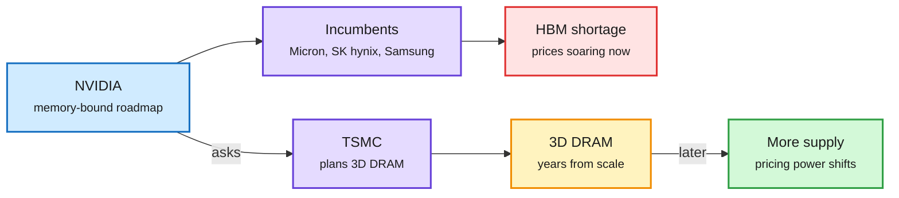

# TSMC weighs 3D DRAM; the post-midterm compute market resets

## TL;DR

The Information reports that **TSMC has started drawing up plans to make 3D DRAM** (memory cells stacked vertically, like 3D NAND) at the request of NVIDIA, its biggest customer. The memory shortage has sent prices soaring, and NVIDIA and Apple are hunting for supply beyond Micron, SK hynix and Samsung. 3D DRAM is years from commercial scale, so this does nothing for today's HBM shortage; the signal is NVIDIA trying to create a fourth memory supplier and TSMC weighing a move into a market it has never served. The same day, three compute-market signals moved: **Microsoft declined to renew** its 2023 deal to rent cloud servers from Oracle; the **CME delayed GPU rental-price futures** a second time, by 60 days, after a request from the CFTC (pushing any approval into January); and chip stocks **bounced 6 to 10%** after Thursday's rout (Credo +10%, Marvell +9%, TSMC and AMD +7%, Micron and ASML +6%).

NVIDIA wants a fourth memory supplier

3D DRAM is a next-decade hedge, not a fix for this year's HBM squeeze.

Blue is the buyer, purple is the suppliers, red is today's constraint, amber is the long-dated bet, green is the outcome NVIDIA wants.

## Other items

- **Qualcomm and Modular.** A Friday filing shows Google Ventures received nearly 3M Qualcomm shares (reported at about $548M) because Qualcomm bought Modular, the AI-compiler startup GV partly owned. Qualcomm announced the Modular deal in June. Social posts framed it as Google buying into Qualcomm for Gemini on Snapdragon, which the filing does not support.
- **Microsoft and Oracle.** Microsoft wound down the Oracle rental because of the hardware those servers carried (The Information's summary is truncated). Separately, Microsoft declined an option to more than double its Texas capacity deal with Nscale ahead of Nscale's planned $35B IPO (DataCenterDynamics, via AI Breakfast).
- **GPU futures.** The CME product tied to NVIDIA GPU rental prices is delayed again. Price discovery for compute stays OTC and index-based for now.
- **Data centers on the ballot.** AI Breakfast counts 41 measures in ten states, with restrictions or bans winning in all but one. Ohio carried 21; Wisconsin now requires a public vote over $450M. Gary Marcus counts 44 of 45.
- **Chip-factory hiring.** US chip factories posted their strongest hiring month since August 2022 in the October jobs report.
- **Siltronic's CEO** says data center orders are pulling wafer supply from other end markets (Reuters, via AI Breakfast).
- **Nebius** reports 1.13% more training throughput on 192 B300 GPUs running DeepSeek V3 from one software change.

## Relation to prior wiki pages

- **Extends** the [memory squeeze (11-03)](2026-11-03-memory-squeeze-hbm-lead-times.md): SK hynix sold out with LTAs over half of 2027-28 output, so buyers need new suppliers, not just more allocation.
- **Connects** to [Micron's roadmap (10-24)](2026-10-24-memory-premium-h200-micron-roadmap.md), which abandoned 4F² DRAM for 3D DRAM, and the Nature Reviews piece noting 3D DRAM inherits 3D NAND's etch problems with tighter leakage limits. TSMC's process strength is etch and deposition, which is why it is a plausible entrant.
- **Follows** [the chip rout (11-06)](2026-11-06-halley-optical-control-plane-and-chip-rout.md), when the SOX fell 12.3%.
- Concept pages: [memory hierarchy](memory-hierarchy.md), [compute economics](compute-economics.md).
