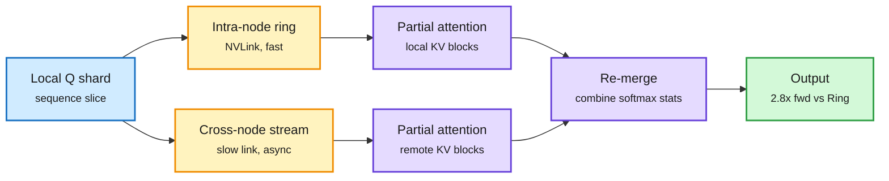

# CHARM+

**TL;DR.** Ring Attention splits a long sequence across GPUs and passes KV blocks around a ring, overlapping each hop with compute. Two things break that overlap: hops depend on each other in sequence, and in mixed topologies (two NUMA sockets over PCIe, or two nodes over a slower link than NVLink inside a node) the slowest link sets the pace for every synchronization. CHARM+ ([arXiv 2611.05906](https://arxiv.org/abs/2611.05906)) reorganizes the sequential ring into levels with parallel communication inside each level, and decouples cross-hardware traffic from intra-hardware traffic, re-merging partial attention results afterward. Against Ring Attention: forward/backward 1.3x/1.7x on dual-NUMA PCIe, 2.8x/2.9x on dual-node NVLink.

Keep the slow link off the critical path

Fast local rings run freely; cross-node traffic runs on its own stream and merges later.

Blue is the input shard, amber is communication, purple is attention compute, green is the result.

## Relation to prior wiki
- Same theme as TPUv7's DCP (decode context parallelism that shards KV by position) in SemiAnalysis's AgentX post ([11-06](2026-11-06-tpu-ironwood-agentx-semianalysis.md)): long-context performance is now a communication-topology problem.
- Training-side counterpart to FLAMIA ([11-04](2026-11-04-flamia-microscaling-attention-blackwell.md)), which attacked attention cost inside one Blackwell GPU with microscaling formats.

## Gaps
No comparison to newer topology-aware schemes (USP/Ulysses hybrids, DeepSpeed's tiled variants). No inference (decode) numbers; gains are forward/backward training kernels. Tested on two-domain topologies; behavior at 8+ nodes is not shown.

Concept pages: [GPU kernels](gpu-kernels.md) · [memory hierarchy](memory-hierarchy.md)
