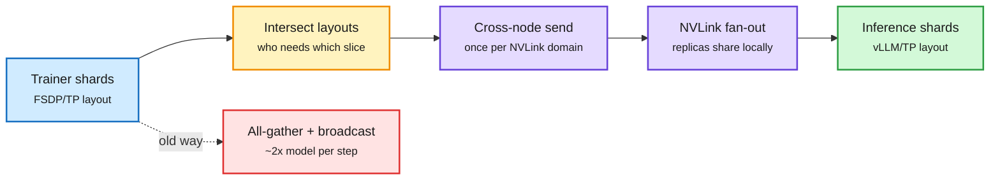

# NVIDIA Reshard collective

**TL;DR.** In RL post-training, every step ends with a *refit*: the trainer's updated weights must reach the inference engine that generates the next rollouts. Today that is an all-gather plus broadcast, moving about 2x the model per step (≈11.2TB for a 2.8T-parameter model in BF16). Reshard treats refit as converting one sharded tensor layout into another (DTensor to DTensor). It sends only the exact shard intersections each receiver needs, and groups replicas by NVLink domain so each byte crosses the slow network once and then fans out over NVLink. In NeMo RL on DGX H100 and GB200 (Qwen3-235B, DeepSeek-V3 671B): 2.7-5.7x faster refit. Hybrid in practice: Reshard for big FFN projections, gather-broadcast for small weights. Open-sourced as NCCL M2N Reshard in NVIDIA/nccl-extensions.

Refit is a layout change, not a broadcast

Only overlapping shards move, and each crosses the network once.

Blue is the trainer, amber is the layout planning, purple is communication, green is the inference copy, red is the old cost.

## Relation to prior wiki
- Same move as CHARM+ ([summary](2026-11-09-charm-plus-cross-hardware-ring-attention.md)) the same window: put the slow link off the critical path by separating inter-domain from intra-domain traffic.
- RL post-training at trillion-parameter scale is becoming communication-bound, not FLOP-bound; see [compute economics](compute-economics.md).

Concept page: [GPU kernels](gpu-kernels.md)
