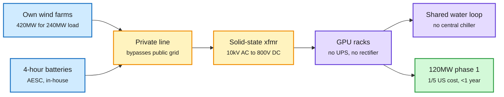

# China's Stargate: the Galaxy campus in Ulanqab

**TL;DR.** SemiAnalysis visited Envision Group's Galaxy campus in Ulanqab, Inner Mongolia: up to 800MW of IT (about 1GW possible), the Chinese counterpart to Stargate Abilene (~820MW critical IT). Phase 1 (120MW) went live in August 2026, built in under a year at about one fifth of US cost. The edge is not modular construction. It is cheap labour (~30,000 workers on 22 projects in one zone), cheap power (~$0.055/kWh all-in), and vertical integration: Envision builds the wind turbines, the private line, the batteries (affiliate AESC) and the rack power. Rents have halved in five years to ~$40/kW/month and capex is under $3M/MW, so returns are thin.

Envision owns every box from turbine to rack

The public grid is a backup, not the supply chain.

Blue is generation and storage, amber is power conversion, purple is the compute hall, green is the outcome.

## Key claims
- **Source-grid-load-storage (SGLS):** two wind farms ~80km apart, 1.75x oversized (420MW wind for 240MW load), plus 4-hour batteries, targeting >60% own-wind supply for phases 1-2. Inner Mongolia has ~57% of China's usable wind; Ulanqab capacity factor 35-40%.
- **800V DC is already live** in a 5MW hall with solid-state transformers going straight from 10kV AC to 800V DC. That is the architecture NVIDIA pushes for ~600kW Kyber racks, still a roadmap item in the US. About a quarter of recent Chinese datacenters run DC; ~97% of US ones use AC UPS.
- **Chiller-free cooling** on one shared water loop for liquid and air-cooled servers.
- **Factory pre-configuration** skips 3-6 months of site commissioning; prefab substation in <3 months vs ~6.
- **Copycats:** CATL became VNET's largest shareholder and is taking 49% of Zhongheng's parent (China's largest datacenter HVDC supplier). Energy-industrial groups are moving into AI infrastructure.
- 25GW of projects announced in Inner Mongolia; SemiAnalysis rejects the "empty halls" narrative.

## Relation to prior wiki
- **Contrast with the US:** the 11-06 digest covered US ballot measures restricting datacenters (40 of 41 passed across 10 states, per AI Breakfast) and a 12% SOX drop driven by power scarcity. China is adding capacity at 1/5 the cost with no local backlash. Power access, not chips, is the binding constraint on both sides (Core Automation said the same in Import AI 480).
- Extends [compute economics](compute-economics.md): datacenter cost per MW is now a geography and integration variable, not a GPU price.

Concept pages: [compute economics](compute-economics.md) · [memory hierarchy](memory-hierarchy.md)
