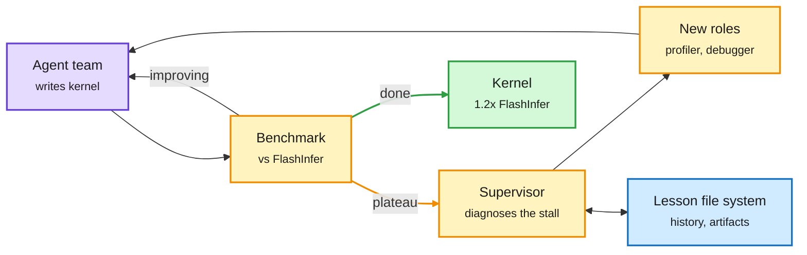

# Kernels written by agent teams, and FlashAttention for relative-position bias

**Date:** 2026-11-10 · **Sources:** Evolving Agent Teams ([arXiv 2610.36848](https://arxiv.org/abs/2610.36848), via [@rohanpaul_ai](https://x.com/rohanpaul_ai/status/2119903588155830773)) · Fast and Exact Relative-Position Attention ([arXiv 2611.01182](https://arxiv.org/abs/2611.01182), HuggingFace 11-09) · Meta LLDB accelerator plugins ([post](https://engineering.fb.com/2026/11/09/developer-tools/extending-lldb-to-debug-applications-that-span-cpus-and-gpus/)) · raw: `raw/twitter/feed/2026-11-10-morning-ranked.json`, `raw/huggingface/2026-11-09-fast-and-exact-relative-position-attention-via-structure-awa.md`

## TL;DR

Two kernel results from the same day. **Evolving Agent Teams** (UC Berkeley) shows coding agents plateau on expert-grade kernels: Claude Code stalled at 0.51x FlashInfer on the MLA paged decode kernel (the attention kernel for DeepSeek-style multi-head latent attention). A supervisor that diagnoses each plateau and rebuilds the team (inventing roles like profiler, debugger, knowledge integrator), plus a persistent file system of lessons, reached 0.74x at matched tokens (a fixed 4-role team: 0.31x). With more budget it wrote a CUDA kernel from scratch at 1.2x mean speedup over production FlashInfer, winning 36 of 47 FlashInfer-Bench workloads (0.86-0.99x on the rest). It also reports KDA prefill at 3.01x over vLLM on AMD MI350X and 3.44x over FlashKDA on B200. **Structure-aware relative-position attention** puts additive relative-position terms (common in audio models) inside a FlashAttention-style tiled kernel with offset-aware tiling, reused query-relation products and atomic-free gradient sharding. At 8K tokens: 1.8-6.4x forward, 2.0-21x backward, and up to 128x less peak memory than the best baseline, in Triton.

The supervisor restructures the team when progress stalls

The fixed team plateaus; the evolving one keeps changing who does what.

Purple is the agents, amber is the measure-and-restructure loop, blue is persistent memory, green is the shipped kernel.

## Relation to prior wiki pages

- **Confirms** the 11-05 result where an agent wrote single-file FlashAttention forward kernels at 1.16x FA3 and 1.46x FA4. Two results in a week where agents beat expert attention kernels: the target is moving from "match cuBLAS" to "beat FlashInfer."
- **Contradiction worth tracking:** on the same day, omarsar0 reported Anthropic models refusing kernel and LLM-optimization tasks most of the time, and Anthropic said it curbed Fable 5.2's self-acceleration abilities. If closed models keep refusing, this line of work moves to open models.
- **Meta LLDB** is the tooling side: one vendor-neutral debugger session showing CPU and GPU as separate processes, instead of CUDA-GDB and ROCgdb separately. Agent kernel loops need exactly this kind of cross-vendor introspection.
- Concept page: [gpu-kernels](gpu-kernels.md), [attention-mechanisms](../llms-foundation-models/attention-mechanisms.md).

## Gaps

Evolving Agent Teams does not report total token spend for the extended-budget run, so the cost per point of speedup is unknown. The relative-position kernel is evaluated at 8K; the abstract claims long-context end-to-end training gains without naming the model.
