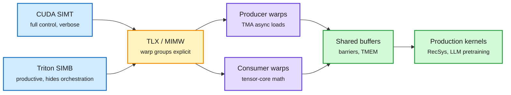

# TLX and the TPU v7 megakernel: orchestration is the new kernel problem

## TL;DR

Two posts on 11-10 make the same point from two chips. **Meta's TLX** (Triton Low-Level Extensions) argues that Hopper and Blackwell made GPU performance a question of orchestration, not arithmetic. Warp specialization, TMA (the Tensor Memory Accelerator, a dedicated unit for async bulk copies), TMEM (Blackwell's tensor memory) and cluster or paired-CTA execution all require several groups of warps to cooperate. CUDA can express this but only through heaps of architecture-specific code. Triton's block-level model hides it inside the compiler. Meta calls the missing middle MIMW (Multiple Instructions, Multiple Warps): the warp group becomes the unit you program. TLX adds explicit warp-group, buffer, barrier and cluster constructs to Triton, used only where needed, so Triton says what to compute and TLX says how to orchestrate it. It runs production RecSys training and inference and large LLM pretraining at Meta on NVIDIA and AMD. Triton kernel count at Meta grew about 3.8x in 10 months against 2.0x for CUDA. **RadixArk's TPU v7 post** serves Meta's Muse Spark Open (816B total parameters, MoE) on one four-chip TPU v7 host with SGLang on the TorchTPU backend. All 62 layers of a decode or verify step run as a single Pallas program, with every weight load, KV read and cross-chip transfer pipelined behind compute.

The warp group is the new unit of programming

TLX sits between CUDA's threads and Triton's blocks, where Hopper and Blackwell features actually live.

Blue is the two existing models, amber is TLX's new layer, purple is the cooperating warp groups, green is the shared state and the shipped kernels.

## Key numbers (TPU v7 megakernel)

- 433 tok/s per user up to 25.9K tok/s per chip on SemiAnalysis's 1M-context AgentX trace.
- 1.94x faster per token than RadixArk's previous path; DFlash2 speculative decoding adds 2.0x per token.
- FP8 KV cache, HiCache and session-aware eviction for long agent sessions. The verify step runs within 1.5 to 1.7x of the pure HBM weight-streaming floor.

## Relation to prior wiki

- **Explains why agent-written kernels are hard.** The 11-10 [Evolving Agent Teams](2026-11-10-evolving-agent-teams-and-relative-position-kernels.md) paper found single agents retreat from WGMMA (Hopper's async warp-group matrix instruction) to easier designs. TLX's MIMW framing names exactly that difficulty: the hard part is cooperation between warp groups, which neither CUDA nor plain Triton makes easy to search over.
- **Megakernels are spreading.** The wiki first logged a Muse Spark Open megakernel on 11-06. Today's TPU post adds speculative verify and long-session KV handling inside the same program.
- **NVIDIA's cuTile** (Jane Street's Mamba-2 forward pass, amplified by PyTorch on 11-10) is the third abstraction-level answer the same week: tile-level Python that targets Tensor Cores automatically.
- Updates [GPU kernels](gpu-kernels.md).

## Gaps

TLX's post gives no end-to-end speedup table in the captured text, only the kernel-count growth. The TPU numbers are on one host and one trace; tokens-per-dollar against GB200 is RadixArk's own plot.

## Links

- [TLX post](https://engineering.fb.com/2026/11/10/open-source/tlx-a-hardware-native-gpu-compiler-for-production-ml/) · [TPU v7 megakernel](https://bit.ly/4zgrhBL) · [cuTile Mamba-2](https://bit.ly/3VigiKf)
