# Mythos ports Claude to AMD; what actually breaks around GPU kernels

## TL;DR

In Anthropic's IPO roadshow video, co-founder Tom Brown says Claude is now trained and served on all four major chip families: AWS Trainium, Google TPUs, NVIDIA GPUs and AMD GPUs. Bringing up a new chip platform used to take dozens of engineers months. This year Anthropic had Mythos try AMD: it got Claude running in three days with "basically no human intervention", porting or writing almost 100% of the kernels. Brown frames the business on **total effective compute**, physical capacity times the compute multipliers the lab discovers (a 4x multiplier means 25 units train what used to need 100), and says Claude will eventually discover multipliers by itself. The same window, a Microsoft and Tsinghua study (2611.09280) read 300 closed issues from seven GPU kernel libraries (FlashAttention, Triton, CUTLASS and others) and found 60.33% trace to the compiler, build system or runtime environment, and only 39.67% to the kernel library code. The largest single cause is version incompatibility among drivers, CUDA, frameworks and packages (25.33%). AWS separately published three in-training checks for silent data corruption (a GPU returning a wrong but plausible number with no error), citing Meta's Llama 3 405B run, where 6 of 419 interruptions over 54 days on 16K H100s traced to SDC.

```mermaid
flowchart LR
  A["Agent port<br/><small>Mythos, 3 days</small>"] --> K["Kernels<br/><small>~100% agent-written</small>"]
  K --> B["Build + runtime<br/><small>60% of failures</small>"]
  B --> H["Hardware<br/><small>4 chip families</small>"]
  H -->|silent error| S["SDC checks<br/><small>replay, fingerprints</small>"]
  S --> C["Effective compute<br/><small>capacity x multipliers</small>"]
  classDef input fill:#d0ebff,stroke:#1971c2,color:#1b1b1b,stroke-width:2px
  classDef core fill:#e5dbff,stroke:#6741d9,color:#1b1b1b,stroke-width:2px
  classDef loop fill:#fff3bf,stroke:#f08c00,color:#1b1b1b,stroke-width:2px
  classDef exit fill:#d3f9d8,stroke:#2f9e44,color:#1b1b1b,stroke-width:2px
  classDef err fill:#ffe3e3,stroke:#e03131,color:#1b1b1b,stroke-width:2px
  class A input
  class K core
  class B,S err
  class H loop
  class C exit
  linkStyle 3 stroke:#e03131,stroke-width:2px
```

The kernel is the easy part now

Agents write kernels in days. What still costs time is the stack around them: builds, versions, and hardware that lies quietly.

Blue is the agent, purple is the kernels, red is where failures actually live, amber is the hardware mix, green is the business metric.

## Key points

- **CUDA moat claim:** The Decoder headlines it as AI "eroding Nvidia's CUDA lead". It is a lab's own claim in a marketing video with no benchmark or performance-parity number. Running is not the same as running at parity.
- **AWS SDC checks** on a DDP loop: a non-finite gradient check (NaN/Inf on the step), a ring replay audit (each GPU recomputes another node's micro-batch and compares loss bit for bit), and a weight-fingerprint comparison after the optimizer step. Tested on 32 H100s with injected faults. ([AWS](https://aws.amazon.com/blogs/machine-learning/detecting-and-recovering-from-silent-data-corruption-on-amazon-sagemaker-hyperpod/))
- **Kernel study angle:** an agent that writes kernels but cannot debug a CUDA/driver/framework mismatch still stalls, which is where the 60% sits.

## Relation to prior wiki pages

- **Confirms a pattern built over two weeks:** agent-written FlashAttention (11-05), evolving agent teams beating FlashInfer on MLA decode (11-10), Meta's TLX and a TPU v7 megakernel (11-11). Mythos on AMD is the first production-scale port claim. The pattern: kernel authorship is commoditizing, so the moat shifts from CUDA code to whoever runs the multi-chip fleet.
- **Fits InfraRSI (11-11)** (an agent harness that speeds up distributed training up to 2.75x with 16 anti-cheating checks): the gains are in configuration and environment, the same place the kernel study finds the bugs.
- **Industry tie:** Nvidia is down about 26% over a month (AI Breakfast) and faces a CEO crisis; a credible "any chip in three days" claim weakens the lock-in story in the same week.
- **Gaps:** no throughput/MFU number for Claude on AMD; the kernel study is issue-tracker data, biased toward reported, reproducible bugs.

Concept pages: [GPU kernels](gpu-kernels.md), [compute economics](compute-economics.md).
